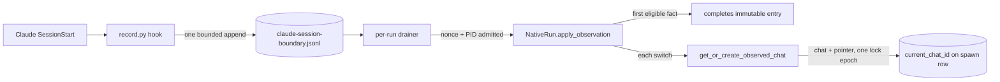

# Architecture: Claude Native Sessions

Claude Code keeps every conversation as one JSONL transcript in a directory that all
Claude processes with the same config root share. This page explains how Meridian
keeps chats pinned to the right transcript in that shared store. It covers the
store layout, how a resume or fork source reaches the child, how a launch-owned
SessionStart journal tracks the last observed session during a run, and how the TUI
trampoline is handled. The cross-harness rule is the
[native session identity decision](../decisions/native-session-identity.md). The
shared seams are in [native session binding](native-session-binding.md). The Claude
entry-identity work described here shipped in v0.7.0 (PR #534, merge `3dae2434`).
The current-chat tracking below is not shipped (see its state note).

## Store layout and the shared-store hazard

```
<config-root>/projects/<slug>/<session-id>.jsonl
```

`<config-root>` is the child's `CLAUDE_CONFIG_DIR` (`~` and relative values resolve
against the child's `HOME` and cwd), else `$HOME/.claude`. `<slug>` is the resolved
working directory with every non-alphanumeric character replaced by `-`. The
Meridian native store for a Claude chat is the resolved
`<config-root>/projects/<slug>` directory
(`ClaudeAdapter.native_store_for_launch`).

Every Claude process sharing a config root shares that store, and Claude's own
recovery is inference-shaped:

1. If Claude loses its session ID, it takes the most recent `.jsonl` in
   `projects/<slug>/`. Two concurrent sessions in the same project can swap.
2. Slug matching can associate `my-project-v2/` with `my-project/`.
3. A nested `meridian spawn` inherits the parent's `CLAUDE_CONFIG_DIR`, so parent and
   child transcripts land in the same namespace.

Meridian does not isolate the config directory per spawn. It avoids relying on any
of these behaviors: every launch names the exact session, and every read opens one
exact file.

## One-attempt identity

A Claude create launch binds its `--session-id` to the chat before exec and invokes
Claude once. An exact typed terminal result, including quota exhaustion, remains the
causal final result; Meridian does not reuse the assigned identity in a second launch.
Cleanup still owns the complete process scope, and post-exit observation still checks
the exact native path for the one turn. See [native session
binding](native-session-binding.md#one-attempt-causality).

## Operations

| Operation | Emitted | Identity |
|---|---|---|
| Create | `--session-id <uuid>` (from `NativeIdentity.session_id`, minted by `assign_session_id`) | Minted and bound before exec |
| Resume | `--resume <id>` | Source verified and seeded before exec |
| Fork | `--resume <id> --fork-session` | New ID unknown until Claude reports it; the first owned identity event binds ID and store together |

Raw passthrough session-identity flags are refused on tracked launches. Owned
identity comes only from qualified Claude envelopes. Session IDs inside nested
message content are never read as identity.

## Source preparation

A resume or fork source is the source chat's recorded `(native_store, id)`
(`SessionRequest.source_native_store`). Before exec, Claude preparation
(`harness/claude_preflight.py:ensure_claude_session_accessible`) opens exactly
`<recorded store>/<id>.jsonl`:

- It validates the file's first line (`validate_claude_session_file`): its
  `sessionId` must equal the ID. A missing, empty, torn, or malformed first line, or
  an ID that is not a plain file name, refuses with
  `NativeSessionUnavailable(missing)`. A readable `sessionId` naming another session
  refuses with `NativeEntryMismatch`. It never searches the ambient config root,
  `~/.claude`, or other projects.
- Otherwise it places the file into the child's own store,
  `<child config root>/projects/<child slug>/<id>.jsonl`. When source and child share
  a config root that is a symlink, created under a unique temporary sibling name and
  moved into place with `os.replace`. Otherwise it is a streamed copy published
  atomically. Either way a crash or error leaves the previous target intact (the
  first version unlinked the target before creating the symlink). If the target
  already is the source, nothing happens.
- The child's effective config root is recorded on the spawn/session
  (`claude_config_dir`) for later reads.

**Why no fallback.** This path once took a config-root hint, re-derived
`projects/<slug>` under it, and searched the ambient root when that missed. Reference
resolution handed it a *project* directory as the *config root*, so the derivation
always missed. With a same-ID file in the ambient root, a Claude fork seeded from
that decoy instead of the recorded conversation. The green test suite did not catch
it; an installed-wheel probe with a decoy did. The fix was structural: one source
key, exact file, typed refusal.

## Reading transcripts

A tracked Claude chat reads `<recorded store>/<id>.jsonl` regardless of the caller's
cwd, with the same first-line `sessionId` validation as preparation. A tracked record
with no recorded store is `unbound`; its `claude_config_dir` hint is not used to
rebuild a path. Only explicitly untracked lookups use a config-root hint, and it
expands only to `<hint>/projects/<slug>`, never to ambient or default roots. See
[session operations](../codebase/session-operations.md#transcript-source-resolution).

## TUI trampoline

Entering `/tui fullscreen` in Claude's TUI starts a transient trampoline session,
and the conversation continues under a different session ID. The entry chat's
assigned ID then has little or no transcript. The real conversation is under the
successor.

**Detection** (`ClaudeAdapter.observe_after_exit`, after the attempt), file-based only:

1. If the recorded ID has a transcript, there is nothing to report.
2. Otherwise, find the recorded ID with `display: "/tui fullscreen"` in Claude's own
   `<config-root>/history.jsonl` (Claude's prompt log, not Meridian's runner history).
3. Take the next same-project prompt with a different session ID.
4. Accept it only if the successor's transcript starts with that prompt.

**What the successor means: a diagnostic, nothing more.** It is returned as
`PostExit.trampoline_successor_id` and persisted in the spawn row's `run_boundary`. It never rebinds the entry chat and never becomes an exit chat. It is not a current-chat observation and does not move the pointer. A possible successor produces an explicit warning naming
the candidate and the recorded entry chat; it is not a verified continuation target.
Without a successor or observed switch, `spawn show pN` says `Exit-session identity:
unverified`, while primary completion omits that absence-only diagnostic. The process result and saved
continue command remain visible. This presentation rule is settled in
[PR #559](https://github.com/haowjy/meridian-cli/pull/559); it does not add exit proof.
For an unresolved run, `session log pN` still shows the entry chat as an entry-based
view. After a fullscreen switch that transcript may be nearly empty. `session log cA` fails
`missing` rather than following the successor, because entry chats never move.

For one integration merge the successor was the run's exit key. The whole-change
review reproduced why that was wrong. Steps 2–4 check that B's prompt starts B's own
transcript, which ties B to B, not to A's process. An unrelated Claude chat started in
the same cwd within the window passes the same checks, even when A exited with code 1
and never made a successor. That run recorded a verified exit for someone
else's conversation. The exit-key derivation and the finalizer parameter were
deleted. Any Claude identity fact needs evidence correlated to the launched child, the
way Pi's boundary record carries the launch nonce and child PID. The SessionStart
journal above is that evidence.

**Why file-based.** A `claude --resume <id> --print` probe was tested and rejected. It
performs model work that hits budget limits and is not deterministic.

## Launch-owned SessionStart journal and current chat

**State:** committed in unmerged [PR #559](https://github.com/haowjy/meridian-cli/pull/559),
base commits `679ab27f`, `cea151fa`, plus thermo structural fixes `7ba1ebb7`…`22eab4ad`
and validation/rendering fix `c6c017f0`. Full automated gate (2443 Python + 108
runtime tests, Ruff, Pyright) passed at `22eab4ad`. Frozen-source native probe at
`22eab4ad` passed all required scenarios (see Evidence below). Nothing is released
or installed; downgrade/mixed-version incompatibility remains.

The earlier design (commits `3aa18aae`…`a2713624`) tried to *prove the final session
at exit*: a `SessionEnd` receipt, verified only if the exact final transcript existed.
The user replaced that requirement with a weaker, more useful one: track the last
session Meridian observed during the run, and let an explicit continuation follow it.
Claude no longer has any exit proof. `SessionEnd` is deliberately not used, and the
old `verified`/`exit_chat_id` outcome is not produced for Claude. The distinction
that matters now is *observed* (a launch-owned fact arrived) versus *readable* (the
exact transcript exists when something actually reads or resumes it).



**Writer.** The `meridian-session-boundary` classic command hook is stdlib-only (no
Meridian import, no subprocess). For each `SessionStart` (`startup`, `resume`,
`fork`, `clear`, `compact`) it appends one JSONL record holding the launch nonce,
parent PID, source, session ID and exact transcript path. Records are bounded
(8 KiB each, 1 MiB per journal, 1 MiB of hook input), written with a single
`O_APPEND` write to a mode-0600 file, and a leading newline isolates a torn tail.
Once the journal is full the hook writes nothing more.

**Admission and drain.** The launcher knows the actual Claude PID only after exec.
Each driver wraps execution in `with native_run.observing(adapter, child_env=…) as observe_child:`;
`on_running` calls `observe_child(pid)`. When the adapter returns a
`native_observation_reader` (Claude only), a private `_ObservationPump` is created and
started inside the context; every other harness returns `None` and no thread starts.
The adapter drops records whose nonce or parent PID is foreign, so a nested Claude
inheriting the environment cannot publish. The reader consumes only complete lines,
and the cursor advances per observation, after that observation's durable publication.
Without that ordering, a failure on a later record would replay earlier ones and
transiently rewind the pointer. Block exit, normal or exceptional, sets stop,
final-drains and joins the pump before `conclude_native_run`. Each fact is
acknowledged only after its publication; a later publication failure retains the
accepted prefix cursor.

**Entry is immutable; the pointer is not.** Observations never rebind the entry.
Only the first *eligible* establishing fact can complete it: `source` must agree with
the planned operation, and the session ID must equal the pre-assigned one when there
is one. So a missing `startup` record followed by an in-TUI `/resume` is not silently
taken as the entry. It is treated as a later switch. Every other fact goes to
`session_store.get_or_create_observed_chat`, which, under one lifetime/history/sessions
lock epoch, finds or materializes the chat for that exact `NativeKey` and publishes
`current_chat_id` on the spawn row. Memory and cursor advance only after that
returns. Dedup uses the full key and only against the immediately previous one, so
A → B → A republishes A.

**What a new chat inherits.** A materialized observed chat is a fresh conversation in
the current work: complete runtime settings and the work attachment from the source
chat, fresh history and generation, and none of the source's lease, spawn ownership
or fork lineage. Its launch-policy snapshot is copied inline from the source chat
(falling back to the original launch row for older records), so policy does not
depend on which run happened to observe the switch. An existing chat that is reused
keeps its own settings and work. Inline snapshot growth in `sessions.jsonl` is a
deliberate, scoped follow-up in the source state (`.context/FUTURE`), not solved
here.

**Reading the pointer.** Ambient context (the spawn's work and parent) resolves the
current chat; an explicit `cOld` stays old; `MERIDIAN_CHAT_ID` in a child is a
launch-time snapshot and does not follow later switches. A fresh launch stays fresh.
`--continue pN` selects `current_chat_id` through `SpawnRecord.continue_chat_id` (a
`mismatch` run keeps the entry chat) and validates the exact transcript at the real
read or resume. There is no fallback to the old chat. A session that was observed
but never persisted (a `/clear` with no turn, or an empty startup) is selected and
then refuses as `native_transcript_missing`.

**Live overlap is recorded, not denied.** Meridian cannot stop a user's native
`/resume` into a chat another run holds. The switch is recorded, and a warning names
the other owner. In the other direction, the Meridian resume and capture paths check
the live observer (`live_observer_for_chat`, which uses the original entry's lease and
process scope) and refuse. Observed chats carry no lease of their own, so that check
is what protects them.

**Known limits.**
- The journal cap, a hard-killed launcher, or a disabled hook can leave later
  switches unobserved. The last accepted pointer stays, and no reaper catch-up
  infers the missing ones.
- A run whose startup record is missing and which never switches leaves its entry
  unbound, as before.
- The TUI trampoline successor below is still only a diagnostic.

**Evidence, by kind.**
- *Code and fake tests:* focused state, runtime and process-seam tests in the
  worktree, including an injected atomic-write failure after chat materialization
  that checks the accepted transition sequence, torn-tail recovery and oversized-input
  refusal. Independent re-review approved the fixes. Full preflight passed 2,441
  Python tests (one skipped), 77 Pi runtime tests, Ruff, Pyright (zero errors,
  75 existing warnings), and both package builds.
- *Frozen native probe (canonical):* real Claude 2.1.296, one Haiku turn, clean
  frozen source `22eab4ad` unchanged before/after. Five scenarios passed: startup →
  `/clear` (pointer advanced while running; entry unchanged; entry policy snapshot
  present before clear); `--continue pN` resumed exact new native ID; separate fresh
  launch did not resume; zero-turn fork (`source=fork`, bound entry, `/clear` advanced
  to new chat, source transcript hash unchanged, normal `/exit`); and SIGTERM of the
  scratch-owned native child (pointer durable at last observed chat, status `failed`).
  All five ended without leaked leases or credentials. The c1 start event has a
  `launch_policy_snapshot` but with `model=null`; the update event carries the real
  final policy (`claude-haiku-4-5`), confirming the entry generation owns its policy
  before any native turn or clear. Observed c2 carries `active_work_id` directly;
  `spawn_id` is null (no spawn lineage). Fork entry c4 has session lineage in its
  start row (`forked_from_history_id`); the spawn-view DTO correctly shows null fork
  pointer. Successor c5 has neither field, as required.
- This does not qualify `/compact`, repeated switches, A→B→A or concurrent writers live.
- *Historical, superseded:* the built-wheel `/clear` → `/exit` and 0.9.3 fork probes
  recorded under the previous `SessionEnd` design (`claude-final-live-probe.md`,
  `claude-fork-clear-final-proof.md`). They qualified the old verified-exit outcome,
  which Claude no longer produces. They are not evidence for this design. They do
  still show that real Claude 2.1.296 emits `SessionStart.source=fork` for a native
  fork.

**Upgrade and rollback.** The spawn row gains `current_chat_id` and the metadata
projection moves to schema 7 in a new namespace. Released 0.9.3 and 0.9.4 readers
rejected the new field on disposable copies (`extra_forbidden`). The human chose
`release:patch` for PR #559 because normal upgrades remain compatible, explicitly
excepting this PR from the release policy's older-reader rule. This classification
does not make downgrade or mixed-version use compatible. Stop active old runs and
back up the runtime before
upgrading. Rollback needs the pre-upgrade state plus a metadata-only index rebuild.
A schema-only rehearsal seeded 0.9.3 state, backed it up, wrote new state, confirmed
old-reader rejection on a copy, then restored the backup. The released reader
accepted it and its metadata-only rebuild exited successfully (reporting one
pending source). This did not exercise native content restoration. Native
transcripts are never rewritten.

**Code:** `harness/claude.py`, `harness/claude_boundary.py`,
`harness/claude_sessions.py`, `harness/claude_preflight.py`,
`launch/native_run.py`, `state/session_store.py` (`get_or_create_observed_chat`),
`state/session_identity.py` (`live_observer_for_chat`), and
`claude_runtime/meridian-session-boundary/`. Tests:
`tests/integration/launch/test_launch_process_claude_session.py` (successor persisted
as a diagnostic; an unrelated concurrent candidate leaves exit unresolved;
contradictory `system/init` fails `entry_mismatch`),
`tests/integration/harness/test_adapter_ownership.py`, and the focused boundary
and projection tests.

## Related

- [Native session identity decision](../decisions/native-session-identity.md)
- [Native session binding](native-session-binding.md)
- [Pi native sessions](pi-native-sessions.md): the analogous shared-store hazard for Pi
- [Codebase: harness adapters](../codebase/harness-adapters.md): Claude PTY capture, system-prompt channel
- [Launch harness compatibility](../decisions/launch-harness-compatibility.md): the original trampoline decision

**Provenance:** `work:native-harness-session-identity`; Lane C `spawn:p7041`, review
`spawn:p7056`, recheck `spawn:p7062` (decoy reproduction), fix passes `spawn:p7058`,
`spawn:p7064`; trampoline exit wiring `spawn:p7063`, removed after whole-change review
`spawn:p7072` by fix pass `spawn:p7076` (recheck `spawn:p7077`). Boundary design and
implementation, first design (final-exit receipt, superseded for Claude):
`work:exit-identity-reporting`, commit `3aa18aae`, review `spawn:p7571`; classic
runtime probe `claude-boundary-live-probe.md`; built-wheel evidence
`claude-final-live-probe.md` and `claude-fork-clear-final-proof.md`; alias-validation
fix `3630a1f0b`, shared persistence gate `a2713624` (still used by Pi), fork source fix
`b74dc0b3`. Current design: same work item, `DIVERGENCE/02-last-observed-session.md`,
`current-chat-primary-refinements.md`, `current-chat-final-review-result.md`,
`current-chat-live-probe-result.md`, `current-chat-frozen-probe-result.md` (spawn:p7642),
`current-chat-rereview-result.md` (spawn:p7641), `current-chat-restore-probe.log` and
`current-chat-final-preflight.log`; commits `19c8ba3e`, `679ab27f`, `cea151fa`
(unmerged, PR #559). Thermo structural fixes (single-pointer routing, unified
publication, entry-policy ownership, lexical pump lifetime, legacy validation):
`current-thermo-implementation-result.md`, commits `7ba1ebb7`, `a279bea4`,
`3fad5cc5`, `22eab4ad`; review `current-thermo-fix-review-result.md`; validation and
rendering fix `c6c017f0` (review `primary-thermo-closure-review-result.md`); frozen
native probe `current-thermo-live-result.md` with corrections
`primary-thermo-native-notes.md`; upgrade evidence
`primary-thermo-released-upgrade-attempt2.log`. No release or installed-CLI change is claimed.
