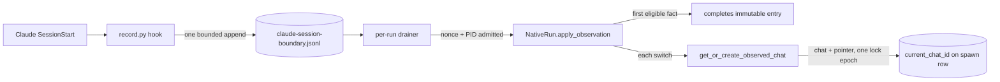

# Claude native sessions

Claude sessions share a store for a config root. Choosing the newest file or inferring from a similar directory slug can select another concurrent conversation; Meridian uses the recorded store and exact ID. See [native session identity](../decisions/native-session-identity.md) and the source checkout's `src/meridian/lib/harness/claude_sessions.py`.

## Reading transcripts

Tracked reads validate the exact recorded store and ID, independent of the caller's cwd. A missing store is unbound rather than an invitation to search ambient roots.

## TUI trampoline

A `/tui fullscreen` successor inferred from prompt history is diagnostic only. A nearby unrelated chat can satisfy the same prompt check, so it cannot prove the successor belongs to this process or replace the entry binding. A probe that resumes Claude in print mode was rejected because it performs model work and is not deterministic.

## Launch-owned SessionStart journal and current chat

**State:** shipped in v0.9.5 ([PR #559](https://github.com/haowjy/meridian-cli/pull/559),
merged 2026-10-12 as `1e5fc390`): base commits `679ab27f`, `cea151fa`, plus thermo structural fixes `7ba1ebb7`…`22eab4ad`
and validation/rendering fix `c6c017f0`. Final full gate (2447 Python tests, one
skipped; 108 runtime tests; Ruff, Pyright and builds) passed at `c6c017f0`.
Frozen-source native probe at
`22eab4ad` passed all required scenarios (see Evidence below). Downgrade and
mixed-version use with 0.9.3/0.9.4 remain incompatible.

The earlier design (commits `3aa18aae`…`a2713624`) tried to *prove the final session
at exit*: a `SessionEnd` receipt, verified only if the exact final transcript existed.
The user replaced that requirement with a weaker, more useful one: track the last
session Meridian observed during the run, and let an explicit continuation follow it.
Claude no longer has any exit proof. `SessionEnd` is deliberately not used, and the
old `verified`/`exit_chat_id` outcome is not produced for Claude. The distinction
that matters now is *observed* (a launch-owned fact arrived) versus *readable* (the
exact transcript exists when something actually reads or resumes it).

**Writer.** The `meridian-session-boundary` classic command hook is stdlib-only (no
Meridian import, no subprocess). For each `SessionStart` (`startup`, `resume`,
`fork`, `clear`, `compact`) it appends one JSONL record holding the launch nonce,
parent PID (the Claude process), source, session ID and exact transcript path.
PR #668 (open; not on `main`) adds `recorded_at` (epoch seconds) and, when Claude
publishes its inbox socket in `CLAUDE_CODE_MESSAGING_SOCKET`, `messaging_socket`.
The hook keeps the socket only if it is absolute, has no control characters, and
fits a Unix socket address (107 bytes; 103 on macOS). It never reads
`CLAUDE_CODE_MESSAGING_TOKEN`. The record stays `v: 2`, and lines without the new
fields still parse. Records are bounded
(8 KiB each, 1 MiB per journal, 1 MiB of hook input), written with a single
`O_APPEND` write to a mode-0600 file, and a leading newline isolates a torn tail.
Once the journal is full the hook writes nothing more.

**Admission and drain.** The launcher knows the actual Claude PID only after exec.
Each driver wraps execution in `with native_run.observing(adapter, child_env=…) as observe_child:`;
`on_running` calls `observe_child(pid)`. When the adapter returns a
`native_observation_reader` (Claude only), a private `_ObservationPump` is created and
started inside the context; every other harness returns `None` and no thread starts.
The adapter drops records whose nonce or parent PID is foreign, so a nested Claude
inheriting the environment cannot publish. The reader consumes only complete lines,
and the cursor advances per observation, after that observation's durable publication.
Without that ordering, a failure on a later record would replay earlier ones and
transiently rewind the pointer. Block exit, normal or exceptional, sets stop,
final-drains and joins the pump before `conclude_native_run`. Each fact is
acknowledged only after its publication; a later publication failure retains the
accepted prefix cursor.

**A second consumer: the message route.** A Claude primary's launcher reads the same
journal directly, without the drainer: it binds the control socket once a
`messaging_socket` appears for its own child's PID, and re-reads the journal on each send.
The PID filter excludes sockets from earlier launches of the same spawn, and because the
launcher owns that child, the PID can't be reused while it serves. Socket checks run at
lookup, so a bad socket field never drops a record's identity facts. Why the inbox and not
a mod: [D-claude-primary-inbox](../decisions/primary-inject.md#d-claude-primary-inbox).
Why the launcher: [D-unified-delivery](../decisions/primary-inject.md#d-unified-delivery).

**Entry is immutable; the pointer is not.** Observations never rebind the entry.
Only the first *eligible* establishing fact can complete it: `source` must agree with
the planned operation, and the session ID must equal the pre-assigned one when there
is one. So a missing `startup` record followed by an in-TUI `/resume` is not silently
taken as the entry. It is treated as a later switch. Every other fact goes to
`session_store.get_or_create_observed_chat`, which, under one lifetime/history/sessions
lock epoch, finds or materializes the chat for that exact `NativeKey` and publishes
`current_chat_id` on the spawn row. Memory and cursor advance only after that
returns. Dedup uses the full key and only against the immediately previous one, so
A → B → A republishes A.

**What a new chat inherits.** A materialized observed chat is a fresh conversation in
the current work: complete runtime settings and the work attachment from the source
chat, fresh history and generation, and none of the source's lease, spawn ownership
or fork lineage. Its launch-policy snapshot is copied inline from the source chat
(falling back to the original launch row for older records), so policy does not
depend on which run happened to observe the switch. An existing chat that is reused
keeps its own settings and work. Inline snapshot growth in `sessions.jsonl` is a
deliberate, scoped follow-up in the source state (`.context/FUTURE`), not solved
here.

**Reading the pointer.** Ambient context (the spawn's work and parent) resolves the
current chat; an explicit `cOld` stays old; `MERIDIAN_CHAT_ID` in a child is a
launch-time snapshot and does not follow later switches. A fresh launch stays fresh.
`--continue pN` selects `current_chat_id` through `SpawnRecord.continue_chat_id` (a
`mismatch` run keeps the entry chat) and validates the exact transcript at the real
read or resume. There is no fallback to the old chat. A session that was observed
but never persisted (a `/clear` with no turn, or an empty startup) is selected and
then refuses as `native_transcript_missing`.

**Live overlap is recorded, not denied.** Meridian cannot stop a user's native
`/resume` into a chat another run holds. The switch is recorded, and a warning names
the other owner. In the other direction, the Meridian resume and capture paths check
the live observer (`live_observer_for_chat`, which uses the original entry's lease and
process scope) and refuse. Observed chats carry no lease of their own, so that check
is what protects them.

**Known limits.**
- The journal cap, a hard-killed launcher, or a disabled hook can leave later
  switches unobserved. The last accepted pointer stays, and no reaper catch-up
  infers the missing ones.
- A run whose startup record is missing and which never switches leaves its entry
  unbound, as before.
- The TUI trampoline successor below is still only a diagnostic.

**Evidence, by kind.**
- *Code and fake tests:* focused state, runtime and process-seam tests in the
  worktree, including an injected atomic-write failure after chat materialization
  that checks the accepted transition sequence, torn-tail recovery and oversized-input
  refusal. Independent closure review approved `c6c017f0`. Final preflight passed
  2,447 Python tests (one skipped), 108 runtime tests, Ruff, Pyright (zero errors,
  75 existing warnings), and both package builds.
- *Frozen native probe (canonical):* real Claude 2.1.296, one Haiku turn, clean
  frozen source `22eab4ad` unchanged before/after. Five scenarios passed: startup →
  `/clear` (pointer advanced while running; entry unchanged; entry policy snapshot
  present before clear); `--continue pN` resumed exact new native ID; separate fresh
  launch did not resume; zero-turn fork (`source=fork`, bound entry, `/clear` advanced
  to new chat, source transcript hash unchanged, normal `/exit`); and SIGTERM of the
  scratch-owned native child (pointer durable at last observed chat, status `failed`).
  All five ended without leaked leases or credentials. The c1 start event has a
  null `launch_policy_snapshot`; the update event carries the real final policy
  (`claude-haiku-4-5`), confirming the entry generation owns its policy
  before any native turn or clear. Observed c2 carries `active_work_id` directly;
  `spawn_id` is null (no spawn lineage). Fork entry c4 has session lineage in its
  start row (`forked_from_chat_id=c2` and a non-null `forked_from_history_id`).
  An absent field on the spawn-view DTO does not establish absent session lineage.
  Successor c5 has neither lineage field nor spawn ownership, as required.
- This does not qualify `/compact`, repeated switches, A→B→A or concurrent writers live.
- *Historical, superseded:* the built-wheel `/clear` → `/exit` and 0.9.3 fork probes
  recorded under the previous `SessionEnd` design (`claude-final-live-probe.md`,
  `claude-fork-clear-final-proof.md`). They qualified the old verified-exit outcome,
  which Claude no longer produces. They are not evidence for this design. They do
  still show that real Claude 2.1.296 emits `SessionStart.source=fork` for a native
  fork.

**Upgrade and rollback.** The spawn row gains `current_chat_id` and the metadata
projection moves to schema 7 in a new namespace. Released 0.9.3 and 0.9.4 readers
rejected the new field on disposable copies (`extra_forbidden`). The human chose
`release:patch` for PR #559 because normal upgrades remain compatible, explicitly
excepting this PR from the release policy's older-reader rule. This classification
does not make downgrade or mixed-version use compatible. Stop active old runs and
back up the runtime before
upgrading. Rollback needs the pre-upgrade state plus a metadata-only index rebuild.
A schema-only rehearsal seeded 0.9.3 state, backed it up, wrote new state, confirmed
old-reader rejection on a copy, then restored the backup. The released reader
accepted it and its metadata-only rebuild exited successfully (reporting one
pending source). A separate final rehearsal used an actual isolated 0.9.4 writer:
its verified c1→c2 state read as current c2 with c2's settings/work, reads left
bytes unchanged, and the next write used the new shape. Released 0.9.4 rejected
that upgraded copy; restoring its backup preserved c2 continuation. Both rehearsals
are schema/reference checks, not native-content restoration. Native transcripts are
never rewritten.

**Code:** `harness/claude.py`, `harness/claude_boundary.py`,
`harness/claude_inbox.py` (the inbox route), `harness/claude_sessions.py` (source seeding), `harness/claude_settings.py`
(settings-file allows read at bind; PR #736, v0.12.3, replaced `harness/claude_preflight.py`).
`launch/native_run.py`, `state/session_store.py` (`get_or_create_observed_chat`),
`state/session_identity.py` (`live_observer_for_chat`), and
`claude_runtime/meridian-session-boundary/`. Tests:
`tests/integration/launch/test_launch_process_claude_session.py` (successor persisted
as a diagnostic; an unrelated concurrent candidate leaves exit unresolved;
contradictory `system/init` fails `entry_mismatch`),
`tests/integration/harness/test_adapter_ownership.py`, and the focused boundary
and projection tests.

