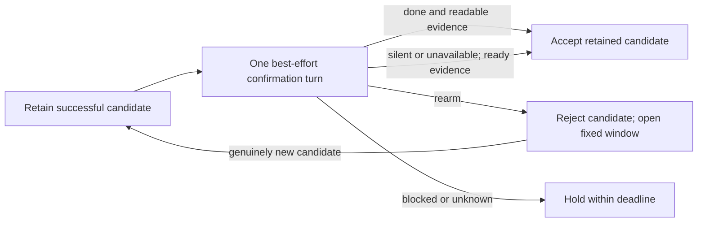

# Drain plans separate lifecycle policy from generic streaming

`drain_plan_factory.build_drain_plan()` returns the complete `DrainPlan` for one
active spawn. It makes the drain loop's lifecycle policy explicit while leaving
the generic streaming loop harness-agnostic.

## Plan composition

- `coordinator: DrainCoordinator | None` — optional harness-specific completion
  policy object.
- `policy: DrainPolicy | None` — terminal-event behavior (`SingleTurnDrainPolicy`
  by default).
- `raw_terminal_frames_authoritative` and `on_policy_selected` — constant loop
  configuration.
- `aux_wake` / `handle_aux_wake` — non-event wake sources such as Pi disk changes.
- `finalizer` — synchronous finalization effects;
- `teardown` — plan-owned async connection and cleanup-phase policy.

The plain streaming path is intentionally `DrainPlan(coordinator=None)`. There is no
public no-op coordinator. Absence of a coordinator means the generic drain loop handles
events with the selected `DrainPolicy` and finalizes from harness terminal frames or
connection close.

`DrainCoordinator` is narrow: start/stop, timeout selection, event observation,
terminal-event handling, timeout handling, after-event checks, close
classification, and stream-exit handling. The factory composes plain, resident,
and Pi plans; `SpawnManager` supplies generic capabilities and holds no Pi
policy.

Terminal publication is owned by `SpawnManager._publish_terminal()`, an
idempotent barrier called by both the drain loop's natural exit and
`stop_spawn()`. `resolve_terminal_outcome()` resolves competing sources:
success wins; otherwise an authoritative stop outcome wins; otherwise the drain
classification stands. The barrier publishes the outcome, resolves the
completion future, and starts one per-spawn async cleanup task. A stuck
cleanup or connection stop cannot hang publication. Cleanup reports are
telemetry and cannot replace the outcome; the startup reaper reconciles
incomplete cleanup after a crash.

## Resident completion

Claude, Codex, and OpenCode resident children share one candidate-scoped
confirmation contract. A **candidate** is a successful or idle terminal turn
retained by the coordinator; it is not yet the spawn's published outcome.

The diagram shows the completion choices; evidence validation and deadline
arbitration still gate publication. Before installing a candidate, the hold
profile consumes and discards candidate-less `done` and `rearm` under the
published-artifact lock. A signal file is delivery, not completion authority:
a stale signal cannot accept a future turn or spend its rearm budget.

- **`done` accepts the retained candidate.** It can override known blockers,
  but never unreadable (`unknown`) evidence. During an active confirmation turn,
  it waits for the closing report up to the completion deadline. It does not
  cancel Meridian descendants; agents should wait for them before finishing.
  Managed-scope teardown does stop leftover harness-native work.
- **`rearm` rejects that candidate.** A granted rearm clears candidate-scoped
  confirmation/done state and starts another fixed completion window. It waits
  for a genuinely new successful/idle candidate, not another timer-generated
  confirmation. It does not latch an indefinite requirement for a later `done`.
- **Silence or unavailable confirmation can accept ready evidence.** Each
  candidate gets one best-effort confirmation turn. A completed silent turn or
  a failed/unavailable injection can accept when neither descendants nor native
  tasks block completion. Live work still holds; `unknown` never authorizes
  success. There are no recurring advisory polls or timeout-soon nudges.

**The retained candidate carries the report.** The drain captures the text of
the turn that formed the candidate, and finalization prefers it over later
assistant text. A reply the child writes after `done` is therefore not its
report; a granted `rearm` drops the captured text with the candidate. The
confirmation message tells the child exactly this
([report contract](../decisions/completion-drain.md#d-completion-report-contract)).

**A hold without a completion-signal channel skips confirmation.** `done` and
`rearm` write Meridian state under its lock. When the connection reports that
the child cannot write there (Codex under an explicit `read-only` sandbox), the hold keeps the same evidence, blocker and
deadline policy but sends no confirmation, reads no signals, and accepts a ready
candidate directly ([D-completion-channel](../decisions/completion-drain.md#d-completion-channel)).
This and the empty accepted-signal set below shipped in v0.12.4 (PR #737).

A fresh descendant assessment must cover every proposed success. Transport
closure does not erase a retained success: ready evidence can accept it;
persisted descendants or temporarily unknown evidence can keep the drain alive
without further event reads. Native-only blockers on a dead backend and
non-transport failures retain their failure diagnostics.

### One hold profile, composed evidence

Selection is capability-driven in `build_drain_plan()`. A connection with a
native task source or resident backend receives `ResidentDrainCoordinator.build`
with one shared hold profile and `HoldEvidence(descendants, native)`. All holds
observe persisted descendants; Claude adds native background-task evidence.
OpenCode 2.x is resident-capable and uses this hold too. Cursor and connections
with neither capability remain plain plans. Pi retains its own quiescence policy.

The profile owns confirmation, signal precedence and the completion window.
Evidence sources report facts; they do not decide whether a child may finish.
The shared mechanism and freshness gate are described in
[completion drain coordination](completion-drain-coordination.md).

### Claude native holds

Claude's `system/background_tasks_changed` event is a full snapshot of
harness-owned background work. `ClaudeNativeTaskSource` keeps the latest
snapshot and reports `native_task` blockers; `HoldEvidence` combines them with
persisted descendants. The source has no timers or signal policy.

A non-empty snapshot blocks completion. When it empties, the closing parent
`result` is still owed. A malformed snapshot holds within the deadline.
Subagent assistant frames are not parent-turn activity. Even a Claude child
without background tasks receives the same best-effort confirmation as other
resident children.

Confirmation reaches Claude through serialized `SpawnManager.inject()` and
resident backends through `begin_followup_turn()`. Neither injection success nor
a native snapshot alone authorizes terminal publication.

### Completion windows and rearm budget

Unless `timeouts.resident_deadline_seconds` is explicit, the completion window
inherits the **calling harness's** configured `wait_yield_seconds`, not the
launched child's harness setting. Claude and Codex default to 3000 seconds.
This is an operational idle/compaction bound, not a prompt-cache guarantee.
The caller's [wait checkpoint](../concepts/spawn-wait-barrier.md) is independent:
its expiry yields control, whereas a child's completion deadline can end the spawn.

The deadline is absolute per arm. Only a granted candidate-scoped rearm renews
it; ordinary events and descendant activity cannot slide it. Rearm grants are
unlimited by default. `--resident-rearm-budget`,
`MERIDIAN_RESIDENT_REARM_BUDGET`, profile `resident-rearm-budget`, or
`timeouts.resident_rearm_budget` opts into a maximum. Granted extensions are
persisted as the spawn's `resident_rearm_count`. The CLI refuses an exhausted
budget; runner-side exhaustion retains `resident_rearm_budget_exhausted`.

With no accepted completion, deadline expiry publishes `timed_out` with
`resident_deadline_expired`, then asynchronously attempts descendant cleanup.
An explicit `done` cannot bypass unreadable evidence; if that override is still
blocked on unreadability at expiry, it fails with `resident_evidence_unreadable`.
The outer attempt timeout remains independent.

### Signal capability belongs to the selected plan

`DrainPlan.accepted_signals` declares what the live coordinator consumes:
hold plans with a completion-signal channel accept `done` and `rearm`, holds
without one accept neither, Pi accepts only `done`, and plain plans accept
neither. The hold coordinator derives its set from the connection capability;
the factory copies it into the plan. The runner publishes the set in
`spawns/<id>/accepted-signals.json` before draining. Signal commands check it,
spawn status, and rearm budget under the published-artifact lock; primary,
terminal, unsupported and exhausted-budget targets fail clearly.

An absent file preserves legacy delivery with an explicit **unconfirmed**
result. The capability stays off the strict spawn row: older readers reject
unknown row fields but ignore this side file. A successful command confirms
possible delivery, not acceptance of a candidate; candidate scope remains the
coordinator's responsibility.

## Timeout carrier

`execution_policy.timeout` (minutes) is the single timeout carrier for both
`--timeout` and `MERIDIAN_TIMEOUT`. Seconds conversion happens at the runner edge
only (`streaming_runner.py`). The former dual model -- `ExecutionBudget.timeout_secs`
alongside `execution_policy.timeout` -- was deleted because CLI armed one carrier
but not the other, and env armed the reverse, producing incorrect behavior in both
paths. The outer attempt timer is non-renewing and defaults to `None`; neither
resident rearms nor Pi child waves can reset it.

## Related pages

- [completion-drain-coordination.md](completion-drain-coordination.md) — shared completion mechanism, profile policy, and evidence authority.
- [Completion decisions](../decisions/completion-drain.md) — why confirmation is candidate-scoped and shared across resident children.
- [spawn-finalization.md](spawn-finalization.md) — terminal write authority and store-level finalization.
- [concepts/harness-abstraction.md](../concepts/harness-abstraction.md) — resident backend capability seam.
