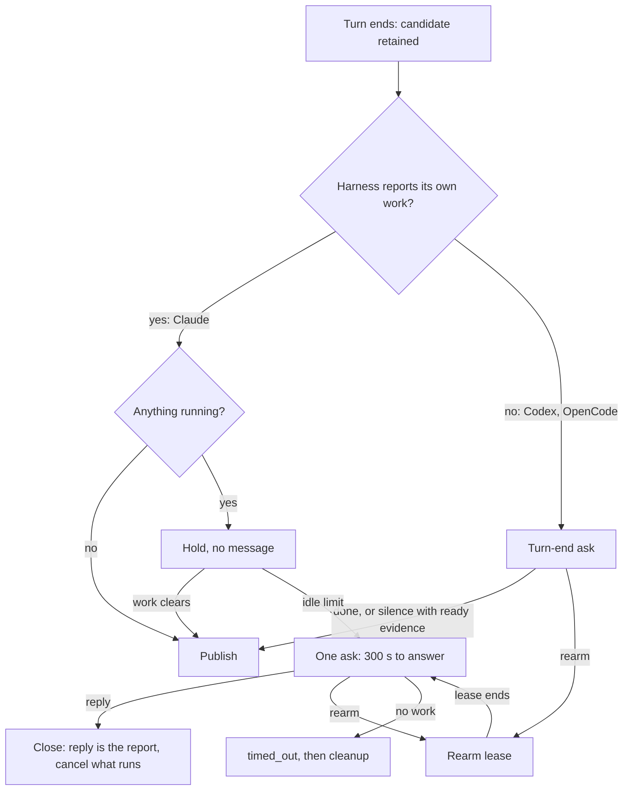

# Drain plans separate lifecycle policy from generic streaming

`drain_plan_factory.build_drain_plan()` returns the complete `DrainPlan` for one
active spawn. It makes the drain loop's lifecycle policy explicit while leaving
the generic streaming loop harness-agnostic.

## Plan composition

- `coordinator: DrainCoordinator | None` — optional harness-specific completion
  policy object.
- `policy: DrainPolicy | None` — terminal-event behavior (`SingleTurnDrainPolicy`
  by default).
- `raw_terminal_frames_authoritative` and `on_policy_selected` — constant loop
  configuration.
- `aux_wake` / `handle_aux_wake` — non-event wake sources such as Pi disk changes.
- `finalizer` — synchronous finalization effects;
- `teardown` — plan-owned async connection and cleanup-phase policy.

The plain streaming path is intentionally `DrainPlan(coordinator=None)`. There is no
public no-op coordinator. Absence of a coordinator means the generic drain loop handles
events with the selected `DrainPolicy` and finalizes from harness terminal frames or
connection close.

`DrainCoordinator` is narrow: start/stop, timeout selection, event observation,
terminal-event handling, timeout handling, after-event checks, close
classification, and stream-exit handling. The factory composes plain, resident,
and Pi plans; `SpawnManager` supplies generic capabilities and holds no Pi
policy.

Terminal publication is owned by `SpawnManager._publish_terminal()`, an
idempotent barrier called by both the drain loop's natural exit and
`stop_spawn()`. `resolve_terminal_outcome()` resolves competing sources:
success wins; otherwise an authoritative stop outcome wins; otherwise the drain
classification stands. The barrier publishes the outcome, resolves the
completion future, and starts one per-spawn async cleanup task. A stuck
cleanup or connection stop cannot hang publication. Cleanup reports are
telemetry and cannot replace the outcome; the startup reaper reconciles
incomplete cleanup after a crash.

## Resident completion

Claude, Codex and OpenCode children share one hold. A **candidate** is a successful
or idle turn the coordinator retains; it is not yet the spawn's published outcome.
What happens to it depends on whether the harness reports its own work.

The diagram shows the common paths; evidence validation and the idle limit still
gate publication. `hold_state.py` owns the whole lifecycle as one table, and
`src/meridian/lib/streaming/.context/completion-and-entry-points.md` says why each
row sits where it does. [Completion decisions](../decisions/completion-drain.md)
hold the reasons for the rules themselves.

- **`done` closes.** It can override known blockers, but it waits for `unknown`
  evidence to become readable, and it waits out a running turn. Then it cancels
  descendants and stops local background tasks through `cleanup`.
- **`rearm` keeps the child open.** A lease sets when it is next asked: when the
  visible blockers change, or with nothing visible, 270 s after the last turn end, or
  at the idle limit with `--long`. That ask has the same outcomes as any other, so the
  child can rearm again. A rearm drops the candidate but keeps the report.
- **Signals need no candidate.** A signal written during a turn waits for that turn's
  end. Of two in one read, the later stands
  ([why this is safe](../decisions/completion-drain.md#d-signals-need-no-candidate)).
- **A parent is woken for what it is owed.** When nothing runs, a parent that has not
  read a finished child gets one message naming each report, before it closes. The
  check reads which child launches it hasn't collected, not a blocker clearing, because
  a child that finished during the parent's turn never shows as a blocker. An idle-limit
  ask names the same children, because a reply to it closes over blockers.

**A hold without a completion-signal channel skips the ask.** `done` and
`rearm` write Meridian state under its lock. When the connection reports that
the child cannot write there (Codex under an explicit `read-only` sandbox), the hold keeps the same evidence, blocker and
deadline policy but sends no ask, reads no signals, and accepts a ready
candidate directly ([D-completion-channel](../decisions/completion-drain.md#d-completion-channel)).

A fresh descendant assessment must cover every proposed success, and a success
never publishes over a running turn. The one exception to the fresh assessment is the
child's own close. Once `done` has readable evidence, or a reply to the ask arrives on
any evidence, the close goes through `cleanup`, which publishes the candidate directly,
because cancelling covers what validation checked. Transport
closure does not erase a retained success: ready evidence can accept it;
persisted descendants or temporarily unknown evidence can keep the drain alive
without further event reads. A transport close during a running turn fails with the
close's outcome and cancels descendants. A dead backend ends the wait at once and cancels
descendants too; before, a Claude child died unnoticed until the deadline.

### One hold profile, composed evidence

Selection is capability-driven in `build_drain_plan()`. A connection with a
native task source or resident backend receives `ResidentDrainCoordinator.build`
with one shared hold profile and `HoldEvidence(descendants, native)`. All holds
observe persisted descendants; Claude adds native background-task evidence.
OpenCode 2.x is resident-capable and uses this hold too. Cursor and connections
with neither capability remain plain plans. Pi retains its own quiescence policy.

`_HoldProfile` is the shell around `hold_state.py`: it reads files and the clock,
sends, and applies what the table returns. Evidence sources report facts; they do not decide whether a child may finish.
The shared mechanism and freshness gate are described in
[completion drain coordination](completion-drain-coordination.md).

### Claude native holds

Claude's `system/background_tasks_changed` event is a full snapshot of
harness-owned background work. `ClaudeNativeTaskSource` keeps the latest
snapshot and reports `native_task` blockers; `HoldEvidence` combines them with
persisted descendants. The source has no timers or signal policy.

A non-empty snapshot blocks completion. When it empties, Claude still owes the
`result` that ends the follow-up turn it starts for the finished task, so the hold keeps
waiting for it. A malformed snapshot holds within the idle limit.
Subagent assistant frames are not parent-turn activity.

Claude's `system/init` marks the turn running a model call before its first
`assistant` frame, as a `turn_active` event that carries no work and renews nothing.
`init` can still land after an evaluation, so a turn end that released a hold settles
for 1 s before it publishes. Before this, a queued task notification raced the close
and a child could be stopped mid-turn with its report lost. A child with no background
work pays no settle.

Every ask reaches its harness through serialized `SpawnManager.deliver()`. Neither
delivery success nor a native snapshot alone authorizes terminal publication. An unknown
delivery result counts as sent and is not retried: Claude's normal success is a write
with no receipt, so a resend could ask twice.

### The idle limit and rearm budget

Unless `timeouts.resident_deadline_seconds` is explicit, the idle limit inherits
the **calling harness's** configured `wait_yield_seconds`, not the launched child's
harness setting. Claude and Codex default to 3000 seconds. This is an operational
bound, not a prompt-cache guarantee. The caller's
[wait checkpoint](../concepts/spawn-wait-barrier.md) is independent: its expiry
yields control, whereas a child's idle limit can end the spawn.

The clock renews on the child's own work inside a turn and on a granted rearm. Work is
a harness event marked `EventSemantics.work`: the child's output, tools and reasoning.
Heartbeats, usage and rate-limit updates are not work, and neither are Meridian's own
nudges or their echoes. Work counts only while a turn runs, so a chatty background
process cannot hold an idle child open, and descendant activity renews nothing. One
foreground command silent for a whole window is still idle and gets the ask.

Rearm grants are unlimited by default, and the budget caps rearms only.
`--resident-rearm-budget`, `MERIDIAN_RESIDENT_REARM_BUDGET`, profile
`harness-overrides.meridian-cli.resident-rearm-budget`, or
`timeouts.resident_rearm_budget` opts into a maximum. Granted extensions are
persisted as the spawn's `resident_rearm_count`; each reason goes to `rearms.jsonl`
when the rearm is charged, so the file holds only rearms that took effect. The CLI
refuses an exhausted budget; runner-side exhaustion retains
`resident_rearm_budget_exhausted`.

With no answer to the ask, the hold publishes `timed_out` with
`resident_deadline_expired`, then attempts descendant cleanup. A `done`
still blocked on `unknown` evidence at expiry fails with
`resident_evidence_unreadable`. The outer attempt timeout remains independent.

### Signal capability belongs to the selected plan

`DrainPlan.accepted_signals` declares what the live coordinator consumes:
hold plans with a completion-signal channel accept `done` and `rearm`, holds
without one accept neither, Pi accepts only `done`, and plain plans accept
neither. The hold coordinator derives its set from the connection capability;
the factory copies it into the plan. The runner publishes the set in
`spawns/<id>/accepted-signals.json` before draining. Signal commands check it,
spawn status, and rearm budget under the published-artifact lock; primary,
terminal, unsupported and exhausted-budget targets fail clearly.

An absent file preserves legacy delivery with an explicit **unconfirmed**
result. The capability stays off the strict spawn row: older readers reject
unknown row fields but ignore this side file. A successful command confirms
possible delivery, not that the hold took it; a rearm read as the hold ends is dropped
and costs no budget.

## Timeout carrier

`execution_policy.timeout` (minutes) is the single timeout carrier for both
`--timeout` and `MERIDIAN_TIMEOUT`. Seconds conversion happens at the runner edge
only (`streaming_runner.py`). The former dual model -- `ExecutionBudget.timeout_secs`
alongside `execution_policy.timeout` -- was deleted because CLI armed one carrier
but not the other, and env armed the reverse, producing incorrect behavior in both
paths. The outer attempt timer is non-renewing and defaults to `None`; neither
resident rearms nor Pi child waves can reset it.

## Related pages

- [completion-drain-coordination.md](completion-drain-coordination.md) — shared completion mechanism, profile policy, and evidence authority.
- [Completion decisions](../decisions/completion-drain.md) — when a child closes, what it reports, and what was rejected.
- [spawn-finalization.md](spawn-finalization.md) — terminal write authority and store-level finalization.
- [concepts/harness-abstraction.md](../concepts/harness-abstraction.md) — resident backend capability seam.
