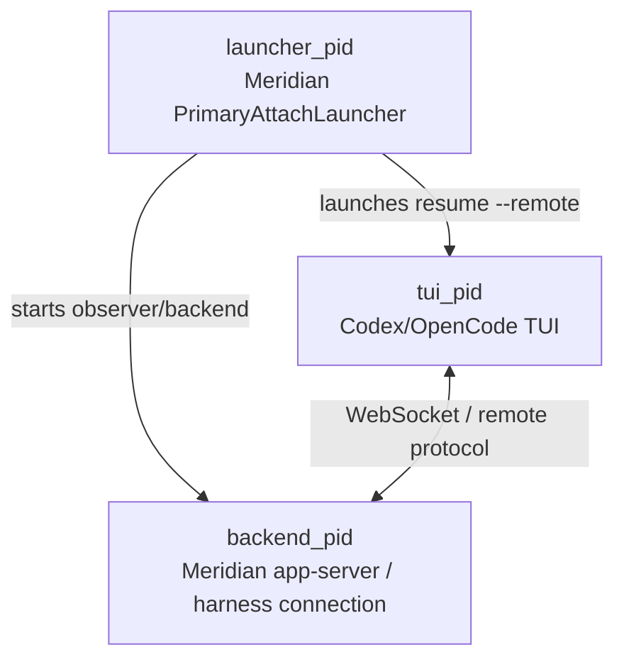

# Architecture: Managed Primary Lifecycle

Managed primaries are interactive Codex/OpenCode sessions where Meridian owns a
small launcher wrapper and a local backend while the user interacts through the
harness TUI. They are not the same lifecycle shape as Claude primaries or child
spawns, so cleanup policy must treat them differently.

Related pages:
- [concepts/spawn-lifecycle.md](../concepts/spawn-lifecycle.md) — generic spawn status machine and crash recovery
- [architecture/state-system/derived-status.md](state-system/derived-status.md) — lock-derived status and the one dead-launch writer
- [architecture/spawn-finalization.md](spawn-finalization.md) — the one terminal writer and the runner's terminal decision
- [architecture/process-scope.md](process-scope.md) — process-scope ownership model; spawn_owned vs session_owned split for managed primaries; the start gate and guardian
- [architecture/primary-terminal-ownership.md](primary-terminal-ownership.md) — native terminal for the TUI, shared job control, cancellation by order, exit-text rule
- [codebase/harness-adapters.md](../codebase/harness-adapters.md) — Codex/OpenCode adapter notes and approval routing
- [decisions/idle-notifications.md](../decisions/idle-notifications.md) — idle adapter hosting for Codex/OpenCode primaries
- [operations/troubleshooting.md](../operations/troubleshooting.md#crashed-spawn-crashed) — diagnosing a `crashed` spawn
- [lessons/arch-refactor-pitfalls.md](../lessons/arch-refactor-pitfalls.md) — implementation pitfalls behind the PR #184 cleanup refinement

---

## Process Roles

Codex and OpenCode managed primaries split one Meridian primary into three
runtime roles:

| Role | Owner | Responsibility | Expected exit relationship |
|---|---|---|---|
| `launcher_pid` | Meridian wrapper process | Start the backend and TUI behind the start gate; write `primary_meta.json`; persist events; stop backend during normal teardown | Should outlive the TUI and exit after normal teardown |
| `backend_pid` | Meridian-managed app-server / connection runtime launched by `launch_managed_backend()` | Maintain the remote protocol connection and event stream; expose `scope_snapshot` | Own session/pgid; its guardian kills the group when the launcher dies, on POSIX |
| `tui_pid` | Harness TUI process | User-facing interactive session, on the user's real terminal in the launcher's foreground group | Its guardian sends one SIGTERM when the launcher dies (root-only mode) |

Both scopes start behind the start gate (#633, ported to the native-terminal
launcher in #646): neither execs before its scope is durable, and each gets a
guardian that acts when the launcher dies. The TUI shares the shell's foreground
group, so its guardian runs in root-only mode, one SIGTERM
([parent-death linkage](process-scope.md#parent-death-linkage)). The per-launcher
Python watchdog #614 proposed never shipped.

Claude primaries are different: Claude is a single black-box harness process.
There is no managed backend/TUI split, and no `primary_meta.json` with
`managed_backend: true`. Generic runner PID liveness remains the right signal
for Claude and for normal child spawns.

---

## Startup, stop, and failure cleanup share one ownership gate

A managed connection owns startup from the first process-publication boundary
through connected-state publication. `stop()` waits for startup or its cleanup to
settle before acknowledging shutdown, so it cannot observe “no process,” return,
and allow an in-flight launch to publish a child afterward. A new `start()` also
cannot cross failure cleanup that still owns and may mutate the old connection's
fields.

The gate covers initial launch as well as an OpenCode conflict replacement. One
startup deadline covers both attempts, including the reserved process-termination
wait. If bounded foreground failure handling stops waiting, shielded cleanup keeps
the same gate until ownership is settled. That cleanup may outlive the startup
call, but it is not another runtime and cannot initiate another attempt.

This reuses the connection's existing lifecycle, stop lock, and durable process
scope. A second task runtime or replacement-only lock was rejected: either would
create another owner without closing the initial-publication race. Core
implementation `078d907a` is approved by `p6069`; `p6060` exercised the native
replacement and normal cleanup paths. The feature remains unreleased.

---

## Launcher Death Is Abnormal Evidence

A managed-primary launcher dying before the TUI exits is abnormal. It means the
Meridian wrapper crashed, was killed, or failed during teardown. It is evidence
to diagnose, not proof that the user-facing TUI and backend are dead.

The launcher is expected to:

1. Start the backend / observer connection.
2. Launch the TUI attached to that backend.
3. Persist primary metadata and connection events, including exact birth epochs for
   launcher/backend/TUI PIDs.
4. Wait for the TUI to exit.
5. Enter finalization / teardown and stop the backend.

If step 4 is interrupted by launcher death on POSIX, the guardians stop the
backend group and send the TUI one SIGTERM, so a dead launcher means a dead
runtime. The launcher is the runner and holds `launch.lock`, so the moment it
dies every reader shows the row `failed`/`crashed`
([derived status](state-system/derived-status.md)). A launcher that receives
SIGTERM or SIGHUP finalizes `cancelled` (exit 130) itself; only SIGKILL and OOM
reach `crashed`. The row stays stored `running` on disk until
`meridian doctor --kill-orphans`, the next primary launch's background repair, or
`spawn cancel` persists the outcome. The next `--continue` sweeps whatever
processes are left ([continue sweep](process-scope.md#continue-sweep)).

The inverse failure is also handled at the launcher boundary: if the observed event
stream dies during managed-primary attach, launch fails and tears down the TUI/backend
instead of leaving a disconnected frontend session running.

---

## Repair and Cleanup Boundary

Reads never signal. `meridian work`, `spawn list`, `spawn show`, `spawn wait` and
`session log` derive a dead launcher's row as `crashed` without writing it or
touching processes.

**The reaper** (`doctor --kill-orphans`, primary-launch background repair)
claims the free lock and writes `failed`/`crashed` with origin `reconciler`, or
`cancelled` if a cancel was requested. Before writing it records a cleanup claim:
the row's recorded `process_scopes.json` scopes or, when there are none, the
backend and TUI PIDs from `primary_meta.json` (checked against their recorded
birth time when one exists). After writing it terminates the claimed scopes ([cleanup claims](state-system/derived-status.md#the-reapers-cleanup-claims)).
A held lock means the launcher is alive, and the reaper does nothing. It has no
activity or grace rules: the lock alone decides.

**`spawn cancel`** on a live managed primary terminates the tracked processes
through `terminate_managed_primary_processes()`, which SIGTERMs only PIDs whose
birth matches `primary_meta.json` (`launcher_birth_epoch`, `backend_birth_epoch`,
`tui_birth_epoch`, one-second tolerance); confirmed reuse or unknown birth is
skipped. Without `--force`, cancel refuses a primary whose session lease owner or
exact-birth launcher is alive. A dead managed primary's outcome is written with
`managed_scopes_pending`; a later `spawn cancel` on that terminal row runs
`release_managed_primary_scopes`. That path checks that the runner is dead by
exact birth, then cleans up from metadata PIDs, else recorded scopes, else the
worker PID (only for a Codex/OpenCode primary with no metadata).

---

## Implementation Map

| File | Role |
|---|---|
| `src/meridian/lib/state/managed_primary.py` | Exact-birth process termination helper, conservative candidate check (`kind == "primary"`, harness `codex`/`opencode`), terminal-row scope release |
| `src/meridian/lib/state/reaper.py` | Dead-launch repair: cleanup claim with managed-primary fallback scopes, then scope termination |
| `src/meridian/lib/core/spawn_service.py` | `cancel()`, `finalize_dead_launch()`, and terminal managed-primary cleanup |
| `src/meridian/lib/state/primary_meta.py` | `primary_meta.json` persistence and parsing |
| `src/meridian/lib/harness/connections/managed_backend.py` | Shared managed-backend launch helper that records backend `ProcessScopeSnapshot` |
| `src/meridian/lib/launch/process/primary_attach.py` | Reads `connection.scope_snapshot`, upgrades backend ownership, and records TUI scope |

---

## Design Rationale

Before identity-v2 PR 3 the reaper guessed whether a managed primary was dead
from the launcher PID, recent file activity and a startup grace, so it kept a
strict skip/finalize discipline: a wrong "dead" guess followed by signals would
have killed a TUI the user was still typing in. With the lock, a free lock is
proof that the launcher is gone, and the guardians have already stopped the
backend and TUI in the common case, so cleanup after a claimed outcome no longer
risks a session the user is still in. The remaining risk is PID reuse.
`terminate_managed_primary_processes()` skips any PID whose birth doesn't match,
but the reaper's fallback targets still signal a PID whose birth time was never
recorded ([cleanup claims](state-system/derived-status.md#the-reapers-cleanup-claims)).

A crash used to finalize `cancelled`, exit 130,
`session_ended_without_finalize`. It now reads `failed`/`crashed` like any other
dead runner; the owner accepted the change when PR 3 merged.
