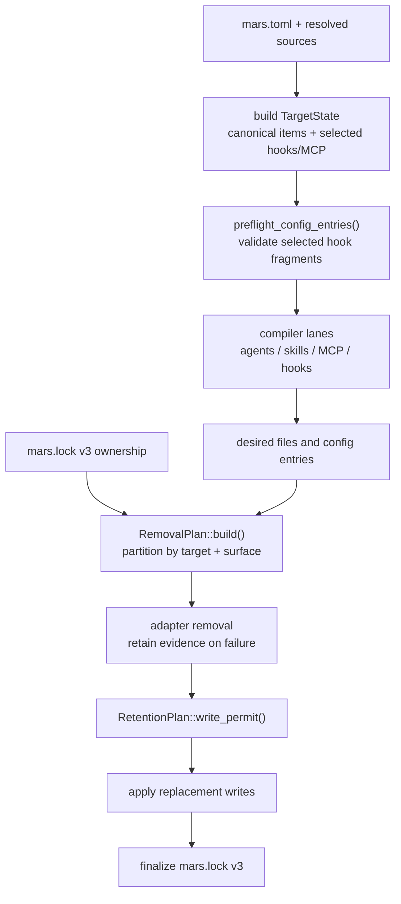

# Mars Compiler Architecture

The Mars compiler is the subsystem in `mars-agents` that transforms package
declarations (`mars.toml` + resolved sources) into materialized output: agent
files, skill files, MCP server config entries, and hook config entries. This
page documents the stable compiler architecture after the
`mars-compiler-cleanup` work item (2026-05).

**Related pages:**
- [concepts/package-management/overview.md](../concepts/package-management/overview.md) — what Mars manages and why
- [lessons/mars-compiler-cleanup.md](../lessons/mars-compiler-cleanup.md) — cleanup lessons: Windows fixes, lock indexing, test split, dead-code deletion, warning routing
- [decisions.md](../decisions.md) — D35–D40 for decisions made during cleanup

---

## Compiler Module Map

```
src/compiler/
  mod.rs              # compiler entry point, orchestrates phases
  context.rs          # CompilerContext: shared resolution state per sync
  agents/
    mod.rs            # agent compilation pipeline
    lower.rs          # profile → materialized agent file
  config_entries/     # extracted module (Phase 3b refactor)
    mod.rs            # entry point: compile_config_entries()
    resolve.rs        # MCP name-collision resolution
  hooks/
    mod.rs            # fragment discovery, event validation, substitution
  mcp/
    mod.rs            # MCP server lowering + collision resolution

src/surface_ownership/
  mod.rs              # per-target path ownership: may_delete, copy_decision
  retention.rs        # config-entry removal outcomes, WritePermit, RetentionPlan

src/lock/
  mod.rs              # mars.lock read/write, LockIndex, config_entries section
```

The `config_entries/` module was extracted as a preparatory refactor (D39)
before two concurrent feature phases (MCP/hook conflict resolution and stale
config cleanup) modified it. Stale-entry detection (`stale.rs`) was subsumed
by `RemovalPlan::build` in `surface_ownership/retention.rs` when the retention
seam was redesigned (see below).

---

## Compilation and Ownership Pipeline



Target construction parses hook and MCP schemas, applies dependency filters and
exported visibility, and carries the selected parsed entries in `TargetState`.
It resolves hook collisions there; MCP candidates stay source-ordered until the
per-target lowerer applies first-wins collision precedence. Config-entry preflight
validates the selected native fragments before apply, so an invalid fragment
cannot partially mutate canonical or target state. Stale ownership is not a
compiler submodule:
`surface_ownership::retention::RemovalPlan` compares prior and desired records,
partitions them by `(target_root, Surface)`, and gates replacement writes with
`WritePermit`.

## Config-Entry Selection and Collisions

Hooks and MCP servers share one selection path. Target construction discovers
each source once, applies its package-boundary rules, and records the parsed item
in `TargetState`. Preflight and config lowering consume that state; neither scans
package directories again.

MCP servers have no canonical installed directory, so a selected MCP value carries
the managed target roots where it applies rather than a `TargetItem`. Same-name
MCP candidates remain unresolved until per-target lowering:

**MCP precedence:**

| Scenario | Winner | Behavior |
|---|---|---|
| Different depth | Shallower package (`_self`, then direct dependencies, then theirs) | `_self` wins silently; a dependency loser is dropped with a warning |
| Same depth | Reached through the earlier `mars.toml [dependencies]` entry | Later dropped with warning |
| Same depth and declaration order | Alphabetically first source | Warning names both sources |

Depth is the shortest distance from the consumer, derived once by
`ResolvedGraph::dependency_depths()`; hooks use the same depths for ordering.
`graph.order` in the dependency graph is **alphabetical**, so declaration order
comes from `mars.toml`, not graph traversal order. This ranking is
[D103](../decisions/package-management.md#d103-collision-precedence-and-hook-order-use-shortest-dependency-depth-2026-10-24),
on unmerged mars-agents PR #193; released mars still ranks every dependency by
declaration order alone.

Selection preserves diagnostic compatibility as well as output. Eligible MCP
items remain in `TargetState` even when none of their declared targets is managed,
so the all-item environment check still sees them. Discovery failures are carried
and reported at the same preflight and compile phases as before, and `_self`
candidates precede dependencies so warning order does not change.

Hooks also use the target build's content selection. Dependency filters and
exported visibility run before the target-scoped canonical destination is chosen.
Two selected dependencies that provide the same hook for one target are a hard
collision; a project-local hook overlays the dependency winner and emits the
ordinary shadow warning. `TargetState` retains the parsed hook, its source
package, and ordering metadata. Preflight, merge-mode lowering and file-mode
lowering all consume that value; none rediscovers or independently chooses hooks.

The selection records intent rather than proof of installation. If an unmanaged
canonical path blocks the selected hook, the content item may be pruned while the
selection remains available for the post-target-sync installed-directory check.
That is what preserves the genuine not-installed warning without letting a
filtered or shadowed loser produce one.

Both manifest loaders convert `visibility` to `Visibility::Local` or
`Visibility::Exported`. An unknown value warns and becomes local, preserving the
old package-boundary behavior while making the typo visible; downstream code
never interprets visibility strings. Dependency `exclude = [...]` still does not
match MCP names: it leaves every MCP server from that source eligible. Whether to
change that user-visible behavior remains an open compiler-local decision.

This split matters to plugin builds: they can lower the pure target selection
with a plugin-root hook path and no project install. Sync adds the installed-dir
check after target copying. See
[D98](../decisions/package-management.md#d98-the-target-build-is-the-only-hook-selection-authority-2026-10-24)
and [D99](../decisions/package-management.md#d99-mcp-selection-joins-target-state-2026-10-24).

---

## Config-Entry Ownership in `mars.lock`

`mars.lock` v3 records config entries as nested maps: the outer key is target
root and the inner key is the config identity. `ConfigEntryRecord` carries
optional `emitted_json`; target and key are map coordinates, not fields in the
record. For example:

```toml
[config_entries.".claude"]
"hook:SessionStart:audit" = { emitted_json = "[...]" }
"mcp:some-server" = {}
```

The lock is the single ownership authority. On sync, the retention seam builds
removal operations from prior and desired maps. Exact emitted JSON permits
structural removal of merge-mode hook entries without claiming adjacent user
configuration. If removal is unconfirmed, prior evidence is retained and no
replacement write permit is issued for that target/surface pair.

The complete v3 schema, lifecycle states, recovery halt, and conflict policy
are canonical in [Sync Model](../concepts/package-management/sync-model.md).

## Two-Surface Ownership Model

Mars manages two distinct ownership surfaces for linked targets:

**Path ownership** (`surface_ownership/mod.rs`). Mars may delete or overwrite
a file at `(target_root, dest_path)` only when the lock holds an
`OutputRecord` for that exact pair. `.mars`-only records do not imply
ownership of files in `.cursor`, `.claude`, or other linked targets. This
covers copied hook directories, agent files, and skill files.

**Config-entry ownership** (`surface_ownership/mod.rs` + adapter removal
methods). Mars may remove a config entry only when the lock holds a
`ConfigEntryRecord` whose recorded `emitted_json` still matches the entry on
disk. Content resemblance without a lock record never establishes ownership.
This covers merge-mode hook entries in `settings.local.json`, `hooks.json`,
and similar config files.

### Canonical self destinations

Selected current-project agents and skills add a stricter canonical guard. If
their `.mars` destination exists without a matching installed lock claim, sync
fails before canonical/native apply and lock finalization. Matching bytes and
`--force` do not establish ownership; the blocking destination must be
relocated. Before this guard runs, sync may reconstruct a claim in memory from
valid pre-write intent for that exact absent destination, prior lock, and output
bytes. The journal is evidence that Mars planned the write, not permission to
adopt arbitrary matching content; see the
[Sync Model](../concepts/package-management/sync-model.md#pending-canonical-writes).

For a managed destination whose selected source changes but whose bytes do
not, an unmodified disk copy takes an `Update` so the lock records the new
owner and retains native claims. A locally modified disk copy does not transfer
ownership. See
[Current-Package Source Selection](../concepts/package-management/self-source-selection.md)
for source precedence and discovery boundaries.

### Retention Seam

When a removal step fails, the question is: what ownership records are retained
and which replacement writes are suppressed? The retention seam
(`surface_ownership/retention.rs`) answers this once, per `(target_root,
surface)` pair, and derives both retention and suppression from the answer.

The seam makes two properties structural rather than convention-dependent:

1. `RemovalOutcome::Confirmed` has no field for retained records. A confirmed
   removal cannot retain its record because there is no place to store one.
2. Every replacement write (merge entries and file outputs alike) requires a
   `WritePermit` that only `RetentionPlan::write_permit()` issues, and only
   for confirmed pairs. An unconfirmed removal cannot permit any replacement
   write because the only constructor returns `None`.

The three call sites that previously decided retention independently -- hook
sweep, stale MCP removal, and OpenCode legacy bridge -- are replaced by a
single `RemovalPlan::execute` closure. Cross-surface bleed (an Mcp failure
retaining Hook records) is unrepresentable because `RemovalPlan::build`
partitions records by surface before any mutation.

See [lessons/verification-and-review-discipline.md](../lessons/verification-and-review-discipline.md)
for the engineering lessons from the review that drove this redesign, and
[decisions/package-management.md](../decisions/package-management.md#d91-native-hook-fragments-replace-command-synthesis-2026-07)
for the D91 decision.

## Plugin Builds Reuse the Target Pipeline

`mars build plugin` is a second consumer of this pipeline, not a second
compiler. It resolves through the publish lens, then calls the same
`prepare_target_state` step sync uses (graph → filtered, renamed, validated
`TargetState`), and lowers agents, skills, exported hooks and exported MCP
through the per-harness lowerers into up to three plugin trees: Claude
(read by Claude, Codex and Grok), Cursor and OpenCode. Each tree takes the
target selection of one harness's sync root (`.claude/`, `.cursor/`,
`.opencode/`) and that harness's lowerer. It never calls `compile()`,
never writes `mars.lock`, and never probes installed harnesses.
Any change to filtering, renames, collision handling or agent lowering
therefore changes plugin output too; that is intended, since a plugin must hold
what sync installs. The differences are where a plugin loader differs from
a project install: the Claude tree drops agent fields Claude ignores in
plugins, and writes MCP environment pass-throughs as `env_vars` for Codex
while sync keeps the native form. Scope
and rationale:
[D100](../decisions/package-management.md#d100-a-package-publishes-one-plugin-holding-its-full-resolved-graph-2026-10-24).
Mechanism (staging, ownership, recovery, the OpenCode runtime): mars-agents
`src/build/AGENTS.md` and `src/build/.context/CONTEXT.md`, on
`release/v0.19.0`, not yet released.

## Cleanup Notes Moved Out

The cleanup also produced operational lessons and test-structure rationale
that are not part of the compiler's steady-state architecture. Those details
live in [lessons/mars-compiler-cleanup.md](../lessons/mars-compiler-cleanup.md)
to keep this page focused on the compiler boundary and data flow.
