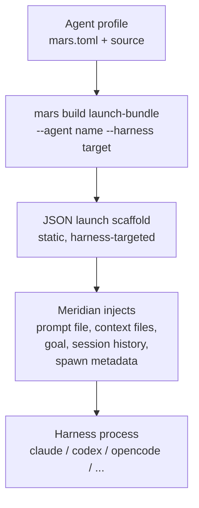
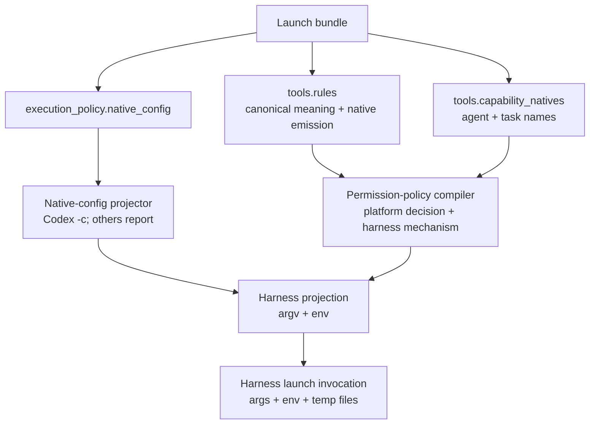

# Mars Launch-Bundle System

Cross-repo system spanning `mars-agents` (builds the scaffold) and `meridian-cli`
(injects per-spawn content and launches the harness). The public verb is `build`
(`mars build launch-bundle`).

> **Status (2026-10-22):** The typed `tools.rules` contract (including `native_tools`
> and `note`) and `tools.capability_natives` shipped in Mars 0.17.0 (mars-agents PR
> #179). Meridian reads them from v0.12.0 (PR #730) and requires Mars ≥ 0.17.0; it
> no longer reads the flat `allowed`/`disallowed` lists.

**Related pages:**
- [mars-compiler.md](mars-compiler.md) — compiler internals, config-entry pipeline
- [mars-targeting.md](mars-targeting.md) — static `.mars/` targeting vs. launch-bundle
- [mars-model-refresh.md](mars-model-refresh.md) — `ensure_fresh`, `--refresh-models` / `--no-refresh-models` on `build launch-bundle`
- [mars-routing.md](mars-routing.md) — routing parity, default harness_order, shared evidence
- [../concepts/native-config.md](../concepts/native-config.md) — native-config passthrough concept
- [../decisions/package-management.md](../decisions/package-management.md) — D80–D85 for decisions made during this work
- [../lessons/mars-launch-bundle-lessons.md](../lessons/mars-launch-bundle-lessons.md) — implementation lessons from the launch-bundle work item
- [cursor-harness.md](cursor-harness.md) — cursor probe; build-time `harness_model` effort resolution

---

## Ownership Boundary

**Mars builds the static scaffold.** At `mars build launch-bundle` time, Mars has
the compiled agent/skill graph. Mars cannot see per-spawn content — prompt files,
context files, goal text, prior session history — because those are runtime concerns
owned by Meridian.

**Meridian injects per-spawn dynamic content and launches.** Meridian reads the
bundle, injects prompt + context files + goal + session history into scaffold slots,
then starts the harness process.



**Mars never receives the prompt file.** The prompt file is per-spawn confidential
content. It enters the flow only at Meridian injection time.

---

## Two-Phase Model

| Phase | Owner | Input | Output |
|-------|-------|-------|--------|
| `mars build launch-bundle` | Mars | agent identity, target harness, launch options | JSON scaffold (bundle) |
| Meridian injection + launch | Meridian | bundle + prompt file + context files + goal + session history | running harness process |

Mars produces a bundle with scaffold slots — placeholder markers where Meridian will
inject per-spawn content before assembling the final system prompt.

---

## Bundle Structure

Top-level fields in the full Mars JSON schema (version 4):

| Field | Type | Description |
|-------|------|-------------|
| `version` | integer | Schema version (currently `4`) |
| `agent` | string \| null | Resolved agent name (`null` for ad-hoc mode) |
| `agent_body` | string \| null | Agent body markdown when an agent is provided; omitted/null in ad-hoc mode |
| `routing` | object | Routing result + Mars diagnostics (`model`, `model_token`, `harness`, `harness_model`, diagnostic fields) |
| `execution_policy` | object | Portable execution settings + `native_config` |
| `prompt_surface` | object | System instruction, supplemental documents, and Mars-rendered `inventory_prompt` |
| `scaffold_slots` | object | Placeholder positions for Meridian injection |
| `tools` | object | Resolved portable tool rules, compatibility flat lists, and profile-independent native names for platform-gated capabilities |
| `skills` | object | `loaded[]` (`name`, `skill_type`, `source_path`, `body` with the harness variant applied), `available[]` (`name`, `skill_type`, `description`, `source_path`), `missing[]` (names). Neither list is filtered by `model-invocable`; see [skill loading](../concepts/skill-loading.md) |
| `provenance` | object | Source attribution for each resolved field |
| `warnings` | string[] | User-visible warnings emitted during build |

Meridian consumes a subset of this schema. Every field is applied, reported as not
applied for the target harness, or deliberately unread
([bundle field consumption](../decisions/bundle-field-consumption.md)). It parses:
- `routing.model`, `routing.model_token`, `routing.harness`, `routing.harness_model`
- `execution_policy` fields
- `prompt_surface.inventory_prompt`
- `tools.rules` and `tools.capability_natives`
- `skills.loaded`, `skills.available` (it lists available skills with their descriptions), `skills.missing`
- `provenance`
- `warnings`

Deliberately unread: `agent_body`, `prompt_surface.system_instruction`,
`supplemental_documents` and `scaffold_slots` (Meridian composes the prompt itself from
the local profile and `skills.loaded`), and the flat `tools.allowed`/`disallowed`/`mcp`
lists. The reasons live in the docstring of meridian-cli
`src/meridian/lib/launch/bundle_adapter.py`. Other routing fields are Mars-owned
diagnostics and are ignored by Meridian.

### `routing` object (Meridian-consumed fields)

Meridian reads the following fields from the `routing` object:

| Field | Type | Description |
|-------|------|-------------|
| `model` | string | Canonical resolved model identifier |
| `model_token` | string | Selected model token from Mars routing/policy resolution (may differ from `model`) |
| `harness` | string | Harness identifier (e.g. `"claude"`, `"codex"`, `"opencode"`) |
| `harness_model` | string \| null | Harness-specific model ID used at harness command-build time when present; otherwise Meridian launches with the canonical resolved model ID |
| `candidate_slugs` | string[] | Diagnostic: raw probe slugs that matched during routing (mainly Cursor). **Consumers should run `harness_model` verbatim** — Mars resolves Cursor `model` + `effort` into `harness_model` at build time and clears `execution_policy.effort` when applied. Meridian may still read `candidate_slugs` for older Mars binaries; see [cursor-harness.md](cursor-harness.md). |

`routing.route_trace` is report schema 2: scope, model attempts, selected pointer,
and outcome. Meridian validates it and keeps it as `selection_report`. It is
diagnostic history, not a retry queue. Other diagnostic fields such as
`selection_kind` and `match_evidence` travel with that report.

### Catalog refresh before build

`mars build launch-bundle` calls **`ensure_fresh`** for the models.dev catalog (default
`RefreshMode::Auto`: HTTP only when TTL-stale), not a read-only cache load. Probe
refresh follows **`ProbeRefreshMode`** from the same **`ModelsRefreshControl`** as
`mars sync` and `mars models list|resolve`. Details: [mars-model-refresh.md](mars-model-refresh.md).

### `execution_policy` key fields

```json
{
  "execution_policy": {
    "effort": "high",
    "approval": "auto",
    "sandbox": "workspace-write",
    "network": {
      "mode": "allowlist",
      "allow": ["github.com", "*.github.com"],
      "deny": ["uploads.github.com"]
    },
    "autocompact": null,
    "autocompact_pct": 80,
    "timeout": null,
    "native_config": {
      "sandbox_workspace_write": { "network_access": false }
    }
  }
}
```

`network` is one resolved object:
`{"mode":"allow"|"deny"|"allowlist"|null,"allow":[...],"deny":[...]}`. Mars resolves
mode by precedence, combines the permission sets, canonicalizes hosts, and drops inert sets.
Meridian parses the object once to its typed network policy. A null mode applies the
sandbox-derived default while retaining denies. Current producers also provide
`provenance.network_source`; without that key Meridian rejects the pre-0.18 bundle and names
the required Mars version rather than guessing a harness default. Mars schema v1 (0.20.0) still emits this object; see
[network in schema v1](../decisions/sandbox-platform-access.md#schema-v1-network). `native_config` is omitted
(`skip_serializing_if = None`) when no native config is declared. Meridian applies it on Codex only; see
[../concepts/native-config.md](../concepts/native-config.md). `autocompact` is a token
count and `autocompact_pct` a percentage; how each harness applies them:
[D-compaction-projected](../decisions/bundle-field-consumption.md#d-compaction-projected).

### `tools` field

```json
{
  "tools": {
    "rules": [
      {
        "capability": "edit",
        "pattern": null,
        "action": "deny",
        "native": ["Edit", "Write", "NotebookEdit"],
        "native_tools": ["Edit", "Write", "NotebookEdit"],
        "native_status": "known"
      },
      {
        "capability": "write",
        "pattern": "src/*",
        "action": "allow",
        "native": ["Edit(src/*)"],
        "native_tools": ["Write"],
        "native_status": "known"
      }
    ],
    "capability_natives": {
      "agent": {
        "native": ["Agent", "SendMessage", "ListAgents"],
        "native_status": "known"
      },
      "task": {
        "native": ["TaskCreate", "TaskGet", "TaskList", "TaskOutput", "TaskUpdate", "TaskStop", "TodoWrite"],
        "native_status": "known"
      }
    },
    "allowed": [],
    "disallowed": ["Edit", "Write", "NotebookEdit"],
    "mcp": []
  }
}
```

`rules` is the policy contract. Each entry keeps the canonical capability and pattern
for meaning and gives two harness facts that neither side derives from the other:
`native`, the permission-rule spelling with the scope appended, and `native_tools`, the
unscoped harness tools the rule concerns. They differ where a harness checks one tool's
paths through another's permission: Claude matches paths only through `Edit(path)` and
`Read(path)`, so a scoped `write` rule is `Edit(src/*)` on the tool `Write`. Meridian
emits permission rules from `native` and decides which tools stay callable (`--tools`,
Pi's `--exclude-tools`) from `native_tools`.

`native_status` is `known`, `absent` (the harness has no such tool, so a deny is
satisfied), or `unknown` (Mars cannot name it: a gap); it is omitted for `*`. `note` is
the only channel for a permission gap, since Mars adds nothing to `warnings[]` for one:
it explains an `unknown` rule, or a `known` rule whose native permission is shared with
another rule or has broader effects. Mars has already resolved overlap among the rules it
wrote (the narrower capability wins per native name), so a `known` rule's `native` can be
empty when a more specific rule shadows it.

The flat `allowed`, `disallowed`, and `mcp` lists are derived compatibility fields for
older consumers. `mcp` holds allowed MCP permission names, never server definitions;
MCP rules reach Meridian as `mcp(...)` entries in `rules`. They cannot represent `ask`, `*`, or the capability a native name came
from. Meridian with typed-rule support reads only `rules`: a bundle without them, or
whose rules lack `native_tools`, stops the launch with "Install mars >= 0.17.0".

`capability_natives` is a separate, profile-independent contract. It is present even
for an ad-hoc bundle or a profile with no tool rules, and always has `agent` (sub-agent
tools) and `task` (task-list tools). Meridian decides *whether* a platform rule applies;
it takes the target harness's names from this map instead of keeping another native-name
table. The entries use the same native table and `native_status` semantics as `rules`.
An `absent` entry therefore has an empty native list and means the harness has no such
built-in capability. The native list can include names retained for supported older
harness builds, such as Claude's retired `TaskOutput`.

---

## Scaffold Slots

Mars emits a six-slot scaffold under `scaffold_slots`; each slot value is
`###SLOT###`. Meridian fills these slots with per-spawn dynamic content.

| Slot key | Placeholder value | Content Meridian injects |
|------|------------|------------------------------|
| `completion_contract` | `###SLOT###` | Goal/completion-contract instruction (`--goal` plus work-goal context when available) |
| `context_prompt` | `###SLOT###` | Launch context block (inventory/context docs built at launch time) |
| `user_prompt_file` | `###SLOT###` | User task prompt content for the spawn |
| `context_files` | `###SLOT###` | Material from `-f` reference files |
| `prior_session_context` | `###SLOT###` | Prior session/context-ref material (`--from`) |
| `spawn_metadata` | `###SLOT###` | Spawn metadata/report-contract instructions attached during composition |

Mars never populates these slots — it only marks where they go. Meridian replaces
each placeholder with actual content or removes it if the slot is unused for a given
spawn.

---

## Harness Support Status

| Harness | Status | Notes |
|---------|--------|-------|
| Claude | First-class | Tool policy (`--tools`, `--disallowedTools`, `--settings` permission rules); native-config reported not applied |
| Codex | First-class | Full bundle; native-config and permission switches via `-c` flags |
| OpenCode | First-class | Tool policy via `OPENCODE_CONFIG_CONTENT` (rules on the `meridian-<profile>` config agent); native-config reported not applied |
| Cursor | Unmaintained | Existing bundle support remains, but its native tool table is carried forward rather than reverified |
| Pi | Active | Bundle supported; permission projection uses native flags plus Meridian's extension where Pi has no native mechanism; native-config reported not applied |
| Gemini | Out of scope | Not a current Mars/Meridian target |

---

## Static Sync vs. Launch-Bundle: Intentional Divergence

Different build products for different consumers:

| | `mars sync` (static) | `mars build launch-bundle` (runtime) |
|---|---|---|
| **Consumer** | Harness-native agent discovery (e.g., Claude Code sidebar) | Meridian's runtime spawn flow |
| **Output** | `.mars/agents/*.md`, `.claude/agents/*.md`, etc. | JSON scaffold |
| **`native-config`** | Dropped from native artifacts (meridian-only in lossiness matrix) | Preserved in `execution_policy.native_config`; Meridian applies it on Codex |
| **Tool policy** | Preserved for harnesses that support it in native artifacts | Preserved in `tools` field for per-harness projection |

The static path serves harness-native discovery; the launch-bundle path serves Meridian.
The harness does not know how to apply `native-config`; Meridian does, on the harnesses
where it has a channel.

---

## Projection Architecture

Two independent projection paths in Meridian:



Results are merged: args concatenated, env vars deep-merged (native-config first,
tool-policy second for overlapping env vars), temp files tracked for cleanup.
Native-config keys Codex skips because Meridian computes them, and blocks a harness
cannot apply at all, go to the enforcement report shown by `--dry-run`, like permission
gaps; neither becomes a launch warning.

The permission compiler owns mechanism choices, not tool spelling. Mars is the sole
owner of the capability-to-native mapping: profile rules arrive already projected in
`tools.rules[].native`, and platform rules obtain their native names from
`tools.capability_natives`. Meridian must not derive either list from the canonical
capability or reverse-map native names back to capabilities.

**Per-harness native-config projection:**

| Harness | Strategy |
|---------|----------|
| Codex | Repeated `-c <key>=<toml-value>` flags; keys Meridian computes are skipped and reported |
| Claude, OpenCode, Pi, Cursor | Not applied; each key reported `[unsupported] ... not applied for <Harness>` |

Per-harness permission mechanisms belong to the Meridian launch system, not this
cross-repo boundary. They may use flags, settings, environment config, or an extension,
but all consume the native names Mars supplied and report any mechanism gap rather than
creating another spelling table. Why Mars owns the names, and what each harness enforces:
[Profile tool permissions](../decisions/tool-permissions.md).

---

## Prompt-Surface Isolation Invariant

**`native-config` entries must never appear in `prompt_surface`, supplemental documents,
or any scaffold slot content.** Enforced structurally:

- **Mars side:** native-config extraction and prompt composition are separate code paths.
  Native config → `execution_policy.native_config`; prompt surface → `prompt_surface`/`scaffold_slots`.
- **Meridian side:** config projector reads `execution_policy.native_config`; content
  projector reads `prompt_surface` and fills scaffold slots. Separate projectors,
  no shared output.

Model context never contains raw harness config.

---

## Compatibility

Schema v4 is the required schema; bundles with older schema versions are rejected at
parse time. The bundle version changes for incompatible contract changes. Additive
fields remain in v4, so `tools.rules` and `tools.capability_natives` did not bump the
schema. Meridian's mars-agents version pin, rather than a new schema number, establishes
when a required additive field is available.

Meridian validates the version field at consumption time:

```python
if version not in _SUPPORTED_BUNDLE_SCHEMA_VERSIONS:
    raise RuntimeError(
        f"Mars launch-bundle schema version {version} is unsupported. "
        f"Expected one of {_SUPPORTED_BUNDLE_SCHEMA_VERSIONS}."
    )
```
