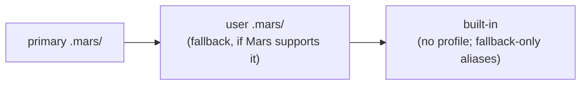

# Mars User Scope

Meridian decides which Mars root every Mars call runs against, so a directory
with no `mars.toml` still gets agents, skills, model aliases and launch targets.
The rationale and rejected alternatives are in
[D97](../decisions/package-management.md#d97-user-scope-packages-live-in-an-ordinary-mars-root-2026-10).

> **Status:** Meridian side on `feat/two-tier-identity` (draft PR #575,
> unmerged). `--fallback-root` is mars-agents PR #173, open; no released Mars
> carries it yet.

## Roots

The user root is `~/.meridian/mars/` (`user_mars_root()`), an ordinary Mars
project: `mars.toml`, `mars.lock`, `.mars/`. It has no `targets` and no
`managed_root`, so it routes unrestricted and every installed harness is
eligible.

`resolve_mars_roots(project_root)` in `lib/catalog/mars_roots.py` is pure and
returns `MarsRoots(primary, scope, user)`:

| Case | `primary` | `scope` | `user` |
|---|---|---|---|
| A `mars.toml` at or above the project root (nearest wins) | that directory | `project` | `~/.meridian/mars` |
| No `mars.toml` anywhere up the tree | `~/.meridian/mars` | `user` | none |
| The project root, or the found `mars.toml`, is the user root | `~/.meridian/mars` | `user` | none |

Identity and content walk differently: content follows Mars's walk-up, so a
repository subdirectory gets the repository's agents and targets, while
[identity](state-system/project-identity.md) never walks, so the subdirectory
keeps its own ad-hoc state. Both canonicalize paths the same way.

Every Mars subprocess (launch bundle, catalog, models, doctor, `mars agents`,
the passthrough) receives `--root <primary>`. Only `meridian mars init` /
`init --link` pass the literal project root. `ensure_resolved_mars_root()` runs
`ensure_user_mars_root()` whenever `scope == "user"`. That function runs
`mars init --root ~/.meridian/mars` under `~/.meridian/locks/user-mars-root.flock`,
re-checking for the `mars.toml` under the lock. Reads such as `doctor` never
create the user root.

## Content lookup

- **Meridian's own catalog** (`catalog/agent.py`, `catalog/skill.py`) reads
  `.mars/agents` and `.mars/skills` from `mars_content_roots(roots)`: primary
  then user, or primary alone when Mars lacks `--fallback-root`.
- **Mars calls** get `mars_fallback_args(roots, …)`: `--fallback-root <user>` on
  `build launch-bundle`, `agents show/list` (used by `spawn subagents`, which
  prints `root` or `fallback` per agent) and the read-only passthrough
  `agents` / `skills` subcommands. Never on mutations or `--user` calls.
- **Configuration** comes from `primary` only: targets, aliases, models cache,
  bootstrap docs, Mars defaults.
- **Source paths.** Bundle `agent_source_path` and skill `source_path` are
  authoritative; Meridian rebuilds primary-root paths only for older bundle
  producers.

**Capability probe.** `mars_supports_fallback_root(executable)`
(`catalog/mars_capabilities.py`) runs `mars build launch-bundle --help` with a
10 s timeout, cached per executable for the process, and looks for
`--fallback-root`. Failure or absence means unsupported. `context` and
`config show` print `mars_fallback: supported|unsupported`.

**Not-found messages.** In user scope:
`Agent '<name>' not found in user packages (<user root>). Run 'meridian mars --user add <source>'.`
Inside a project when Mars is unsupported and the agent exists only in user
packages: `found in user packages; add it here: meridian mars add <source>`. A
dry run warns "models cache unavailable" until the first `--user sync` or real
launch fills the user root's cache.

**Executable choice.** `resolve_mars_executable()` prefers the `mars` beside
the running Python (the install's own) over `PATH`. A probe that puts a dev
build first on `PATH` still gets `.venv/bin/mars`.

## `meridian mars` passthrough

`cli/mars_passthrough.py` decides in one place:

1. `--user` → `--root ~/.meridian/mars` (ensured first).
2. Otherwise the mutation gate: if `scope == "user"` and the subcommand is one
   of `add`, `remove`, `link`, `unlink`, `sync`, `upgrade`, `rename`,
   `override`, `adopt`, `version`, `repair`, `resolve` or the pair
   `models alias`, fail with
   `no project Mars root here; run 'meridian init --link', or use 'meridian mars --user …'`.
   The gate runs before root injection, including under
   `MERIDIAN_PROJECT_DIR`, so Mars's own auto-init on `add` / `link` never
   fires in a bare directory.
3. Otherwise inject `--root <primary>` (and `--fallback-root` for read-only
   `agents` / `skills` when supported).

## Bare `meridian opencode -a reviewer`

1. The ad-hoc root materializes (not on `--dry-run`); the user Mars root is
   ensured.
2. `reviewer.md` loads from `~/.meridian/mars/.mars/agents/`.
3. `mars build launch-bundle --root ~/.meridian/mars --agent reviewer` routes
   unrestricted.
4. The directory stays empty.

## Related

- [Project identity](state-system/project-identity.md) — tiers and retention
- [Mars launch bundle](mars-launch-bundle.md) — the bundle contract
- [Mars targeting](mars-targeting.md) — targets and harness projection
- [Package management](../concepts/package-management/overview.md) — the
  package model
