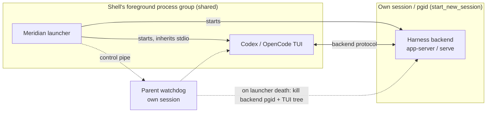

# Architecture: Who Owns the Terminal in an Interactive Primary

An interactive primary puts a harness TUI on the user's terminal. Meridian has
to decide how much of itself sits between that TUI and the terminal. The answer
differs per harness, and it settles four other things: how job control works,
how the launcher's death is contained, how a closed pane is recorded, and what
Meridian may print.

Rationale and rejected alternatives:
[decisions/primary-terminal-ownership.md](../decisions/primary-terminal-ownership.md).
Process roles and reconciliation:
[managed-primary-lifecycle.md](managed-primary-lifecycle.md). Scope
containment and the launcher watchdog: [process-scope.md](process-scope.md).

> **Status (2026-10-17).**
> - The exit-text rule is merged (PR #607).
> - The native terminal for Codex/OpenCode shipped in PR #646
>   (`feat/native-terminal-gate`, merge `bc2374b5c`, 2026-10-16, v0.10.15), built
>   on the start gate and guardian
>   ([D-start-gate-guardian](../decisions/spawn-identity.md#d-start-gate-guardian),
>   PR #633, merged). PR #614 was closed unmerged.
>   **Divergence:** the job-control diagram and the "parent watchdog" wording
>   below still describe #614. The shipped containment is the gate and guardian;
>   [process-scope.md#parent-death-linkage](process-scope.md#parent-death-linkage) owns it. This page has not been
>   re-verified against #646 beyond the signal sections.
> - The launcher-output window
>   ([below](#launcher-output-during-the-tui-goes-to-launcherlog)) is merged
>   (PR #621, merge `23eb2d6d2`, v0.10.11).
> - SIGTERM/SIGHUP cancel for black-box (Claude/Pi PTY) primaries is merged
>   (PR #658, #623, merge `8055a1f77`, v0.10.19).

---

## Terminal mode per harness

| Harness | Mode | What sits between TUI and terminal |
|---|---|---|
| Codex | native inherit | Nothing. The TUI inherits the launcher's stdin/stdout/stderr. |
| OpenCode | native inherit | Nothing. |
| Claude | PTY mediated | Meridian's PTY relay: inner PTY, raw-mode stdin forwarding, output copy, resize bridge, teardown restore codes. |
| Pi | PTY mediated (native also supported) | Same relay. |

The **adapter declares the default mode** in its capabilities
(`default_terminal_surface_mode`); policy resolution validates that the default
is one the adapter supports, and the process selector turns the mode into a
launcher. The mode is not a user choice. There is no flag, env var or config
key to change it, and it is **not persisted in launch-policy snapshots**, so
`--continue` always gets the current adapter default rather than replaying an
old one. TTY detection no longer decides PTY versus native; it only matters as
a fallback where a PTY is unavailable. Explicit output capture
(`output_log_path`) still forces PTY or pipe capture regardless of mode.

### Why Codex and OpenCode don't need the relay

Meridian observes a Codex or OpenCode primary through its own connection to the
harness backend (app-server WebSocket, OpenCode HTTP/SSE): events, idle sensing,
session identity, metadata and reports all come from that side channel. The TUI
is only a client of the same backend. Nothing Meridian needs passes through the
TUI's bytes, and the managed attach never set an output log.

The relay was therefore pure cost for these two harnesses. Its nested PTY was
the cause of the resize mangling behind #596: the user's terminal resized, the
inner PTY lagged, and the TUI repainted at the wrong geometry. With the TUI on
the real terminal, `SIGWINCH` and the window size reach it directly.

### Why Claude and Pi keep the relay

**Not because Meridian reads their output.** Interactive Claude/Pi output is
never captured (capture happens only with `--print`). Claude's session id comes
from the launch itself (`--session-id` plus the `SessionStart` boundary
journal; see [native-session-binding.md](native-session-binding.md)). Idle
sensing reads Claude's transcript or Pi's extension, not the screen. Any page
that says Claude "needs the PTY to observe" its session is out of date.

The relay stays because the owner chose it: Claude and Pi resize fine through
the relay ("i didn't really have any problems resizing claude and pi so its
fine"), so there was no reason to move them. What the relay still does for them
is crash-time terminal cleanup (mouse modes off, cursor shown, alternate screen
left if the child died inside it). Moving them native is an open option, not a
blocked one: Pi's adapter already lists native inherit as supported.

---

## Job control in native mode

- **One shared foreground group.** The launcher and the TUI share the shell's
  foreground process group. Meridian calls neither `setpgid` nor `tcsetpgrp`;
  the shell owns job control as it does for any command.
- **Ctrl+Z is the TUI's.** A TUI in raw mode reads Ctrl+Z as byte `0x1a` and
  stops itself with `kill(0, SIGTSTP)`. That stops the whole group, launcher
  included, and the shell prints `Stopped`; `fg` resumes both. Meridian
  installs no SIGTSTP, SIGTTIN, SIGTTOU or SIGCONT handler and sends no stop
  signal. The backend and the watchdog sit outside the group and keep running.
- **SIGINT is ignored only while the TUI runs.** Ctrl+C at the TUI arrives as a
  byte too, but a TUI may also signal its own group, and a SIGINT to the group
  would otherwise turn into launcher teardown. So `PrimaryAttachLauncher`
  registers a no-op SIGINT receiver with the process-global
  `SignalCoordinator` immediately before starting the TUI and unregisters it
  right after the TUI exits, before backend teardown. During backend startup,
  Ctrl+C still aborts the launch cleanly. The TUI starts with default SIGINT.
- **SIGHUP/SIGTERM cancel.** A closed pane sends SIGHUP to the whole group and
  a kill sends SIGTERM. The launcher's receiver, registered for all of `run()`,
  unblocks the TUI wait, stops the backend, and finalizes. A signal that lands
  before the TUI exists is latched and honored once it starts.

The black-box path (Claude/Pi PTY relay, and native only as OpenCode's
managed-attach fallback) gets the same outcome from PR #658: a SIGTERM/SIGHUP
receiver around `run_primary_process_with_capture()`, `cancelled` carried to
finalize, exit 130, and `escalate_on_repeat` with the same 1 s grace, so a
terminal-close burst (HUP, HUP, TERM within milliseconds) cancels once and a
deliberate later repeat force-quits. The child is stopped only through the
start gate: group TERM then the guardian's KILL for PTY, one root TERM for
native ([gap #657](#known-gaps)).

### Signal handlers run inside the main thread

`SignalCoordinator` installs handlers with `signal.signal`. Python runs those
handlers on the main thread, between bytecodes of whatever the main thread was
doing. A handler that takes a `threading.Lock` the main thread already holds
deadlocks the launcher against itself. Anything a coordinator receiver touches
must be lock-free or use an `RLock`. A TUI-exit ordering recorder on the closed
PR #614 hit exactly this in review.

The trap is wider than locks you write. `LaunchGate.terminate()`/`close()` take
a plain `Lock`, and `threading.Event.set()` takes the Event's internal
`Condition`, so the PTY launcher's `cancel_wait()` is not handler-safe. The
black-box receiver therefore **only latches a bool**. `running.wait()` runs on
a daemon thread; the main thread polls it every 100 ms and, outside handler
context, calls `terminate()` and `cancel_wait()` once each. The poll loop's
`except BaseException` path does the same before re-raising, so a
`KeyboardInterrupt` cannot leave the relay thread holding the tty in raw mode
with the harness alive. Managed attach calls `cancel_wait()` directly from its
handler and is safe only because the native launcher's `cancel_wait()` sets a
plain attribute. A new receiver that needs the gate or an Event uses the latch
and a main-thread poll.

### A dead terminal raises `termios.error`, which is not an `OSError`

After SIGHUP or a pane kill, the outer tty may already be gone when the PTY
relay restores it. `termios.tcgetattr`/`tcsetattr` then raise `termios.error`,
which does **not** subclass `OSError`, so cleanup that catches only `OSError`
escapes with a traceback and skips the rest of teardown. The first pane-kill
probe for #623 hit exactly this. Dead-tty paths in `_copy_primary_pty_output`
catch both. A `select` failure drops stdin and keeps draining the master rather
than breaking out, because a child blocked on a full pty would hang the
following `waitpid`.

---

## Cancellation is decided by order, not exit code

A run counts as **cancelled (exit 130)** if the launcher received SIGHUP or
SIGTERM **before it observed the TUI's exit**, whatever exit code the TUI
reported. If the launcher saw the TUI exit first, the TUI's real result stands.
Shipped code needs no separate recorder. Managed attach reads its latch once, when
the main task resumes from the TUI wait. The black-box receiver (PR #658) latches
only while the wait thread has not yet marked the wait complete. A signal in the
microseconds between the child's exit and that mark turns a clean exit into
cancelled, which was accepted.

The exit code can't decide this, because a pane close sends SIGHUP to the TUI
as well as the launcher, and harnesses react differently. OpenCode treats SIGHUP
as a normal quit and exits 0. An earlier rule ("cancelled if the TUI died by
signal or the wait was cancelled") recorded a closed OpenCode pane as
`succeeded 0`. `main` records it as cancelled 130, so that was a regression.
Order of observation gives the same answer for every harness.

---

## Meridian never writes to a terminal a TUI owns

Two rules, for every harness:

1. **While a TUI owns the terminal, Meridian writes nothing to it.** That covers
   every launcher thread, every warning and traceback, and every child that is
   not the TUI. Native mode has no relay at all. Startup telemetry clears its own
   line with carriage returns before the TUI takes over and is silent after. The
   launcher's other output is held in a file for the length of the TUI
   ([below](#launcher-output-during-the-tui-goes-to-launcherlog)).
2. **Meridian never covers or erases a harness's exit text; its hint goes
   below.** Codex prints `Disconnected… codex --remote … resume <uuid>`, Claude
   prints `Resume this session with: claude --resume …`, and Pi prints its own
   resume text. All of it stays. Meridian's `To continue with meridian:
   meridian --continue …` line is appended after it. After the harness exits,
   nothing Meridian writes may move the cursor up or erase.

### The `ESC[?1049l` root cause

The rule came from a bug in the PTY relay. Meridian's quit hint was overwriting
Claude's resume line, leaving `meridian --continue p12-410f-7062-…`: the hint
followed by the tail of Claude's UUID. A harness leaves the alternate screen
itself when it exits. The relay's teardown restore sequence then sent
`ESC[?1049l` a second time. tmux treats that as "restore the saved cursor" and
jumped back to where the harness had started, so the hint was printed over the
harness's text.

An earlier fix (`95d429f10`, in PR #590, closed unmerged; its replacement #616
did not carry it and was itself closed unmerged) added `ESC[J` to erase what
was below the cursor. That hid the leftover UUID tail by erasing the harness's
exit text along with it. The owner rejected it: "i don't want to cover the
harness exit", "we should just append after it", "(for all harneses)".

PR #607 (v0.10.9) fixed the cause. The relay watches the child's output for
exact DEC alternate-screen transitions (modes 47, 1047 and 1049), keeping only a
short tail between reads so a sequence split across reads still matches. At
teardown it sends `ESC[?1049l` only if the child's last transition was an
*enter*, which means it crashed or was killed inside the alternate screen.
Codes that don't move the cursor (mouse reporting off, cursor shown) stay
unconditional. No `ESC[J`.

### Launcher output during the TUI goes to `launcher.log`

*Merged in PR #621 (`23eb2d6d2`, v0.10.11).*

Rule 1 was first kept only by Meridian's own code paths printing nothing, and
that was not enough. A launcher runs threads beside the TUI. The startup
background-repair thread, for one, logs through structlog to `sys.stderr`, and
children inherit fd 2. Before #621, any warning from any of them landed at the
TUI's cursor. The incident: a crashed Claude primary was resumed, the repair thread
logged `orphan_primary_capture_failed` with a traceback, and the traceback was
drawn across the live Claude screen. Codex panes showed the same thing.

The fix works at the file-descriptor level, so nothing that writes through fds
0–2 can get around it.
`tui_terminal_window()` (`lib/launch/process/terminal_ownership.py`) opens before
the TUI process starts and closes after it exits:

- It duplicates the terminal fds and yields the duplicates as `TerminalFds`
  (defined in `ports.py`). The TUI and the relay talk to the terminal only through
  these duplicates.
- It points launcher fd 0 at `/dev/null`, so no child started during the window
  can read the user's keystrokes.
- It points fds 1 and 2 at `spawns/<id>/launcher.log`, so Python logging,
  tracebacks from threads, C-level writes and inheriting children all land in the
  file.
- A relay owns its own duplicates until its `wait()` returns. When the window
  closes the saved fds while a managed-attach relay thread is still running
  (after a stop timeout or a second cancel), the kernel can hand those fd numbers
  to the next `open()`. The relay would then write TUI bytes into a state file.
- `terminal_fds` is always set. When the run isn't interactive the window yields
  the real fds 0, 1 and 2, so no launcher keeps a `None` fallback.
- The subprocess launcher mirrors a TUI's stderr to the saved terminal fd, not to
  `sys.stderr`. Otherwise the TUI's own stderr would land in `launcher.log` and
  trigger the pointer.

**Why a separate file, not `stderr.log`.** During the TUI, the Codex and
OpenCode backends and Claude's `PRIMARY_STDERR_LOG` all write to the spawn's
`stderr.log`. App-server `ERROR` lines in mid-session are normal. A pointer keyed
to `stderr.log` would show after ordinary Codex sessions.

**The pointer.** After the TUI exits, Meridian prints at most one line, below the
harness's exit text and the `meridian --continue` hint:
`Launcher output during the TUI was written to …/launcher.log`. It is printed
only when the log grew during this window. "The log is non-empty" is the wrong
test once a spawn directory outlives one launch (#616's run model, closed
unmerged, and identity-v2's continue-keeps-ID both reuse `spawns/pN/`), because
an old launch's output would trigger a pointer on a clean run. On a normal exit, the result
renderer appends the pointer. When an exception leaves the window, the window
prints it itself after restoring the fds. Those failed runs are the ones where
the log matters most.

**Limits.**
- A program that opens `/dev/tty` directly, such as an ssh or git credential
  prompt, can still draw on the screen. Closing that would need `setsid` for
  launcher-spawned helpers, which is out of scope.
- A background write that races the fd swap can split, so part of a line can
  reach the terminal just after the TUI exits. Nothing is drawn over a live TUI.
  This was accepted.
- Inside the window `sys.stdout.isatty()` is `False`. Terminal capability
  checks must run before the window or use `window.terminal_fds`.
- The window doesn't change signal policy. A launcher killed by a default
  signal dies whatever its fds point at. Signal handling belongs to the runner,
  and on #614 to `SignalCoordinator`.

**Integration with #614.** A native-terminal launcher must enter the same window
and pass `window.terminal_fds` as the TUI's `stdin`, `stdout` and `stderr`.
Otherwise the "inherited" stdio it hands to the TUI is `/dev/null` and
`launcher.log`. `Popen` dups the passed fds onto the child's 0, 1 and 2 even
though the duplicates are non-inheritable. #621 landed first, so #614 makes this
change during its rebase.

The invariant for code in that directory is in the colocated
`src/meridian/lib/launch/process/AGENTS.md` ("The TUI owns the terminal
exclusively").

### What native mode cannot clean

With no relay, nobody runs a terminal-restore `finally` if the TUI is
`kill -9`ed. Stale TUI bytes stay in the pane. That is the cost of not sitting
in the byte path, and it was accepted.

---

## Known gaps

- **#611**: one live run where a ~92 s Ctrl+Z on native OpenCode stopped again
  immediately after `fg`. It did not reproduce: plain Codex/OpenCode resumed at
  30/60/90 s, and Meridian with OpenCode at 25/95 s and with Codex at 60 s. The
  traced stop was always the TUI's own `kill(0, SIGTSTP)`, and Meridian sent no
  stop signal and made no terminal ioctl after resume. No job-control change
  without a capture: if it recurs, `strace -f` from process creation and record
  the first event after `fg`.
- **#610**: on macOS a native TUI that exits instantly can be reported as a
  lifetime-link failure, because psutil sees a zombie with no birth time and
  watchdog registration fails closed.
- **Closed by PR #658 (merge `8055a1f77`): before it, a Claude/Pi primary's
  launcher had no SIGTERM/SIGHUP handler** (#623). The rest of this entry
  describes builds before the fix. Claude, Pi and Cursor primaries take the
  black-box PTY path (`run_primary_process_with_capture`, bootstrap mode
  `SUBPROCESS_ONLY`), which registers no receiver there. A SIGTERM to the
  launcher, for example from a systemd scope stop, kills it by default action.
  No runner exit is recorded and no session stop is appended; the harness and
  its guardian are orphaned under PID 1. Reconciliation later records the run as
  `orphan_run`, and the session generation stays unstopped
  ([what that does to capture](state-system/session-state.md#a-later-start-closes-abandoned-generations);
  [incident](../operations/troubleshooting.md#primary-crashed-with-no-exit-or-stop-recorded)).
  PR #658 was live-verified on PTY Claude for TERM, HUP, rapid HUP+TERM, `tmux
  kill-pane` and `systemctl --user stop` of a scope: each gives `cancelled`, 130,
  one session stop, no orphan.
- **A signal during finalize still kills the launcher** (both paths, after
  #658). Each receiver is unregistered before `_finalize_lifecycle()`, so a TERM
  or HUP that lands in finalize hits the default disposition and the run stays
  active. Both paths also replace the child's raw exit code with 130 at the
  process layer. Both are acceptance criteria for identity-v2 PR 4 (sole-writer
  outcome, [D-spawn-identity-v2](../decisions/spawn-identity.md#d-spawn-identity-v2)):
  hold a latch-only receiver across the one outcome write, and carry the raw
  code plus `cancelled` to the writer, mapping to 130 there.
- **#657: native black-box cancel has no KILL.** When the black-box path runs a
  native launcher, `terminate()` releases the root-only gate and the guardian
  sends one TERM. A TUI that ignores or slowly handles TERM can keep the shell's
  terminal after Meridian has finalized. Managed attach is unaffected: its
  lifecycle owner escalates to a birth-checked KILL. This path is not
  live-verified, because the CLI cannot select it: Claude is always PTY, Codex
  raises on attach failure, and OpenCode reaches it only through the
  managed-attach fallback. Only the fake-launcher seam test covers it.
- **OpenCode mid-turn Ctrl+C ends the session.** That is OpenCode's own key
  binding (`app_exit=ctrl+c`, `session_interrupt=escape`) and also happens on
  `main`. It is not a Meridian bug.

---

## Implementation map (`main`)

| Path | Role |
|---|---|
| `lib/launch/process/terminal_ownership.py` | `tui_terminal_window()`: fd-level window, `launcher.log`, exceptional-exit pointer (PR #621) |
| `lib/launch/policies.py` | Resolves the adapter's default `TerminalSurfaceMode` |
| `lib/harness/{codex,opencode,claude,pi}.py` | Capability declarations: supported modes and default |
| `lib/launch/process/selector.py` | `select_process_backend()`: capture → PTY/pipe; else mode → native/PTY/fallback |
| `lib/launch/process/native_launcher.py` | Inherited-stdio `Popen`, no pgid change, registers the TUI scope with the watchdog |
| `lib/launch/process/primary_attach.py` | Signal receivers, SIGINT window, cancel latch, teardown order |
| `lib/launch/process/runner.py` | `run_primary_process_with_capture()`: black-box TERM/HUP latch, wait thread, 100 ms poll (PR #658) |
| `lib/launch/process/pty_launcher.py` | Claude/Pi relay; alternate-screen tracking and conditional `ESC[?1049l`; dead-tty tolerance |
| `lib/launch/signals.py` | `SignalCoordinator`: one process-global seam for handler install/restore |

Provenance: `work:native-terminal-primaries` (`decisions.md` D1–D9;
`evidence/native-terminal.md`, `final-matrix.md`, `long-stop.md`,
`round-4-live.md`); `work:relay-exit-text` (archived); `chat:c7524`.
Launcher-output window: `work:resume-after-crash` (`decisions.md` R1, R5, R7,
R9, R10; `evidence/incident-b1.md`, `lane-a-live-terminal-ownership.md`,
`review-lane-a.md`; `spawn:p8138`, `spawn:p8161`, `spawn:p8162`).
Black-box signal cancel: `work:relay-signal-exit` (`decisions.md` S1–S7;
`spawn:p8396` coder and live probes, `spawn:p8399` review F1–F6,
`spawn:p8400` fixes).

## Related

- [Primary-terminal ownership decisions](../decisions/primary-terminal-ownership.md) — D-exit-text-append, D-tui-quiet-launcher, and the native-terminal choice
- [Managed primary lifecycle](managed-primary-lifecycle.md) — launcher roles, failure cleanup, and reconciliation
- [Crash troubleshooting](../operations/troubleshooting.md#primary-crashed-with-no-exit-or-stop-recorded) — the systemd OOM-scope incident that exposed the launcher-output gap
