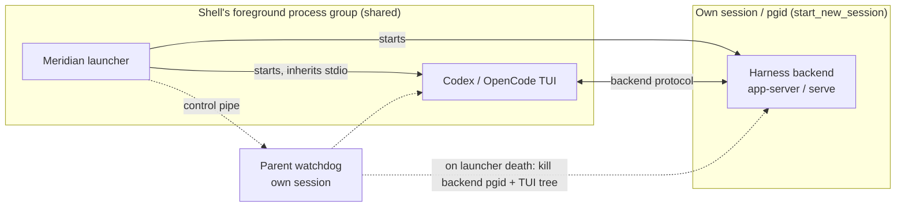

# Architecture: Who Owns the Terminal in an Interactive Primary

An interactive primary puts a harness TUI on the user's terminal. Meridian has
to decide how much of itself sits between that TUI and the terminal. The answer
differs per harness, and it settles four other things: how job control works,
how the launcher's death is contained, how a closed pane is recorded, and what
Meridian may print.

Rationale and rejected alternatives:
[decisions/primary-terminal-ownership.md](../decisions/primary-terminal-ownership.md).
Process roles and reconciliation:
[managed-primary-lifecycle.md](managed-primary-lifecycle.md). Scope
containment and the launcher watchdog: [process-scope.md](process-scope.md).

> **Status (2026-10-15).** The exit-text rule shipped in v0.10.9 (PR #607). The
> native terminal for Codex/OpenCode is built on branch
> `feat/native-terminal-primaries` and has no PR yet. Until it merges, `main`
> still runs Codex/OpenCode primaries through the PTY relay, and a Linux
> backend's parent-death link is still `PR_SET_PDEATHSIG`. The rest of this
> page describes the decided design, which that branch implements.

---

## Terminal mode per harness

| Harness | Mode | What sits between TUI and terminal |
|---|---|---|
| Codex | native inherit | Nothing. The TUI inherits the launcher's stdin/stdout/stderr. |
| OpenCode | native inherit | Nothing. |
| Claude | PTY mediated | Meridian's PTY relay: inner PTY, raw-mode stdin forwarding, output copy, resize bridge, teardown restore codes. |
| Pi | PTY mediated (native also supported) | Same relay. |

The **adapter declares the default mode** in its capabilities
(`default_terminal_surface_mode`); policy resolution validates that the default
is one the adapter supports, and the process selector turns the mode into a
launcher. The mode is not a user choice. There is no flag, env var or config
key to change it, and it is **not persisted in launch-policy snapshots**, so
`--continue` always gets the current adapter default rather than replaying an
old one. TTY detection no longer decides PTY versus native; it only matters as
a fallback where a PTY is unavailable. Explicit output capture
(`output_log_path`) still forces PTY or pipe capture regardless of mode.

### Why Codex and OpenCode don't need the relay

Meridian observes a Codex or OpenCode primary through its own connection to the
harness backend (app-server WebSocket, OpenCode HTTP/SSE): events, idle sensing,
session identity, metadata and reports all come from that side channel. The TUI
is only a client of the same backend. Nothing Meridian needs passes through the
TUI's bytes, and the managed attach never set an output log.

The relay was therefore pure cost for these two harnesses. Its nested PTY was
the cause of the resize mangling behind #596: the user's terminal resized, the
inner PTY lagged, and the TUI repainted at the wrong geometry. With the TUI on
the real terminal, `SIGWINCH` and the window size reach it directly.

### Why Claude and Pi keep the relay

**Not because Meridian reads their output.** Interactive Claude/Pi output is
never captured (capture happens only with `--print`). Claude's session id comes
from the launch itself (`--session-id` plus the `SessionStart` boundary
journal; see [native-session-binding.md](native-session-binding.md)). Idle
sensing reads Claude's transcript or Pi's extension, not the screen. Any page
that says Claude "needs the PTY to observe" its session is out of date.

The relay stays because the owner chose it: Claude and Pi resize fine through
the relay ("i didn't really have any problems resizing claude and pi so its
fine"), so there was no reason to move them. What the relay still does for them
is crash-time terminal cleanup (mouse modes off, cursor shown, alternate screen
left if the child died inside it). Moving them native is an open option, not a
blocked one: Pi's adapter already lists native inherit as supported.

---

## Job control in native mode

- **One shared foreground group.** The launcher and the TUI share the shell's
  foreground process group. Meridian calls neither `setpgid` nor `tcsetpgrp`;
  the shell owns job control as it does for any command.
- **Ctrl+Z is the TUI's.** A TUI in raw mode reads Ctrl+Z as byte `0x1a` and
  stops itself with `kill(0, SIGTSTP)`. That stops the whole group, launcher
  included, and the shell prints `Stopped`; `fg` resumes both. Meridian
  installs no SIGTSTP, SIGTTIN, SIGTTOU or SIGCONT handler and sends no stop
  signal. The backend and the watchdog sit outside the group and keep running.
- **SIGINT is ignored only while the TUI runs.** Ctrl+C at the TUI arrives as a
  byte too, but a TUI may also signal its own group, and a SIGINT to the group
  would otherwise turn into launcher teardown. So `PrimaryAttachLauncher`
  registers a no-op SIGINT receiver with the process-global
  `SignalCoordinator` immediately before starting the TUI and unregisters it
  right after the TUI exits, before backend teardown. During backend startup,
  Ctrl+C still aborts the launch cleanly. The TUI starts with default SIGINT.
- **SIGHUP/SIGTERM cancel.** A closed pane sends SIGHUP to the whole group and
  a kill sends SIGTERM. The launcher's receiver, registered for all of `run()`,
  unblocks the TUI wait, stops the backend, and finalizes. A signal that lands
  before the TUI exists is latched and honored once it starts.

### Signal handlers run inside the main thread

`SignalCoordinator` installs handlers with `signal.signal`. Python runs those
handlers on the main thread, between bytecodes of whatever the main thread was
doing. A handler that takes a `threading.Lock` the main thread already holds
deadlocks the launcher against itself. Anything a coordinator receiver touches
must be lock-free or use an `RLock`. The TUI-exit ordering recorder below hit
exactly this in review and moved to an `RLock`.

---

## Cancellation is decided by order, not exit code

A run counts as **cancelled (exit 130)** if the launcher received SIGHUP or
SIGTERM **before it observed the TUI's exit**, whatever exit code the TUI
reported. If the launcher saw the TUI exit first, the TUI's real result stands.
A small recorder (`_TuiExitOrdering`) notes "signal seen" only if the exit has
not been recorded yet; the wait thread records the exit before publishing the
result.

The exit code can't decide this, because a pane close sends SIGHUP to the TUI
as well as the launcher, and harnesses react differently. OpenCode treats SIGHUP
as a normal quit and exits 0. An earlier rule ("cancelled if the TUI died by
signal or the wait was cancelled") recorded a closed OpenCode pane as
`succeeded 0`. `main` records it as cancelled 130, so that was a regression.
Order of observation gives the same answer for every harness.

---

## Meridian never writes to a terminal a TUI owns

Two rules, for every harness:

1. **While a TUI owns the terminal, Meridian writes nothing to it.** Native mode
   has no relay at all. Startup telemetry clears its own line with carriage
   returns before the TUI takes over and is silent after.
2. **Meridian never covers or erases a harness's exit text; its hint goes
   below.** Codex prints `Disconnected… codex --remote … resume <uuid>`, Claude
   prints `Resume this session with: claude --resume …`, and Pi prints its own
   resume text. All of it stays. Meridian's `To continue with meridian:
   meridian --continue …` line is appended after it. After the harness exits,
   nothing Meridian writes may move the cursor up or erase.

### The `ESC[?1049l` root cause

The rule came from a bug in the PTY relay. Meridian's quit hint was overwriting
Claude's resume line, leaving `meridian --continue p12-410f-7062-…`: the hint
followed by the tail of Claude's UUID. A harness leaves the alternate screen
itself when it exits. The relay's teardown restore sequence then sent
`ESC[?1049l` a second time. tmux treats that as "restore the saved cursor" and
jumped back to where the harness had started, so the hint was printed over the
harness's text.

An earlier fix (`95d429f10`, in still-open PR #590) added `ESC[J` to erase what
was below the cursor. That hid the leftover UUID tail by erasing the harness's
exit text along with it. The owner rejected it: "i don't want to cover the
harness exit", "we should just append after it", "(for all harneses)".

PR #607 (v0.10.9) fixed the cause. The relay watches the child's output for
exact DEC alternate-screen transitions (modes 47, 1047 and 1049), keeping only a
short tail between reads so a sequence split across reads still matches. At
teardown it sends `ESC[?1049l` only if the child's last transition was an
*enter*, which means it crashed or was killed inside the alternate screen.
Codes that don't move the cursor (mouse reporting off, cursor shown) stay
unconditional. No `ESC[J`.

### What native mode cannot clean

With no relay, nobody runs a terminal-restore `finally` if the TUI is
`kill -9`ed. Stale TUI bytes stay in the pane. That is the cost of not sitting
in the byte path, and it was accepted.

---

## Known gaps

- **#611**: one live run where a ~92 s Ctrl+Z on native OpenCode stopped again
  immediately after `fg`. It did not reproduce: plain Codex/OpenCode resumed at
  30/60/90 s, and Meridian with OpenCode at 25/95 s and with Codex at 60 s. The
  traced stop was always the TUI's own `kill(0, SIGTSTP)`, and Meridian sent no
  stop signal and made no terminal ioctl after resume. No job-control change
  without a capture: if it recurs, `strace -f` from process creation and record
  the first event after `fg`.
- **#610**: on macOS a native TUI that exits instantly can be reported as a
  lifetime-link failure, because psutil sees a zombie with no birth time and
  watchdog registration fails closed.
- **#590 still carries `ESC[J`**: the open PR's restore sequence appends
  `ESC[J`, and a comment there asks for it to be dropped. Merged as-is, it would
  break rule 2 for Claude/Pi again.
- **OpenCode mid-turn Ctrl+C ends the session.** That is OpenCode's own key
  binding (`app_exit=ctrl+c`, `session_interrupt=escape`) and also happens on
  `main`. It is not a Meridian bug.

---

## Implementation map (branch `feat/native-terminal-primaries`)

| Path | Role |
|---|---|
| `lib/launch/policies.py` | Resolves the adapter's default `TerminalSurfaceMode` |
| `lib/harness/{codex,opencode,claude,pi}.py` | Capability declarations: supported modes and default |
| `lib/launch/process/selector.py` | `select_process_backend()`: capture → PTY/pipe; else mode → native/PTY/fallback |
| `lib/launch/process/native_launcher.py` | Inherited-stdio `Popen`, no pgid change, registers the TUI scope with the watchdog |
| `lib/launch/process/primary_attach.py` | Signal receivers, SIGINT window, `_TuiExitOrdering`, teardown order |
| `lib/launch/process/pty_launcher.py` | Claude/Pi relay; alternate-screen tracking and conditional `ESC[?1049l` |
| `lib/launch/signals.py` | `SignalCoordinator`: one process-global seam for handler install/restore |

Provenance: `work:native-terminal-primaries` (`decisions.md` D1–D9;
`evidence/native-terminal.md`, `final-matrix.md`, `long-stop.md`,
`round-4-live.md`); `work:relay-exit-text` (archived); `chat:c7524`.
