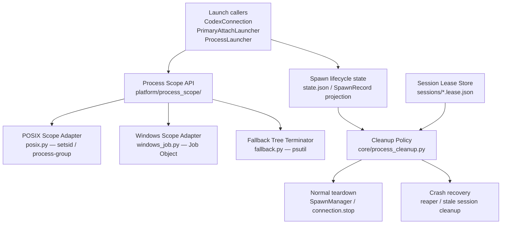

# Architecture: Process-Scope Ownership and Cleanup

Process-scope ownership is Meridian's mechanism for ensuring that every subprocess tree
it starts is reclaimed on spawn completion, cancel, or crash — without killing unrelated
managed-primary sessions that are still serving an active frontend lease.

Related pages:
- [architecture/managed-primary-lifecycle.md](managed-primary-lifecycle.md) — managed-primary
  spawn_owned vs session_owned ownership split
- [decisions/launch.md](../decisions/launch-process-ownership.md#d-process-scope-ownership-durable-process-scope-ownership-over-posix-only-or-psutil-only-cleanup) — why Option D was
  chosen over A/B/C
- [concepts/spawn-lifecycle.md](../concepts/spawn-lifecycle.md) — generic spawn status machine
  and reaper model

---

## Problem

Meridian leaves harness-owned subprocesses alive after spawn completion, cancel, or
launcher crash. Two concrete failure modes drove the design:

1. `codex app-server` processes survive after streaming spawn success, failure, or cancel.
2. Tool subprocesses (e.g. pytest xdist workers launched by a Bash tool) reparent to PID 1
   after the harness exits and are never reaped.

Single-PID `SIGTERM` to `worker_pid` is insufficient when intermediates have exited and
descendants have reparented. A containment model is required.

---

## Design Decision: Option D — Durable Process-Scope Ownership

Four options were evaluated. Option D was adopted; the rejected options remain partially
useful as sub-components.

### Option A — Process-group / session-owned launches (POSIX-only)

Launch every execution in its own POSIX session; kill the group on teardown and reaper.

**Kept:** POSIX group termination is used as the primary POSIX mechanism inside Option D.
**Rejected as the sole design:** `CREATE_NEW_PROCESS_GROUP` on Windows is for console
signal routing, not tree reclamation. Child tools can still survive root termination.
Managed-primary preservation cannot be expressed with group semantics alone.

### Option B — Explicit descendant tracking via `psutil` tree kill

Discover `children(recursive=True)` and terminate/kill the tree at teardown and reaper time.

**Kept:** `psutil` tree kill is the degraded fallback inside Option D for legacy spawns,
corrupt metadata, and failed Job Object assignment.
**Rejected as primary mechanism:** Snapshot-based — races if an intermediate exits before
the snapshot, dropping its descendants from the tree. No positive containment boundary;
crash recovery depends on rediscovery.

### Option C — Harness-specific cleanup only

Let each harness adapter own subprocess cleanup.

**Rejected:** Misses generic tool-child leaks; duplicates policy across Claude/Codex/OpenCode;
violates policy/mechanism separation. Reaper remains inconsistent.

### Option D — Durable process-scope ownership (adopted)

Introduce a shared process containment layer with OS-specific mechanisms, durable
ownership metadata, and lease-aware cleanup policy. This gives normal teardown and the
reaper the same mechanism seam, and turns managed-primary preservation from an implicit
exception into an explicit ownership class.

---

## Module Boundaries



| Module | Responsibility |
|---|---|
| `lib/platform/process_scope/` | **Mechanism only** — how to launch in a new scope and terminate the tree. Four sub-modules: `base.py` (shared types), `posix.py` (setsid/process-group), `windows_job.py` (Job Object), `fallback.py` (psutil tree kill) |
| `lib/platform/launch_gate.py` | **Start gate and guardian**: no harness execs before its scope is durable; a guardian in its group kills the group when the runner dies. See [Parent-death linkage](#parent-death-linkage). |
| `lib/state/launch_lock.py`, `lib/launch/continue_sweep.py` | **Runner-lifetime lock and the continue sweep**: before a continue, refuse a live source or kill a dead one's leftover scopes. See [Continue sweep](#continue-sweep). |
| `lib/core/process_cleanup.py` | **Policy only** — whether to terminate a scope. Consults spawn record, session lease store, and managed-primary metadata. Never decides how. |
| `lib/state/process_scope_projection.py` | **Persistence** — read/write process-scope sidecars at `spawns/<spawn-id>/process_scopes.json`. Operations: `record_scope`, `mark_scope_released`, `read_scopes_from_disk`, tolerant read for legacy spawns. |

The mechanism/policy split is load-bearing. Adding a new platform is one adapter file
in `platform/process_scope/`. Changing cleanup rules is one edit to `core/process_cleanup.py`.
Neither needs to touch the other.

### Scope Recording for Stdio Children

Stdio-transport children (Claude, Pi, Cursor) launch through
`launch_managed_stdio()` in `connections/managed_stdio.py`. The factory
handles subprocess exec, stderr log open, durable scope registration
(via `register_spawn_owned_process()` from `managed_backend.py`), and
provisional ownership during the registration window. Adapters no longer
call `register_spawn_owned_process()` directly or manage scope handles
themselves; the helper owns the full launch-to-registered lifecycle.

The provisional ownership pattern addresses a gap where cancellation between
subprocess exec and scope registration could strand a child: the factory
acquires a `ScopedProcessHandle` immediately after exec, and if registration
fails, wraps cleanup in `reap_on_ownership_transfer_failure()` so the child
is terminated even under repeated cancellation delivery.

`register_spawn_owned_process()` remains in `managed_backend.py` — naming
debt accepted ahead of #424's layering split; it serves all transports, not
only managed backends.

---

## Scope Ownership Classes

Every process scope is tagged with one of two ownership classes at launch time:

| Class | Meaning | Cleanup trigger |
|---|---|---|
| `spawn_owned` | The scope lives and dies with its owning spawn | Terminate when the spawn terminates, times out, is cancelled, or the owning runner disappears |
| `session_owned` | The scope is preserved while an associated session lease is active | Preserve while lease exists; reclaim when the lease disappears or explicit session shutdown runs |

Managed-primary sessions split ownership:

- **`launcher`** — `spawn_owned`. Disposable Meridian wrapper process.
- **`backend`** and **`tui`** — `session_owned`. Preserved while the frontend lease is active.

This makes preservation an explicit durable policy, not an absence of cleanup rules.

---

## Durable State Shape

Process-scope ownership is persisted as cleanup metadata in
`spawns/<spawn-id>/process_scopes.json`. The sidecar is **not** spawn-state
authority — `state.json` still owns lifecycle status, terminal origin, and user
visible spawn facts. The sidecar exists so cleanup paths can recover containment
facts after a crash without re-deriving them from PIDs.

`backend_lifecycle.json` no longer exists. The parent-death and containment facts
that used to need a separate backend lifecycle sidecar now live on
`ProcessScopeSnapshot` and are serialized into `process_scopes.json`.

```json
{
  "scopes": [
    {
      "scope_id": "backend",
      "owner_policy": "spawn_owned",
      "owner_id": "<spawn_id>",
      "role": "harness_backend",
      "containment": "posix_pgid",
      "root_pid": 123,
      "root_created_at_epoch": 1778290000.123,
      "pgid": 123,
      "job_name": null,
      "degraded_reason": null,
      "release_id": "backend:..."
    }
  ],
  "released": ["backend:..."]
}
```

Key fields:

- **`containment`** — `posix_pgid | windows_job | pid_tree_fallback`. Records which
  mechanism was actually established.
- **`root_created_at_epoch`** — PID-reuse guard. Before any signal, the current
  process birth time is compared against this value. Confirmed reuse skips the kill.
- **`parent_death_linked`** — no longer written since #633 and ignored on read. It
  recorded that a link was configured, not that it covered anything: Codex's native
  process outlived its runner on a scope marked `true` (`spawn:p8231`).
- **`release_id`** — stable identity for one concrete scope release. Re-recording the
  same release upgrades ownership in place; distinct releases with the same label are
  preserved.
- **`released`** — sidecar list of release IDs already cleaned up. This replaces the
  older inline `released_at` idea and prevents duplicate cleanup on later reaper runs.
- **`degraded_reason`** — non-null when containment setup fell back from the preferred
  mechanism.

Managed-primary lease and session facts stay in `primary_meta.json` and session leases.
The scope record carries mechanism facts only — no `chat_id`, no TUI semantics, no
frontend lease rules.

---

## Platform Mechanisms

### POSIX: setsid / process-group

Harness root processes that Meridian captures or observes are launched in a new
session (`setsid()`) or process group when possible. On teardown, `os.killpg(pgid,
SIGTERM)` kills the entire group. If descendants survive the grace period,
`os.killpg(pgid, SIGKILL)` follows.

Group kill is strictly stronger than single-PID kill: descendants that have reparented
to PID 1 are still in the original group and receive the signal.

Group kill is only used when the recorded scope root is the process-group leader
(`pgid == root_pid`). If a launch inherited the parent process group, signalling that
PGID could kill the parent agent or test runner. Those non-isolated scopes degrade to
PID-tree cleanup. A native-inherit TUI is the planned case: it shares the shell's
foreground group with the launcher, so its scope is recorded as `pid_tree_fallback`
and only its own process tree is ever signalled.

Pipe-captured subprocess launches and Claude/Pi observer backends are isolated into
their own POSIX sessions so later scope cleanup targets the child group, not the
launching Meridian process group.

### Parent-death linkage

A scope record lets cleanup act *later*. The start gate makes runner death clean
up *now* ([D-start-gate-guardian](../decisions/spawn-identity.md#d-start-gate-guardian),
#633, v0.10.13). Every harness on Linux and macOS starts as a POSIX `sh` stub
behind a pipe handshake in `platform/launch_gate.py`:
- the stub doesn't exec the harness until the runner has recorded its scope with a
  verified birth time and written `go`, so no harness runs unregistered;
- before exec, it double-forks a guardian into the harness's process group. The
  guardian blocks on the pipe, whose only writer is the runner. EOF means the runner
  died: SIGTERM to the group, the adapter's grace, SIGKILL.
- a harness that must share the runner's or the shell's group gets **root-only**
  mode: one SIGTERM to the harness PID and nothing later. That is a non-TTY primary
  whose stdin is a TTY, and the native-terminal Codex/OpenCode TUI (#646; one
  signal suffices for Codex because its npm wrapper forwards SIGTERM to the Rust
  TUI).

Group mode covers managed stdio (Claude, Pi, Cursor), managed backends (Codex,
OpenCode) and the PTY primary. PDEATHSIG,
`parent_watchdog.py` and `detached_process.py` are gone.

What the guardian misses, the [continue sweep](#continue-sweep) finishes: a
guardian that was itself killed (OOM, by hand), a scope recorded before #633, and
a root-only harness that ignored its SIGTERM. A descendant that moved into its own
session (`setsid`, `nohup … &`, Claude's Bash tool) escapes both.

#609 tracks folding the older termination paths (`platform/terminate.py`,
`fallback.terminate_tree`) onto one termination path.

### Windows: Job Object (legacy, untested)

Managed backend parent-death linkage on Windows uses a Job Object with
`JOB_OBJECT_LIMIT_KILL_ON_JOB_CLOSE`. `launch_managed_backend()` keeps the returned
handle alive with the connection, so a worker crash closes the handle and kills the
detached backend.

`CREATE_NEW_PROCESS_GROUP` is kept only where console signal semantics are needed. It
is not treated as an ownership boundary.

Durable scope cleanup cannot persist an OS handle across processes. A recorded
`ProcessScopeSnapshot` may say `containment="windows_job"` and carry the job name, but
sync cleanup paths (`reconcile_active_spawn`, cancel, session exit) fall back to
PID-tree termination unless they still hold a live handle. This is recorded as a
degraded cleanup result, not as proof that the scope was uncontained during launch.

### Degraded fallback: psutil tree kill

When containment setup fails or scope metadata is absent (legacy spawns), cleanup falls
back to `psutil.Process(root_pid).children(recursive=True)` + terminate/kill sequence.
The snapshot-race limitation applies (see Option B rejection above), but this is
acceptable for the fallback path since it is better than no cleanup.

---

## Interface Contract

### Cleanup entry points: async vs sync

Two entry points dispatch to the same platform logic. They are mirrors of each other;
callers pick based on their execution context.

| Entry point | Who uses it | Where |
|---|---|---|
| `ScopedProcessHandle.terminate(grace_seconds)` | Async callers: `SpawnManager`, `connection.stop` | `platform/process_scope/base.py` |
| `terminate_scope_sync(scope, grace_seconds, reason)` | Sync callers: reaper, cancel path, session-exit | `platform/process_scope/__init__.py` |

Synchronous cleanup is no-throw; backend exceptions are reduced to a degraded
`CleanupResult`. The async handle also reduces ordinary backend exceptions, but
caller `asyncio.CancelledError` intentionally propagates so the handle and scope
remain recoverable. Only the ownership-transfer guard
`reap_on_ownership_transfer_failure()` shields cleanup across cancellation at the
startup boundary. Both entry points dispatch to the same POSIX / Windows / fallback
adapters based on `scope.containment` and return typed cleanup evidence when they
complete.

`terminate_scope_sync()` is a public function in the platform layer (not a helper in
`core/`). This keeps mechanism co-located with the adapters it dispatches to: callers
import from the mechanism layer directly, not from the policy layer that wraps it.

### `ScopedProcessHandle`

Returned by launchers that participate in the scope system.

```
ScopedProcessHandle:
  process / pid
  snapshot: ProcessScopeSnapshot
  terminate(grace_seconds) -> CleanupResult
```

The platform adapters suppress `NoSuchProcess`, `AccessDenied`, and equivalent Windows
errors so exception-safety is handled at the mechanism layer, not at each call site.

Scope snapshots must be **persisted before `connection.stop()` is called**, not after.
If the launcher crashes between `stop()` and snapshot persistence, no scope record
exists and the reaper falls back to the degraded path. Persisting first ensures that
even a crash during teardown leaves recoverable state.

### `ProcessCleanupPolicy`

Decides **whether** to terminate, never **how**. Inputs: spawn record + embedded scope
snapshots, session lease state, managed-primary metadata when present.

Outputs:

| Decision | Meaning |
|---|---|
| `terminate_now` | Scope is spawn-owned and the owner is dead or being cancelled |
| `preserve_active_lease` | Scope is session-owned, process is alive, and a valid lease exists |
| `finalize_only` | Scope is already gone (process exited naturally / auto-cleaned) |
| `fallback_pid_tree` | No scope snapshot available — use psutil tree kill against recorded worker PID |

`session_owned` scopes are not unconditionally preserved. If the root process has died
(PID not found, or birth-time mismatch indicating PID reuse), the scope is reclaimed
even though its policy is `session_owned`. Preserving a dead scope leaks the record
without protecting anything — the root is already gone.

---

## Cleanup Triggers

Cleanup is side-effectful, so status reads never do it. Status/list/wait/dashboard
calls derive status from the runner-held `launch.lock`
([derived status](state-system/derived-status.md)) without writing terminal state
or terminating processes. Recorded scope cleanup runs only from paths that
intentionally repair or control lifecycle.

Four sync cleanup paths exist. All route through `terminate_scope_sync()` when a
`ProcessScopeSnapshot` is available.

### Dead-launch repair (the reaper)

`state/reaper.py:reconcile_active_spawn()` runs from `meridian doctor
--kill-orphans`; the primary-launch background pass (`recover_crashed_launches`)
claims and recovers rows the same way, bounded per pass. It claims the
spawn's free `launch.lock`, records a cleanup claim of the unreleased
`spawn_owned` scopes in `process_scopes.json`, writes the dead launch's outcome,
then terminates each claimed scope and marks it released. With no scope records
it falls back to a managed primary's metadata PIDs or the recorded `worker_pid`
(degraded path). A held lock means the runner is alive, and nothing is signalled.
Details: [cleanup claims](state-system/derived-status.md#the-reapers-cleanup-claims).

### Continue sweep

Step 3 of the reopen in `launch/continue_launch.py` (which replaced PR 2's
`continue_sweep.py`) runs on every continue path before any harness starts
([the reopen](state-system/spawn-launches.md#the-reopen)). It takes the source's
runner-held `spawns/pN/launch.lock` non-blocking. Held means the runner is alive:
the continue is refused and nothing is signalled. Free means it is dead: each
unreleased, birth-verified scope gets `terminate_scope_sync(reason="continue_sweep")`
and is marked released. An unknown birth is never signalled; a reused root PID is
released without a signal. An old spawn ID first resolves to its chat's current
owner (`chat_record(chat).spawn_id`), which is refused if live and swept if dead.
Rules and residuals: [PR 2 as built](../decisions/spawn-identity.md#pr-2-as-built-the-launch-lock-and-the-sweep).

### Cancel path

`SpawnApplicationService.cancel` is the only cancel. A live runner gets SIGTERM
and then SIGKILL of its tree, by exact birth only. A launch with no runner is
torn down under its claimed lock by `state.managed_primary.tear_down_dead_launch`:
a managed primary's backend and TUI first, then every recorded scope, each by
exact birth, with graces bounded by the cancel's deadline. An unknown birth is
never signalled. Since v0.18.0, `terminate_pgid` also SIGTERMs snapshotted
descendants outside the group, so a harness's background task in its own
process group dies inside the grace instead of surviving the cancel. Sequence:
[cancel on the lock](state-system/derived-status.md#cancel-on-the-lock).

### Session-exit reclamation

`reclaim_session_owned_scopes_for_chat(runtime_root, chat_id)` in
`core/process_cleanup.py` reclaims all unreleased `session_owned` scopes on spawns
belonging to a `chat_id`. Called from the `session_scope()` finally block, after
`stop_session()`, in a nested try/finally so it runs even if `stop_session()` raises.

Reclaims by `chat_id`, not `harness_session_id`. A single meridian session can span
multiple harness sessions (e.g., resume after compaction creates a new harness session
ID). Reclaiming by `harness_session_id` would miss scopes registered under earlier
harness session IDs.

---

## Scope Liveness Projection

Root PIDs recorded in `process_scopes.json` can be launcher shims (e.g. an npm
wrapper that forks the real `codex app-server`). A dead root PID does not mean
the serving process is gone — the real child may be alive in the same PGID,
reparented to PID 1.

`scope_liveness(scope)` in `state/reaper.py` is the single projection for
scope-health queries. It returns three signals:

| Signal | Meaning |
|---|---|
| `root_alive` | `is_process_alive(root_pid, created_after_epoch=…)`: the birth check with the 30 s slack |
| `pgid_reachable` | `is_pgid_reachable(pgid)` — `os.killpg(pgid, 0)` probe |
| `likely_serving` | `root_alive or pgid_reachable` |

`is_pgid_reachable` is deliberately named *reachable*, not *alive*. It has no
birth-time reuse guard (the scope stores only the root's birth time), so after
a group fully dissolves a reused PGID could belong to an unrelated group.
Signal-0 also counts zombies. It is a diagnostic signal with documented limits,
not a liveness authority. PGID reachability changes diagnostics only — no
kill/finalize decisions depend on it.

Its consumers ask about scopes, not spawn status, so identity-v2 PR 3 left them
on it: the chat-busy check before `--continue` (`live_observer_for_chat`), session
archive, and runner-history prune. Spawn status never reads it.

---

## Known Gaps (Follow-up Items)

Detailed deferred-work notes live in [open-questions/process-scope.md](../open-questions/process-scope.md).
This page keeps only the architectural summary needed to understand the current
containment model.

- **PROC-004:** POSIX cleanup now attempts a degraded full-process-table PGID sweep
  when the recorded root is already dead and the original group appears dissolved.
  The remaining gap is narrower: a child that starts a new process group before the
  scope snapshot can still escape that PGID-based cleanup.
- **PROC-007:** fully closing the remaining metadata-only lifecycle edge now tracks
  whether any path can still launch without `process_scopes.json`; if such a path
  exists, cleanup falls back to `worker_pid`.
- **PROC-008:** Windows parent-death linkage uses a live Job Object handle, but
  durable sync cleanup cannot use a persisted handle; those paths degrade to PID-tree
  cleanup.

---

## Migration Phases (Summary)

| Phase | Exit gate |
|---|---|
| Phase 1: shared mechanism, no policy expansion | Normal completion/cancel/timeouts stop Codex app-server and tool-child trees on POSIX and Windows |
| Phase 2: durable scope sidecar + reaper integration | Crash a runner; reaper converges to terminal state; no owned subtree survives |
| Phase 3: managed-primary ownership split | Launcher death with active lease preserves runtime; without lease reclaims runtime |
| Phase 4: simplification pass | Remove duplicated tree-kill helpers; narrow log messages to policy outcomes |

---

## Design Rationale Summary

The mechanism/policy/persistence split keeps each layer independently evolvable:
- A new OS uses one new platform adapter and zero policy edits.
- A new ownership class (e.g. workspace-owned) is one new enum value and one policy branch.
- A new state backend is one new projection module and zero adapter changes.

The durable-state-first discipline (record scope before stop, tolerant reads on the
reaper side) implements crash-only semantics for cleanup: a crashed launcher leaves
enough state that the reaper can recover correctly without any graceful-shutdown path.
