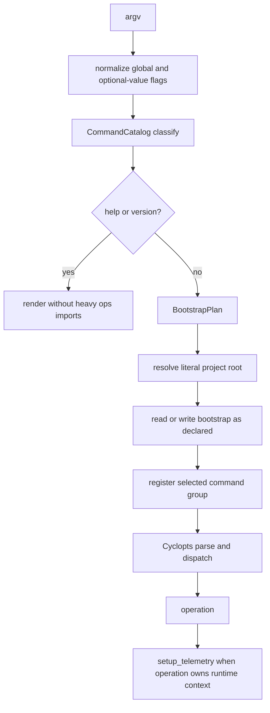

# Architecture: CLI Startup Pipeline

CLI startup classifies the invocation before importing command implementations.
A lightweight descriptor catalog decides registration, bootstrap requirements,
output defaults, and help behavior. Runtime telemetry is installed by the
operation paths that own a resolved runtime root; the previously documented
`TelemetryBootstrap` process seam was intended design and never shipped.

## Descriptor-Driven Flow

`CommandDescriptor` records a command path, summary, startup class, bootstrap
plan, telemetry mode, default output mode, and root source. Registration buckets
live separately in `command_groups.py` (`COMMAND_REGISTRATION`).
`classify_invocation()` chooses a descriptor from the import-cheap
`COMMAND_CATALOG` by longest-prefix match; selective registration then imports
and registers only the relevant group, and Cyclopts parses and dispatches the
registered tree directly. There is no lazy command wrapper.

Because classification falls back to the longest matching prefix, a subcommand
without its own descriptor silently inherits its parent's startup class and
bootstrap plan. That is how `spawn done` and `spawn rearm` ran as `spawn`
(`WRITE_RUNTIME`) until phase 1 of the [cleanup program](../codebase/cleanup-program.md)
gave them exact descriptors. Every real subcommand needs one, and nothing tests
for drift.

## Root Resolution and Establishment

`resolve_cli_project_root()` honors an explicit directory, then
`MERIDIAN_PROJECT_DIR`, then the literal execution CWD.
`resolve_project_root_resolution()` returns the root together with its source
and execution CWD.

> [!FLAG] **Needs human review.** Establishment is currently a no-op. Since
> #388, `resolve_cli_project_root()` reports `established=True` for every root,
> so any CWD is treated as a project, the descriptor flag
> `bootstrap_plan.auto_init_cwd` is unreachable, and write commands create the
> project identity through `prepare_for_runtime_write()` wherever they run.
> `cwd_has_project_id()` (literal `meridian.toml` / `mars.toml`, no ancestor
> walk) exists but nothing calls it. Whether to delete the flag or restore a
> real check is open (`cli/.context/TODO`;
> [decision](../decisions/codebase-cleanup.md#d-auto-init-inert-auto_init_cwd-is-a-todo-not-a-feature)).

Bootstrap plans distinguish reads from writes: read-only commands do not
silently create identity or runtime state. `SystemExit` remains outside `except Exception`, so
intentional CLI exits are not rewritten as bootstrap failures.

## Bootstrap Service Split

The startup policy describes requirements; bootstrap services perform the
minimum allowed action after global options are known. Project config access and
runtime-root creation are separate requirements. This prevents help, version,
and rootless operations from mutating a checkout or user state.

Post-parse bootstrap is reserved for facts only Cyclopts can establish. The
normal path classifies and performs its cheap prerequisites before heavy command
registration.

## Telemetry as Shipped

There is no `TelemetryBootstrap` class or universal
`TelemetryBootstrap.install(plan)` call. `setup_telemetry()` remains a live seam
in spawn operations and the background execution path. Those callers install a
rootless/buffering sink when needed and upgrade or replace it once the logical
owner and runtime root are known. `BufferingSink` is therefore current, not a
superseded pattern.

The consequence is narrower than the old intended design: command descriptors
can declare startup telemetry policy, but operation-owned call sites still
perform installation. Changes must audit both CLI startup and background spawn
entry paths until a real single process seam is implemented.

## Help and Selective Imports

Root help uses descriptor metadata without importing all operation modules. `app_tree.py` owns the Cyclopts groups;
`COMMAND_REGISTRATION` and selective registration attach only what the current
invocation needs. Heavy library exports use explicit lazy imports where startup
profiling justified them.

This keeps help/version cheap without creating a second command inventory: the
descriptor catalog and command-group registry have distinct jobs and derive
routing/help views from their declared entries.

## Related

- [Startup / Health / Sandbox Decisions](../decisions/startup-health-sandbox.md)
- [State Model](../concepts/state-model.md)
- [Telemetry Overview](telemetry/overview.md)
- [Codebase Guide](../codebase/guide.md)
