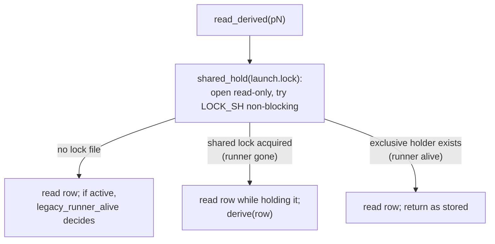

# Derived Spawn Status

Whether a spawn is still running comes from one fact: whether
`spawns/<id>/launch.lock` is held. The runner takes that lock exclusively before
the row is published and holds it until it exits; the kernel drops it when the
runner dies, however it dies. A brief holder (a repair, a prune) can also hold
it for seconds, and readers then show `running` too. No PID, file mtime,
heartbeat or grace period decides the status of a lock-backed row. Once the
lock is free, the stored terminal or the launch's own files decide the
outcome, as the table below shows.

The stored `status` field in `state.json` stays, but it changes once per launch:
a row is created (or reopened) `running`, and the lock holder writes the
terminal status once, in the same write as the `terminal` facts. Decision and
rationale: [D-continue-reopens](../../decisions/spawn-identity.md#d-continue-reopens)
and, for the lock itself,
[D-spawn-identity-v2](../../decisions/spawn-identity.md#d-spawn-identity-v2).
Launch numbers and per-launch directories are on
[spawn launches](spawn-launches.md).

## Stored and derived status

| Stored status | `launch.lock` | Derived status |
|---|---|---|
| terminal | any | the stored terminal |
| `running` (or a legacy `queued`/`finalizing`) | held | as stored |
| active | free, the launch left a durable report | `succeeded`, exit 0 |
| active | free, no report, a cancel request | `cancelled`, the request's exit code |
| active | free, no report, no cancel request | `failed`, error `crashed` |
| active | no lock file (row from a build before the lock) | `legacy_runner_alive` decides |

`derive(row)` in `state/spawn_status.py` is the rule for the three "free" rows,
and it checks the report first. A cancel request is `cancel.json` in the
launch's directory, or the legacy `cancel_intent` field on a v3 row. A report
counts only when `has_durable_report_completion` accepts it, so a `# Spawn
failed` wrapper or a harness control frame is not a success
([classification](../spawn-finalization.md#durable-completion-evidence-classification)).

**Why the report wins, with or without a cancel.** The live runner already lets
a durable report beat a bare cancel; the lockless lane did the same. Ranking it
first in `derive` means one rule for every writer of a dead launch (cancel,
continue, doctor, the repair pass), so `spawn cancel` can never turn a crash
into a success or a success into a cancel just by arriving late. The earlier
rule, "a report counts only through an outcome the runner wrote", made a
cancelled-after-finishing launch read `cancelled` and differed between lanes;
it was reversed while building v0.18.0.

The derived terminal exists only in memory. Readers never write. A dead
launch's row stays stored `running` until a lock holder
[persists the outcome](#who-persists-a-dead-launchs-outcome).

**A derived terminal's `finished_at` is never empty and never the reader's
clock.** The chain is the legacy `runner_exit.exited_at`, the legacy
`last_attempt_exited_at`, the newest mtime among the launch's runner-activity
files (output, stderr, debug log, runner lifecycle log, report), then
`started_at`. A dead runner no longer touches those files, so two reads agree.

## `read_derived`: one consistent read

`state/spawn_status.py` owns liveness. Every status reader goes through it.

1. **Try the shared lock and keep it.** `launch_lock.shared_hold` opens the lock
   file without creating it and tries `LOCK_SH|LOCK_NB`, keeping a shared lock
   across the caller's body.
2. **Read the row inside the hold.** With the shared lock held, no runner can
   take the exclusive lock until the read finishes, so a free lock plus a
   stored-active row really is a dead launch.
3. **Fall back for lockless rows.** `legacy_runner_alive` applies the
   exact-birth PID check, plus a 15 s grace for a row with no runner PID yet.

**Holding the lock across the read is the point.** Probe, release, then read is
not atomic: a new holder can publish an active row in between, and a live
launch reads `crashed`. The race test goes red against both split orders
([lesson](../../codebase/test-determinism.md#race-tests-must-go-red-against-the-split-implementation)).

| Function | Use |
|---|---|
| `read_derived(root, id)` | One row, lock-consistent. Quarantine propagates as `SpawnStateQuarantined` |
| `overlay_derived(root, rows)` | Rows from a scan or the history index. Re-reads only stored-active rows |
| `is_live(root, id)` | "Is it still running?" as a boolean |
| `derive(row)` | The pure rule, for a row read while its lock was free |
| `poll_launch(root, id, n)` / `wait_until(...)` | "Has launch n finished?": `Finished`, `LockFree` (carrying the derived row) or `Running`; once the row has moved past n it answers from `launches/<n>/launch.json`. Cancel and the pinned `spawn wait` both use it |
| `claim_dead_launch(root, id, expected_n=)` | The writers' entry point, [below](#who-persists-a-dead-launchs-outcome) |

## Selection versus liveness

Two kinds of question look alike and need different status:

- **"Is it live?"** Show, list, wait, stats, inject, `@latest`, idle children,
  descendant evidence, telemetry status and retention use **derived** status.
- **"Which rows still need a writer, or may be destroyed?"** Descendant
  cancellation, cancel-all, archive capture and retirement, the repair pass's
  candidates, and doctor's warnings select by **stored** status. A dead but
  unpersisted row is still stored `running`, and that is exactly the set that
  still needs a writer and must not be archived half-written.

Review caught each of these selecting by derived status:

| Site | What derived selection did | Fix |
|---|---|---|
| `spawn_tree.active_descendants` (used by `cancel_descendants`) | A dead child read `failed` and was skipped: its scopes were never swept and its row stayed stored `running` | Select stored-active; `cancel()` claims the dead ones |
| Session archive (`archive --eligible --apply`) | Captured a stored `running` row into the ZIP and retired its directory, so nothing could ever finalize it | Archive captures and retires only stored-terminal rows |
| Doctor's live-spawn warning | Overlaying derived status dropped dead stored-active rows from the warning | Plain `doctor` warns `dead_spawns_unfinalized` and points at `--kill-orphans` |

When adding a reader, decide which question it asks before choosing the call.

## Who persists a dead launch's outcome

Only a holder of the exclusive lock writes, and every holder goes through one
claim. `claim_dead_launch` acquires the lock non-blocking, re-reads the row and
derives:

| Result | Meaning | The caller's handle |
|---|---|---|
| `Claimed` | A stored-active row whose runner is dead; carries the stored and derived rows | held; the caller writes `derived` |
| `Settled` | The row already has a terminal | held, for cleanup only |
| `Live` | Busy, contended, row missing, quarantined, or the row is no longer launch `expected_n` | none |
| `Lockless` | No lock file | none |

`expected_n` is a guard under the lock: a cancel that observed launch K and then
lost a race to a continue gets `Live` and no write, and reads K's archived
outcome instead of touching K+1.

`SpawnApplicationService.finalize_dead_launch` writes a claimed outcome. The
outcome's `origin` comes from `derive`: `cancel` when a cancel request decided
it, else `reconciler`. Because it is the outcome every reader was already
showing, no reader sees a change. The holders that call it:

| Holder | When |
|---|---|
| A continue | [step 3 of the reopen](spawn-launches.md#the-reopen): it must end launch K before starting K+1 |
| `spawn cancel` | its claim-first step ([cancel](#cancel-on-the-lock)) |
| The background repair pass | `recover_crashed_launches`, scheduled by a primary launch that is not a continue |
| `meridian doctor --kill-orphans` | `reconcile_active_spawn` over every row (`iter_repair_candidates`) |

Writers that hold no lock never write launch facts into `state.json`; that rule
is what makes reopening a row in place safe
([the fence](spawn-launches.md#the-fence)).

### The background repair pass

Before v0.18.0 every primary launch read every `state.json` to find dead
launches: 1.6 s warm and 5.7 s cold at 2,890 rows, growing with the project.
`recover_crashed_launches` in `state/reaper.py` is bounded instead: one pass at a
time under `locks/repair.lock`; candidates are the history index's stored-active
rows in spawn-ID order, resuming after the `repair-cursor` file; at most 64 lock
attempts and 32 recoveries per pass. Lockless rows are never touched, and a busy
index skips the pass. The cursor moves past every row it visits, live or dead,
so every active row is visited within ⌈active rows / 64⌉ passes, however many
of them are live.

Doctor keeps the full walk, because a human asked for it. It is also the only
place that resolves a terminal row whose reaper cleanup claim outlived a crash.

### The reaper's cleanup claims

Process cleanup is slow and can fail, so the reaper records its targets before
it writes the outcome: a `before_finalize` callback snapshots the row's
unreleased `spawn_owned` scopes into `spawns/<id>/reaper_cleanup_claim.json`.
Only when the row has no scope list at all does it fall back to a managed
primary's backend and TUI from `primary_meta.json`, or the recorded
`worker_pid`. A managed primary that recorded scopes has its backend and TUI as
session-owned scopes, which the reaper does not claim; the next continue or
cancel of that spawn stops them. After the write it
terminates each claimed scope, marks it released, and keeps only the targets
that raised. The claim file stays spawn-level, not per launch, so doctor's scan
and the delete guard still find it after a reopen; a continue's step 3 resolves
it before launch K+1 starts. The fallback targets still signal a PID whose birth
is unknown, unlike cancel and the continue sweep.

## Cancel on the lock

`SpawnApplicationService.cancel` is the only cancel lane; the sequence is in
`src/meridian/lib/core/.context/cancel.md`. What matters across the system:

- **One observation.** Cancel reads the row once and pins launch K. Every later
  read is pinned to K too (`poll_launch(spawn, K)`, `claim_dead_launch(expected_n=K)`),
  so a continue that starts K+1 mid-cancel is never signalled, swept or
  claimed.
- **Intent goes into K's directory** (`cancel.json`), never into `state.json`.
  On a v3 row only, cancel also writes the legacy `cancel_intent` field, because
  an older-build runner decides `cancelled` from that field alone.
- **Claim first.** A launch whose runner is already dead is claimed at once,
  with no signal and no grace.
- **Exact births only.** SIGTERM the runner, wait out the grace (5 s), SIGKILL
  its tree, wait the kill window (1 s). One deadline of 6 s covers every wait,
  where the old CLI lane chained budgets to about 21 s. An unknown birth is
  never signalled, and cancel no longer uses the 30 s PID-birth slack.
- **The runner's own stop fits inside the grace.** A runner stopping because it
  was signalled gets `SIGNAL_STOP_BUDGET_SECS` (grace minus 2 s) for interrupt,
  connection stop, scope reap and drain. Without that bound a real Claude stop
  took about 10 s, so cancel SIGKILLed the runner and lost its usage; the fake
  harness stops at once and hid it.
- **Past the deadline** the result is `finalizing` (exit 1) and the intent stays
  in K's directory, so whichever holder ends K records the right outcome.

## Lockless rows from older builds

Rows written before the launch lock existed have no `launch.lock`:

- readers judge them with `legacy_runner_alive`;
- the repair pass and doctor never finalize them, because a build that old may
  still be running them and only its own reaper can know;
- `spawn cancel` ends one only when `legacy_runner_alive` says its runner is
  gone, and writes `derive(row)`, the same rule as every other lane;
- a continue takes a converting acquisition: under the mutation lock it re-checks
  the runner and creates the lock file with `O_EXCL`.

`legacy_runner_alive`, its 15 s grace, and the archive exclusions for
`heartbeat`, `finalize-evidence.json` and `launch-boundary.jsonl` go together
once lockless rows are gone.

## Quarantine does not block every resume

`live_observer_for_chat` reads each quarantined row leniently for the chats it
might be serving, under `shared_hold`, instead of refusing every chat when any
row is unreadable:

| Quarantined row | Result |
|---|---|
| JSON unreadable | may observe: block |
| names another chat | skip |
| names this chat, or names no chat | the lock decides: free → skip, held or absent → block |

Older builds quarantine every v4 row this build writes; what each older build
does with them is on [spawn launches](spawn-launches.md#older-builds-on-the-same-runtime).

## Deleted mechanisms: do not bring back

Each of these was a guess or a second writer that the lock replaces.

| Deleted | What it did | Why it must stay gone |
|---|---|---|
| Heartbeat (`spawns/<id>/heartbeat`; `is_spawn_genuinely_active`) | Activity within 120 s meant alive | A SIGKILLed runner read `running` for up to 120 s |
| Activity mtimes as liveness | Same 120 s window over more files | Same false "running"; a quiet live runner could look dead. (Mtimes now only date a derived `finished_at`) |
| Startup and post-exit graces (15 s, 5 s) | Excused a missing PID or a just-exited runner | The lock is held from publication; only lockless rows keep the 15 s grace |
| Pre-worker-ghost rule and the launch-boundary journal | Guessed that a `--bg` row stuck before its worker was dead | The lock passes through the `--bg` hand-off unbroken |
| `finalize-evidence.json` | A separate durable-report breadcrumb | `derive` reads the launch's own report |
| `reconciliation.py`, `decide_generic_reconciliation`, `reconcile_spawns` | The reaper's decision engine | Readers use `read_derived`; writers use `claim_dead_launch` |
| `queued` and `finalizing` as written statuses, `mark_finalizing`, `record_runner_exit` | A chain of active statuses with a compare-and-swap | One holder writes once; `--status queued`/`finalizing` still parse with a deprecation warning, for old rows |
| The terminal authority lattice (`decide_terminal_write`, `can_replace_reconciliation`) | Let an "authoritative" origin replace a `reconciler` terminal | Only a lock holder writes, and the first terminal wins. `origin` is a label now |
| `streaming/signal_canceller.py` and the app-server cancel lane | A second cancel with its own outcome type and re-reads by ID | It killed K+1's scopes and returned K+1's outcome after a continue |
| The `--bg` parent's `mark_running` after the hand-off | Wrote launch facts from a process that no longer held the lock | The worker records its own launch facts on adoption |
| 30 s PID-birth slack in readers and cancel | Accepted a PID born within 30 s of the record | PID reuse kept dead spawns `running`. It survives only in doctor's scope display and harness backend liveness |
| Failure codes `orphan_run`, `orphan_finalization`, `missing_runner_pid`, `launch_boundary_no_takeover` | Named which guess fired | A dead launch is `crashed` |

## Known gaps

- **#671:** a parent's finish or cancel does not converge its descendants;
  `cancel_descendants` runs only from resident-drain cleanup. A policy question.
- **#831:** `spawn.finished` hooks can be lost when a runner is signalled around
  its terminal write. The mask defers SIGTERM and SIGHUP for the store write
  only, and hooks run unmasked after it.
- **#841:** a crashed streaming child's derived `finished_at` reads about one
  second after its start: a streaming runner writes no `output.jsonl`, and none
  of the other activity files change mid-turn.
- **#842:** `meridian streaming serve` passes no signal-stop budget, and the
  post-SIGKILL wait and the teardown's second stop can overrun it by about 1 s.
- **#838:** cancel, the repair pass, doctor and continue each keep their own
  teardown of a dead launch; one function should end it.
- The live runner ranks a non-zero exit code above a durable report, while a
  dead launch lets the report win. The split is accepted: the report-first rule
  is for launches with no runner, where no exit code was recorded.

## Related Pages

- [Spawn launches](spawn-launches.md): launch numbers, the reopen and the fence
- [Spawn state](spawn-state.md): the stored row and its writers
- [Spawn lifecycle](../../concepts/spawn-lifecycle.md)
- [Process scope](../process-scope.md): scopes, sweeps and exact births
