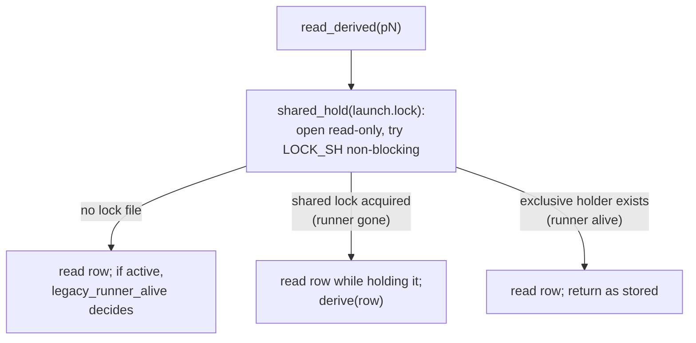

# Derived Spawn Status

> identity-v2 PR 3 (#672, issue #663, v0.10.24). This is how `main` decides
> spawn status. PR 4 removes stored status itself (see
> [what PR 4 changes](#what-pr-4-changes)). Decision and rationale:
> [D-spawn-identity-v2, PR 3](../../decisions/spawn-identity.md#pr-3-as-built-read_derived-and-one-dead-launch-finalize).

A spawn's status is decided by one fact: whether its runner still holds
`spawns/<id>/launch.lock`. The runner takes that lock exclusively before the row
is published and holds it until it exits; the kernel drops it when the runner
dies, however it dies ([launch lock](../../decisions/spawn-identity.md#pr-2-as-built-the-launch-lock-and-the-sweep)).
No PID, file mtime, heartbeat or grace period decides the status of a
lock-backed row.

## Stored and derived status

`state.json` still has a `status` field in state v3. It is now only what the
last writer recorded. The status every reader shows is **derived** from that
row plus the lock:

| Stored status | `launch.lock` | Derived status |
|---|---|---|
| terminal | any | the stored terminal |
| active (`queued`, `running`, `finalizing`) | held | the stored active status, unchanged |
| active | free, cancel intent stored (`spawn cancel` records one before it signals) | `cancelled` |
| active | free, no cancel intent | `failed`, error `crashed` |
| active | no lock file (row from a build before PR 2) | `legacy_runner_alive` decides |

A runner that dies without writing its outcome is `crashed` even if it left
`report.md` or a `runner_exit(succeeded)` record. **A report counts only through
an outcome the lock holder wrote.** Before PR 3 such a runner was finalized
`succeeded`; that rule is gone on purpose (see the [lessons](../../lessons/state-design-lessons.md#a-deleted-rule-survives-in-other-writers-and-in-fixtures)).

The derived terminal exists only in memory. Readers never write. A dead
launch's `state.json` stays stored-active until a writer persists the outcome
[under the lock](#who-persists-a-dead-launchs-outcome).

## `read_derived`: one consistent read

`state/spawn_status.py` owns liveness. Every status reader goes through it.

The three steps:

1. **Try the shared lock and keep it.** `launch_lock.shared_hold` opens the lock
   file without creating it and tries `LOCK_SH|LOCK_NB`. It yields whether the
   lock was free, held, or absent, and keeps a shared lock across the caller's
   body.
2. **Read the row inside the hold.** If the shared lock was acquired, no runner
   can take the exclusive lock until the read finishes, so a free lock plus a
   stored-active row really is a dead launch. If an exclusive holder exists, the
   row is returned as stored: it is live, or at most one outcome write stale.
3. **Fall back for lockless rows.** No lock file means a row from a build before
   PR 2. `legacy_runner_alive` decides: the exact-birth PID check, plus a 15 s
   grace for a row with no runner PID yet (a `--bg` row before its worker
   records itself).

**Holding the lock across the read is the point.** Probing the lock, releasing
it, then reading the row is not atomic. Between the probe and the read a runner
can finish (lock free, row already terminal: harmless) or a new holder can start
and publish an active row (lock observed free, row active: a live launch read as
`crashed`). The race test pins this deterministically and goes red against both
split orders ([lesson](../../codebase/test-determinism.md#race-tests-must-go-red-against-the-split-implementation)).

Helpers built on it:

| Function | Use |
|---|---|
| `read_derived(root, id)` | One row, lock-consistent. Quarantine propagates as `SpawnStateQuarantined` |
| `overlay_derived(root, rows)` | Rows from a scan or the history index. Re-reads only stored-active rows; a row whose directory vanished keeps its scanned value |
| `is_live(root, id)` | "Is it still running?" as a boolean |
| `derive(row)` | The pure rule, for a row read while its launch lock was free (the caller holds or observed it free) |
| `quarantine_may_observe(root, report, chat)` | The lenient quarantine check below |

## Selection versus liveness

Two kinds of question look alike and need different status:

- **"Is it live?"** Show, list, wait, stats, inject, `@latest`, idle children,
  descendant evidence, telemetry status and retention ask this. They use
  **derived** status.
- **"Which rows still need a writer, or may be destroyed?"** Descendant
  cancellation, archive capture and retirement, and doctor's warnings and pruning
  candidates ask this. They select by **stored** status. A dead but unpersisted
  row is still stored-active, and that is exactly the set that still needs
  convergence and must not be archived half-written.

Review caught each of these selecting by derived status:

| Site | What derived selection did | Fix |
|---|---|---|
| `spawn_tree.active_descendants` (used by `cancel_descendants`) | A dead child read `failed`, so it was skipped: its scopes were never swept and its row stayed stored `running` | Select stored-active; `cancel()` then claims the dead ones under the lock |
| Session archive (`archive --eligible --apply`) | A dead, unfinalized row read terminal, so archive captured a stored `running` row into the ZIP and retired the loose directory. With the directory gone, nothing could ever finalize it, and `spawn list` showed it active forever | Archive captures and retires only stored-terminal rows; `capture_record` refuses a non-terminal row |
| Doctor's live-spawn warning | Overlaying derived status silently dropped dead stored-active rows from the warning | Plain `doctor` warns `dead_spawns_unfinalized` and points at `--kill-orphans` |

When adding a reader, decide which question it asks before choosing the call.

## Who persists a dead launch's outcome

Only a holder of the exclusive lock writes a dead launch's outcome, and all of
them go through one path.

`claim_dead_launch(root, id)` acquires the lock non-blocking, re-reads the row
and derives, and returns a typed result:

| Result | Meaning | The holder's handle |
|---|---|---|
| `Claimed` | A stored-active row whose runner is dead; carries the stored and derived rows | held; the caller writes `derived` |
| `Settled` | The stored row is already terminal | held; for cleanup only |
| `Live` | Busy, contended, row missing, or quarantined | none |
| `Lockless` | No lock file: a row from a build before PR 2 | none |

`SpawnApplicationService.finalize_dead_launch` is the only writer of a claimed
outcome. It runs the claim off the event loop, runs an optional
`before_finalize` callback under the handle, and writes the derived terminal
while still holding the lock. The caller supplies the terminal's `origin`
(`reconciler` or `cancel`), which the
[authority lattice](../spawn-finalization.md) uses to decide whether a later write may replace it. Since the outcome it
writes is the one every reader was already deriving, no reader sees a change.

Its callers:

- **The reaper**, `state/reaper.reconcile_active_spawn`, with origin
  `reconciler`. Its `before_finalize` records the cleanup claim, and it sweeps
  the claimed scopes afterwards. It runs from `meridian doctor --kill-orphans`
  and from the background repair that primary launches schedule
  (`ops/diag.schedule_background_repairs`), both only in a root process
  (`_MERIDIAN_DEPTH` absent, empty or `0`), never inside a spawn. Plain `doctor`
  persists nothing; it warns `dead_spawns_unfinalized` instead. A primary
  `--continue` skips the background orphan pass: its own continue sweep takes
  the source's lock, and a repair holding that lock made the continue refuse.
  If a `doctor` or another continue does hold a dead source's lock, the refusal
  says the lock is "held by a repair or another continue".
- **Cancel convergence**, `SpawnApplicationService._force_cancel_convergence`,
  with origin `cancel`.

These two used to disagree: cancel wrote `succeeded` from a durable report while
the reaper derived `cancelled`, and whichever wrote first won. Routing both
through one claim makes the outcome independent of ordering.

The reaper's cleanup of an already-terminal row also goes through the claim
(`Settled` → clean up under the handle). Cleanup is not finalization, so a
lockless terminal row is cleaned once `legacy_runner_alive` is false.

### The reaper's cleanup claims

Process cleanup is slow and can fail, so the reaper records its targets before
it writes the outcome. Its `before_finalize` callback snapshots the row's
unreleased `spawn_owned` scopes into `spawns/<id>/reaper_cleanup_claim.json`
(under the spawn lock). When a row has no `process_scopes.json`, it adds fallback
targets: a managed primary's backend and TUI PIDs from `primary_meta.json`, or
the recorded `worker_pid`. After the outcome is written, it terminates each
claimed scope (`terminate_scope_sync`, 5 s grace), marks it released, and keeps
only the targets that raised for a later pass. A crash between the outcome and
the cleanup therefore leaves a durable claim, which is why
`iter_repair_candidates` also yields terminal rows that still have one.

`locks/reaper-cleanup/<id>.lock` stops two reapers signalling the same scopes.
A row whose terminal origin is not `reconciler`, such as a runner's own outcome,
has its claim cleared without any signal.

The fallback targets predate PR 3 and still signal a target whose birth time is
unknown, unlike the continue sweep, which never signals an unknown birth. PR 4
removes the claims and the cleanup lock; whether it also drops the fallbacks is
not yet decided.

## Lockless rows from older builds

Rows written by builds before PR 2 have no `launch.lock`. They keep the
pre-PR-3 rules:

- readers judge them with `legacy_runner_alive`;
- the reaper and `doctor` **never finalize** them; the old build's own reaper
  still does;
- explicit `spawn cancel` keeps the pre-PR-3 report/cancel lattice for them.

`legacy_runner_alive`, its 15 s grace, and the archive exclusions for
`heartbeat`, `finalize-evidence.json` and `launch-boundary.jsonl` are removed
together once lockless rows are gone.

## Quarantine no longer blocks every resume

Before PR 3, `live_observer_for_chat` refused to resume any chat if any spawn
row was quarantined. A single row this build can't load, such as a v4 row from a newer
build, therefore blocked `--continue` everywhere. Now each quarantined row is
read leniently for its top-level `current_chat_id`, under `shared_hold`:

| Quarantined row | Result |
|---|---|
| JSON unreadable | may observe: block (nothing proves it isn't a live observer) |
| names another chat | skip |
| names this chat, or names no chat | the lock decides: free → skip, held or absent → block |

This is what lets PR-3 builds keep resuming chats once PR 4 writes v4 rows.

## Deleted mechanisms: do not bring back

Each of these was a guess that the lock replaces. Re-adding any of them
reintroduces a false "dead" or false "running".

| Deleted | What it did | Why it must stay gone |
|---|---|---|
| Heartbeat (`spawns/<id>/heartbeat`, written every 30 s; `is_spawn_genuinely_active`) | Activity within 120 s meant alive | A SIGKILLed runner read `running` for up to 120 s; nothing reads it now |
| Activity mtimes (`stderr.log`, `report.md`, `bash-records.json`) | Same 120 s window over more files | Same false "running"; a quiet live runner could look dead |
| Startup and post-exit graces (15 s, 5 s) | Excused a missing PID or a just-exited runner | The lock is held from publication; only lockless rows keep the 15 s grace |
| Pre-worker-ghost rule and the launch-boundary journal (`launch-boundary.jsonl`, `locks/launch-boundary/`) | Guessed that a `--bg` row stuck before its worker was dead | The lock passes through the `--bg` hand-off unbroken; the journal had no other reader |
| `finalize-evidence.json` and report-preferred recovery | Turned a durable report into `succeeded` | A report counts only through an outcome |
| `reconciliation.py`, `decide_generic_reconciliation`, the managed-primary status strategy, `reconcile_spawns`, `peek_reconciled_active_spawn` | The reaper's decision engine and read projection | Readers use `read_derived`; writers use `claim_dead_launch` |
| `is_process_alive`'s 30 s birth slack, in status readers | Accepted a PID born within 30 s of the record | PID reuse kept dead spawns `running` |
| Failure codes `orphan_run`, `orphan_finalization`, `missing_runner_pid`, `launch_boundary_no_takeover` | Named which guess fired | A dead launch is `crashed`; nothing writes the old codes |

The 30 s slack remains in cancel's signal targeting until PR 4 rewrites cancel
(owner: "readers only").

## Behaviour that changed in PR 3

- A runner SIGKILLed after `record_runner_exit(succeeded)` but before its
  outcome shows `failed`/`crashed` (before: `succeeded`).
- A managed primary whose launcher is SIGKILLed or OOM-killed shows
  `failed`/`crashed` (before: `cancelled`, exit 130,
  `session_ended_without_finalize`). SIGTERM and SIGHUP still finalize
  `cancelled`.
- Cancelling a dead spawn that left a report but no outcome gives `cancelled`
  (before: `succeeded`).

The owner accepted all three as the design's report-through-outcome rule
applied early. Separately, `spawn cancel-all` now selects every stored-active
row (`queued`, `running`, `finalizing`), so it also cancels and persists dead,
unfinalized and `queued` spawns.

## Not yet true

- Cancel's request, and the `finalizing` transition cancel writes for a managed
  primary, are still written outside the launch lock. So `read_derived` is exact about the runner's
  liveness, not about racing writes. Consistency against racing writes needs
  every lifecycle write under the exclusive lock, which PR 4 provides.
- Cancel's `_has_live_execution_owner` gate (slack PIDs) can still veto the
  lock, and `spawn cancel` on an already-dead launch waits out a 5 s grace
  before converging.
- A derived terminal with no recorded exit time shows `finished_at: ""`.
- A parent's finish or cancel does not converge its descendants:
  `cancel_descendants` runs only from resident-drain cleanup (#671, a policy
  question that predates PR 3).

## What PR 4 changes

PR 4 deletes stored status. `read_derived` then reads `current.outcome` instead
of `status`; the stored active statuses go away with their filters and stats
buckets; the reaper becomes a bounded `recover_crashed_launches` pass; and
cancel writes only a `cancel_request` and lets the lock holder write the
outcome. A held lock keeps the stored active status in PR 3 so that vocabulary
churns once, in PR 4.

## Related Pages

- [Spawn state](spawn-state.md): the stored row and its writers
- [Spawn lifecycle](../../concepts/spawn-lifecycle.md)
- [Process scope](../process-scope.md): the continue sweep that first used the lock
