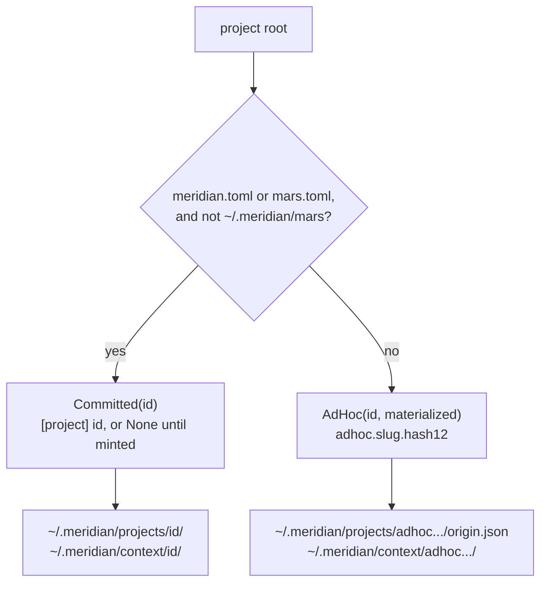

# Project Identity

Every command resolves a **project root** (explicit `-C`, then
`MERIDIAN_PROJECT_DIR`, then the literal CWD; never an ancestor). The root's
contents decide its tier, and the tier decides where state lives. The rationale
and rejected alternatives are in
[D-two-tier-identity](../../decisions/state.md#d-two-tier-identity).

> **Status:** on `main` since PR #575 (merged 2026-10-14, `d160a07d9`,
> `release:minor`). Released in v0.10.0 (`b8da247f9`) after #579 fixed the
> app-lane socket path that failed the first release-on-main preflight. Releases up to v0.9.12
> predate it.

## The seam

`lib/state/project_identity.py` is the only place that decides identity. Every
reader (runtime authority, state paths, runtime root, context resolver,
bootstrap) goes through it.

| Function | Kind | Behaviour |
|---|---|---|
| `resolve_project_identity(root)` | pure | Marker present → `Committed(id)` with the id from `[project] id`, or `None` if not yet minted. Otherwise → `AdHoc(id, materialized)`, where `materialized` means `projects/<id>/` is a directory |
| `ensure_project_identity(root)` | write | `Committed(None)` → mint a three-word id into `meridian.toml` under `project_config_transaction`. `Committed(id)` → nothing. `AdHoc` → under the project lifetime flock (shared), create `projects/<id>/` and `origin.json` if absent, else touch `origin.json` if older than `ADHOC_TOUCH_INTERVAL_SECONDS` (1 h). Nothing is written in the root |
| `mint_committed_identity(root, scaffold)` | write | `init` / `config init`: writes the scaffold and the minted id in one atomic write. `ensure` calls it with an empty scaffold for `Committed(None)`, so there is one minting path |
| `state_id(identity)` | pure | The id whose state exists, or `None` for an unmaterialized ad-hoc place. Readers use it instead of re-checking `materialized` |
| `nearest_ancestor_project_marker(root)` | pure | Only for the creation notice. It never changes identity |

`has_project_marker()` (`lib/config/project_root.py`) is the tier predicate. It
treats the user Mars root `~/.meridian/mars/` as unmarked even though it holds a
`mars.toml`, so running Meridian from inside the user package root never
commits it as a project.

**Ad-hoc key.** `adhoc.<slug>.<hash12>`: `hash12` is the first 12 hex digits of
sha256 over `root.resolve().as_posix()`; the slug is the lowercased basename with
runs of other characters collapsed to `-`, trimmed, at most 24 characters
(`root` if empty). Example: `adhoc.tmp-1lzkf7qa2c.3f9a1c2e7b10`. The prefix
`ADHOC_PROJECT_ID_PREFIX` is defined only here, and `get_committed_project_id`
rejects a committed id that starts with it. Case-insensitive macOS volumes can
give one directory two keys.

An ad-hoc id runs up to 43 characters, longer than a three-word committed id.
Do not bind an AF_UNIX socket at a path under the runtime root: `sun_path`
holds about 107 bytes (103 on macOS). `control_socket_path()` hashes into the
fixed `/tmp/meridian-<uid>/` for this reason, never `$TMPDIR`: macOS's 48-byte
`$TMPDIR` pushed the path to 107 bytes, and a per-process `$TMPDIR` (nix-shell,
sandboxes, CI) made the runner and the `meridian spawn inject` client compute different paths.
Launches add that directory to each harness sandbox's writable roots so a
sandboxed runner can bind its socket (PR #735, v0.12.2). Three `test_signal_canceller` tests
that put `app.sock` under an ad-hoc test root failed the first release-on-main
preflight after PR #575 (run `38586754232`).

The socket directory is shared by every project and outlives every runner, so a
SIGKILLed runner leaves its socket behind and spawn-directory cleanup cannot
find it: the socket path is not under the runtime root, and the root may
already be gone (most leaked sockets observed on one host came from deleted
pytest roots). Recovery happens when the next control server starts: it removes
the current user's control sockets that are at least two minutes old and
refuse a nonblocking *datagram* connect with `ECONNREFUSED`. A bound stream
socket answers that probe with `EPROTOTYPE` on Linux and macOS before the
kernel looks at listen or backlog state, so a runner paused between `bind` and
`listen`, or a listener with a full backlog, is never mistaken for a dead one.
A stream connect was rejected as the probe because macOS refuses a live
listener whose backlog is full. Mechanism and exclusions:
`lib/streaming/.context/CONTEXT.md` in meridian-cli (branch
`stale-control-sockets`, unmerged as of 2026-10-23; until it lands, abandoned
sockets accumulate).

**`origin.json`** is `{path, created_at}`, written once with
`write_model_once` (staged file, linked into place). Its mtime is the
cheap activity signal. A crash after `mkdir` and before `origin.json` heals on
the next `ensure`.

## Reads stay pure

Reads, `doctor` and every `--dry-run` resolve identity and never call
`ensure`. An unmaterialized ad-hoc place reads as "no state":
`runtime_root=None`, empty `spawn list` / `work list`, unresolved context
paths. Ad-hoc project-relative context paths also count as unresolved, so
bootstrap never runs `mkdir` inside the directory. A dry run uses an uncreated
preview path (`get_dry_run_preview_root()`, `$MERIDIAN_HOME/cache/dry-run`) as
the launch projection's runtime root; making that root optional is deferred
(`lib/launch/.context/TODO`, #569).

The runtime authority snapshot carries `identity_tier`, `project_id`, the
identity source (`meridian.toml` | `path` | `unminted`), `identity_created`,
and the [Mars roots](../mars-user-scope.md). `context`, `config show` and
`doctor` print them; `config get <key>` stays one line so scripts keep working.

## Who writes where

| Command in a bare directory | Effect |
|---|---|
| Launch, `spawn`, `spawn done/rearm/cancel`, `work start/switch` | `ensure` materializes the ad-hoc root. Human mode prints a one-time notice: `meridian: <path> has no meridian.toml; state is kept for this path only. Run 'meridian init' to share it.` Agent mode and MCP `spawn.create` / `continue` get `identity_created` instead |
| `hooks run` | Read authority; a no-op when nothing is materialized, so a task dir never gains identity |
| `config set/reset`, `workspace init` | Error `no project config here; run 'meridian init'` |
| `init`, `config init` | Atomic scaffold + id, then bootstrap. If an ad-hoc root existed: `note: earlier ad-hoc state at <root> is not carried over` |
| `meridian mars init` | Writes only `mars.toml`; the next write mints the committed id |
| `doctor` | Per-project repairs run only if the runtime root exists; otherwise `project_state: no state here`. `--global` always runs |

`init` never moves or merges the ad-hoc root. It becomes unreachable from the
path and ages out.

## Retention

`meridian doctor --global --prune` is the only reclaimer, in
`lib/ops/pruning.py`; nothing prunes automatically, by the user's choice
([D-two-tier-identity](../../decisions/state.md#d-two-tier-identity)). Two
scans, each owning one namespace:

- **`scan_orphan_project_dirs`** (committed roots, unchanged): a quiescent root
  whose tree mtime is older than `state.retention_days` (default 30). It skips
  `adhoc.*`.
- **`scan_adhoc_project_dirs`** (ad-hoc roots only), keyed on
  `state.adhoc_retention_days` (default 30; `-1` disables; `0` means as soon as
  quiescent). `doctor` reads the key with `load_user_config()` or
  `MERIDIAN_STATE_ADHOC_RETENTION_DAYS`, never from the cwd project.

For an ad-hoc root:

- **Last activity** is the newest of every signal: `origin.json`'s mtime, the
  newest mtime anywhere in the runtime root's tree, the newest mtime in the
  `context/<id>/` tree, spawn `started_at` / `finished_at`, and session
  `started_at` / `stopped_at`. The hourly `origin.json` touch alone left a
  near-zero protection window at the hour boundary, so it is only one signal
  among several. A recent spawn therefore keeps a root whose `origin.json` is
  old. Scans read and touch nothing.
- **Reason.** `adhoc-idle` (path still bare), `adhoc-shadowed` (path now holds
  a marker), or `adhoc-path-gone` (path missing or unreadable, or no
  `origin.json`).
- **Threshold.** `N` days for idle, `min(N, ADHOC_STALE_RETENTION_DAYS = 7)` for
  shadowed and gone. Every ad-hoc prune also needs activity older than the 1 h
  touch interval, the shared constant.
- **Listing.** `doctor --global` reports every materialized ad-hoc root
  (`AdHocProjectDir`: id, origin path, reason, last activity, size,
  `prunable`), so pre-`init` state is findable as soon as it is shadowed. The
  `stale_adhoc_project_dirs` warning counts only the prunable ones.
- **Prune.** Under `try_lock_file(project_lifetime_flock, exclusive)` it
  re-scans the root (quiescence and activity), then deletes `projects/<id>/` and
  `context/<id>/` together. `ensure` holds the same flock shared, so the two
  never interleave. The flock lives at `~/.meridian/projects/.locks/<id>.lock`,
  outside the root, so the `rmtree` never removes the lock inode.

## Related

- [State roots and work items](roots-and-work-items.md) — read/write resolvers
  and work-item storage
- [Mars user scope](../mars-user-scope.md) — where package content comes from
- [Health checks](../../operations/health-checks.md) — the `doctor` flow
- [State model](../../concepts/state-model.md) — the concept-level picture
