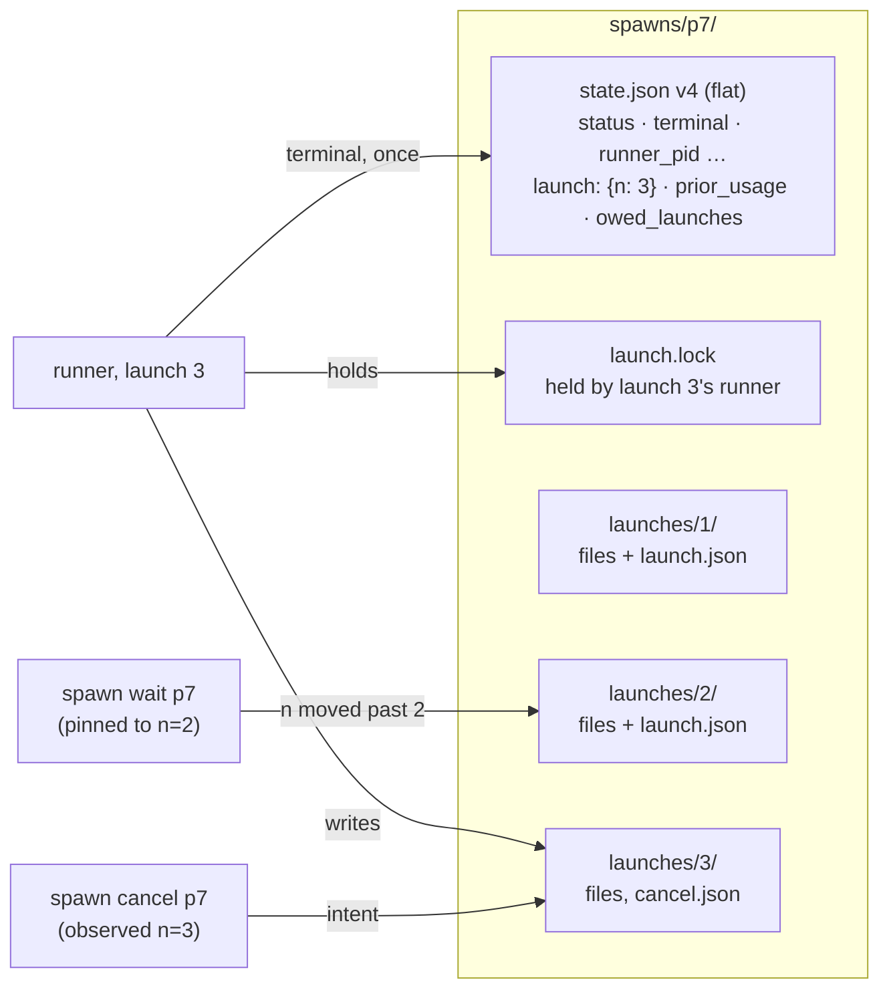

# Spawn Launches

A spawn `pN` keeps one ID for its whole life. Each run of it is a **launch**,
numbered `n` inside the row. `--continue pN` (primary or child, from the CLI or
the session browser) reopens `spawns/pN/` in place as launch n+1; `--fork` and
`--from` create a new spawn. So `MERIDIAN_SPAWN_ID` stays `pN` across continues,
and every child's `parent_id` stays valid.

No user types, reads or sees `n`. It names a directory and pins waits, cancels
and delivery ledgers. Everything a user sees describes the spawn: status and
report are the current launch's; cost, tokens and duration are totals over
every launch. User-facing behavior is in meridian-cli
`docs/upgrading.md#a-continue-keeps-the-spawn-id`. Why it is built this way:
[D-continue-reopens](../../decisions/spawn-identity.md#d-continue-reopens).

Three rules make reopening one row safe:

1. **The lock serializes launches.** A runner holds `launch.lock` for its whole
   life, so launch n+1 can begin only after n's runner is dead. Two continues of
   pN race for one `flock`; the loser is refused before it writes anything.
2. **A writer without the lock never writes launch facts into `state.json`.** It
   writes into the launch directory it observed, or signals an exact
   `(pid, birth)` it read once ([the fence](#the-fence)).
3. **Each launch writes into its own directory**, `launches/<n>/`, launch 1 of a
   new spawn included, so a report, scope list or signal from launch n can't be
   read as n+1's.

## On disk

**State v4** is v3 plus three spawn-level fields; every other field stays flat
and describes the current launch, so readers, the history index and the Pi
schema read it as before:

| Field | Holds |
|---|---|
| `launch: {n}` | which launch the flat fields describe |
| `prior_usage` | duration, cost and token totals of launches before n, plus the last launch's raw harness cumulative ([usage](#usage-across-launches)) |
| `owed_launches` | `{n, parent_id}` for each background launch a continue moved past ([owed results](#waits-owed-results-and-delivery)) |

v3 is "`launch` absent". The serializer writes `v: 4` when `launch` is present
and `v: 3` otherwise, in one conditional (`record_to_stored_state`). A write by
a process without the lock (`work rename`, session archive) therefore leaves an
older build's row v3; only a reopen, which holds the lock and so proves no older
runner is alive, sets `launch`.

**Paths.** Every per-launch file (report, stderr, output, params, prompts,
`primary_meta.json`, process scopes, `cancel.json`, signal files, control
actions, runner and debug logs, harness boundary files) is reached only through
`LaunchPaths`, built in `state/paths.py` from a row. `launch` absent maps to the
spawn directory itself, so a pre-upgrade row's launch 1 stays at the top level;
present maps to `launches/<n>/`. The source lints (meridian-cli
`src/meridian/dev/lints.py`, run in both preflight gates) reject per-launch
file names as string literals, and `LaunchPaths` built anywhere, outside
`state/paths.py` and its TypeScript twin `shared/pi_state_paths.ts`. Its blind spot is pre-upgrade rows; for new spawns,
a reader that skips the resolver finds nothing and fails its first test, which
is why launch 1 of a new spawn is not at the top level.

Spawn-level, unchanged by a reopen: `state.json`, `launch.lock`, `scope.json`,
`reaper_cleanup_claim.json`, the delivery ledgers, the control socket name
(launch n+1's runner unlinks a stale socket before binding).

**Archive.** When a holder starts launch n+1 it first copies launch n's row,
outcome included, to `launches/<n>/launch.json`. Nothing rewrites it later. A
wait or cancel pinned to n reads it once `launch.n` has moved on.

**Reports of earlier launches.** `spawn report show pN` shows the current
launch's report. `spawn report search` reads every launch's report
(`spawn_report_files` in `state/paths.py`), so a continue never hides an
earlier run's report from search. A hit names the spawn, never the launch;
its JSON `report_path` (deprecated) is that hit's own file.

## The reopen

`launch/continue_launch.py` runs the reopen for all three continue paths; the
state transaction is `state/spawn_store.reopen_spawn`, beside `start_spawn`. The
colocated contract is in `src/meridian/lib/state/.context/CONTEXT.md` ("Launch
ownership"); the steps in brief:

1. **Target.** A chat ref, or an older spawn of a chain continued before the
   upgrade, resolves to the chat's current spawn O. Such a redirect is refused
   when it would change O's parent or kind, so a caller never moves a spawn it
   didn't name. A continue that names its spawn directly may move it
   ([parents](#the-reopen), below).
2. **Acquire** pN's launch lock, non-blocking. Busy means refuse before any
   write. A lockless v3 row takes the converting acquisition.
3. **Finish launch n** under the lock: write its derived outcome if it has none,
   resolve a leftover reaper claim, stop a managed primary's backend and TUI,
   sweep its birth-verified scopes, and refuse if any survive.
4. **Pre-check**: the cycle check when the parent changes, and an advisory try
   of the target chat's lock.
5. **Prepare** the launch (config, execution contract). A setup error writes
   nothing beyond step 3. Fresh spawns prepare before reserving too, so a failed
   preparation leaves no row.
6. **Commit** with `reopen_spawn`: archive n, create `launches/<n+1>/`, and one
   `state.json` write built by the same row builder as `start_spawn`, so the
   per-launch reset list can't drift between creation and reopen.
7. **Hand over** the same lock handle to the runner: in-process for primaries
   and foreground children, a duplicated fd to the `--bg` worker.
8. **Start the session.** `start_session` keeps the bounded chat lock from
   [D-owner-on-start](../../decisions/chat-spawn-ownership.md#d-owner-on-start).
   Losing that race after commit leaves launch n+1 `failed` ("Chat cN is held")
   until the next continue, which targets the same chat. It takes a native
   `/resume` in a 2 s window, so this is accepted rather than fenced.

**Kept across a reopen:** the ID, `history_id`, harness, agent, skills, the
launch-policy snapshot, `work_id`, `desc`, `goal` (unless given). **Reset:**
every per-launch field (status back to `running`, terminal, runner and worker
PIDs, launch mode, `chat_id` to the target, session binding, parent and kind
from the caller, start time, the legacy `runner_exit`/`last_attempt_*`/
`cancel_intent`).

**Parents.** A continue moves pN under its caller, and `kind` follows the
caller: `spawn --continue` makes a child, a terminal `meridian --continue` a
primary. Children of earlier launches stay pN's children and move with it. A
caller may not continue one of its own ancestors; the check walks the caller's
stored ancestor chain to its end under `spawns_flock`, bounded only by a visited
set. It is not bounded by `max_depth`: re-parenting moves whole subtrees, so a
stored chain can be longer than the depth limit, and a bounded walk missed real
cycles in review.

**Continue flags.** Each path accepts and refuses what it did before v0.18.0,
with one deliberate change: `--work` is now accepted on both paths. Accepted
flags take effect and stick: `-m` changes the current launch's
model, `--work`/`--desc` replace the spawn's own, and a primary continue's
policy flags (approval, sandbox, network, effort, autocompact) update the
stored launch-policy snapshot, so a later plain continue replays what the spawn
last ran with. The full lists are in `docs/upgrading.md`.

## The fence

Rule 2 applied to every process that can act on pN without its lock:

| Writer | Hazard on a reopen | Now |
|---|---|---|
| `spawn cancel` | re-read the row by ID and killed or claimed launch n+1 | one observation, pinned to n ([cancel on the lock](derived-status.md#cancel-on-the-lock)) |
| `--bg` parent's `mark_running` after the hand-off | wrote launch facts onto a later launch | deleted; the worker records its own launch facts |
| Session-scope reclaim of stale chats | killed a reopened launch's harness | takes each row's lock non-blocking (Busy: skip) and re-checks the row after acquiring; the runner's own session-exit reclaim passes the handle it holds |
| Prune, retention delete, archive capture | probe-then-`rmtree` deleted a just-reopened row | hold the lock across the delete or capture; Busy: skip |
| `spawn done`/`rearm` signals, control counters | launch n's unconsumed signal carried into n+1 | per-launch files |
| A harness child writing `report.md` | an orphan of launch n wrote the report n+1 reads | the path it was given is launch n's |

**Brief lock holders** (reclaim, prune, archive, the repair pass) hold a row's
lock for seconds. Meanwhile readers derive it `running`, and a continue refuses
with "held by a repair or another continue; retry in a moment". There is no
retry loop.

**Residual:** a descendant that escaped the sweep (`nohup … &`) and kept
`MERIDIAN_SPAWN_ID` can still run `spawn done` or `session task-dir set`
against pN. It can't start a harness, write a status, or write into launch
n+1's directory.

## Usage across launches

The owner ruled that nothing a user sees resets on a continue: "if we continue,
shouldn't it just be aggregated anyways? there shouldn't even be a change once
we continue". Every surface (`spawn show`, `list`, `stats`, JSON, Pi) reports
`SpawnRecord.total_usage`, which is `prior_usage` plus the current launch's
terminal. JSON shows the totals, never a nested `prior_usage`.

**Seeding cumulative harnesses.** Claude (`result.modelUsage`, `total_cost_usd`)
and Codex (`thread.tokenusage.updated`) report a running total for the whole
native session, not per turn. Summing those across launches double counts. So
each terminal stores the harness's raw cumulative (`harness_cumulative`, an
opaque per-harness value), `prior_usage` carries the last one, and the next
launch's extractor subtracts it: launch usage = reported total − seed. Fresh
spawns and rows with no stored cumulative seed zero. The seed is never inferred
from the stream. Inferring it as "the first result's cumulative minus that
turn's `usage`" was built once and measured wrong on real Claude streams: `usage` covers only the main model while `modelUsage` has a row
per subagent model, so a fresh launch that used a subagent subtracted its own
subagent usage, and a session resumed on another model got a price-ratio cost
split shown as exact. Pi, OpenCode and Cursor report per launch and store no
cumulative. Every runner seeds: the streaming runner, the primary runner and
the black-box fold.

**Known double count.** A v3 row's first reopen counts launch 1 again: the
older record kept no cumulative to subtract.

**Forks.** `--fork` resumes the source's native session in a new row, so its
first report includes the source's usage too. `fork_usage_seed`
(`launch/fork.py`) seeds the new row with the raw harness cumulative that the
source chat's owner spawn stored for the same native session; a different session or an
unknown source seeds zero, and the fork counts the source's usage again.

## Waits, owed results and delivery

Every consumption record used to be keyed by child ID, so once launch 1 of a
child was consumed, launch 2 would never be delivered. Every key is now
`(spawn_id, n)`, written as `pN:n` inside the files. The CLI never shows that
key.

**Pinned waits.** `spawn wait pN` pins the launch it resolved. Once `launch.n`
moves past the pin, it reads `launches/<n>/launch.json` once and returns that
launch's result. Waits re-run as new processes (`--yield-after-secs`, Pi
checkpoints), so the pin is stored in the caller's ledger as
`wait_pins: {pC: {n, expires_at}}`. It dies when launch n is consumed by any
path, when the caller continues pC, or when it expires: each poll refreshes it to
one effective yield interval ahead. A wait that lost its pin pins the current
launch, and the earlier result is still owed, so nothing is lost.

**Owed launches.** Owed discovery selects children by their current parent and
launch mode, so after a reopen the row shows only n+1, and an unconsumed
background launch n would vanish. Whenever launch n was a background launch,
`reopen_spawn` appends `{n, parent_id}` to `owed_launches`; the history index
(v13) projects the list into a side table, and owed discovery unions current
children with those entries.

**Ledger files.** New files, because bumping the version in place fails both
ways: an older Python build reads an unknown version as absent and rewrites the
whole document, and an older Pi extension throws on it and stops delivering.

| Read, never written | Read and written |
|---|---|
| `spawns/
/observed-spawns.json` | `spawns/
/observed-launches.json` (observed, waiting, leases, `wait_pins`, `delivered`) |
| `pi-bash/
/delivery-receipts.json` | `pi-bash/
/launch-receipts.json` |
| `pi-bash/
/cleared-spawns.json` | `pi-bash/
/cleared-launches.json` |
| `pi-bash/
/observed-spawns.json` (mirror) | retired |

A bare legacy entry `pC` reads as `(pC, 1)`, which is exact: older builds can't
read a v4 row, so they only ever consumed launch 1. Retiring the legacy reads
and collapsing `owned_parent_ids` to the caller waits on a deprecation window
(#836).

**`spawn collect` and `spawn ack` keep bare IDs.** Launch keys on the wire break
Claude delivery, because the mod's ID pattern rejects `:`, and they let a bare
`ack` consume a running launch. `collect`
returns bare, de-duplicated IDs and records what it handed out in the caller's
`delivered` map; `ack pN` consumes exactly those launches, or with no record the
spawn's finished, owed, unconsumed launches, never a running one. A delivered
launch that is no longer current carries its report inline (64 KiB shared
budget), because `spawn report show pN` now shows the next launch. Contract:
`src/meridian/pi_runtime/.context/delivery-contract.md`; Claude's side is
[child-result delivery](../../concepts/child-result-delivery.md).

**Hooks and telemetry.** `spawn.created` fires on creation only; every launch
emits `spawn.started` and `spawn.finished`. Lifecycle event IDs hash
`(spawn_id, event_type, n − 1)`, so launch 1 keeps the ID older builds gave it
(hook dedupe still holds) and launch 2 doesn't dedupe against it. Payloads carry
`spawn_id` and no launch number.

## The history index

The index (v13) holds each row's `record_json`, which every `spawn list` and
`spawn stats` call parses and validates. Its read budgets and cold-build rules
are in meridian-cli `src/meridian/lib/state/.context/history.md`. Two rules
keep state v4 rows from making the index slower or more fragile than in v0.17:

- **Default v4 fields stay out of `record_json`.** Most rows are v3 or never
  continued, yet a full dump wrote empty `launch`, `prior_usage`,
  `owed_launches` and `terminal.harness_cumulative` into each one, for every
  read to parse again. Warm `list` and `stats` measured 80–100 ms slower than
  v0.17 on a 3,024-spawn runtime; with these fields dropped (and `stats`
  summing only what it prints) the range of paired differences spans zero.
  `SpawnRecord.index_json()` omits a field holding its default, and
  validation restores it, so the round trip is exact (checked on 3,035 real
  rows). Write index rows through `index_json()`, never `model_dump_json()`.
  A second projection model was ruled out: one more schema to keep in step.
- **A failed first build latches.** A build that misses its budget leaves every
  later index-backed command failing until `meridian session index rebuild`.
  So the first build writes each row once and reuses the record it wrote
  (re-reading it was about a third of build time), and it gets the same 60 s
  budget as the explicit rebuild. A 12,000-spawn build still takes about 15 s;
  a resumable build would remove the fixed cap and is not built.

## Older builds on the same runtime

One v4 row used to break older builds runtime-wide: a history-index rebuild hit
`SpawnStateQuarantined` and latched a failure, so every index-backed command
failed, and a running v4 launch with no observed session made
`live_observer_for_chat` refuse every chat. A compatibility patch (#824, to `main` as its own
v0.17.x release) makes older builds treat a newer-format row as absent in the
index, let it observe its chats only while its lock is held, and accept it as a
parent. Builds without that patch stay broken against v4 rows, which is why
the upgrade note asks every install sharing a runtime to update first. The index moved to v13 (its own sqlite file, marker namespace and
failure latch) so older builds never validate a v4 `record_json`.

| Older build | Against v4 rows |
|---|---|
| any | `show`, `wait`, `cancel`, `continue` refuse that spawn; its own v3 spawns work |
| any | prune, archive, retention and restore refuse while v4 rows exist. Safe: run them from v0.18.0 |
| v0.17.x runner of a v3 row, cancelled by v0.18.0 | `cancelled`, because cancel also writes the legacy `cancel_intent` on a v3 row |
| older Python or Pi | re-delivers results the new build consumed, once per run of the older build; never loses one |
| older Pi extension still loaded after a continue | can't see launch 1 and marks it consumed without showing it; the upgrade note says to restart Pi sessions |

## Related

- [Derived status](derived-status.md): the status rule, dead-launch writers and cancel
- [Spawn state](spawn-state.md): the stored row and its mutation seam
- [Process scope](../process-scope.md): the sweep a continue runs before launch n+1
- [Spawn wait barrier](../../concepts/spawn-wait-barrier.md)
