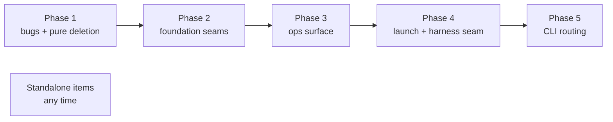

# Codebase Cleanup Program

On 2026-10-13 a thermo-nuclear maintainability review read meridian-cli in six
lanes (ops/core, launch/streaming, harness, state/config, CLI/misc, and the
pyright branch itself) and produced 68 findings. The cleanup program works
through them in five phases. This page holds the diagnosis, the phase plan, and
where each phase stands. Rationale for the program's scope decisions lives in
[Codebase cleanup decisions](../decisions/codebase-cleanup.md).

**Tracking:** phases 3–5, the standalone items and the deferred bugs live in
GitHub issue [#569](https://github.com/haowjy/meridian-cli/issues/569). The
per-finding evidence (file:line, proposals) is in `cleanup-backlog.md` of
`work:pyright-strict`, with the lane reports at `spawn:p7728`–`spawn:p7732`.
Finding IDs such as `launch#9` mean finding 9 of that lane's report.

## The Six Structural Problems

The codebase is about 120k lines of Python, with 15 files over 1k lines. The
findings cluster into six recurring problems. Each one explains a class of bug,
which is why the program removes the structure rather than patching instances.

1. **No single owner of a spawn turn.** Primary launch, spawn streaming and
   streaming-serve each re-orchestrate prelaunch → bind → native identity →
   conclude → finalize, and each patches the environment after bind. Fixes keep
   landing in two runners at once; `streaming_runner.py` and
   `launch/process/runner.py` are the most-churned files in the repo.
2. **Harness specifics leak out of `harness/`.** Branches on harness ID appear
   in launch, ops, core, config and transcript code. The design rule "new
   harness = one adapter + registration" is false today: a harness spans 4–16
   files plus about 15 shared switches ([harness adapters](harness-adapters.md)).
3. **Doubled entry points.** Two fork implementations, sync/async twin wrappers
   on every op, authority resolved two ways in each op, two bootstrap pipelines,
   three command registries, two session-reference resolvers. Each pair drifts:
   CLI `--fork` and MCP fork already apply different inheritance (B5).
4. **Validation done twice.** About 1,000 lines of hand-written TOML normalizers
   duplicate the Pydantic models beneath them, and hooks are parsed in two
   passes.
5. **No shared IO seams.** At least eight sidecars hand-roll
   read/validate/lock-mutate-write, and there are four different JSONL torn-line
   policies.
6. **Dead machinery.** Designs that were built and never wired in, or whose last
   caller went away: lazy Cyclopts dispatch, about 20 unread `HarnessContract`
   fields, a production fallback around `build_launch_context()`, phantom
   command-catalog entries.

## Phase Plan

| Phase | What it does | Problems addressed | Status |
|---|---|---|---|
| 1 | Fix the confirmed bugs; delete machinery nothing runs | 6, plus bugs from 2–3 | Shipped in v0.9.11 (PR #571, merged 2026-10-14) |
| 2 | Config normalizers collapse into Pydantic, `settings.py` split, one `iter_config_layers`; typed JSON sidecar documents and one `iter_jsonl` with a single torn-tail rule; `cli/invocation.py` to break imports into `cli.main` | 4, 5 | Shipped in v0.9.12 (PR #574, merged 2026-10-14) |
| 3 | One prepared context per op; sync handler with derived async; one bootstrap owner; one `spawn_follow_up(continue \| fork)`; refs parsed once | 3 | Deferred, #569 |
| 4 | All env composition inside bind; typed request-handler base and shared managed-backend runtime; OpenCode rebuilt as one serve connection with V1/V2 dialect strategies; a `launch/turn.py` turn host shared by all three drivers; drain as single terminal authority; per-harness dialects and bundle ports replacing harness-ID switches | 1, 2 | Deferred, #569 |
| 5 | `CommandDescriptor` becomes the only command record; per-command quirks become descriptor fields; `main.py` split | 3 | Deferred, #569 |

Standalone items (any time): `git_autosync._sync` restructure, reaper split into
pure decisions plus side effects, session-store locking, `history_index` split,
`codex_ws` split with a `StdioNdjsonConnection` base, and extracting control
actions from `spawn_manager.py`.

**Behavior changes that need sign-off before their phase starts** (all listed in
#569): fork semantics unify (phase 3); `SpawnActionOutput` becomes a
discriminated union, changing the wire format (phase 3); one bootstrap owner in
agent mode (phase 3); the primary path honors `request.env` (phase 4). Phase 2's
torn-tail JSONL rule was the one phase-2 behavior change; the user chose it after
a runtime probe ([decision](../decisions/state.md#one-jsonl-commit-rule-a-row-exists-when-its-newline-does-cleanup-phase-2-2026-10)).

## Phase 1 Outcome

Phase 1 took only what carried no behavior risk: bugs with a reproduction or a
code-verified cause, and deletions with proof that nothing read the code. Net
effect: about 2,200 lines removed against 850 added. Where a finding had a bug
half and a restructure half, only the bug half landed; the rest is in #569.

**Bugs fixed:**

| ID | Bug | Fix |
|---|---|---|
| B1 | Streaming-runner signal cleanup ran inside `mask_sigterm()`, so SIGTERM reset to `SIG_DFL` mid-teardown and a stale handler stayed bound to a closed loop | Cleanup runs before the mask; teardown stays masked |
| B2 | `SpawnParams` accounting checked the union across adapters, so `model_override_explicit` was unaccounted in four adapters | Accounting is per adapter |
| B3 | `spawn done` / `spawn rearm` had no command descriptor and classified as `spawn` (`WRITE_RUNTIME`); phantom `spawn create` / `spawn continue` descriptors existed | Exact descriptors; phantoms removed |
| B4 | `plugin_api.get_user_config()` read `~/.meridian/config.toml` directly, ignoring `--config` / `MERIDIAN_CONFIG` | Resolves through `resolve_user_config_path()` |
| B6 | Two `getattr(handler, "no_runtime_hitl", …)` sites used opposite defaults | Attribute declared on `ServerRequestHandler`, read directly |
| B8 | `prepare_for_runtime_read()` loaded config without the resolved authority snapshot | All four `prepare_for_*` pass the same authority |

B7 (`spawn wait` failing on "unresolved sources" under contention) was
root-caused but not fixed here; PR #546 owns it
([decision](../decisions/codebase-cleanup.md#d-b7-via-546-the-spawn-wait-contention-failure-is-fixed-by-pr-546)).

**Deleted** (verified unread across `src/`, tests, the Pi runtime, mars-agents
and the prompt repos):

- Lazy Cyclopts dispatch (`lazy_dispatch.py`), the descriptor fields that fed it
  (`lazy_target`, `extension_ref`, redirects), and `lib/extensions/descriptors.py`
- The archived app-server extension specs, `ExtensionSurface.HTTP`,
  `requires_app_server` (also dropped from discovery JSON), and dead server exit codes
- The spawn-archive overlay (`lib/spawn/archive.py`, `SpawnApplicationService.archive()`,
  the `spawn.archived` telemetry event), whose only caller went with the app-server specs
- The production `build_launch_context()` facade and the rebuild/fork-rewrite path
  in `run_harness_process()`
- Unread `HarnessContract` fields, enums and empty submodels (the live fields are
  now flat on the contract)
- The Windows TCP/port-file spawn-injection client
- Bootstrap config/context pass-throughs, `lib/utils/time.py`, `next_spawn_id`,
  and the public status-alias re-exports from `spawn_store`

**Conventions made explicit.** These now live in the colocated docs of the
directories they bind:

| Convention | Where it is stated |
|---|---|
| Each adapter accounts for every `SpawnParams` field itself, in `consumed_fields` or `explicitly_ignored_fields` | `lib/harness/AGENTS.md`; [invariant I-11](../principles/invariants.md) |
| Request-handler capabilities (`no_runtime_hitl`) are declared on the protocol, never probed with `getattr` defaults | `lib/harness/connections/AGENTS.md` |
| `PreparedLaunchSurface` is mandatory for `run_harness_process()`; `DIRECT` composition and `build_launch_context()` are test-only (`tests/support/launch.py`) | `lib/launch/AGENTS.md`; [launch system](../architecture/launch-system.md) |
| Every real subcommand has an exact `CommandDescriptor`; no test catches drift | `cli/AGENTS.md`; [startup pipeline](../architecture/startup-pipeline.md) |
| `plugin_api` reads config through `resolve_user_config_path()` | `plugin_api/AGENTS.md` |
| Every `prepare_for_*` passes its resolved authority to `load_config()` | `lib/bootstrap/AGENTS.md` |

**Left open by phase 1:**

- Server-side Windows branches remain in `streaming/control_socket.py` (TCP
  port file) and `streaming/signal_canceller.py` (app-server HTTP cancel)
  (`lib/streaming/.context/FUTURE`).
- `LaunchRuntime.composition_surface` still defaults to `DIRECT`, and 18 test
  files go through a 171-line facade that reimplements direct preparation
  (`lib/launch/.context/FUTURE`).
- `plugin_api` depends on `lib.config` (cli#8 restructure half), CLI and MCP
  invoke extensions through separate code (cli#9), and the control-socket
  client still lives in the CLI (cli#11) — all in #569.

## Phase 2 Outcome

Phase 2 built the shared seams that problems 4 and 5 lacked. Three lanes (config,
state IO, CLI) each merged after its own gates and a corpus comparison against its
base; the integration review (G2) then found the config lane had moved the double
validation rather than removed it, and a fix pass plus a polish pass finished the job
([decision](../decisions/codebase-cleanup.md#d-g2-double-validation-the-first-config-pass-relocated-the-ladder)).
Under `src/` the phase is roughly line-neutral (+4.0k / −4.3k): the 2,180-line
`settings.py` became eight focused config modules of about 2,000 lines in total.

**Behavior preserved, verified by corpus:** config values, precedence, per-value
provenance, unknown-key warnings, `config show` text and JSON, `config set`, hooks
across three layers, and CLI output byte-identical in human and agent modes. Changes
a user can see: config errors name the file; seven cases that printed a raw Pydantic
dump print one line; `MERIDIAN_HARNESS_WAIT_YIELD_SECONDS_PI` is honored; a torn JSONL
tail stays invisible until the next append; the telemetry sink repairs torn tails
(it had no repair on `main`).

**Conventions made explicit** (stated where they bind):

| Convention | Where it is stated |
|---|---|
| Config has one validation path: the Pydantic models under `MeridianConfig` (`config/models.py`, `harness_models.py`, `history_models.py`, the dynamic-section descriptor models). Key-warning policy is `ClassVar`s on `ConfigModel`; env vars exist only through `config_field()` catalog metadata; the layer merge is explicit in `config/loader.py`. No hand normalizers, no `pydantic-settings` | `lib/config/AGENTS.md`; [config precedence](../concepts/config-precedence.md) |
| Hook rows validate through `lib/hooks/schema.py` (`HookConfigSection.model_validate`, `HookSpec`); field constraints live on the models, hand checks only for multi-field rules; hook sources are user < project < local, with no builtin layer | `lib/hooks/AGENTS.md` |
| JSON sidecars go through `lib/state/json_doc.py` (`read_model` / `write_model` / `mutate_model`, the last requiring a lock) | `lib/state/.context/CONTEXT.md`; [durability and locking](../architecture/state-system/durability-and-locking.md) |
| JSONL is read and appended only through `lib/state/jsonl.py`: a row exists when its newline does; the appender repairs a delimiter-less valid tail; malformed complete rows skip (debug diagnostic); archive receipts raise; the single-row writer owns the newline | `lib/state/AGENTS.md`, `.context/CONTEXT.md`; [state decisions](../decisions/state.md#one-jsonl-commit-rule-a-row-exists-when-its-newline-does-cleanup-phase-2-2026-10) |
| Telemetry's durability unit is the batch: one repair, one write, one `fsync` per `write_batch` | `telemetry/local_jsonl.py`; [local persistence](../architecture/telemetry/local-persistence.md) |
| CLI modules read invocation state from `cli/invocation.py` inside an `invocation_scope`; `get_global_options()` raises outside one; nothing imports `cli.main` | `cli/AGENTS.md`, `cli/.context/CONTEXT.md`; [startup pipeline](../architecture/startup-pipeline.md) |

**Removed:** `config/settings.py` (importers use `config.models`, `config.loader`,
`config.dynamic_sections`); the `pydantic-settings` dependency and the re-entrant
`BaseSettings` load with its `_SETTINGS_CONTEXT` workaround; the TOML normalizer
ladders and the six-section catalog pre-parse; `hidden_env_specs` (replaced by one
`harness_profile_model()` factory); the hooks hand ladder and its `model_construct`
bypass; a phantom builtin hook-config layer; `inbound.jsonl`
([decision](../decisions/codebase-cleanup.md#d-jsonl-inventory-delete-inboundjsonl-keep-runner-lifecycle-and-debug));
four hand-written JSONL loops; the dead `auto_init_cwd` plumbing; function-local
imports of `cli.main` (a 30-module import cycle).

**Left open by phase 2** (all in #569 unless noted):

- `config show` replaces the whole `[[hooks]]` array per layer while the hook runtime
  layers rows by `(name, event)`; the two disagree (pre-existing).
- Several config fields (17 at the 2026-10-13 audit) still lack catalog metadata, so they have no env var and no
  generic `config get/set` (`lib/config/.context/FUTURE`).
- `sessions.jsonl` grows without bound (15 MB in one real project); `history.jsonl`
  legacy-archive recognition has no writer or reader left.
Project identity, which the phase-2 review of `auto_init_cwd` reopened, was
settled outside the program: the two-tier model merged in PR #575
([decision](../decisions/state.md#d-two-tier-identity)). #569 now tracks only
phases 3–5, the standalone items and the deferred bugs.

## How the Stack Landed

On 2026-10-14 the user merged the chain one PR at a time: #570 (pyright strict,
v0.9.10), #571 (phase 1, v0.9.11), #574 (phase 2, v0.9.12), then mars-agents
#173 (0.16.0) and #575 (two-tier identity). Each child was retargeted to `main`
only after its parent landed, and `main` was merged into it, not rebased.

What the landing surfaced:

- **The PR fast gate never runs most of `tests/integration/`** (#576). #574's
  8 `test_streaming_serve` failures and #575's 7 `test_workspace_ops` failures
  were caught only by reviewers' full-tree runs. #575's 3 `test_signal_canceller`
  failures (`AF_UNIX path too long`: `app.sock` under an ad-hoc test root) were
  logged in full-tree runs as environment noise ("3 AF_UNIX env"), passed PR CI,
  and then failed the release-on-main preflight, so v0.10.0 was not cut. Run
  the full tree before calling a stacked PR ready, and do not wave a failure
  through as environmental without showing it also fails on `main`.
- **Pi streaming contract tests flake under load** (#577), on `main` and on
  every branch alike. Compare against `main` before treating them as a
  regression.
- Merge and release mechanics (CHANGELOG re-homing, `merge-tree` exit codes,
  shipping Mars before the pin) are in
  [release sequencing](../lessons/release-sequencing.md#landing-a-stacked-chain-2026-10-14).

## Sources

`work:pyright-strict` (`cleanup-backlog.md`, `decisions.md` D8, D10–D41),
`spawn:p7728`–`spawn:p7732` (lane reviews), `spawn:p7746`, `spawn:p7747`,
`spawn:p7748` (phase-1 lanes), `spawn:p7749` (B7 investigation),
`spawn:p7763` (phase-1 integration review), `spawn:p7769` (review fixes);
phase 2: `spawn:p7750`, `spawn:p7770`, `spawn:p7780` (config), `spawn:p7751`,
`spawn:p7775`, `spawn:p7781` (state IO), `spawn:p7764` (CLI), `spawn:p7765` (state#1
review), `spawn:p7771` (torn-tail probe), `spawn:p7789`, `spawn:p7793` (JSONL
inventory and deletion), `spawn:p7782`, `spawn:p7791` (project identity),
`spawn:p7794`, `spawn:p7795` (G2 reviews), `spawn:p7799`–`spawn:p7801`, `spawn:p7809`
(fix lanes), `spawn:p7810` (re-verification), `spawn:p7813` (polish).
