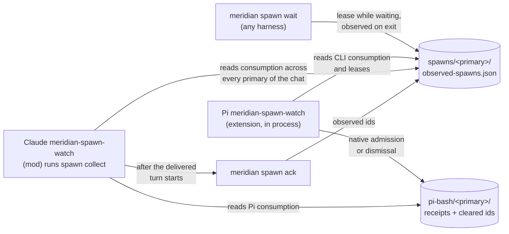

# Child Result Delivery

A lead that launches `meridian spawn --bg` learns each child's result by one of
three routes: its own `meridian spawn wait`, Pi's `meridian-spawn-watch`
extension, or Claude's `meridian-spawn-watch` mod. Owed discovery reads the
durable consumption evidence each route already owns; there is no separate
claim subsystem for result delivery.

Status: all three routes have shipped (the Claude route in v0.11.9, PR #724),
and Claude's header-only delivery shipped in v0.12.8 (PR #743). Bounded owed
results in no-arg wait are implemented on the unmerged `fix/owed-wait` branch.
Rationale and rejected designs:
[decisions/child-result-delivery.md](../decisions/child-result-delivery.md).



## Which route a lead has

| Lead | Automatic delivery | Without it |
|---|---|---|
| Interactive Claude primary | `meridian-spawn-watch` mod, unless `harness.claude.spawn_watch.enabled = false` | Explicit wait |
| Pi primary or spawned Pi session | `meridian-spawn-watch` extension, unless `harness.pi.spawn_watch.enabled = false`; at idle and at tool boundaries | Explicit wait |
| Spawned Claude (`claude -p`) | None (#722). A spawned lead is not allowed to finish while its descendants run, so it cannot forget them the same way | Explicit wait |
| Codex, OpenCode | None | Explicit wait |

`meridian spawn wait` remains the barrier on every harness: it is how a lead
blocks for results it needs before it can go on
([spawn wait barrier](spawn-wait-barrier.md)). The watchers cover the lead that
launched background work and ended its turn without waiting. That lead
otherwise stalls, since nothing starts its next turn when the child finishes.
Prompting alone did not prevent it: the spawn guidance already says to wait,
and a Sonnet lead still answered "I'll report when it finishes" and went idle.

## What a lead is owed

A child is **owed** to a lead while all of these hold:

- its `parent_id` is one of the chat's primary spawn ids. A resumed chat gets a
  new primary spawn, and the children of earlier primaries are still owed to it;
- it was launched in the background (`launch_mode == "background"`). A
  foreground spawn's result already went to the command that ran it;
- no route has recorded it as consumed.

Only direct children count. A child does not finish until its own descendants
have, so a grandchild's result reaches the lead through its parent's report.
For a nested caller, the same owed rule applies only to its own direct background
children; it does not take the primary's backlog, siblings, or terminal
grandchildren.

Pi's extension applies the first and third conditions to the current primary
only, and does not apply the second, so it also delivers foreground children
again (#718).

## Consumption sources

There is no single consumption file shared by every route. Owed discovery
unions three kinds of evidence for every relevant primary generation:

- current and legacy `observed-spawns.json`: ids consumed by CLI wait or ack;
- `delivery-receipts.json`: exact Pi native admission;
- `cleared-spawns.json`: results the user dismissed in Pi.

The shared reader opens each source once per call. A damaged or unreadable
source is skipped and diagnosed independently, so one truncated Pi receipt file
cannot prevent wait or collect from honoring the remaining evidence.

The current `observed-spawns.json` lives in the primary's own spawn directory,
`spawns/<primary spawn id>/`, under the project's runtime state. It holds two
things:

- **observed ids**: durable. A child listed here was handed to the lead and is
  never delivered automatically again.
- **wait leases**: temporary. A running `spawn wait` holds a lease naming its
  ids, its process id and that process's birth time, with an expiry. A lease
  counts only while that exact process is alive, so a killed wait stops
  covering its ids.

Writers record under the caller's own primary spawn id: `spawn wait` and
`spawn ack` both do. Readers that decide what is owed must read the consumption
sources of every primary in the chat. A lead that handled a child before a
crash, then resumed under a new primary, has that evidence under the old
primary. A reader that looked only at the current primary would deliver the
child again at every idle.

Writes take the primary's published-spawn lock, the per-spawn lock every
writer of a file in `spawns/<id>/` takes. That lock refuses a spawn whose
`state.json` is missing or quarantined (unreadable and set aside by the spawn
repository), so a write never recreates a directory that pruning or archiving
deleted. When it refuses, nothing is recorded:
`spawn ack` exits with an error, and `spawn wait` still waits and returns its
results without a lease or observation. No reader looks for children of such a
primary, so nothing is delivered twice.

Python's observation owner is `lib/state/spawn_observations.py`; the shared Pi
consumption reader lives in `lib/harness/pi_private_state.py`. Pi's TypeScript
extension reads the observation file with its own schema
(meridian-cli `src/meridian/pi_runtime/.context/delivery-contract.md`), so a
schema change moves both.

Fetching a result is not itself consuming it. `spawn show`, `spawn report
show`, and `session log` remain pure reads. A terminal result returned by
`spawn wait` is consumed unless the caller supplies `--no-observe`; `spawn
ack` is the other command that records consumed ids.

### Transition from `pi-bash/`

Builds before PR #729 kept the file at `pi-bash/<primary>/observed-spawns.json`,
a directory owned by Pi's background-bash extension. For one minor release after
the move ships, both locations count:

- **Every reader unions both files**: Python ops, Pi's disk watcher, and Pi's
  TypeScript extension. A child is consumed if either file lists it, and leased
  if either holds a live lease on it. A `spawn wait` started by an older build
  may still be writing the old file. A damaged old file counts as empty: it is
only a compatibility copy, and a later mirror write may replace it. A damaged
new file keeps the handling every current file gets.
- **Writers mirror to the old file when `pi-bash/<primary>/` exists.** A Pi
  session started before an upgrade reads only the old file. Claude primaries
  never have that directory, and the mirror never creates it.
- **Nothing is migrated or deleted.** A still-running older `spawn wait` would
  recreate a deleted old file.
- **Rolling back** to an older build is safe for Pi primaries, which are
  mirrored. A Claude primary's results consumed after the upgrade can be
  delivered once more.

Every transitional line in meridian-cli is tagged `legacy-observed-spawns
(#719)`; removing them next minor release is one search.

## Wait

`spawn wait` leases the ids it is waiting on while it polls. On every exit,
including errors and the hard timeout, it makes one write that releases the
lease and records the terminal spawns it returned as observed. A watcher that
sees a live lease leaves those ids alone; if the wait is killed, the lease dies
with it and the ids are owed again.

On the unmerged `fix/owed-wait` branch, target resolution also asks `owed.py`
for terminal children from the shared owed scope. That step snapshots the
scope, keeps finished rows, subtracts the active blocked-on ids, and takes at
most the oldest 32. The result classes stay separate: owed rows are late
delivery, not work this invocation waits for. They are included in the existing
observation lease, but the unchanged wait loop and its pending table contain
blocked-on ids only. The existing `finally` consumes owed rows and terminal
blocked-on rows together.

Owed rows render through collect's header-only formatter and appear in JSON as
`owed_spawns`, with no `report_body` even under `--full`. Blocked-on rows remain
in `spawns` and keep ordinary wait output and their requested report body after
the wait blocks for them. Only blocked-on rows drive run counts, single-result
compatibility fields, fail-fast, aggregate failure, and the CLI exit code. An
old failed owed child therefore remains visibly failed without making an
otherwise successful wait fail. Excess owed rows stay eligible for the next
normal wait or collection.
`--no-observe` makes the same selection and rendering but creates no lease or
consumption record, so it can return the same oldest batch again.

## Claude: the `meridian-spawn-watch` mod

The split follows "adapters report facts, core decides". Core decides which
children are owed, when to return, what the lead reads and what counts as
consumed. The mod only senses idle, runs two hidden commands, and submits text.

```mermaid
sequenceDiagram
    participant M as mod (in Claude)
    participant C as meridian spawn collect
    participant K as meridian spawn ack
    M->>C: 2 s after a main-loop turn ends, or at session start
    C-->>M: {kind: delivery, ids, text} or {kind: empty}
    M->>M: claim ids; hold while the prompt box is in use
    M->>M: $.prompt.submit(nonce line + text)
    M->>K: on the main-loop turn.start carrying the nonce
    K-->>M: {acked: ids}
```

**`spawn collect`** discovers the owed children with one history-index query
and subtracts consumed ids before reading any `state.json`. It then polls only
the remaining children, once a second, reading derived status: a child that
died without writing a terminal state shows as failed once its launch lock is
free. If any
owed child was already finished at the first look, it returns every finished
one at once: those results are already late. Otherwise it waits until the whole
owed set has finished, as `spawn wait` would. Leased ids are skipped while the
lease lives, never treated as a reason to exit. Just before returning it
re-reads consumption and leases, so a wait or ack that took a result meanwhile
drops it from the batch. A wait can still lease an id just after that final
check, producing one duplicate header; this short race is accepted instead of
adding chat-scoped claim state, commands, or plugin protocol. The broader
plugin-held-but-unacknowledged window already has the same at-least-once
tradeoff. Collect consumes nothing, and exits when its parent process
changes (Claude died) or when it is killed. A delivery carries at most 32
results. Each member contains its identity and
terminal outcome, worker, failure when present, distinct task directory, and
the exact `meridian spawn show <id>` lookup command. `collect` reads no report
bodies and has no report-byte budget. Pi keeps its separate TypeScript renderer
and bounded report excerpts.

**The mod** starts `collect` 2 s after a main-loop `turn.complete` with reason
`answer`, and at `session.start` (a resumed or reloaded session is idle with
nothing to end). Not after Esc, an error, or a refusal: the user stopped the
work, or the next request would fail the same way. Any main-loop `turn.start`
kills the collector. Subagent, teammate and compaction-fork turns carry
`agentId` and are ignored; without that filter, background agents would starve
delivery. `/clear` starts nothing: results stay owed until the next normal idle.

**Delivery order is what makes it crash-safe.** Consumption is recorded only
once the lead's conversation has the text:

1. The mod claims the ids in memory; a later `collect` gets them as
   `--exclude`.
2. It holds while the prompt box has a draft or was touched in the last 10 s,
   so a delivery never lands under the user's typing.
3. It submits the text under a `[meridian-spawn-watch delivery <nonce>]` line.
   `$.prompt.submit` resolves when the prompt is queued, not when its turn
   starts, so its return proves nothing.
4. The ack runs on the main-loop `turn.start` whose text contains the nonce,
   and on nothing else.

| Failure | Result |
|---|---|
| Claude killed while `collect` runs | Nothing consumed; the resumed chat delivers before the first prompt |
| Prompt dropped, or queued and the queue cleared | No turn carried the nonce; nothing acked; the next idle redelivers |
| Crash after the turn starts, before the ack lands | The lead may see the result once more after resume (accepted) |
| Ack keeps failing | Its ids stay excluded until the mod reloads; one duplicate after a restart instead of a turn at every idle |

The mod and its full behaviour table: meridian-cli
`src/meridian/claude_runtime/meridian-spawn-watch/README.md`. The command
contract: `src/meridian/lib/ops/spawn/.context/CONTEXT.md` ("Idle Spawn
Delivery Contract").

## Pi: the `meridian-spawn-watch` extension

Pi's extension runs inside the Pi process, watches `spawns/` for direct children
of its own spawn, and delivers results at idle (`sendMessage` with a new turn)
and at tool-bearing turn boundaries (native steer). It records exact native
admission in `delivery-receipts.json` rather than trusting the send's return.
Mechanism: [Pi runtime coordination](../architecture/pi-runtime/coordination.md).

## Known gaps

- The idle "your turn" push still fires while a watcher is about to wake the
  lead, because `spawn --bg` reads as a *maybe* wake to idle core (#717).
- The spawn guidance still tells every lead that un-waited background spawns
  are lost, which is no longer true on Claude and Pi primaries (#720).
- Each Claude idle pays one Meridian CLI start (about 0.7 s, measured) for
  `collect`, even when nothing is owed (#721).
- No delivery for spawned Claude leads, and no mid-turn delivery on Claude
  (#722).

## Related

- [Spawn wait barrier](spawn-wait-barrier.md)
- [Idle adapters](../architecture/idle-adapters.md): the idle push and how each
  harness reports running work
- [Claude Code mods and the inbox](../research/claude-code-mods-and-inbox.md):
  host behaviour the mod depends on
- Provenance: `work:claude-spawn-watch` (design reviews `spawn:p8815`,
  `spawn:p8822`; runtime probe `spawn:p8840` on Claude Code 2.1.307).
