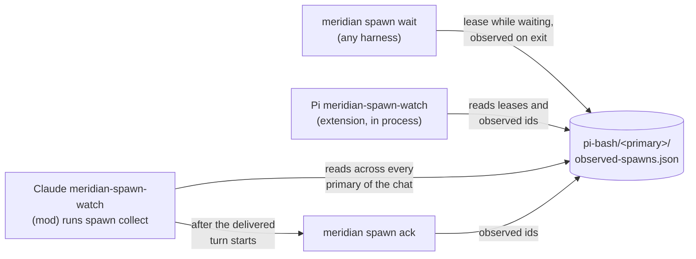

# Child Result Delivery

A lead that launches `meridian spawn --bg` learns each child's result by one of
three routes: its own `meridian spawn wait`, Pi's `meridian-spawn-watch`
extension, or Claude's `meridian-spawn-watch` mod. All three record what they
handed the lead in one file per primary, `observed-spawns.json`, so a result
that one route delivered is not delivered again by another.

Status: the Claude route is on the unmerged meridian-cli branch
`feat/claude-spawn-watch` (2026-10-21); the Pi route and explicit waits have
shipped. Rationale and rejected designs:
[decisions/child-result-delivery.md](../decisions/child-result-delivery.md).



## Which route a lead has

| Lead | Automatic delivery | Without it |
|---|---|---|
| Interactive Claude primary | `meridian-spawn-watch` mod, unless `harness.claude.spawn_watch.enabled = false` | Explicit wait |
| Pi primary or spawned Pi session | `meridian-spawn-watch` extension, unless `harness.pi.spawn_watch.enabled = false`; at idle and at tool boundaries | Explicit wait |
| Spawned Claude (`claude -p`) | None (#722). Its completion hold already waits on descendants before the spawn finishes | Explicit wait |
| Codex, OpenCode | None | Explicit wait |

`meridian spawn wait` remains the barrier on every harness: it is how a lead
blocks for results it needs before it can go on
([spawn wait barrier](spawn-wait-barrier.md)). The watchers cover the lead that
launched background work and ended its turn without waiting. That lead
otherwise stalls, since nothing starts its next turn when the child finishes.
Prompting alone did not prevent it: the spawn guidance already says to wait,
and a Sonnet lead still answered "I'll report when it finishes" and went idle.

## What a lead is owed

A child is **owed** to a lead while all of these hold:

- its `parent_id` is one of the chat's primary spawn ids. A resumed chat gets a
  new primary spawn, and the children of earlier primaries are still owed to it;
- it was launched in the background (`launch_mode == "background"`). A
  foreground spawn's result already went to the command that ran it;
- no route has recorded it as consumed.

Only direct children count. A child's own completion hold waits for its
descendants, so a grandchild's result reaches the lead through its parent's
report.

Pi's extension applies the first and third conditions to the current primary
only, and does not apply the second, so it also delivers foreground children
again (#718).

## The consumption record

`observed-spawns.json` lives at `pi-bash/<primary spawn id>/` under the project's
runtime state. The directory name dates from when only Pi used the file; moving
it is a state-compatibility change (#719). It holds two things:

- **observed ids**: durable. A child listed here was handed to the lead and is
  never delivered automatically again.
- **wait leases**: temporary. A running `spawn wait` holds a lease naming its
  ids, its process id and that process's birth time, with an expiry. A lease
  counts only while that exact process is alive, so a killed wait stops
  covering its ids.

Writers record under the caller's own primary spawn id: `spawn wait` and
`spawn ack` both do. Readers that decide what is owed must read the file of
every primary in the chat. A lead that waited on a child before a crash, then
resumed under a new primary, has that observation in the old primary's file.
A reader that looked only at the current primary would deliver the child again
at every idle.

Python's owner is `lib/state/spawn_observations.py`. Pi's TypeScript extension
reads the same file with its own schema
(meridian-cli `src/meridian/pi_runtime/.context/delivery-contract.md`), so a
schema change moves both.

Fetching a result is not consuming it. A command that reads a child's result
for display or for a notification uses `spawn wait --no-observe`.

## Explicit wait

`spawn wait` leases the ids it is waiting on while it polls. On every exit,
including errors and the hard timeout, it makes one write that releases the
lease and records the terminal spawns it returned as observed. A watcher that
sees a live lease leaves those ids alone; if the wait is killed, the lease dies
with it and the ids are owed again.

## Claude: the `meridian-spawn-watch` mod

The split follows "adapters report facts, core decides". Core decides which
children are owed, when to return, what the lead reads and what counts as
consumed. The mod only senses idle, runs two hidden commands, and submits text.

```mermaid
sequenceDiagram
    participant M as mod (in Claude)
    participant C as meridian spawn collect
    participant K as meridian spawn ack
    M->>C: 2 s after a main-loop turn ends, or at session start
    C-->>M: {kind: delivery, ids, text} or {kind: empty}
    M->>M: claim ids; hold while the prompt box is in use
    M->>M: $.prompt.submit(nonce line + text)
    M->>K: on the main-loop turn.start carrying the nonce
    K-->>M: {acked: ids}
```

**`spawn collect`** discovers the owed children with one history-index query
and subtracts consumed ids before reading any `state.json`. It then polls only
the remaining children, once a second, with derived (lock-aware) status. If any
owed child was already finished at the first look, it returns every finished
one at once: those results are already late. Otherwise it waits until the whole
owed set has finished, as `spawn wait` would. Leased ids are skipped while the
lease lives, never treated as a reason to exit. Just before returning it
re-reads consumption and leases, so a wait or ack that took a result meanwhile
drops it from the batch. It consumes nothing, and exits when its parent process
changes (Claude died) or when it is killed. A delivery carries at most 32
results and 64 KiB, with every result's identity and outcome line kept and
report bodies cut to share the rest; the bounds follow Pi's delivery contract.

**The mod** starts `collect` 2 s after a main-loop `turn.complete` with reason
`answer`, and at `session.start` (a resumed or reloaded session is idle with
nothing to end). Not after Esc, an error, or a refusal: the user stopped the
work, or the next request would fail the same way. Any main-loop `turn.start`
kills the collector. Subagent, teammate and compaction-fork turns carry
`agentId` and are ignored; without that filter, background agents would starve
delivery. `/clear` starts nothing: results stay owed until the next normal idle.

**Delivery order is what makes it crash-safe.** Consumption is recorded only
once the lead's conversation has the text:

1. The mod claims the ids in memory; a later `collect` gets them as
   `--exclude`.
2. It holds while the prompt box has a draft or was touched in the last 10 s,
   so a delivery never lands under the user's typing.
3. It submits the text under a `[meridian-spawn-watch delivery <nonce>]` line.
   `$.prompt.submit` resolves when the prompt is queued, not when its turn
   starts, so its return proves nothing.
4. The ack runs on the main-loop `turn.start` whose text contains the nonce,
   and on nothing else.

| Failure | Result |
|---|---|
| Claude killed while `collect` runs | Nothing consumed; the resumed chat delivers before the first prompt |
| Prompt dropped, or queued and the queue cleared | No turn carried the nonce; nothing acked; the next idle redelivers |
| Crash after the turn starts, before the ack lands | The lead may see the result once more after resume (accepted) |
| Ack keeps failing | Its ids stay excluded until the mod reloads; one duplicate after a restart instead of a turn at every idle |

The mod and its full behaviour table: meridian-cli
`src/meridian/claude_runtime/meridian-spawn-watch/README.md`. The command
contract: `src/meridian/lib/ops/spawn/.context/CONTEXT.md` ("Idle Spawn
Delivery Contract").

## Pi: the `meridian-spawn-watch` extension

Pi's extension runs inside the Pi process, watches `spawns/` for direct children
of its own spawn, and delivers results at idle (`sendMessage` with a new turn)
and at tool-bearing turn boundaries (native steer). It records exact native
admission in `delivery-receipts.json` rather than trusting the send's return.
Mechanism: [Pi runtime coordination](../architecture/pi-runtime/coordination.md).

## Known gaps

- The idle "your turn" push still fires while a watcher is about to wake the
  lead, because `spawn --bg` reads as a *maybe* wake to idle core (#717).
- The spawn guidance still tells every lead that un-waited background spawns
  are lost, which is no longer true on Claude and Pi primaries (#720).
- Each Claude idle pays one Meridian CLI start (about 0.7 s, measured) for
  `collect`, even when nothing is owed (#721).
- No delivery for spawned Claude leads, and no mid-turn delivery on Claude
  (#722).

## Related

- [Spawn wait barrier](spawn-wait-barrier.md)
- [Idle adapters](../architecture/idle-adapters.md): the idle push and how each
  harness reports running work
- [Claude Code mods and the inbox](../research/claude-code-mods-and-inbox.md):
  host behaviour the mod depends on
- Provenance: `work:claude-spawn-watch` (design reviews `spawn:p8815`,
  `spawn:p8822`; runtime probe `spawn:p8840` on Claude Code 2.1.307).
