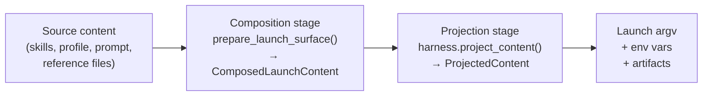

# Composition Pipeline

Every spawn involves assembling content — skills, agent profile, user prompt,
reference files, prior output — and delivering it to the harness in the right
form. Each harness has its own channels: Claude reads an appended system prompt
file, Codex takes developer instructions, and OpenCode takes an instruction file.

The **Semantic IR + Adapter Projection** pattern is how Meridian handles this
without coupling content assembly to harness-specific logic.

---

## The Core Insight

Content assembly and content delivery are separable concerns:

- **Assembly**: classify content by semantic meaning, independent of how any
  harness will use it
- **Delivery**: each harness adapter decides how to route each category to its
  own channels

Separating these means composition code never contains `if harness == "claude":`
branches. Harness choices stay in adapters, where they belong.

---

## Two-Stage Pipeline



### Stage 1: Composition → ComposedLaunchContent

`ComposedLaunchContent` is the harness-agnostic intermediate representation
(the "Semantic IR"). It classifies content into three categories:

| Category | What belongs here |
|----------|------------------|
| `SYSTEM_INSTRUCTION` | Behavioral controls for the agent |
| `USER_TASK_PROMPT` | The user's actual request |
| `TASK_CONTEXT` | Reference files, prior run output, context |

Fields in the IR:

| Field | Category | Meaning |
|-------|----------|---------|
| `launch_preamble` | SYSTEM_INSTRUCTION | Launch-mode-specific framing |
| `agent_profile_body` | SYSTEM_INSTRUCTION | Agent profile body text |
| `completion_contract` | SYSTEM_INSTRUCTION | Bounded goal contract from `--goal TEXT`; empty when no goal given |
| `supplemental_documents` | SYSTEM_INSTRUCTION | Typed `PromptDocument`s: loaded skills (full bodies), then bootstrap docs |
| `available_skills` | SYSTEM_INSTRUCTION | On-demand skills, listed by name only |
| `guidance_blocks` | SYSTEM_INSTRUCTION | `CompositionBlock`s sorted by phase then priority: agent inventory, spawn prompting and spawn contract (only for agents with spawn capability), work/task-dir/session discovery, then the context-env block |
| `report_instruction` | SYSTEM_INSTRUCTION | "Write a report at the end" directive |
| `passthrough_system_fragments` | SYSTEM_INSTRUCTION | Explicit `--append-system-prompt` args |
| `user_task_prompt` | USER_TASK_PROMPT | Raw user request (template-substituted) |
| `reference_items` | TASK_CONTEXT | Structured reference file/dir objects |
| `prior_output` | TASK_CONTEXT | Sanitized output from a prior spawn |

The `SYSTEM_INSTRUCTION` blocks are assembled in a fixed order (`SYSTEM_INSTRUCTION_BLOCK_ORDER` in `composition.py`, rendered by `render_system_instruction_blocks()`). Order matters because a system prompt is read top to bottom. The profile orients the agent and the goal follows it. Loaded skills come after both, grouped principle → guardrail → reference under type headers. Passthrough fragments come last so explicit user-supplied text can override or append:

```
launch_preamble → agent_profile_body → completion_contract
    → supplemental_documents (skills, then bootstrap) → available_skills listing
    → guidance_blocks → report_instruction → passthrough_system_fragments
```

The key constraint: **no cross-category concatenation before projection**. You
can't join skill documents and `user_task_prompt` into a single blob and call it
`user_task_prompt`. The semantic classification must survive intact until
`project_content()` is called.

### Stage 2: Projection → ProjectedContent

`harness.project_content(composed)` is the adapter's opportunity to map each
semantic category to its harness-specific channel. The output is
`ProjectedContent`:

- `system_prompt: str` — content for the harness's system-instruction channel
  (empty = omit)
- `user_turn_content: str` — content for user-turn or inline prompt channel
- `reference_routing` — per-reference decisions (`"inline"`, `"omitted"`)
- `channels` — overall routing decisions (written to `projection-manifest.json`)

#### How Each Harness Projects

**Claude:**
- SYSTEM_INSTRUCTION → `--append-system-prompt-file <path>` (file avoids
  ARG_MAX limits for long system prompts)
- TASK_CONTEXT + USER_TASK_PROMPT → user-turn channel, context first then prompt
- References: `"inline"` (rendered as content blocks) or `"omitted"` for
  empty-body files

**Codex and OpenCode:**
- SYSTEM_INSTRUCTION → a system field (`channels.system_instruction =
  "system-field"`): Codex developer instructions; OpenCode a materialized
  instruction file
- TASK_CONTEXT + USER_TASK_PROMPT → user turn, context first
- References: `"inline"` or `"omitted"`; no native injection

---

## Why "Classify Before Flatten" Matters

Imagine this (wrong) approach:

```python
# DON'T DO THIS — premature flattening
full_prompt = "\n\n".join([skills, profile_body, refs, user_task])
content = ComposedLaunchContent(user_task_prompt=full_prompt)
```

This loses the semantic boundaries. The harness can no longer route system
instructions to the system-prompt channel — everything looks like user task
content. Claude gets a worse system prompt. Debugging content routing becomes
impossible.

The correct approach keeps categories distinct until `project_content()`:

```python
# DO THIS — preserve semantic categories
content = ComposedLaunchContent(
    supplemental_documents=compose_skill_prompt_documents(loaded_skills),
    agent_profile_body=body,
    user_task_prompt=user_task,
    reference_items=refs,
)
projected = harness.project_content(content)
```

---

## Anti-Patterns

These are guardrails, not just suggestions. Code that violates them fails review.

**G-1: Harness-ID branches in composition code**
```python
# WRONG: composition code should never know about harness IDs
if harness.id == HarnessId.CLAUDE:
    prompt = join(skills, body, user_task)
```
*Fix: implement `project_content()` in the harness adapter instead.*

**G-2: Premature cross-category flattening**
```python
# WRONG: loses semantic classification before projection
full_prompt = "\n\n".join([skills, body, refs, user_task])
composed = ComposedLaunchContent(user_task_prompt=full_prompt, ...)
```
*Fix: keep categories in their respective fields.*

**G-3: Writing artifacts from anything but what the harness receives**
```python
# WRONG: an intermediate, or the projected prompt before post-projection additions
atomic_write_text(log_dir / "system-prompt.md", projected.system_prompt)
```
*Fix: `write_projection_artifacts()` writes `system-prompt.md` from
`run_params.appended_system_prompt`. That is the prompt the harness receives,
and Claude reads this exact file through `--append-system-prompt-file`. It
extends the projected system prompt with additions made after projection, such
as the source-edit-directory instruction. `starting-prompt.md` comes from
`projected.user_turn_content` when projection ran.*

---

## Observability Artifacts

After projection, Meridian writes a set of durable artifacts to the spawn's
log directory. These are useful for debugging what the harness actually received:

| File | Content |
|------|---------|
| `system-prompt.md` | The full appended system prompt the harness receives (Claude reads it directly) |
| `starting-prompt.md` | The user-turn content |
| `references.json` | Per-reference routing decisions |
| `projection-manifest.json` | Harness + surface + channel routing summary |

`starting-prompt.md` replaced the older `prompt.md`. Readers fall back to
`prompt.md` for older spawn dirs.

---

## Pre-Composed Prompts (Legacy Path)

Some older code paths use `prompt_is_composed=True` — a flag indicating the
prompt is already fully assembled and should bypass the composition stage
entirely. This is a legacy escape hatch. It produces no `ComposedLaunchContent`
and calls no `project_content()`. The projection manifest won't reflect real
routing, and the system-prompt.md artifact may be absent.

New code should never set `prompt_is_composed=True`. The composition pipeline
handles all cases correctly.

---

## Surface Scope

The composition pipeline runs for two surfaces:

- **`SPAWN_PREPARE`** (subagent spawns) — runs full composition: skill
  injection, reference loading, template variable substitution, prior-output
  inclusion
- **`PRIMARY`** (interactive primary launch) — same pipeline, plus
  `passthrough_system_fragments` (explicit system prompt passthrough args) and
  request-supplied supplemental documents after the loaded skills

The **`DIRECT`** surface is test-only (`tests/support/launch.py`): it skips
policy resolution and trusts a pre-resolved request. Production policy
resolution rejects it.

---

## Skill Delivery: One Path

Loaded skills reach the agent the same way on every harness and both surfaces
(primary and spawn). `_build_spawn_composed_launch_content()` and
`_resolve_primary_projection()` always set `supplemental_documents` from
`compose_skill_prompt_documents(loaded_skills)`. Projection then renders them
into the system prompt after the agent profile. Bind-time re-projection
(`_reproject_context_env_at_bind`) rebuilds from the same composed content, so
skills survive bind without special handling. On replay, loaded skills come from
the launch policy snapshot's `loaded_skills`.

**Don't add a second channel keyed on a harness capability.** Mars also writes
skills into each harness's native skill directory, but a native skill list shows
only model-invocable skills. A loaded skill that isn't model-invocable reaches
the agent only through composition. An earlier split did exactly this: it
suppressed composition on "native-skill" harnesses and added a Claude-only append
channel. It left Claude with no loaded skills for five months.

To check delivery, read `system-prompt.md` (Claude) or the Codex developer
instructions in the spawn params, and confirm that each loaded skill appears
exactly once. `tests/e2e/spawn/skill-injection.md` is the scenario.

See [D-skill-single-path](../decisions/launch.md#d-skill-single-path-loaded-skills-are-composition-documents-on-every-harness)
for the decision rationale.

---

## Agent Inventory Prompt

The `inventory` guidance block is populated from the Mars
launch-bundle `prompt_surface.inventory_prompt` field. Mars owns rendering of the
`# Meridian Agents` block, including harness-aware delegation guidance, native-agent
sections, model metadata, and `model-invocable` filtering. Meridian does not rebuild
or patch the inventory string in Python; `bundle_adapter.py` parses the field and
launch composition embeds it verbatim.

`build_guidance_blocks()` (`launch/spawn_guidance.py`) adds the inventory, together
with spawn prompting and the spawn contract, only when the agent has spawn
capability (`has_spawn_capability(profile)`). The gate is the agent's capability,
not the surface: a spawned agent that can spawn gets the inventory too.

Catalog scanning remains neutral: `scan_agent_profiles()` and `load_agent_profile()`
return profiles regardless of `model-invocable`. The model-facing visibility rule is
owned by Mars at inventory render time, while explicit CLI invocation via
`meridian spawn -a <agent>` remains available.

Resume and snapshot replay carry the rendered bundle inventory on the launch policy
snapshot (`bundle_inventory_prompt`) so a resumed session uses the same inventory text
without re-rendering it.

See [model-resolution/agent-profiles.md](model-resolution/agent-profiles.md#model-invocable-true--false)
for the field semantics.

---

## Related Pages

- [Harness Abstraction](harness-abstraction.md) — the `project_content()`
  contract and how each harness implements it
- [session-initiation.md](session-initiation.md) — four-mode session initiation model; why `prior_output` (`--from`) goes in the user turn, not the system prompt; identity lock and bare-flag inference
- `../architecture/launch-system.md` — where the prepare/bind seam fits in
  the full launch factory
- `../codebase/harness-adapters.md` — per-harness projection notes
