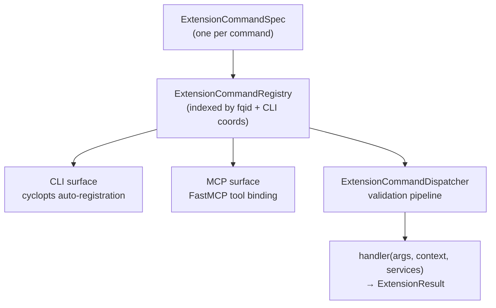
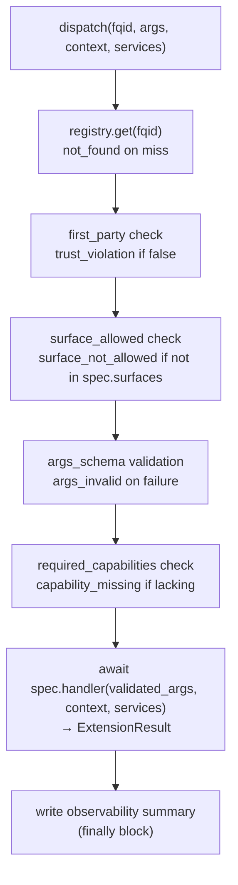

# Extension System

Every user-visible Meridian command — `spawn list`, `work start`, `session log`,
`config set` — is defined as an `ExtensionCommandSpec` in a single registry.
CLI and MCP read from the same registry. There is one place to add a command,
and it appears on every active surface it belongs to.

The prior model had CLI commands and HTTP API endpoints implemented in parallel
with separate specifications, and MCP tools as a third track. The extension
system unified all three behind one spec. The HTTP app server was later
archived and its surface removed; CLI and MCP are the only surfaces.

---

## The Core Model

A command's spec defines:
- Its **fully-qualified ID** (`extension_id.command_id`, e.g., `meridian.spawn.list`)
- Its **args schema** (Pydantic model)
- Its **result schema** (Pydantic model)
- Which **surfaces** it's reachable from (`CLI`, `MCP`, or both)
- Its **handler** — the async function that executes the command
- A **sync handler** — for CLI paths that don't use async

---

## Why One Spec Instead of Three

Before the extension system, commands existed in two tracks:
- `OperationSpec` in the ops manifest — fed CLI and MCP
- HTTP endpoints in the app server — parallel implementation, separate code

This caused real problems:
- HTTP endpoint behavior diverged from CLI behavior over time
- New commands had to be implemented twice
- There was no single place to see "what commands does Meridian have?"

The extension system makes `ExtensionCommandSpec` the single representation.
Adding a command = writing one spec in `ops/commands.py` (or a module under
`extensions/commands/`) and registering it. All surfaces pick it up automatically.

---

## Surface Allocation

`ExtensionSurface` has two members, `CLI` and `MCP`. The registry advertises
only commands a surface can actually run; there are no registered-but-unhosted
commands.

Not all commands appear on all surfaces. Surface assignment reflects the
intended consumer:

| Pattern | Surfaces | Rationale |
|---------|---------|-----------|
| `spawn.list`, `spawn.show`, `spawn.wait`, `spawn.stats`, `report.*`, `models.list`, `doctor`, `mermaid.check` | CLI, MCP | Read-mostly queries useful to humans and agents |
| `spawn.cancel`, `spawn.files`, `spawn.children`, … | CLI | Spawn control and inspection from the shell |
| `config.*`, `workspace.init` | CLI | Human-managed configuration |
| `session.log`, `session.search` | CLI | Transcript access is a human/CLI concern |
| `work.*` | CLI | Work lifecycle is CLI-managed |

Launching a spawn is not an extension command: `meridian spawn` is a regular
CLI command with its own startup descriptor. Check `meridian ext commands --json`
for the live surface list.

The security constraint: **non-first-party commands cannot expose CLI or MCP
surfaces.** First-party means registered via `first_party.py:register_first_party_commands()`.
This prevents third-party extension injection into trusted CLI or MCP surfaces.

---

## The Dispatcher Validation Pipeline

The `ExtensionCommandDispatcher` runs a validation pipeline before every
command execution:

Error codes from the pipeline: `not_found`, `trust_violation`,
`surface_not_allowed`, `args_invalid`,
`capability_missing`, `handler_error`.

The observability summary is written in the `finally` block regardless of
success or failure — every invocation is recorded.

---

## Invocation Context and Capabilities

`ExtensionInvocationContext` carries caller identity and granted permissions:

- `caller_surface` — which surface invoked this command
- `authority` — the runtime authority snapshot; project and runtime roots
  resolve through it
- `work_id`, `work_path` — active work item context
- `spawn_id` — spawn context if applicable
- `capabilities` — what the caller is allowed to do
- `request_id` — correlates the invocation with its observability record

`ExtensionCapabilities` defaults to `denied()` on both surfaces (no
subprocess/kernel/hitl); grants are explicit through the context builder.

---

## Adding a New Command

1. Define a Pydantic args model and result model
2. Write the handler function (async, takes `(args, context, services)`)
3. Write a sync handler (for CLI)
4. Create an `ExtensionCommandSpec` (or use `ExtensionCommandSpec.from_op()`
   for op-style handlers)
5. Add it to `ops/commands.py:get_all_op_specs()` (op-style commands) or
   register it in `extensions/first_party.py` (extension-specific commands,
   e.g. `extensions/commands/mermaid.py`)

The spec appears in CLI and MCP automatically based on the `surfaces`
set. No separate routing code needed.

---

## Observability

Every dispatch writes an `ExtensionInvocationSummary` to
`extension-invocations.jsonl` in the runtime root. The summary includes:
- `fqid` and `surface`
- `started_at` and `duration_ms`
- `success` and `error_code`
- Redacted args and result (secrets stripped, strings truncated at 512 bytes)

Write failures go to stderr — they never raise and never block the command.

---

## Related Pages

- [../architecture/startup-pipeline.md](../architecture/startup-pipeline.md) —
  how the CLI classifies and registers commands before dispatch
- [../codebase/guide.md](../codebase/guide.md) — where ops handlers live
