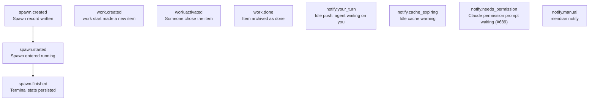

# Hooks and Plugins

> **Status:** The event names, `when` conditions, git-autosync defaults,
> payload schema 3 and Plugin API 3.0.0 below are on the unmerged
> `fix/hook-event-names` branch (PR #688, #687); `main` (v0.10.28) still has
> the old names. The permission notice is on the unmerged
> `feat/permission-prompt-ping` branch (PR #689, #684), which still calls it
> `session.needs_permission` at Plugin API 2.1.0 and renames it to
> `notify.needs_permission` at 3.1.0 when it rebases onto #688.

Hooks are callbacks that fire at spawn and work lifecycle events and at
notification events. They're the extension point for automation that should
happen around agent activity — syncing state to a remote repo, sending
notifications, triggering downstream pipelines.

The plugin API is what hooks (including built-in hooks) use to interact with
Meridian's state. It's a stable, narrow boundary that built-in hooks are
required to use — even though they live in the same codebase as everything else.

---

## What Hooks Are For

Hooks answer the question: "What should happen every time a spawn completes?"
or "What should happen every time I switch work items?"

They're not for modifying agent behavior — the agent is already running when
hooks fire. They're for **side effects** triggered by lifecycle events:
syncing, notifying, logging, triggering external systems.

Hooks don't watch turns inside a harness session. Deciding when a primary
went idle or when its prompt cache is about to expire belongs to the idle
adapters and core idle policy
([Idle Notifications](../decisions/idle-notifications.md)); the adapters are
harness mods and launcher tasks, not Meridian hooks. Once idle decides to
notify, though, the notice is a hook event, and hooks deliver it (see
[Notifications](#notifications-the-built-in-notify-route)).

---

## Event Taxonomy

Events are named for the moment that just happened. Spawn events follow one
spawn; work events follow a work item; `notify.*` events each carry a
notification.



- `spawn.created` fires once the record is written, queued or already
  running. `spawn.started` fires on every path into `running`, including a
  spawn whose first persisted state is `running`. `spawn.finished` fires for
  each persisted terminal write, so an authoritative rewrite of a reconciler's
  terminal state fires it again with the same event ID.
- `work start` on a new item fires `work.created`, then `work.activated`.
  Activation means a user or agent chose the item: `work start`, `work switch`
  (even to an archived item, even with no session), or a primary launch
  attaching `--work` / `--from` work, which fires once before the harness
  starts. Child work inheritance, `work rename` and `work clear` maintain the
  attachment without firing it. Work event IDs are unique per firing.
- Every `notify.*` event carries a `notification` payload, and the routes on
  that event deliver it
  ([D-notify-hook-events](../decisions/idle-notify-channels.md#d-notify-hook-events--notifications-are-hook-events-delivered-by-routes)).

Every hook failure logs and continues; no hook can stop the event that fired
it. A config row naming a removed event (`spawn.start`, `spawn.running`,
`spawn.finalized`, `work.start`, `work.started`, `session.responded`,
`session.cache_expiring`) fails to load and names its replacement. Why the
names changed, why there are no aliases, and what activation excludes are in
[The Hook Event Contract](../decisions/hook-event-contract.md).

---

## Hook Configuration

Hooks are configured in TOML files under `[[hooks]]` arrays. Each row
configures one hook, identified by the combination of `(name, event)`.

```toml
# Built-in hook — fires on all default events
[[hooks]]
builtin = "git-autosync"
remote  = "git@github.com:org/meridian-context.git"

# Custom shell hook — fires when a child spawn finishes
[[hooks]]
name    = "on-finish"
event   = "spawn.finished"
command = "scripts/on-finish.sh"
when.kind = ["child"]
```

**Built-in vs command hooks:**
- `builtin` — a registered built-in handler by name; mutually exclusive with `command`
- `command` — a shell command string executed as a subprocess

Key configuration fields:

| Field | Purpose |
|-------|---------|
| `event` | Which event to fire on; omit for built-in defaults |
| `enabled` | Default `true` |
| `priority` | Within one source, higher runs first; sources run `default`, `user`, `project`, `local` |
| `interval` | Throttle: `"30s"`, `"5m"`, etc. |
| `when.status` | `spawn.finished` only: `success`, `failure`, `cancelled`, `timeout` |
| `when.agent` | Filter by agent profile name; spawn and notification events |
| `when.kind` | Filter by spawn kind: `child`, `primary`, `streaming`; spawn and notification events |

A condition the event can never supply is a load error on a row that names its
`event`: work events reject `when.agent` and `when.kind`. An unevented builtin
row keeps the default events its conditions can match and records the rest as
disabled overrides, which still replace lower-layer rows of the same
`(name, event)`. It fails only if no default can match. The `EVENTS` table in
`lib/hooks/types.py` owns each event's default timeout (60s for
`spawn.finished` and `work.done`, 30s otherwise) and its available `when`
fields.

### Config Layering

Hook configuration is layered with an override model:

```
default (Meridian's `notify` routes)  (lowest priority)
  ↑
user config (~/.meridian/config.toml)
  ↑
project config (meridian.toml)
  ↑
local config (meridian.local.toml)  (highest priority)
```

A hook row in a higher-priority source with the same `(name, event)` key
replaces the lower-priority row entirely. The `default` layer holds one hook
named `notify` per notification event, and it is overridden like any other
layer. Layering lets teams set project-wide defaults and individual machines
override them locally without committing machine-specific config.

A builtin row with no `event` expands into one row per default event of
that builtin, in the builtin's declared order. `meridian hooks run NAME` still treats rows under one name with the
same builtin, command, options and timeout as **one action**.
Without `--event` it runs once, as the last of those events; a `git-autosync`
row with no `event` runs as `work.done`. `--event` is required only when the rows
differ. meridian-base's `context-autosync` hook depends on this: it calls
`hooks run NAME` with no `--event` and ignores failures, so an error there
silently stops KB syncing.

**Validation has one owner.** `lib/hooks/config.py` validates every
`[[hooks]]` row; the general config loader does not. `load_hooks_config_report`
returns the valid rows plus one error per invalid row, and `load_hooks_config`
raises on any. `meridian hooks check` exits 1 naming every invalid row.
Runtime dispatch (notifications, spawn lifecycle and work events) uses the
report: it drops only the invalid rows and warns, so a typo in one row cannot
silence notifications, stop spawns, or undo another row's `enabled = false`.

---

## Hook Context

When a hook fires, it receives context about the triggering event:

| Field | Meaning |
|-------|---------|
| `event_name` | Which event fired |
| `event_id` | Stable per spawn and event for spawn events; unique per firing otherwise |
| `spawn_id` | Spawn that triggered the event; the notifying spawn when known |
| `spawn_status` | `spawn.finished` only: `success`, `failure`, `cancelled`, `timeout` |
| `spawn_agent` | Agent profile name |
| `spawn_kind` | `child`, `primary` or `streaming` |
| `spawn_cost_usd`, `spawn_duration_secs` | `spawn.finished` only |
| `spawn_error` | `spawn.finished` only: the persisted terminal error |
| `work_id` | The event's work item: the item for work events, the spawn's or session's work otherwise |
| `work_dir` | That item's scratch directory, active or archived |
| `project_root` | Project root |
| `runtime_root` | Project state root; absent in an ad-hoc directory nothing has initialized |
| `notification` | Notification events only: `title`, `body`, `priority`, `email`, `label`, `attachments` |

**Command hooks** receive context as `MERIDIAN_*` environment variables and as
JSON on stdin (payload `schema_version` 3). Notification events add
`MERIDIAN_NOTIFICATION_TITLE`, `MERIDIAN_NOTIFICATION_BODY` and
`MERIDIAN_NOTIFICATION_PRIORITY`. The runner first strips every hook-payload
variable inherited from the caller, so a field absent from this event cannot
carry a stale value from the session that fired it.

**Built-in hooks** receive the typed `plugin_api.HookContext` directly; `lib/hooks`
uses the same `HookContext`, `HookResult` and `HookEventName` types (plugin API
3.0.0). A builtin returns structured output in `HookResult.details`, a
JSON-serializable mapping whose keys that builtin documents. The `notify`
builtin sets `details["transports"]`. The plugin API stays neutral: no field
on `HookResult` belongs to one builtin. A builtin declares the events it
accepts in `BuiltinHook.supported_events`. A row on any other event is a
config error, and a builtin that accepts only notification events cannot be
run by `hooks run`.

Hooks run even without a runtime root; only interval-throttled hooks skip
there, having nowhere to keep their state. `MERIDIAN_HOOKS_ENABLED=false`
turns off all hooks, notifications included.

---

## The Plugin API Boundary

Built-in hooks (like `git-autosync`) take general capabilities **only** from
`meridian.plugin_api`, never from `meridian.lib.*`. The one exception is a
tightly coupled companion a builtin wraps: `git-autosync`'s `autosync_store`,
and the `notify` builtin's `lib/notify` transports (imported lazily). No
external plugin should depend on those, so they stay out of the plugin API.

This is an enforced discipline, not just a convention. The reasoning:

> A built-in hook that imports from internal library code is coupling itself to
> implementation details that can change at any time. The plugin API is a stable
> surface that external plugins can also use. By requiring built-ins to use it,
> we ensure the plugin API stays adequate — if a built-in needs something
> that's not in the API, that's a signal to extend the API, not to break the
> boundary.

The plugin API surface includes:
- Hook types: `Hook`, `HookContext` (built with `HookContext.from_roots`),
  `HookResult`, `HookEventName`, `HookOutcome`, and the closed vocabularies
  `SpawnKind` and `SpawnStatus`, which core lifecycle and spawn state import
  rather than defining their own
- Notification types: `Notification` and `NOTIFICATION_EVENTS`
- State paths: `get_user_home()`, `get_project_home()`
- Submodules, imported directly: `plugin_api.git` (`generate_repo_slug()`,
  `normalize_repo_url()`, `resolve_clone_path()`), `plugin_api.fs`
  (`file_lock()`), `plugin_api.config` (`get_user_config()`,
  `get_git_overrides()`)

---

## Notifications: the Built-In `notify` Route

Idle push, the cache warning, the permission notice, and
`meridian notify "<title>" ["<body>"]` build a `plugin_api.Notification`;
`lib/notify/emit.py` fires its event through `HookDispatcher`. The built-in
`notify` hook (`lib/hooks/builtin/notify.py`) calls `lib/notify`'s `send()`
directly (a companion it wraps, imported lazily) to reach the transports: ntfy,
SMTP, Gmail, `none`.

```toml
# Cache warnings to push only, at priority 5 (replaces that event's default route)
[[hooks]]
builtin = "notify"
event   = "notify.cache_expiring"
[hooks.options]
channels = ["push"]
priority = 5

# A Slack channel is a command hook on the same event
[[hooks]]
name    = "slack"
event   = "notify.cache_expiring"
command = "scripts/slack-notify.sh"
```

- `channels`: `push` / `email` aliases or backend names; default both.
  `priority`: 1–5.
- The default routes are a `default` source below `user`, one row named
  `notify` per event. An unnamed `builtin = "notify"` row is named `notify`,
  so a row for an event, even with `enabled = false`, replaces only that
  event's default through the ordinary `(name, event)` override.
- `channels` names are checked when config loads; an unknown name is a
  config error, not a failed push later.
- `emit` returns a `RouteReport`: one `RouteResult` per route, named by the
  hook, with the transports that delivered. A route is `sent` (possibly
  with a warning, such as ntfy delivering the text but rejecting a file),
  `failed`, or `none` (skipped, or every backend `none`). `send()` keeps its
  own per-transport `SendReport`. Idle marks a stage failed only when no route
  delivered; no route at all is ok with a warning.

There is no separate `[notify.channels]` or `[[notify.routes]]` table: hook
rows are the routes and command hooks are the channels.

---

## Git-Autosync: The Primary Built-In

`git-autosync` is the built-in hook that keeps a git-backed remote in sync
with local Meridian state (KB, work directories, etc.). It works on any
configured sync root — KB, work, strategy, or other contexts — and does not
require an active work item.

**Default events**: `spawn.finished`, `work.activated`, `work.done` when no
`event` is specified. It never syncs at spawn start, so no spawn launch waits
on git. Because `work.activated` fires synchronously, a primary launch that
attaches `--work` or `--from` work waits for one sync before its harness
starts, and `work start` / `work switch` sync even from a shell with no
session. Why these three is in
[D-autosync-default-events](../decisions/hook-event-contract.md#d-autosync-default-events--spawnfinished-workactivated-workdone).
It skips when there is no runtime root.

### What It Does

On each event, git-autosync:

1. Ensure `.git/info/exclude` contains default ignores (`.git`, `**/.git`)
2. Abort any in-progress merge or rebase (when `conflict_policy = "abort"`, the default)
3. `git add -A` — stage all changes, including deletions and renames
4. Apply exclude patterns (`git reset -- <excluded>`)
5. Stash any excluded dirty files before integration
6. If staged: `git commit -m "autosync: <ISO timestamp>"`
7. `git fetch origin` (60s timeout)
8. Check divergence with fallback when `rev-list --left-right` fails
9. If behind: `git merge origin/<branch>` — on conflict: abort, local-wins, record conflict
10. If ahead: `git push`
11. Unstash excluded files

### Commit-First Workflow

Local changes are committed **before** integrating remote changes. This
ensures local edits exist as a real commit before any remote history is
applied, regardless of the integration outcome.

### Merge, Not Rebase

`git-autosync` integrates with `git merge origin/<branch>` rather than `git pull --rebase`.
See [../decisions/git-autosync-merge-strategy.md](../decisions/git-autosync-merge-strategy.md)
for the rationale behind that choice.

### Conflict Handling (Local-Wins)

When `git merge origin/<branch>` fails with a conflict:

1. **`git merge --abort`** — restores the pre-merge state. Local changes stay as committed HEAD (local-wins). No content is lost.
2. **Write conflict metadata** to `conflicts/<id>.json` in the sync root's autosync state directory (below) — conflict ID, affected paths, local/remote SHAs, remote branch, trigger event. The conflict JSON is the durable signal; per-conflict rewrites of user-owned AGENTS.md were removed because no agent ingestion contract existed to consume them.
3. **Subsequent sync cycles retry** the merge automatically. If new changes make it clean, everything pushes. If still conflicting, the existing record is reused (no re-recording).

The clone is never wedged. After a conflict: clean state with local commits at HEAD, pending merge to resolve. Other machines are unaffected.

Resolution: `git merge origin/<branch>`, resolve any conflicts, `git add` + `git commit`, then `meridian sync conflict resolve <id>` to clean up metadata.

### Artifact Ownership: `autosync_store.py`

A dedicated module `hooks/builtin/autosync_store.py` owns all autosync artifact reads and writes:

- Sole owner of the `.meridian/autosync/` file layout and JSON schemas, plus the canonical sync-root transaction lock
- Imports `meridian.plugin_api` for writes and `meridian.lib.platform.locking` for the reentrant transaction lock (the plugin lock API is intentionally non-reentrant; a complete autosync transaction requires reentrancy)
- Both `git_autosync.py` (write path) and ops modules (read path for CLI/dashboard) go through it
- Ops modules know *which* directories are sync roots; autosync_store knows *what* artifacts live inside them
- All sync-root mutations run inside `transaction(sync_root)`, which holds the canonical lock and yields a mutation capability

Artifact locations (project runtime state, outside the sync root, keyed by a
hash of the sync root's resolved path):
- `<runtime_root>/autosync/<hash>/conflicts/<id>.json` — per-conflict metadata
- `<runtime_root>/autosync/<hash>/state.json` — last sync outcome and timestamp

### Conflict CLI

- `meridian context status` — terse per-context status; one line per conflict: ID, path, type
- `meridian sync conflict show <id>` — conflict detail: SHAs, remote branch, affected paths, merge resolution commands
- `meridian sync conflict resolve <id>` — mark resolved and clean up metadata

### Clone Management

Each configured remote gets a clone in `~/.meridian/git/<slug>/`. Access to
each clone is serialized with a per-clone lock (`~/.meridian/locks/clone-<hash>.lock`).
If the lock can't be acquired within 60 seconds, the sync is skipped rather
than blocking the agent session indefinitely.

### Session-End Coverage Gap

git-autosync fires on meridian lifecycle events by default: `spawn.finished`,
`work.activated`, and `work.done`. These cover agent activity
coordinated through meridian, but miss commits created after the last such
event — most commonly knowledge capture by an Agent-tool subagent as a
session's final act. Those commits sit stranded locally until the next
meridian lifecycle event.

The `context-autosync` hook in `meridian-base` closes this gap.
It is a Mars-compiled Claude hook that fires at harness `SubagentStop`
and `SessionEnd`, discovers each enabled `git-autosync:*` instance via
`meridian hooks list`, and runs them. This bridges Mars-compiled harness
hooks (which fire at harness session events) with Meridian's builtin hook
system (which runs the actual sync logic).

The fragment authoring model (D91) is what made this hook reliable: Claude
gives `SessionEnd` hooks a 1.5-second default budget, and the v0.11.0
command-synthesis schema had no way to set a per-event `timeout`. The
fragment carries `"timeout": 30` on its `SessionEnd` entry, raising the
budget to 30 seconds -- the first concrete capability the fragment model
unlocked for an existing hook. See
[../ecosystem/prompt-packages/meridian-base.md](../ecosystem/prompt-packages/meridian-base.md#hooks).

### Failure Philosophy

All errors produce `skipped` (not `failure`). Sync failures are non-fatal —
the agent session continues. The skip reason is recorded so it's visible in
diagnostics, but the hook doesn't block the spawning lifecycle.

| Skip reason | Cause |
|-------------|-------|
| `missing_repo` | No remote configured |
| `lock_timeout` | Couldn't acquire clone lock in 60s |
| `conflict_detected` | Merge conflict — local state preserved, conflict recorded |
| `merge_failed` | Merge failed for non-conflict reason |
| `fetch_failed` | Fetch timed out or failed |
| `push_failed` | Push non-zero |
| `nothing_to_sync` | No staged changes, not behind remote |

### Configuration

```toml
[[hooks]]
builtin = "git-autosync"
remote  = "git@github.com:org/meridian-context.git"
exclude = ["*.log", "tmp/"]

# Restrict to completed spawns only:
[[hooks]]
builtin = "git-autosync"
remote  = "git@github.com:org/meridian-context.git"
event   = "spawn.finished"

# Keep legacy "leave" behavior instead of abort-on-conflict:
[[hooks]]
builtin = "git-autosync"
remote  = "git@github.com:org/meridian-context.git"
[hooks.options]
conflict_policy = "leave"
```
---

## Writing a Custom Shell Hook

Custom hooks run as subprocesses with the hook context available as environment
variables:

```bash
#!/bin/bash
# scripts/notify.sh — fires on spawn.finished

echo "Spawn $MERIDIAN_SPAWN_ID finished: $MERIDIAN_SPAWN_STATUS"
echo "Cost: \$${MERIDIAN_SPAWN_COST_USD}"
echo "Agent: $MERIDIAN_SPAWN_AGENT"
```

A notification channel reads the `notification` object on stdin or the env:

```bash
#!/bin/bash
# scripts/slack-notify.sh — fires on a notification event
curl -s -X POST "$SLACK_WEBHOOK" \
  --data "$(jq -n --arg t "$MERIDIAN_NOTIFICATION_TITLE" --arg b "$MERIDIAN_NOTIFICATION_BODY" '{text: ($t + "\n" + $b)}')"
```

A failing hook is logged and the next hook runs. No setting makes a hook's
success required.

---

## Project Root Resolution in Hooks Context

Hook processes run inside meridian spawn processes, which inherit the spawning session's `MERIDIAN_PROJECT_DIR` environment variable. Without special handling, a post-commit hook would resolve its project root from that inherited env var — which may point to a different checkout or worktree — rather than from the actual current working directory.

**The fix:** Use `resolve_project_root_resolution(ignore_env=True)` for any hook command that must operate relative to the actual working directory. With `ignore_env=True`, root discovery uses the literal CWD (no ancestor walk), bypassing the inherited `MERIDIAN_PROJECT_DIR`.

**When to use `ignore_env=True`:**

| Caller | Use `ignore_env` | Reason |
|---|---|---|
| CLI commands run by a user | No (default) | User's session env is the right anchor |
| `meridian hooks list/check/run` | Yes (#178) | They inspect and run the hooks of the checkout you are in; inside a spawn they can resolve a different project than `meridian notify`, which follows the inherited env |
| Shell hooks and git hooks invoked from inside a spawn | Yes | Hooks must operate on CWD, not on the parent spawn's project |
| Built-in hooks (git-autosync, etc.) | No | They do not resolve a root; they take `project_root` from the `HookContext` the dispatcher builds |

**Pattern:** Pass `ignore_env=True` whenever the caller is a subprocess that inherits a session env but needs CWD-relative resolution.

---

## Related Pages

- [../operations/troubleshooting.md](../operations/troubleshooting.md) — diagnosing hook failures
- [../architecture/telemetry/overview.md](../architecture/telemetry/overview.md) — durable telemetry and transient logging boundary
