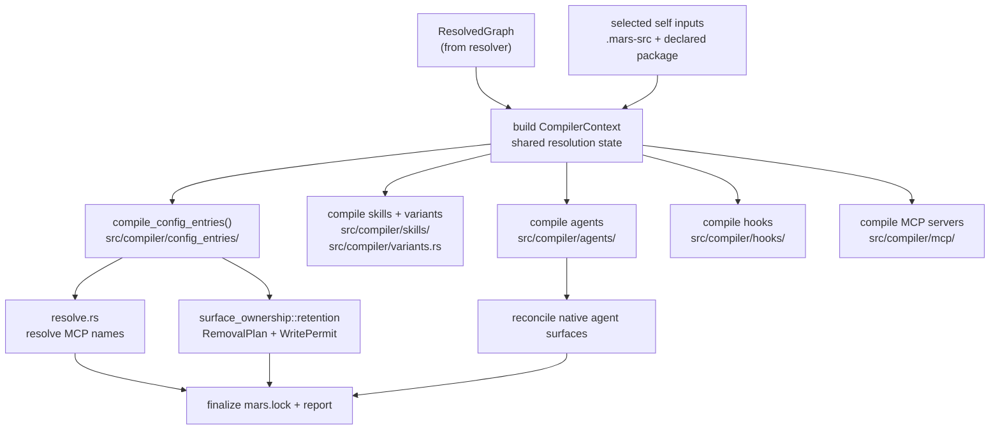

# Compiler Pipeline

The Mars compiler transforms resolved dependencies plus selected
current-project inputs into materialized output: agent profiles, skill files,
MCP config entries, hook config entries, and model alias tables. Entry point:
`compiler::compile()` in `src/compiler/mod.rs`.

## Pipeline Stages



## Module Map

```
src/compiler/
  mod.rs               ← entry point: compile(), agent emission policy
  context.rs           ← CompilerContext: shared resolution state per sync
  agents/
    mod.rs             ← agent compilation pipeline
    lower.rs           ← profile → materialized agent file
  config_entries/
    mod.rs             ← entry: compile_config_entries()
    resolve.rs         ← MCP name-collision resolution
  hooks/
    mod.rs             ← hook lowering, per-target platform-aware commands
  mcp/
    mod.rs             ← MCP server lowering, collision resolution
  skills/
    mod.rs             ← universal skill frontmatter parsing + lowering
  variants.rs          ← skills/<name>/variants/<harness>/SKILL.md indexing and selection

src/surface_ownership/
  retention.rs         ← stale removal, evidence retention, write permits
```

## Compiler Lanes

Each compiler lane handles one kind of output artifact:

### Agents (`compiler/agents/`)

Reads selected agent profiles from the target state and materializes them into
`.mars/agents/*.md`. When agent emission is active, also lowers each profile to
the format each native harness target requires (YAML frontmatter + Markdown for
Claude/OpenCode/Cursor, TOML for Codex).

Agent emission is policy-driven via three modes:

| Mode | Behavior |
|---|---|
| `Auto` | Detect from `MERIDIAN_MANAGED` env var |
| `Always` | Always emit to native harness dirs |
| `Never` | Never emit to native harness dirs |

`MERIDIAN_MANAGED=1` (set by Meridian when invoking `mars sync`) causes `Auto`
to behave as `Never`. See [targeting.md](targeting.md) for the full emission
model.

### Skills and Variants (`compiler/skills/`, `compiler/variants.rs`)

Parses universal skill frontmatter from `.mars/skills/*/SKILL.md`. Indexes
optional harness variants at `skills/<name>/variants/<harness>/SKILL.md`.
Validates layout — variants must live under a named skill. It still indexes
`variants/<harness>/<model>/` directories, but nothing selects them; model-level
variants are not supported ([D60](../../decisions/package-management.md#d60-skill-variants-are-selected-by-harness-only)). Lowers skill metadata
into per-harness projection format for target sync.

### Config Entries (`compiler/config_entries/`)

Handles MCP server and selected hook config entries written into harness-native
config files (`.mcp.json`, `settings.json`, `codex_mcp.json`, etc.).

MCP and hooks reach this lane differently:

**MCP selection and `resolve.rs`** — target construction discovers each source
once, applies source filters and exported visibility, and carries the parsed MCP
candidates plus their managed targets in `TargetState`. Preflight and config
lowering consume that state. `resolve.rs` resolves same-name candidates per
target using these precedence rules:

| Collision | Winner |
|---|---|
| Different depth | Shallower package wins (`_self` silently; a dependency loser with a warning) |
| Same depth | Earlier `mars.toml [dependencies]` entry wins, later dropped with warning |
| Same depth and declaration order | Alphabetically first source; both named in warning |

Depth is the shortest distance from the consumer (`ResolvedGraph::dependency_depths()`).
`graph.order` is alphabetical, so declaration order comes from `mars.toml`.
Depth-first ranking is [D103](../../decisions/package-management.md#d103-collision-precedence-and-hook-order-use-shortest-dependency-depth-2026-10-24),
on mars-agents `release/v0.19.0`, not yet released.
See [D99](../../decisions/package-management.md#d99-mcp-selection-joins-target-state-2026-10-24).

**Hook selection** — target construction applies dependency filters, exported
visibility, target scope, collisions, and the local overlay once. It carries the
selected parsed hook in `TargetState`. Preflight and both lowering modes consume
that selection; `config_entries` does not rediscover or re-resolve hooks. Two
selected dependency providers are a hard collision, while a local hook shadows a
dependency with a warning. The selection survives an install skip so sync can
issue the real post-install missing-directory warning. A plugin build can lower
the same selection with its own hook-root mapping and no project install. See
[D98](../../decisions/package-management.md#d98-the-target-build-is-the-only-hook-selection-authority-2026-10-24).

Hook and MCP loaders parse visibility into the shared `Visibility` enum. Unknown
values warn and become local, which preserves the previous package-boundary result
without leaving downstream string comparisons. Dependency `exclude` filters do
not yet match individual MCP names; that user-facing choice remains open.

**Ownership retention** — after desired entries are resolved,
`surface_ownership::retention::RemovalPlan` compares them with lock-v3 records,
partitions removal by target and surface, retains prior evidence on failure, and
issues `WritePermit` only for pairs safe to replace. This is the stale-cleanup
seam; there is no `config_entries/stale.rs` module.

### Hooks (`compiler/hooks/`)

Parses per-target native fragment files. MergeJson targets (Claude, Codex,
Cursor) validate native event keys and merge exact JSON entries. File targets
(OpenCode and Pi) substitute `${MARS_HOOK_DIR}` and materialize TypeScript
files. `preflight_config_entries()` validates selected fragments before apply so
an invalid fragment cannot leave partial state. Removed-schema compatibility
validation still parses dependency hooks during target construction, including
filtered transitive sources, without selecting them for emission.

### MCP Servers (`compiler/mcp/`)

Parses `mcp.toml`, preserves symbolic env references (`${VAR}` form for Claude,
plain variable names for Codex), pre-flights missing env vars, lowers parsed MCP
items into target entries. Collision resolution is shared with `config_entries/`.

## CompilerContext

`CompilerContext` (`src/compiler/context.rs`) carries shared resolution state
across all compiler lanes for a single sync: the resolved graph, the project
root, managed root, target registry, and lock from the previous sync. Lanes
read from context instead of re-resolving independently.

## Output to Lock

After all lanes complete, `compiler::compile()` writes the updated lock via
`lock::build()`. The lock records:

- Content-hashed provenance for every managed file
- Config-entry provenance for every installed MCP/hook entry
- Carry-forward of skipped or locally-modified items (not overwritten)

The lock write is atomic (tmp+rename). See [sync-model.md](sync-model.md) for
how the lock feeds the diff phase on the next sync.

## Invariants

- **I-1: Effectful selection has one owner** — target construction selects hooks
  and MCP candidates; preflight and lowering consume those values rather than
  rediscovering source config entries. MCP collision resolution remains in the
  per-target lowerer.
- **I-2: All writes are atomic** — tmp+rename, lock-guarded.
- **I-3: Target sync is per-target non-fatal** — a failure in one harness target
  records a warning and continues; sibling targets are not aborted.
- **I-4: Depth, then declaration order, for MCP collisions** — the shallowest
  package wins; at equal depth the earlier `[dependencies]` entry wins. Graph
  traversal order is never used.
- **I-5: Windows filename safety** — filename validation rejects Windows-invalid
  and reserved device names on all platforms before any write.

## Key References

- Entry point: `src/compiler/mod.rs` lines 35–96
- Agent emission policy: `src/compiler/mod.rs` lines 99–217
- MCP config-entry resolution: `src/compiler/config_entries/resolve.rs`
- Ownership retention: `src/surface_ownership/retention.rs`
- Hook compilation (native events): `src/compiler/hooks/mod.rs`
- MCP lowering: `src/compiler/mcp/mod.rs`
- Skill compilation: `src/compiler/skills/mod.rs`
- Variant indexing: `src/compiler/variants.rs`

## Related

- [targeting.md](targeting.md) — where compiled output lands and how harness projection works
- [sync-model.md](sync-model.md) — diff → plan → apply cycle that wraps the compiler
- [architecture/mars-compiler.md](../../architecture/mars-compiler.md) — hook selection, MCP collision rationale, config-entry provenance in the lock
- [decisions/package-management.md](../../decisions/package-management.md) — decisions behind the compiler design
