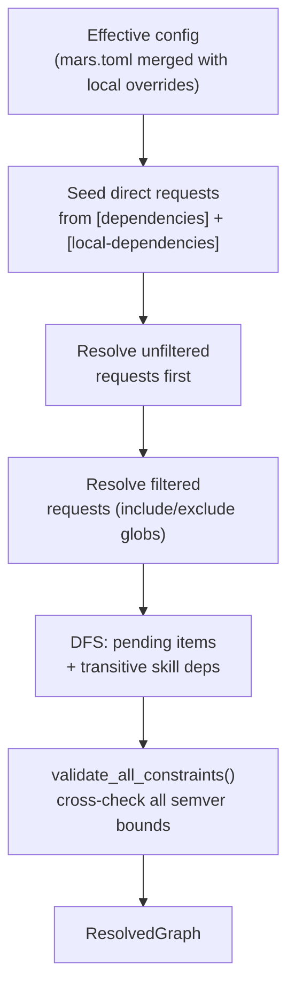
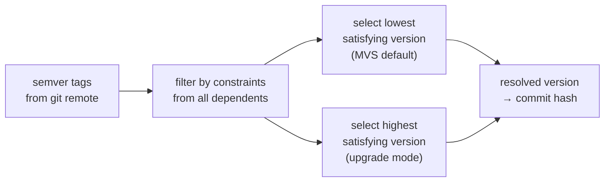
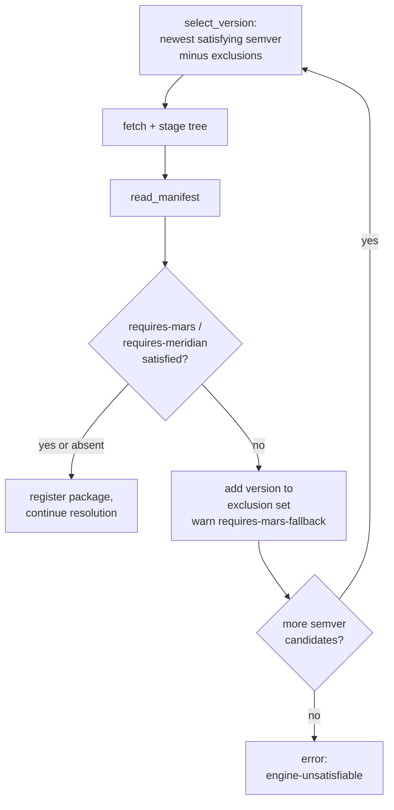

# Resolution Algorithm

The Mars resolver takes package declarations from `mars.toml`, fetches remote
sources into a global cache, and produces a `ResolvedGraph` — a version-pinned,
constraint-validated dependency graph. The resolver is trait-based and runs
before the compiler.

Entry point: `src/resolve/mod.rs`. Main types in `src/resolve/types.rs`.

## Data Structures

| Type | Role |
|---|---|
| `ResolvedGraph` | Final output: versioned nodes, item assignments |
| `ResolvedNode` | One package: source identity, resolved version, discovered items |
| `PendingItem` | In-flight item being resolved (agent, skill, bootstrap doc) |
| `VersionConstraint` | Semver constraint from a dependency declaration |
| `VisitedSet` | Guards against diverging source identities across names |
| `PackageVersions` | Tracks per-package version selections for constraint checking |
| `ResolveOptions` | Controls maximize/upgrade/bump/frozen mode |

## Resolution Flow



Steps in detail:

1. **Seed** — collect direct requests from both `[dependencies]` and
   `[local-dependencies]` sections. Unfiltered requests (no include/exclude)
   are resolved first; filtered ones follow.
2. **DFS traversal** — `resolve_package_bottom_up()` dedupes by source
   identity, applies subpaths, reads transitive manifests, discovers items, and
   seeds further transitive dependencies.
3. **Transitive skill resolution** — `resolve_skill_ref()` searches the
   requester's package, then the full dependency closure, then the remaining
   graph. Emits `SkillNotFound` if absent.
4. **Constraint validation** — `validate_all_constraints()` checks that resolved
   versions still satisfy every declared semver bound, including those from
   transitive dependencies.

## Version Selection

Path sources (`path = "../dir"`) bypass versioning — they are live filesystem
reads with no version semantics.

Git sources (`url = "https://..."`) use semver-based selection via
`resolve_git_source()` in `src/resolve/version.rs`:

1. **Ref pin** — if the dependency declares a specific `rev`/`tag`/`branch`,
   use it directly.
2. **Maximize mode** (upgrade) — fetch all tags, select the highest satisfying
   version.
3. **Locked commit replay** — if the lock has a satisfying commit, reuse it
   without a fetch.
4. **Safe fallback** — if the locked commit is unreachable (force-pushed,
   deleted), falls back to fetching rather than aborting.

Default algorithm is **MVS (Minimum Version Selection)**: when multiple
constraints exist on a package, the highest *lower bound* wins. This matches
Go module semantics. Maximize mode flips to highest available satisfying
version. Engine-excluded versions are removed from the candidate set before
selection (see [Engine Version Constraints](#engine-version-constraints)).



`select_version()` in `src/resolve/version.rs` implements this.

## Engine Version Constraints

Packages may declare minimum engine requirements via `requires-mars` and
`requires-meridian` in `[package]`. These are checked after manifest read
and before dependency collection, at the same point where the walk-down loop
runs.

### Walk-Down Loop

When the selected candidate's manifest declares an engine requirement the
running engine does not satisfy, the resolver excludes that version and
re-selects. This walk-down repeats until a compatible candidate is found or
all candidates are exhausted.



Walk-down exists only for semver sources with multiple candidates. Path,
ref-pinned, and untagged (HEAD) sources have no alternative — an incompatible
manifest is a hard error. `--ignore-requires-mars` and `--ignore-requires-meridian`
disable the respective check.

### Exclusion Set

The exclusion map (`EngineExclusions`) lives in driver state alongside the
restart overrides. Each entry records `(SourceName, Version)` with the
`EngineRequirementFailure` that caused it. This provenance means exhaustion
errors name the real engine requirement, not a generic semver conflict.
Exclusions persist across resolver restarts — `select_version` receives them,
and restart overrides are skipped when their version is excluded.

### Engine Check Placement

The check runs in `resolve_package_bottom_up` (`src/resolve/package.rs`)
after `read_manifest` and before `collect_manifest_requests`. Both
`requires-mars` and `requires-meridian` are checked; a version fails if
either constraint is unsatisfied. The consumer project's own
`[package]` requirements are checked once in `load_config` (hard error,
no fallback).

### Version Parsing

Bare versions (`"0.12"`) are rewritten to `>=0.12.0`. Full semver ranges
are accepted. Prerelease and build metadata are stripped from the running
version before matching. Invalid syntax is a manifest error (strict
`VersionReq::parse`, no RefPin fallback). Implementation:
`src/resolve/requires.rs`.

## Constraint Validation

After all packages are resolved, `validate_all_constraints()` runs a second
pass over every declared constraint in the full graph. This catches cases where
a transitively-selected version satisfies one dependent but violates another
that was processed later in DFS order.

`VisitedSet` and `PackageVersions` guard against a package being resolved to
different versions under different names — if two dependency names resolve to
the same source URL, they must use the same version.

## Filter Modes

Each dependency declaration supports include/exclude filters:

```toml
[dependencies]
meridian-base = {
  url = "https://github.com/org/pkg",
  version = ">=1.0",
  include = ["agents/coder.md", "skills/meridian-spawn/**"],
  exclude = ["skills/experimental/**"]
}
```

`sync/filter.rs` applies these modes. An agent that passes an include filter
also pulls in its declared skill dependencies transitively — `seed_items_for_request()`
in `src/resolve/package.rs` handles this.

Filters select agents, skills and hooks; they name no MCP server. A dependency
narrowed by an include filter still contributes every MCP server it exports
(mars v0.20.5 and later).

Filter combinations are validated at config load time; incompatible combinations
(e.g., `include` with `only-skill`) are rejected with a diagnostic.

## Discovery

A package's items come from two owners. The `mars-schema` crate's preparation
(`mars_schema::prepare::prepare`) selects agents and skills, including Claude
plugin manifests and a flat-root `SKILL.md`. The binary's `src/discover/mod.rs`
finds only the kinds the crate does not own: hooks (direct children of the
package-root `hooks/`) and bootstrap docs (`bootstrap/*/BOOTSTRAP.md`, found
with the crate's bounded directory walk). `package_items()` combines the two
into one item list; `discover_binary_owned_items()` is the hooks-and-bootstrap
half. Nothing in `src/discover/` may walk a tree for agents or skills.

The contract, the walk's boundaries (hidden directories, generated plugin
trees, `[plugin].dir`), and collision rules live in mars-agents'
`src/discover/.context/CONTEXT.md`. Why discovery is convention-based is
[D87](../../decisions/package-management.md#d87-convention-based-source-discovery-and-explicit-hidden-foreign-import).

Current-project source selection is separate from dependency resolution.
`.mars-src/` is always eligible; when `[package]` is present, the declared
package's agents and skills are also eligible and use Mars-native dialect.
`.mars-src` wins matching self definitions before staging. Both roots retain
the ordinary occupied-layer discovery contract. See
[self-source-selection.md](self-source-selection.md) for precedence, flat-root
naming, and generated-output boundaries.

## Source Cache

Fetched git sources use a cache root resolved in this order: `MARS_CACHE_DIR`,
the OS cache directory plus `mars/cache`, then `<cwd>/.mars/cache` when no OS
cache directory is available. `archives/` and `git/` live below that root;
`GlobalCache` in `src/source/mod.rs` manages those subdirectories.

Path sources bypass the cache. Archive extraction includes retry and path-safety
checks; git fetching handles tag, branch, HEAD, and semver resolution.

## Trait Boundary

The resolver is decoupled from concrete source modules via four traits
(`src/resolve/mod.rs`):

| Trait | Responsibility |
|---|---|
| `VersionLister` | List available versions for a source |
| `SourceFetcher` | Fetch a source at a specific version |
| `ManifestReader` | Read `mars.toml` from a fetched source |
| `SourceProvider` | Compose the above into a single resolution interface |

`RealSourceProvider` in `src/resolve/provider.rs` bridges these traits to the
concrete source modules.

## Invariants

- **I-1: Source identity is single** — a package source URL cannot resolve to
  different identity under different dependency names in the same graph.
- **I-2: Constraints checked twice** — at traversal time (fast-fail) and after
  full resolution (cross-check).
- **I-3: Path sources are unversioned** — no semver logic applies; the current
  filesystem state is used.
- **I-4: Locked commits are replayed unless unreachable** — reproducible installs
  by default, safe degradation under force-push or deletion.
- **I-5: Traversal path safety** — `apply_subpath()` rejects escaping or missing
  subpaths; `SourceSubpath`/`DestPath` normalize separators and reject traversal
  sequences.
- **I-6: Engine exclusions are monotone** — the exclusion set only grows across
  restart passes. Combined with the constraint-driven selection monotone, this
  guarantees termination: each walk-down step strictly shrinks the candidate list,
  and the optimum can only move downward.

## Key References

- Main resolution flow: `resolve()` in `src/resolve/mod.rs`
- Version selection: `select_version()` in `src/resolve/version.rs`
- Git resolution: `resolve_git_source()` in `src/resolve/version.rs`
- Package bottom-up resolution: `resolve_package_bottom_up()` in `src/resolve/package.rs`
- Item seeding + filters: `seed_items_for_request()` in `src/resolve/package.rs`
- Skill reference resolution: `resolve_skill_ref()` in `src/resolve/skill.rs`
- Subpath rooting: `apply_subpath()` in `src/resolve/path.rs`
- Item discovery: `package_items()` in `src/discover/mod.rs`
- Filter logic: `src/resolve/filter.rs`
- Source parser: `src/source/parse.rs`

## Related

- [sync-model.md](sync-model.md) — how the resolved graph feeds the sync cycle
- [compiler-pipeline.md](compiler-pipeline.md) — what happens to the resolved graph after resolution
- [self-source-selection.md](self-source-selection.md) — current-package selection and self ownership
- [overview.md](overview.md) — mars.toml format and dependency declaration syntax
- [decisions/package-management.md](../../decisions/package-management.md) — why MVS, why trait-based resolver
