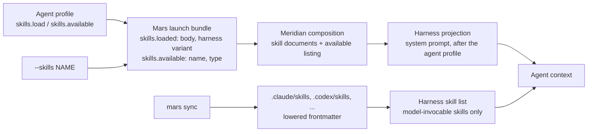

# How Skills Reach an Agent: Loaded, Available, Model-Invocable

Three settings decide whether an agent has a skill. They answer different
questions, and confusing them is how agents lose skills:

| Setting | Lives in | Question it answers |
|---|---|---|
| `skills.load` | agent profile | Is the skill's full text in the agent's context from the first turn? |
| `skills.available` | agent profile | Is the agent pointed at the skill so it can load it later? |
| `model-invocable` | the skill's own frontmatter | Can a model find the skill by itself in the harness's skill list? |

`--skills` on `meridian spawn` and `meridian start` is a caller-side `load`.
`user-invocable` decides whether a human can trigger the skill with `/name`.
It plays no part in what an agent receives.

## The Loading Rule

**A loaded skill's full text is composed into the agent's system prompt on every
harness, whatever its `model-invocable` setting.** This holds for skills under
the profile's `skills.load` and for skills attached with `--skills`.

`model-invocable` gates discovery, never an explicit load. So a skill marked
`model-invocable: false` and listed under one agent's `load` is a skill that
agent always has and that no model can stumble on by itself. That pairing gives
one agent its role-specific method (a solo-developer workflow, a review
checklist) without spending a description line on every other agent's turn, and
without other agents loading it because its description looked relevant.

The harness's native skill list (the skills a harness such as Claude Code or
Codex advertises to its model, each with a description line, for the model to
load on its own) is not a delivery channel for loaded skills. `mars sync` writes
every skill into each harness's native skill directory, but the harness lists
only the model-invocable ones. A loaded skill that
isn't model-invocable is missing from that list and present in the prompt. A
model-invocable loaded skill shows up in both places.

See [D-load-ignores-invocability](../decisions/package-management.md#d-load-ignores-invocability-model-invocable-gates-discovery-not-an-explicit-load)
and [D-skill-single-path](../decisions/launch.md#d-skill-single-path-loaded-skills-are-composition-documents-on-every-harness).

## The Paths

| Path | Who sets it | What the agent receives | Effect of `model-invocable: false` |
|---|---|---|---|
| `load` | profile author | Full text in the system prompt, every run, after the agent profile body | None |
| `--skills` | the caller, per launch | Same as `load`; added to the profile's `load` list | None |
| `available` | profile author | The skill's name under `# Available Skills`, grouped by type, marked not yet loaded. The agent loads it itself, normally through the harness's skill tool | The harness won't list or load it, so the agent is shown a name it can't load. Treat `available` + `false` as a contradiction |
| native discovery | `mars sync`, for every installed skill | One description line per model-invocable skill, on every turn, in the harness's own list | Absent |
| user invocation | the human typing `/name` | Whatever the harness does on a slash command | None; `user-invocable` governs this |

A profile's `skills:` is either a flat list, which means all `load`, or a
mapping with `load` and `available` keys. A name in both lists counts as loaded.

```yaml
skills:
  load: [dev-principles, solo-dev]   # solo-dev is model-invocable: false
  available: [diagnose, probe]
```

Each path costs context differently. `load` costs the full text on every turn
of every run, a model-invocable skill costs one description line on every turn
of every agent, and `--skills` costs nothing until a caller attaches it.

## Who Does What



Mars, the package manager, resolves the profile and any `--skills` names into
the launch bundle that Meridian launches from. For
each loaded skill it reads `.mars/skills/<name>/`, picks the harness variant
body if there is one ([variants](skill-schema.md#skill-variants)), and returns
the body without frontmatter. Mars is the only skill resolver: Meridian never
parses the profile's `skills` or reads `.mars/skills/`, and an exact continue
reuses the bodies saved in its launch snapshot
([D-mars-sole-skill-resolver](../decisions/package-management.md#d-mars-sole-skill-resolver-meridian-never-resolves-skills)).
Meridian turns each loaded body into a skill document, renders the
available listing, and hands both to the harness adapter, which places them in
the system prompt. Unknown names come back as `missing` and produce a warning,
not a failed launch: the bundle lists them under `missing` and Meridian adds a
launch warning.

The native skill directories are a separate pipeline. They serve the harness's
own discovery and slash commands, and Meridian does not depend on them for
anything it loads.

## What the Agent Sees

Each loaded skill arrives under a header that names it:

```text
# Skill: /solo-dev

Loaded: its full text follows, so `/solo-dev` in your instructions means this
text. Its files are in `.mars/skills/solo-dev/`; open the resources it names
from there.
```

The header names the skill so the agent can match it to a `/solo-dev` in its
instructions. Without it, an agent that checks the harness skill list, which
omits non-invocable skills, concludes the skill is unavailable and skips it. An
agent whose body names a skill its profile loads can rely on that skill being in
context even though its harness's skill list omits it.

Loaded skills are grouped by `type` (principle, guardrail, then the rest), each
group under a one-line header such as "Override other guidance when loaded."

## Known Exceptions

> [!FLAG] **Needs human review.** The rule above is the intended behaviour on
> every harness. These gaps were found on 2026-10-17 and are not fixed.

- **OpenCode v2 receives no composed system prompt.** Meridian builds it, with
  every loaded skill, but the v2 message API has no `system` field and v2 ignores
  the instructions file Meridian writes into `OPENCODE_CONFIG_CONTENT`. Loaded
  skills, the agent profile body and Meridian's injected guidance all fail to
  reach the model. OpenCode v1 streaming delivers them; the `opencode run`
  subprocess path drops the system prompt on any version. The fix is a separate
  change; see [harness adapters](../codebase/harness-adapters.md#skill-delivery).
- **An exact continue lists available skills without their directories.** A
  continued session replays from its launch snapshot, which stores the rendered
  "Available Skills" text but not the skill entries, so those skill directories
  are not projected into the continued session's workspace. Loaded skills replay
  in full. Tracked in
  `src/meridian/lib/launch/.context/FUTURE` in meridian-cli.

## Related

- [skill-schema.md](skill-schema.md): frontmatter fields, per-harness lowering, variants
- [composition-pipeline.md](composition-pipeline.md): where skill documents sit in the system prompt
- [model-resolution/agent-profiles.md](model-resolution/agent-profiles.md): the rest of the profile
- [../architecture/mars-launch-bundle.md](../architecture/mars-launch-bundle.md): the bundle contract
- [../lessons/arch-refactor-pitfalls.md](../lessons/arch-refactor-pitfalls.md#a-capability-gated-second-channel-drifts-from-the-first-pr-208--pr-661): how loaded skills once went missing on Claude
