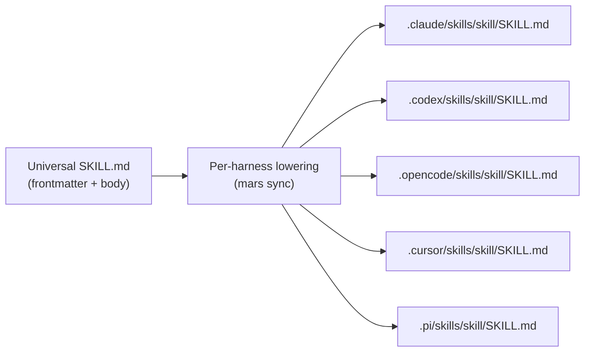

# Skill Schema, Variants, and Per-Harness Lowering

This page covers three related concepts:

1. **Universal skill frontmatter** — the common schema that every SKILL.md uses,
   independent of harness
2. **Per-harness lowering** — how the universal schema is projected to each
   harness's native format on sync
3. **Skill variants** — how a single skill name can have harness-specific
   override versions selected at launch time

Which skills an agent actually receives, and what `model-invocable` does and
doesn't control there, is on [skill-loading.md](skill-loading.md).

---

## Universal Skill Frontmatter Schema

Every SKILL.md carries a YAML frontmatter block. The schema is harness-agnostic:

```yaml
---
name: my-skill                    # canonical short name (required)
description: >                    # one-liner shown in skill catalog (required)
  What the skill does.
model-invocable: false            # can the model self-load this skill? (default: true)
user-invocable: false             # can the user trigger it with /name? (default: true)
tools:                            # tools pre-approved while the skill runs; map form (optional)
  bash(git *): allow
  read: allow
disallowed-tools: [agent]         # inline denials (optional)
license: Apache-2.0               # SPDX identifier (optional)
metadata:                         # free-form pass-through block (optional)
  author: acme-team
  version: 1.2.0
  custom-field: any-value
---

Skill body content here...
```

**Fields:**

| Field | Required | Default | Meaning |
|---|---|---|---|
| `name` | Yes | — | Canonical identifier; must be unique in the package |
| `description` | Yes | — | Short description for catalogs and help text |
| `model-invocable` | No | `true` | Whether the model can find this skill in its harness's skill list and load it by itself. Does not affect a skill an agent profile loads |
| `user-invocable` | No | `true` | Whether the user can trigger it with `/name` |
| `tools` | No | — | Tools the skill pre-approves, same rule grammar as agent profiles. Grants never restrict. List form is deprecated (it still grants, with a warning) |
| `disallowed-tools` | No | — | Tools the skill denies; merges with denials in `tools` |
| `license` | No | — | SPDX license identifier; propagated to skill catalogs |
| `metadata` | No | — | Arbitrary key-value data — pass-through everywhere |

Canonical skills do not author `allowed-tools`: Mars warns and strips it. A foreign
skill's harness-native `allowed-tools` is lifted to canonical `tools:` as grants on
import.

**Invocability is two orthogonal dimensions, not one enum.** Before this schema,
a single `invocation: explicit | implicit` field collapsed two independent concerns.
Every harness (Claude, Codex, OpenCode, Pi, Cursor) independently controls
model-invocability and user-invocability. The two-boolean representation matches
what harnesses actually support. See [decisions.md](../decisions.md) — D71.

**Both default to `true`.** A skill without these fields is fully invocable.
Set `model-invocable: false` to keep the skill out of every model's skill list;
set `user-invocable: false` to prevent slash-command triggering. Both false is
valid: no model or human can trigger the skill, and it reaches an agent only
because that agent's profile loads it or a caller attaches it with `--skills`.

**Presence is not a skill property.** Whether a skill is loaded is decided by
the agent profile's `skills:` (`load` or a flat list) and by `--skills`, never by
skill metadata. A loaded skill arrives in full even when `model-invocable` is
false. See [skill-loading.md](skill-loading.md).

**Legacy fields are hard errors.** The old `invocation:`, `disable-model-invocation`,
and `allow_implicit_invocation` fields emit a `RemovedField` error diagnostic and
are ignored. Skill authors must migrate:

```yaml
# Old                              New
invocation: explicit          →    model-invocable: false
invocation: implicit          →    (remove — both default true)
disable-model-invocation: true →   model-invocable: false
allow_implicit_invocation: false → model-invocable: false
```

`user-invocable: false` has no old equivalent — it's a new capability.

---

## metadata: Pass-Through Semantics

`metadata` is a free-form YAML mapping. No consumer validates or acts on
its keys — it is pure pass-through:

- **Meridian** includes it verbatim in compiled skill metadata (catalog listing,
  `meridian mars list --json` output). Agents can read it.
- **Harness adapters** ignore unknown frontmatter fields. A skill with
  `metadata.custom-field` emits cleanly to `.claude/skills/`, `.codex/skills/`,
  etc., without errors.
- **Mars** records it in the lock file's content hash but does not interpret it.

---

## Per-Harness Lowering

On `mars sync`, each skill in `.mars/skills/*/SKILL.md` is emitted to every
enabled harness's native skill directory. The emission is not a simple file
copy — it goes through a **lowering step** that projects the universal schema
to each harness's expected format.

**Invocability compilation matrix:**

| Source field | Claude | Codex | OpenCode | Pi | Cursor |
|---|---|---|---|---|---|
| `model-invocable: false` | `disable-model-invocation: true` | sibling `openai.yaml`: `policy.allow_implicit_invocation: false`† | dropped silently | `disable-model-invocation: true` | `alwaysApply: false`, description stripped (Manual rule)‡ |
| `model-invocable: true` | (omit) | (omit) | (omit) | (omit) | `alwaysApply: false`, description kept |
| `user-invocable: false` | `user-invocable: false` | dropped (lossiness) | dropped (lossiness) | dropped (lossiness) | dropped (lossiness) |
| `user-invocable: true` | (omit) | (omit) | (omit) | (omit) | (omit) |

† Codex gets the sibling file only when the source explicitly sets
`model-invocable: false`; absent or `true` writes nothing, since Codex defaults
to allowing implicit invocation.

‡ Cursor rules have no invocation flag. Without a description, Cursor's agent
can't auto-select the rule, which is the closest equivalent.

**Lossiness model:** When a harness has no native equivalent for a field (e.g.,
Codex has no `user-invocable`), the lowering records a `Dropped` lossiness entry.
These are internal metadata for tooling (`mars validate --verbose`), not
user-visible warnings. Only `Approximate` lossiness entries surface to users.



**Native projections are always refreshed on sync.** Even if the source skill
hasn't changed, every native harness file is re-emitted. If Mars detects that
a native projection has diverged from what sync would produce (e.g., manual
edits in `.claude/skills/`), it emits a divergence warning. This keeps the
single canonical source in `.mars/skills/` authoritative.

**Why always refresh:** The alternative (skip unchanged projections) would
silently leave stale projections after frontmatter format changes or harness
output changes. Staleness would only surface as subtle harness behavior
differences. Always-refresh makes sync idempotent and trustworthy.

---

## Skill Variants

A skill may ship an alternate body for a specific harness, so one package can
serve Claude and Codex without the user choosing a file. Variants are selected
by harness only; model-level variants are not supported
([D60](../decisions/package-management.md#d60-skill-variants-are-selected-by-harness-only)).

### Variant Directory Convention

```
skills/
  my-skill/
    SKILL.md               # base body (always required)
    variants/
      claude/
        SKILL.md           # Claude body
      codex/
        SKILL.md           # Codex body
```

The base `SKILL.md` is always required. A harness variant is
`variants/<harness>/SKILL.md`, where `<harness>` is one of `claude`, `codex`,
`opencode`, `pi`, `cursor`.

### Selection

Mars selects the body when it builds the launch bundle: the body of
`variants/<harness>/SKILL.md` if that file exists, otherwise the base body.
Matching is exact. The base frontmatter supplies metadata such as `type` either
way, and variant frontmatter is ignored. `mars sync` makes the same choice when
it writes each harness's native skill directory. Meridian receives the selected
body in the bundle and does no variant selection, live or on replay
([D-mars-sole-skill-resolver](../decisions/package-management.md#d-mars-sole-skill-resolver-meridian-never-resolves-skills)).

A directory one level deeper, such as `variants/claude/sonnet/SKILL.md`, is
never selected. Mars still indexes such directories and warns when one lacks a
`SKILL.md`; that is leftover from the earlier model-level design, not a
supported layout.

### When to Use Variants

Use a variant when a skill's behavior must differ across harnesses:
- The Claude body names Claude's tools; the Codex body names Codex's. Only
  bodies vary: tool grants and other frontmatter come from the base skill
- A skill works only on Claude; the base SKILL.md has a stub explaining this

Don't use variants for minor wording tweaks. Variants add maintenance cost;
use them only when runtime behavior genuinely differs.

---

## Compilation Invariant

`mars sync` emits native projections **always** — it does not use content-hash
optimization to skip unchanged skills. This guarantees that the native harness
dir always reflects the current `.mars/skills/` state after sync. The invariant:

> After `mars sync` completes without errors, every `.{harness}/skills/<skill>/SKILL.md`
> is byte-for-byte identical to what the lowering step would produce from `.mars/skills/<skill>/SKILL.md`.

Divergence between `.mars/skills/` and native dirs is only possible between
sync runs (e.g., from manual edits). `mars check` validates the invariant.

---

## Related Pages

- [skill-loading.md](skill-loading.md) — load vs available vs `model-invocable`: which skills an agent receives
- [package-management/overview.md](package-management/overview.md) — what mars manages, sync workflow
- [bootstrap-docs.md](bootstrap-docs.md) — two-tier bootstrap doc discovery and `meridian bootstrap`
- [../architecture/mars-targeting.md](../architecture/mars-targeting.md) — why skills are emitted to each harness's native dir
- [../decisions.md](../decisions.md) — D58–D63 for specific decisions made during capability-packaging work
