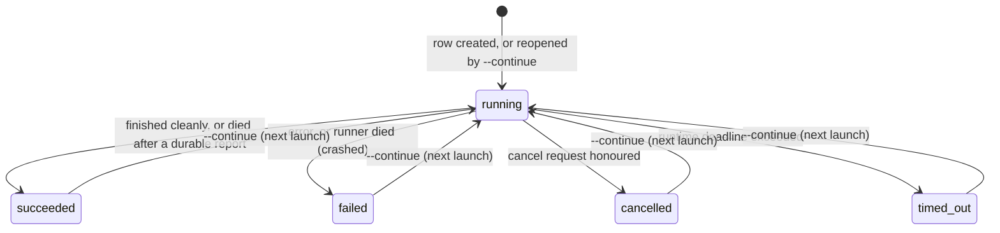
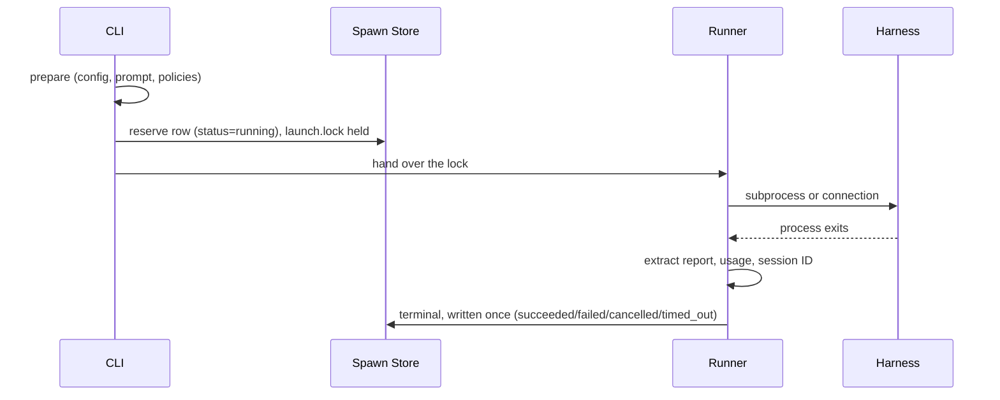

# Spawn Lifecycle

A **spawn** is Meridian's unit of delegated work — a single harness invocation
with a defined start, a prompt, and an eventual terminal state. Every `meridian
spawn` command creates one. Every background subagent is one. The primary
interactive session is one too (kind `"primary"`).

Understanding the spawn lifecycle is foundational: it governs how work is
tracked, how crashes are recovered from, and what observers can rely on.

---

## What a Spawn Is

At its core, a spawn is:

1. A **per-spawn state file** (`spawns/<id>/state.json`) — the authoritative record
2. A **spawn directory** (`spawns/<id>/`) — `launch.lock`, plus one directory per
   launch (`launches/<n>/`) holding that run's prompt, output and report
3. A **running harness process** (while a launch runs) — Claude, Codex, OpenCode, Pi, or Cursor

The state file is created before the process launches and persists after the
process exits until retention deletes the spawn aggregate. The process itself
is ephemeral; while the aggregate is published, the spawn record is its durable
authority.

A spawn keeps one ID across `--continue`: each run is a **launch**, numbered
inside the row and never shown to users. The row describes the current launch;
cost, tokens and duration are totals over every launch. `--fork` and `--from`
create a new spawn. Mechanism: [spawn launches](../architecture/state-system/spawn-launches.md).

### Primary vs Child

| Kind | Created by | Purpose |
|------|-----------|---------|
| `primary` | `meridian` CLI interactive launch | The user's interactive session |
| `child` | `meridian spawn` command | Delegated subagent work |

Both kinds go through the same lifecycle. The distinction matters for session
management and the top-level chat tree, not for lifecycle semantics.

---

## The Status Machine

`SpawnStatus` is a `StrEnum` (`core/domain.py`) — the single authority for the
status vocabulary. Lifecycle sets (`ACTIVE_SPAWN_STATUSES`,
`TERMINAL_SPAWN_STATUSES`) are derived from a member-to-lifecycle-class map,
not declared as separate constants.

The stored status changes once per launch: the row is created or reopened
`running`, and the holder of `launch.lock` writes the terminal once. A
`--continue` starts the next launch of the same spawn, so a terminal is final
for its launch, not for the spawn.

### Active Statuses

- **`running`** — a launch exists and its runner is alive (it holds
  `launch.lock`), or it died and no lock holder has written its outcome yet;
  readers then show the derived terminal.
- **`queued`**, **`finalizing`** — written only by builds before v0.18.0 and
  still readable on their rows. `--status queued`/`finalizing` parse with a
  deprecation warning. Cancel can still *report* `finalizing` when its deadline
  passes with the runner alive; nothing writes it to the row.

### Terminal Statuses

- **`succeeded`** — the turn completed. Report available through
  `meridian spawn report show <id>`.
- **`failed`** — check the `error` field and the launch's `stderr.log`.
  See [failure error codes](#failure-error-codes) below.
- **`cancelled`** — a cancel request decided the outcome.
- **`timed_out`** — exceeded its runtime deadline. A failure class kept
  distinct from generic `failed` in list, status and stats.

---

## Spawn Capability Gating

Not every agent receives spawn instructions in its system prompt. Meridian gates spawn knowledge injection on whether the agent profile has a non-empty `subagents` roster:

- If `profile.subagents` is non-empty → the agent receives the agent inventory block **and** the harness-templated spawn usage contract. This is automatic — no profile field to enable it.
- If `profile.subagents` is empty or the profile is absent → neither block is injected. The agent is a leaf worker; spawn instructions would waste context.
- Opt-out: `harness-overrides.meridian-cli.capabilities: {spawn: false}` suppresses injection even when `subagents` is non-empty ([D105](../decisions/package-management.md#d105-meridian-hosts-own-full-name-namespaces-under-harness-overrides-2026-10-27)).
- There is intentionally **no positive `spawn: true` override** — having `subagents` IS the capability. Two sources of truth (`subagents` roster AND a boolean flag) would invite drift.

The spawn contract is a first-class composition block (the `spawn-contract` guidance block from `build_guidance_blocks()`), not appended to the inventory string. This ensures continue/fork re-applies it exactly once — snapshot→replay→recompose doesn't duplicate or drop it.

The policy lives in `launch/spawn_guidance.py`. Contracts are harness-templated: Claude gets a contract naming Claude's `run_in_background`; all other harnesses get a generic contract referencing "your harness's background execution."

**Why always-injected:** The safety-critical spawn contract was previously only in the opt-in `meridian-spawn` skill. Across three separate incidents the model never loaded it — models hit the double-backgrounding footgun, background-wrap timeout, and lost spawn tracking.

See [decisions/launch.md](../decisions/launch.md#d-spawn-capability-gate-capability-gated-spawn-knowledge-injection-pr-328-2026-06).

---

## From Request to Terminal State

The journey of a typical foreground spawn:

`spawn wait` blocks until the terminal is written, or until the lock is free
and the outcome can be derived, not until the harness process exits.

### Prepare before reserve

A spawn is prepared (model and harness resolution, prompt composition,
workspace projection, permission pipeline) before its row is reserved, so a
setup error leaves no row. A continue prepares before it commits the next
launch: a setup error there commits nothing new, though the continue may
already have written the previous launch's outcome and swept its processes. After reservation, the
announce step creates the work item and emits lifecycle events.

The detached background worker uses `Popen` with `start_new_session=True`, so it
survives the launcher being killed. The window between the row's publication
and the worker's adoption is covered by `launch.lock`: the launcher holds it
from publication, and the worker inherits a duplicate of the descriptor when it
starts. If the launcher dies before starting the worker, the lock is free and
the row reads `failed`/`crashed`.

This reverses the earlier reserve-before-prep order
([D-reserve-before-prep](../decisions/launch.md#d-reserve-before-prep-reserve-spawn-row-before-preparation-for-crash-recovery-pr-328-2026-06)),
which wrote a `queued` row first so a crash during preparation left a visible
row. With the lock held from publication, a reserved row can no longer be
stranded, and preparing first means a failure leaves nothing behind.

### Resident Turn Boundaries

Claude, Codex and resident OpenCode children retain a successful/idle turn as a
**completion candidate**, then request one best-effort confirmation turn.
`done` accepts that candidate with readable evidence; `rearm` rejects it and
opens another fixed window for a genuinely new candidate. Candidate-less
signals are discarded. Silent or unavailable confirmation accepts only when
native and persisted-descendant evidence is ready; `unknown` stays fail-closed.

`done` is a residency control, not a status source. It cannot manufacture a
successful candidate and does not cancel Meridian descendants. The coordinator
still validates fresh evidence before publishing. Deadline expiry ends the
hold and starts best-effort descendant cleanup; ordinary activity does not
renew the deadline. See [drain plans](../architecture/drain-plans.md) for
signal delivery, report ordering, capability selection and timeout precedence.

### Startup Bound

The startup phase (backend boot, connection, session handshake) is bounded by a
configurable watchdog. Default: 5 minutes. Configurable via
`timeouts.startup_minutes` (TOML) or `MERIDIAN_STARTUP_TIMEOUT_MINUTES` (env).
Exceeding the bound produces terminal `failed` with error `startup phase timeout
after <N>s`. Both the spawn subprocess path and the streaming-serve path apply
the same bound via `streaming_runner.py`.

### One launch-level attempt

Each harness turn executes once. Terminal, transport, timeout, guardrail, identity,
cleanup, cancellation, and generic failures finalize rather than trigger another
attempt. A launch's `stderr.log`, `report.md` and runner logs live in its
`launches/<n>/` directory (at the spawn root for a launch from before v0.18.0).
Existing `attempt-N/` directories are legacy, read-only retry evidence. See the [one-attempt
decision](../decisions/launch.md#d-one-launch-attempt-harness-turn-failures-finalize-without-replay).

### Prompt Source

A spawn prompt comes from `--prompt` / `-p` (inline text) or `--prompt-file` /
`-f` (file path). Stdin is read only when `--prompt-file -` is given explicitly.
There is no implicit stdin fallback: a spawn invoked without a prompt source and
with an open silent stdin returns an error immediately rather than blocking on a
read that may never complete. Empty prompt is valid for `--continue` and
reference-only launches.

---

## Crash Recovery: Derived Status and Repair

Meridian uses a **crash-only design**: correctness never depends on a graceful
shutdown path, even where one exists (a primary finalizes itself on SIGTERM). A
runner holds `spawns/<id>/launch.lock` exclusively from before its row is
published until it exits, and the kernel releases the lock however it dies. The
held lock is the only liveness fact; no PID, heartbeat, file mtime or grace
period decides the status of a lock-backed row.

### Readers derive; they never write

Every status reader (`spawn show`, `list`, `wait`, stats, inject, the work views,
telemetry) calls `read_derived`. A stored-active row whose lock is free reads, on
the very next read, as `succeeded` if the launch left a durable report,
otherwise `cancelled` if a cancel was requested, otherwise `failed` with error
`crashed`. The derived terminal is in memory only. Mechanism:
[derived status](../architecture/state-system/derived-status.md).

### Persisting the outcome

A dead launch's `state.json` stays stored `running` until a holder claims its
free lock and writes the outcome readers already show, through
`finalize_dead_launch`:

- the next `--continue` of that spawn, which must end launch n before starting n+1;
- `spawn cancel`, which claims a dead launch at once with no signal;
- the bounded background repair pass a primary launch schedules (not a continue),
  and `meridian doctor --kill-orphans`. Both run only in a root process; a spawn
  calling `meridian spawn list` cannot reap its parent.

Plain `meridian doctor` persists nothing; it warns `dead_spawns_unfinalized`.

Rows from builds before the launch lock have no lock file. Readers judge them
by an exact-birth PID check plus a 15 s grace for a row with no runner PID yet,
and the repair pass and doctor never finalize them.

### Managed primaries

Codex and OpenCode managed primaries have separate launcher, backend and TUI
processes. The launcher is the runner and holds the lock. If it is SIGTERMed or
SIGHUPed it finalizes `cancelled` (exit 130) itself. If it is SIGKILLed or
OOM-killed, the row reads `failed`/`crashed` (or `succeeded`/`cancelled` by the
rule above); the guardians stop the backend
group and TUI, and the next continue or cancel of that spawn stops whatever is
left, backend and TUI included. Doctor's reaper claims only `spawn_owned`
scopes, and a managed primary's backend and TUI are session-owned, so doctor
leaves them unless the row recorded no scopes at all. See
[managed-primary lifecycle](../architecture/managed-primary-lifecycle.md).

### Failure error codes

| Code | Meaning |
|------|---------|
| `crashed` | The runner died (lock free) without writing an outcome, with no durable report and no cancel request. Hard kill, OOM, host reboot, or a crash mid-drain. Check the launch's `stderr.log`. |

`orphan_run`, `orphan_finalization`, `missing_runner_pid` and `orphan_primary`
were written by the guessing reaper before identity-v2 PR 3. Old rows may still
carry them; nothing writes them now.

---

## One writer per launch

Only the holder of a launch's `launch.lock` writes its terminal, and the first
terminal write wins; `origin` is a diagnostic label. This replaced a
"projection authority" lattice under which a runner's write could replace a
reconciler's. Why it is gone: [spawn finalization](../architecture/spawn-finalization.md#one-writer-first-terminal-wins).

---

## Cancellation and cancel-all Scoping

`meridian spawn cancel <id>` cancels the launch it observes, through the one
cancel lane ([cancel on the lock](../architecture/state-system/derived-status.md#cancel-on-the-lock)). `meridian spawn cancel-all` cancels all active spawns in the current chat scope.

### Subtree Scoping for Nested Orchestrators

When `cancel-all` is called from inside a nested spawn (`MERIDIAN_SPAWN_ID` is set in context), it scopes cancellation to **descendants of the caller only** — not siblings, the primary session, or other agents in the same chat.

This mirrors the descendant-scoping of `spawn wait` (see [spawn-wait-barrier.md](spawn-wait-barrier.md)). Implementation uses `_collect_descendants(caller_spawn_id, all_spawns)` BFS in `ops/spawn/api.py` to build the descendant set before issuing cancel events.

**Why this matters:** Without subtree scoping, an orchestrator spawn calling `cancel-all` to clean up its sub-agents could accidentally cancel parallel work launched by sibling spawns or the primary session. Subtree scoping makes `cancel-all` safe to call from nested orchestrators without cross-agent coordination.

**Bypass when needed:** `--include-others` flag bypasses subtree scoping and cancels all active spawns across the entire chat tree. Use this only when the caller is explicitly responsible for the whole chat, not just its own subtree.

**Contrast with `spawn wait`:** Both commands apply descendant-scoping when called from a nested spawn, using the same BFS walk. The difference is effect: `wait` blocks until descendants complete; `cancel-all` sends cancel events to descendants immediately.

---

## Key Invariants

1. A spawn state record exists before the harness process launches, and is prepared before it is reserved: a setup error leaves no new row or launch.
2. A spawn keeps its ID across `--continue`; each launch writes into its own directory.
3. Status readers never write state or signal processes. A held `launch.lock` reads as running (normally the runner; for seconds, a brief holder such as the repair pass); a free lock on a stored-active row means the launch is dead.
4. A launch's terminal is written once, by a holder of its `launch.lock`: its runner, or for a dead launch a continue, cancel, the repair pass or doctor, all through `finalize_dead_launch`. A writer without the lock never writes launch facts into `state.json`.
5. A dead launch with a durable report is `succeeded`, with or without a cancel request.
6. `meridian spawn done` controls residency (terminate-now vs stay-resident), not terminal status.
7. The published `state.json` row owns every spawn artifact. After retention
    deletes the row, late writers fail closed and cannot recreate the spawn
    directory.

---

## Related Pages

- [State Model](state-model.md) — how spawn `state.json` files and session
  JSONL preserve crash tolerance through atomic writes
- [Harness Abstraction](harness-abstraction.md) — what the harness process
  actually is
- [architecture/state-system/overview.md](../architecture/state-system/overview.md) — implementation details of the spawn store; [derived-status.md](../architecture/state-system/derived-status.md) — lock-derived status and the dead-launch writer
- [architecture/state-system/spawn-launches.md](../architecture/state-system/spawn-launches.md) — launches, the reopen, usage across launches, owed results
- [architecture/spawn-finalization.md](../architecture/spawn-finalization.md) — finalization subsystem: the one writer, store-level write, arbitration, conclude accumulator
- [architecture/completion-drain-coordination.md](../architecture/completion-drain-coordination.md) — shared Pi/resident completion mechanism and evidence boundary
- [decisions/completion-drain.md](../decisions/completion-drain.md) — candidate-scoped confirmation and shared native/descendant completion policy
- [architecture/managed-primary-lifecycle.md](../architecture/managed-primary-lifecycle.md) — managed-primary process roles and cleanup boundary
- [spawn-output-contract.md](spawn-output-contract.md) — what a caller sees after a spawn completes: report-first default, transcript pointer, progressive disclosure flags
- [harness-abstraction.md](harness-abstraction.md) — terminal status semantics per harness (`succeeded` = turn-completion, not work-correctness)
