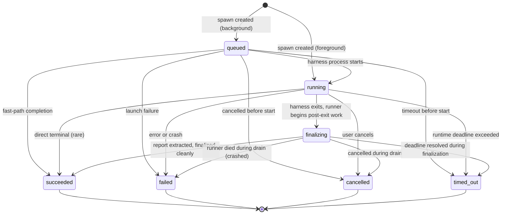
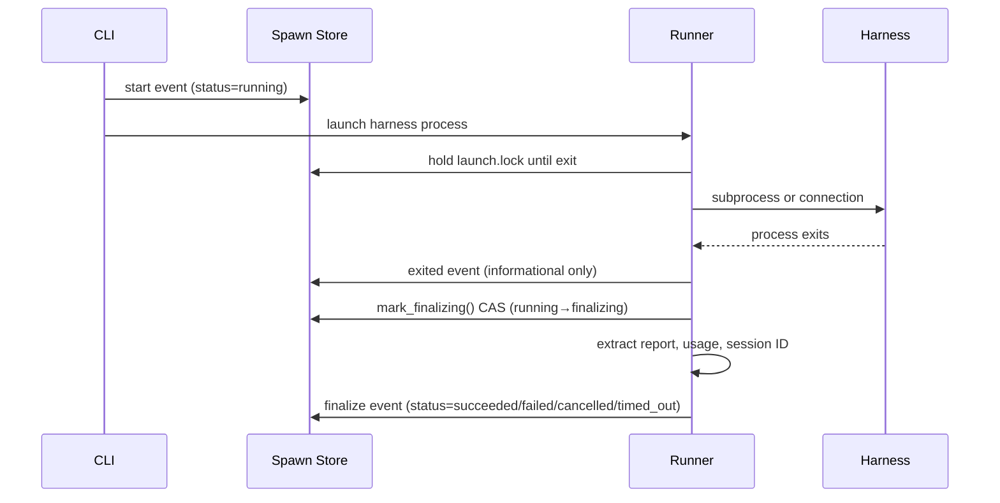

# Spawn Lifecycle

A **spawn** is Meridian's unit of delegated work — a single harness invocation
with a defined start, a prompt, and an eventual terminal state. Every `meridian
spawn` command creates one. Every background subagent is one. The primary
interactive session is one too (kind `"primary"`).

Understanding the spawn lifecycle is foundational: it governs how work is
tracked, how crashes are recovered from, and what observers can rely on.

---

## What a Spawn Is

At its core, a spawn is:

1. A **per-spawn state file** (`spawns/<id>/state.json`) — the authoritative record
2. An **artifact directory** (`spawns/<id>/`) — prompt, output, report, `launch.lock`
3. A **running harness process** (while active) — Claude, Codex, OpenCode, or Direct

The state file is created before the process launches and persists after the
process exits until retention deletes the spawn aggregate. The process itself
is ephemeral; while the aggregate is published, the spawn record is its durable
authority.

> **identity-v2** ([D-spawn-identity-v2](../decisions/spawn-identity.md#d-spawn-identity-v2),
> seven PRs, 1–3 merged). This page describes `main`. Since PR 3 every reader
> derives status from whether the runner holds `spawns/pN/launch.lock`
> ([derived status](../architecture/state-system/derived-status.md)), but status
> is still also stored in `state.json`. Still to come: PR 4 removes stored status,
> so `queued` and `finalizing` stop being statuses and the reaper stops writing
> outcomes; PR 7 keeps one ID across `--continue`, with each run a **launch**
> counted inside the record.

### Primary vs Child

| Kind | Created by | Purpose |
|------|-----------|---------|
| `primary` | `meridian` CLI interactive launch | The user's interactive session |
| `child` | `meridian spawn` command | Delegated subagent work |

Both kinds go through the same lifecycle. The distinction matters for session
management and the top-level chat tree, not for lifecycle semantics.

---

## The Status Machine

`SpawnStatus` is a `StrEnum` (`core/domain.py`) — the single authority for the
status vocabulary. Lifecycle sets (`ACTIVE_SPAWN_STATUSES`,
`TERMINAL_SPAWN_STATUSES`) are derived from a member-to-lifecycle-class map,
not declared as separate constants.

### Active Statuses

- **`queued`** — Spawn row exists; harness process not yet started. Occurs for
  background spawns during the setup window, or when the spawn is waiting to
  be claimed by a background worker.
- **`running`** — Harness process is live and doing work. The runner holds
  `launch.lock` for its whole life.
- **`finalizing`** — Harness process has exited; the runner is doing post-exit
  work (extracting the report, recording usage, finalizing the spawn row). This
  is an active state — the runner is still operating. Treat it like `running`
  when polling.

### Terminal Statuses

- **`succeeded`** — Work completed successfully. Report available in
  `report.md`.
- **`failed`** — Work failed. Check `error` field and `stderr.log` for details.
  See [failure error codes](#failure-error-codes) below.
- **`cancelled`** — Spawn was cancelled before or during execution.
- **`timed_out`** — Spawn exceeded its runtime deadline. It is terminal and counts
  as a failure class, but it is not folded into generic `failed`; list/status/stats
  surfaces can distinguish timeouts from other failures.

### Allowed Transitions

Not every path is valid. Key constraint: `queued → finalizing` is **not**
allowed. A queued spawn cancelled before the process starts goes directly to
`cancelled`, not through `finalizing`.

---

## Spawn Capability Gating

Not every agent receives spawn instructions in its system prompt. Meridian gates spawn knowledge injection on whether the agent profile has a non-empty `subagents` roster:

- If `profile.subagents` is non-empty → the agent receives the agent inventory block **and** the harness-templated spawn usage contract. This is automatic — no profile field to enable it.
- If `profile.subagents` is empty or the profile is absent → neither block is injected. The agent is a leaf worker; spawn instructions would waste context.
- Opt-out: `meridian-capabilities: {spawn: false}` suppresses injection even when `subagents` is non-empty. (The key is moving to `harness-overrides.meridian.capabilities`, unreleased.)
- There is intentionally **no positive `spawn: true` override** — having `subagents` IS the capability. Two sources of truth (`subagents` roster AND a boolean flag) would invite drift.

The spawn contract is a first-class composition block (the `spawn-contract` guidance block from `build_guidance_blocks()`), not appended to the inventory string. This ensures continue/fork re-applies it exactly once — snapshot→replay→recompose doesn't duplicate or drop it.

The policy lives in `launch/spawn_guidance.py`. Contracts are harness-templated: Claude gets a contract naming Claude's `run_in_background`; all other harnesses get a generic contract referencing "your harness's background execution."

**Why always-injected:** The safety-critical spawn contract was previously only in the opt-in `meridian-spawn` skill. Across three separate incidents the model never loaded it — models hit the double-backgrounding footgun, background-wrap timeout, and lost spawn tracking.

See [decisions/launch.md](../decisions/launch.md#d-spawn-capability-gate-capability-gated-spawn-knowledge-injection-pr-328-2026-06).

---

## From Request to Terminal State

The journey of a typical foreground spawn:

The `exited` event is **informational only** — it records the raw process exit
code and timestamp for audit purposes, but does not change the spawn's
projected status. A spawn stays `running` (or `finalizing`) until a `finalize`
event arrives. This is why `spawn wait` blocks until finalization, not until
the process exits.

### The `mark_finalizing()` CAS

When the harness exits, the runner calls `mark_finalizing()` — a
compare-and-swap that transitions `running → finalizing` only if the current
status is exactly `running`. Observers see that the harness is done and the
runner is extracting its report. Liveness doesn't depend on it: the runner still
holds the lock. PR 4 deletes the CAS with stored status.

If `mark_finalizing()` fails (the spawn was already cancelled or finalized by
something else), the runner logs it and proceeds to `finalize_spawn()` anyway —
the projection authority rule handles the resulting race.

### Reserve-Before-Prep Crash Window

Background spawns use a two-phase reserve/announce pattern to close a crash window:

1. **Reserve** — `lifecycle.start(dispatch_events=False)` writes only the spawn row (status `queued`). No work item, no lifecycle/telemetry/subrun events.
2. **Prepare** — model/harness resolution, prompt composition, workspace projection, permission pipeline. If preparation fails, the reserved row is cleaned up via `spawn_store.remove_spawn_events()` — graceful prep failures are side-effect-free.
3. **Announce** — `lifecycle.announce_started()` + subrun event emit runs only after preparation succeeds. Creates the work item, emits lifecycle/telemetry/subrun events.

The detached background worker uses `Popen` with `start_new_session=True` (POSIX) / `DETACHED_PROCESS` (Windows), so it survives the launcher being killed. The irreducible window (row written, Popen not yet called) is covered by the launcher's `launch.lock`, which it hands to the worker: if the launcher dies first, the lock is free and the row reads `failed`/`crashed`.

**Rejected: detach-first reorder.** The original implementation moved Popen before row creation (~9ms gain). This was rejected because work-item creation and start events leaked on graceful preparation failure — the earlier setup steps had already run. The two-phase split (reserve → announce) fixes both: reserve creates nothing but the row; announce emits everything only on confirmed prep success.

See [decisions/launch.md](../decisions/launch.md#d-reserve-before-prep-reserve-spawn-row-before-preparation-for-crash-recovery-pr-328-2026-06).

### Resident Turn Boundaries

Claude, Codex and resident OpenCode children retain a successful/idle turn as a
**completion candidate**, then request one best-effort confirmation turn.
`done` accepts that candidate with readable evidence; `rearm` rejects it and
opens another fixed window for a genuinely new candidate. Candidate-less
signals are discarded. Silent or unavailable confirmation accepts only when
native and persisted-descendant evidence is ready; `unknown` stays fail-closed.

`done` is a residency control, not a status source. It cannot manufacture a
successful candidate and does not cancel Meridian descendants. The coordinator
still validates fresh evidence before publishing. Deadline expiry ends the
hold and starts best-effort descendant cleanup; ordinary activity does not
renew the deadline. See [drain plans](../architecture/drain-plans.md) for
signal delivery, report ordering, capability selection and timeout precedence.

### Startup Bound

The startup phase (backend boot, connection, session handshake) is bounded by a
configurable watchdog. Default: 5 minutes. Configurable via
`timeouts.startup_minutes` (TOML) or `MERIDIAN_STARTUP_TIMEOUT_MINUTES` (env).
Exceeding the bound produces terminal `failed` with error `startup phase timeout
after <N>s`. Both the spawn subprocess path and the streaming-serve path apply
the same bound via `streaming_runner.py`.

### One launch-level attempt

Each harness turn executes once. Terminal, transport, timeout, guardrail, identity,
cleanup, cancellation, and generic failures finalize rather than trigger another
launch. The spawn's `stderr.log`, `report.md`, `runner-lifecycle.jsonl`, and
`tokens.json` remain at the spawn root. Existing `attempt-N/` directories are legacy,
read-only retry evidence; new runs do not create or rotate them. See the [one-attempt
decision](../decisions/launch.md#d-one-launch-attempt-harness-turn-failures-finalize-without-replay).

### Prompt Source

A spawn prompt comes from `--prompt` / `-p` (inline text) or `--prompt-file` /
`-f` (file path). Stdin is read only when `--prompt-file -` is given explicitly.
There is no implicit stdin fallback: a spawn invoked without a prompt source and
with an open silent stdin returns an error immediately rather than blocking on a
read that may never complete. Empty prompt is valid for `--continue` and
reference-only launches.

---

## Crash Recovery: Derived Status and Repair

Meridian uses a **crash-only design**: correctness never depends on a graceful
shutdown path, even where one exists (a primary finalizes itself on SIGTERM). A
runner holds `spawns/<id>/launch.lock` exclusively from before its row is
published until it exits, and the kernel releases the lock however it dies. The
held lock is the only liveness fact; no PID, heartbeat, file mtime or grace
period decides the status of a lock-backed row.

### Readers derive; they never write

Every status reader (`spawn show`, `list`, `wait`, stats, inject, the work views,
telemetry) calls `read_derived`. A stored-active row whose lock is free reads as
`cancelled` if a cancel was requested, otherwise `failed` with error `crashed`,
on the very next read. A report or `runner_exit` record left by a runner that
died before writing its outcome doesn't change that. The derived terminal is in
memory only. Mechanism: [derived status](../architecture/state-system/derived-status.md).

### Persisting the outcome

A dead launch's `state.json` stays stored-active until a writer claims its lock
and writes the outcome readers already show. `finalize_dead_launch` is that one
writer. It is called by:

- `meridian doctor --kill-orphans`, and the background repair that a primary
  launch schedules (skipped for a primary `--continue`, whose own sweep owns the
  source). Both run only in a root process; a spawn calling `meridian spawn list`
  cannot reap its parent.
- cancel convergence, after `spawn cancel` finds no live owner.

Plain `meridian doctor` persists nothing; it warns `dead_spawns_unfinalized`.

Rows from builds before identity-v2 PR 2 have no lock file. Readers judge them
by an exact-birth PID check plus a 15 s grace for a row with no runner PID yet,
and background repair never finalizes them.

### Managed primaries

Codex and OpenCode managed primaries have separate launcher, backend and TUI
processes. The launcher is the runner and holds the lock. If it is SIGTERMed or
SIGHUPed it finalizes `cancelled` (exit 130) itself. If it is SIGKILLed or
OOM-killed, the row reads `failed`/`crashed`; the guardians stop the backend
group and TUI, and the reaper sweeps whatever recorded scopes remain. See
[managed-primary lifecycle](../architecture/managed-primary-lifecycle.md).

### Failure error codes

| Code | Meaning |
|------|---------|
| `crashed` | The runner died (lock free) without writing an outcome and with no cancel request. Hard kill, OOM, host reboot, or a crash mid-drain. Check `stderr.log` and `report.md`: work may exist even though the spawn failed. |

`orphan_run`, `orphan_finalization`, `missing_runner_pid` and `orphan_primary`
were written by the guessing reaper before identity-v2 PR 3. Old rows may still
carry them; nothing writes them now.

---

## Projection Authority Rule

Multiple writers can attempt to finalize a spawn (the runner, the reconciler, a
cancel operation). Meridian resolves races by classifying writers:

- **Authoritative** origins: `runner`, `launcher`, `launch_failure`, `cancel`
- **Reconciler** origins: `reconciler` (explicit repair)

The first authoritative finalize wins. A later authoritative write cannot
overwrite an earlier authoritative write. However: **authoritative always
overrides reconciler**. For lock-backed rows a reconciler now writes only
after claiming the free lock, so the runner is already dead and can't arrive
later to override it. The lattice remains until PR 4 deletes it.

Metadata (cost, tokens) is merged from all finalize events regardless of
authority. No writer loses its token accounting.

The authority lattice is enforced at two layers:
1. **Under flock** — `spawn_store.finalize_spawn()` calls `decide_terminal_write()` inside the exclusive flock, making the read-decide-write sequence atomic across concurrent processes.
2. **During state mutation** — v2 spawn storage applies the same rule when updating `state.json`, so later reads observe the same authority decision that was made under lock.

See [architecture/spawn-finalization.md](../architecture/spawn-finalization.md) for the full decision lattice and concurrent-write mechanics.

---

## Cancellation and cancel-all Scoping

`meridian spawn cancel <id>` cancels a specific spawn. `meridian spawn cancel-all` cancels all active spawns in the current chat scope.

### Subtree Scoping for Nested Orchestrators

When `cancel-all` is called from inside a nested spawn (`MERIDIAN_SPAWN_ID` is set in context), it scopes cancellation to **descendants of the caller only** — not siblings, the primary session, or other agents in the same chat.

This mirrors the descendant-scoping of `spawn wait` (see [spawn-wait-barrier.md](spawn-wait-barrier.md)). Implementation uses `_collect_descendants(caller_spawn_id, all_spawns)` BFS in `ops/spawn/api.py` to build the descendant set before issuing cancel events.

**Why this matters:** Without subtree scoping, an orchestrator spawn calling `cancel-all` to clean up its sub-agents could accidentally cancel parallel work launched by sibling spawns or the primary session. Subtree scoping makes `cancel-all` safe to call from nested orchestrators without cross-agent coordination.

**Bypass when needed:** `--include-others` flag bypasses subtree scoping and cancels all active spawns across the entire chat tree. Use this only when the caller is explicitly responsible for the whole chat, not just its own subtree.

**Contrast with `spawn wait`:** Both commands apply descendant-scoping when called from a nested spawn, using the same BFS walk. The difference is effect: `wait` blocks until descendants complete; `cancel-all` sends cancel events to descendants immediately.

---

## Key Invariants

1. A spawn state record exists before the harness process launches.
2. For background spawns, the row is reserved (`queued`) before preparation; announcement (work item + events) only after prep succeeds. Graceful prep failures are side-effect-free.
3. The `exited` event is informational — status transitions require `finalize`.
4. `queued → finalizing` is not a valid transition.
5. Status readers never write state or signal processes. A held `launch.lock` means live; a free lock on a stored-active row means dead.
6. A lock-backed dead launch's outcome is written only by a holder of its lock, through `finalize_dead_launch`: the reaper at root depth (`_MERIDIAN_DEPTH` absent, empty, or `0`), or `spawn cancel`. Rows with no lock file are finalized only by explicit cancel, with the pre-PR-3 report/cancel rule.
7. Runner-origin finalization supersedes reconciler-origin finalization.
8. `meridian spawn done` controls residency (terminate-now vs stay-resident), not terminal status.
9. The published `state.json` row owns every spawn artifact. After retention
    deletes the row, late writers fail closed and cannot recreate the spawn
    directory.

---

## Related Pages

- [State Model](state-model.md) — how spawn `state.json` files and session
  JSONL preserve crash tolerance through atomic writes
- [Harness Abstraction](harness-abstraction.md) — what the harness process
  actually is
- [architecture/state-system/overview.md](../architecture/state-system/overview.md) — implementation details of the spawn store; [derived-status.md](../architecture/state-system/derived-status.md) — lock-derived status and the dead-launch writer
- [architecture/spawn-finalization.md](../architecture/spawn-finalization.md) — finalization subsystem: policy function, store-level flock, arbitration, conclude accumulator
- [architecture/completion-drain-coordination.md](../architecture/completion-drain-coordination.md) — shared Pi/resident completion mechanism and evidence boundary
- [decisions/completion-drain.md](../decisions/completion-drain.md) — candidate-scoped confirmation and shared native/descendant completion policy
- [architecture/managed-primary-lifecycle.md](../architecture/managed-primary-lifecycle.md) — managed-primary process roles and cleanup boundary
- [spawn-output-contract.md](spawn-output-contract.md) — what a caller sees after a spawn completes: report-first default, transcript pointer, progressive disclosure flags
- [harness-abstraction.md](harness-abstraction.md) — terminal status semantics per harness (`succeeded` = turn-completion, not work-correctness)
