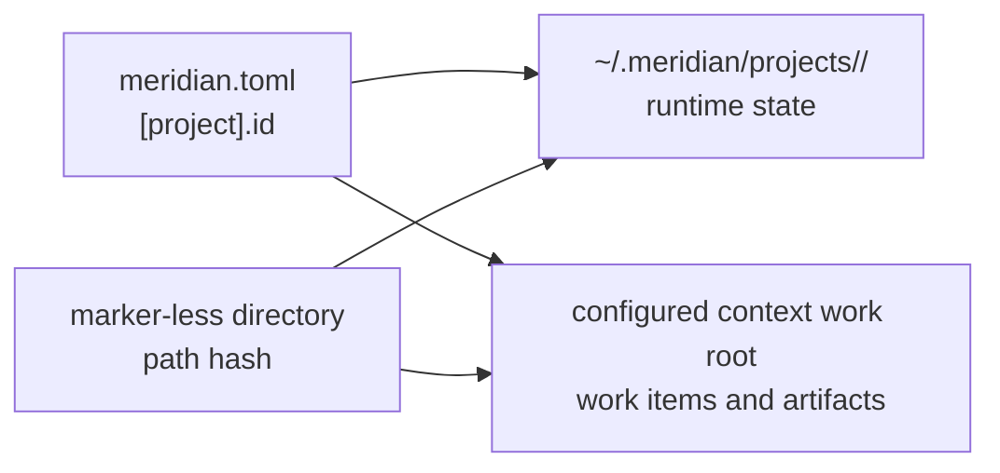

# State Model

Meridian separates identity from runtime state. Identity comes in two tiers,
decided only by what the literal project root contains
([D-two-tier-identity](../decisions/state.md#d-two-tier-identity)):

- A **committed project** holds `meridian.toml` or `mars.toml`. Its identity is
  `[project].id` in `meridian.toml`, a generated three-word id minted on the
  first write.
- An **ad-hoc place** holds neither, or is the user Mars root
  `~/.meridian/mars/` (whose `mars.toml` belongs to user packages). Its identity is `adhoc.<slug>.<hash12>`,
  derived from the canonical path, and nothing is ever written into the
  directory.

Either id selects a user-local runtime directory. Work items use the configured
context work root because they are shared task artifacts, not repo state.

## Three Roots, Three Responsibilities

- **Project config:** `meridian.toml` is committed and is the authoritative home
  of committed identity. Committing it is how clones and worktrees share state.
- **Runtime root:** `~/.meridian/projects/<id>/` is never committed. It contains
  spawn state and artifacts, session events, locks, and runtime caches. An
  ad-hoc root also holds `origin.json` naming its path, and
  `meridian doctor --global --prune` reclaims it after 30 idle days.
- **Work root:** `[context.work]` resolves the mutable work-item store. A work
  item can therefore be shared or archived independently of the repository.

No active state, lock, cache, generated `.gitignore`, or fallback context
folder belongs under repo-local `.meridian/`, and `.meridian/id` is not read.

Committed identity lets a repository move without losing its runtime history;
ad-hoc identity does not survive a move, and retention reclaims the orphan.
Cloned repositories share an identity only when their committed
`meridian.toml` does. Ad-hoc state never merges into a committed project:
`meridian init` starts the project with empty history.

## Storage Patterns

Different state shapes have different update patterns. “Files as authority”
does not mean every domain uses one file format.

### Per-Spawn State Files

`spawns/<id>/state.json` is the authoritative mutable row for one spawn. Every
published-row mutation acquires its stable per-spawn lock, re-reads the row,
applies a pure mutation, and atomically replaces the file. Artifacts under the
same spawn directory live only while that row remains published.

The former global `spawns.jsonl` is legacy input for a one-shot migration, not
the current store.

### JSONL Event Stores

Sessions and append-only journals use JSONL. Writers serialize append and
repair torn tails; readers tolerate an incomplete final record. JSONL is used
where ordered history is the contract, not as a universal state model.

### Mutable Work-Item JSON

Each work item has `__status.json` under the context work root. The repository
store owns locking, mutation, rename intent, and archive transitions.

### Artifact Directories

Prompt, transcript, report, `launch.lock`, and diagnostic files live beneath a
spawn directory. They supplement `state.json`; none is an independent spawn
lifecycle authority.

## Crash and Concurrency Model

State writes use one of three publication mechanisms: atomic file replacement,
durable JSONL append, or atomic directory publication. Locks live at stable
paths outside deletable data and are removed only through validated exclusive
GC. A store mutation means acquire, re-read, mutate, and publish—not “read now,
lock later.”

Ordinary list/show/wait reads derive a dead runner's active row as terminal
(`crashed`) from its free `launch.lock`, without changing disk. Explicit repair
(`doctor --kill-orphans`, primary-launch background repair, cancel) performs
durable finalization and process cleanup under that lock. This keeps observation from becoming an
unexpected destructive action.

The exact lock order, state machine, migration codec, layouts, and repair paths
are canonical in [Architecture: State System](../architecture/state-system/overview.md).
The rationale and superseded alternatives are in [State Decisions](../decisions/state.md).

## Root Resolution

The user root is resolved by `get_user_home()` and may be overridden by
`MERIDIAN_HOME`. The normal runtime root is `<user-root>/projects/<project-id>`;
`MERIDIAN_RUNTIME_DIR` can override it for isolated execution and tests.

The project root is the explicit `-C` directory, then `MERIDIAN_PROJECT_DIR`,
then the literal CWD. There is no ancestor walk, and `.mars/`, `.git`, or
`.agents/` alone do not make a directory committed. Package content does walk
up to the nearest `mars.toml`, so a repository subdirectory uses the
repository's agents while keeping its own ad-hoc state
([Mars user scope](../architecture/mars-user-scope.md)). Reads never mint an
id or materialize an ad-hoc root; the mechanism is in
[project identity](../architecture/state-system/project-identity.md).

## Related Pages

- [Project identity](../architecture/state-system/project-identity.md) — tiers, ad-hoc keys, retention
- [Architecture: State System](../architecture/state-system/overview.md) — current paths,
  stores, locks, reconciliation, and migrations
- [State Decisions](../decisions/state.md) — identity, store, and concurrency
  rationale
- [State Design Lessons](../lessons/state-design-lessons.md) — historical
  mistakes and transferable lessons
- [Spawn Lifecycle](spawn-lifecycle.md) — lifecycle states and terminal behavior
