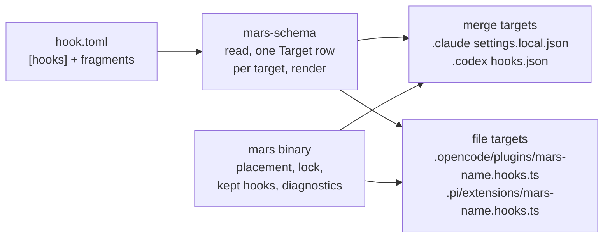

# Decisions: Mars Portable Hooks

> **Status:** On mars-agents `release/v0.25.0` (PR #296, with the
> legacy-ownership removal in #282); ships in Mars 0.25.0 through release PR
> #281 once the owner approves it. Importers and Cursor rendering are planned
> for 0.26 and not built. The mechanism and the per-harness tables are in
> mars-agents `docs/config/mcp-and-hooks.md` ("Declaring Hooks in a Package")
> and `crates/mars-schema/AGENTS.md` (the `hooks` row). This page records why
> the feature is shaped this way, what was rejected, and the harness behaviour
> behind it.

A package's `hooks/<name>/hook.toml` may declare a `[hooks]` table: Claude
Code's hooks JSON, written in TOML. Mars renders it for every managed target
(Claude, Codex, OpenCode, Pi) and reports each event or answer a target can't
carry. Native per-target files (fragments: `claude.json`, `codex.json`,
`opencode.ts`, `pi.ts`) still work beside it or alone.

---

## D-hooks-join-the-pipeline: hooks import and render like agents and skills

**Decision (owner).** Hooks get one model in Mars's form, a renderer for each
target and (planned for 0.26, not built) importers from each harness dialect:
the same pipeline agents and skills use. Any Claude event may be declared; the per-target table decides
where it renders, and every skip is reported. There is no list of "portable
events" for authors to learn.

The owner: "mars is supposed to be able to import a github repo from
anything, and then convert it to 'mars' to then be able to converted back to
everything again (the import part is mostly for wasm for meridian-flow my new
service)". Asked whether to ship only the before-tool guard: "the entire
portable stuff".

**Rejected.** A guard-only `[guard]` table (one pre-tool veto). It fixed the
immediate problem, meridian-base's `protect-tmux-server` needing four
hand-written adapters, but left hooks outside the pipeline and would have
needed a second schema for every later kind of hook.

## D-claude-is-the-syntax: Claude's names, fields and script contract

**Decision (owner, details the design lead's).** `[[hooks.<Event>]]` matcher
groups hold `[[hooks.<Event>.hooks]]` handlers, with Claude's event and field
names spelled exactly, camelCase included (`onFailure`, `statusMessage`). A
script reads Claude's hook input on stdin and answers with exit 2 or Claude's
JSON, limited to the answers every target shares for that event (the table
is "What a script may answer" in mars-agents `docs/config/mcp-and-hooks.md`).
`if` and `onFailure` keep Claude's meaning and defaults: a failing script lets
the action run unless `onFailure = "block"`, which Claude 2.1.295+ and the
generated OpenCode and Pi glue honour and Codex ignores.

The owner: "make our syntax as close as possible to claude i think (for most
stuf...?) although i guess we are using toml... at least be able to read
claude hooks and spit out mars stuff".

**Why.** The script's stdin and stdout are runtime data, not config, so Mars
can't convert them at sync time. Claude, Codex and Cursor already pass the
script Claude-shaped input and read Claude-shaped answers, and they run the
command directly, with no Mars code in between. A Mars-defined neutral JSON
would need a translator process wrapped around every command on those
harnesses, and none of python3, node or `mars` is guaranteed to be installed.
OpenCode and Pi run Mars-generated TypeScript, which translates in place. Copying Claude's names keeps import and export a
transcription. The answer limit exists because Codex parses every answer
strictly (see the harness facts below).

**Accepted costs.** `hook.toml` mixes Mars's kebab-case top-level keys
(`visibility`, `skip-targets`) with Claude's camelCase inside `[hooks]`. Codex
cannot fail closed: it has no `onFailure`, and a script that crashes, prints
invalid JSON or times out lets the action run. Authors who need fail-closed on
Codex handle failure inside the script.

**Rejected.**
- Mars-own snake_case fields (`on_error`, `command_contains`): consistent with
  `mars.toml`, but they turn import and export into translation.
- A fail-closed default: following Claude won over "a guard that fails open is
  silently off".
- A generated shell wrapper around every command. It existed to provide
  `command_contains`, `on_error` and Cursor's allow body; Claude's fields
  replaced the first two, and Cursor treats exit 0 with empty stdout as "no
  decision".

## D-rules-in-mars-schema: every hook rule lives in `mars-schema`, one row per target

**Decision (design and tech lead).** The pure, WASM-safe `mars-schema` crate
owns the `hook.toml` reader and writer, validation, and a renderer for every
target, including the generated OpenCode and Pi TypeScript. Each target is one
`Target` row (`hooks/targets.rs`) holding its placement (merge into a JSON
file, or write files into a directory), its events with the matcher field
each tests, its answer translation and the harness version last verified. The
binary keeps placement on disk, lock ownership, kept hooks and sync
diagnostics. The reader takes text and returns path-free diagnostics; the
binary adds the location once. Keep it this way: a hook rule added in the
binary is invisible to WASM consumers and to the importers.

**Why.** Two consumers need the rules without the binary. Meridian Flow runs
`mars-schema` as WASM and can preview every target's output (the
`renderHooks` export). The planned 0.26 importers are the reverse of the
same table, so the plan is to add the dialect to the `Target` row (no such
field exists yet) rather than build a second table. One row per target also
means a new harness version or a new target changes one place; when the facts
were spread over four (the schema table, a string dispatch in the TypeScript
renderer that fell back to Pi, an OpenCode check in the binary, the binary's
own file table), they drifted apart.

**Rejected.** Hook parsing in the binary (`src/compiler/hooks/`), which left
WASM unable to read hooks; and MCP's split, where the canonical form is
Mars-own TOML and the Codex and OpenCode renderers live in the binary.
Rendering is pure text generation, so it belongs in the crate.

## D-render-what-the-target-parses: never write a handler a target rejects

**Decision (design lead, from review).** Each renderer checks its output
against what the target's parser accepts. For Codex: `type` only `command` or
`mcp_tool` (no `mcp_tool` on `SessionEnd`), `timeout` as whole seconds rounded
up, no `null`s. Everything dropped is reported.
`crates/mars-schema/tests/codex_hooks_mirror.rs` deserializes rendered Codex
documents against copies of Codex 0.164.0's config structs, so the renderer
and the mirror can't disagree; the mirror itself is updated by hand when Codex
changes, which is what `scripts/hook-smoke` (manual, live) is for. The Claude
plugin tree is read by Claude, Codex and Grok, so its `hooks/hooks.json` keeps
Claude's event set (Codex ignores events it doesn't know inside `"hooks"`) but
drops the handlers Codex can't parse.

**Why.** On Codex one handler it can't parse discards the whole
`.codex/hooks.json`, so every hook in it stops running, the user's own
included. Passing Claude's JSON through unchanged (the first design) would
have let one `http` handler in a dependency disable the project's guards.

## D-validation-by-origin: a dependency's broken hook keeps its last good install

**Decision (design lead, from two review rounds; as built).**
- The project's own hooks are strict: an unknown key, unknown event or invalid
  table fails the sync, because the user can fix it.
- A dependency's hooks never fail the sync. An unknown top-level key is
  ignored with a warning; an unknown event is skipped with a warning while the
  hook's other events render. Any other failure, including one bad handler
  `timeout` or `onFailure`, keeps the whole hook exactly as the previous sync
  installed it, on every target and in its position in each event array, and
  warns `hook-invalid-kept` naming the package and version. A broken hook
  that was never installed installs nothing, with the same warning.
- Unknown fields inside handlers and matcher groups always pass through.

**Why.** Staying strict everywhere means every field or Claude event a later
release adds breaks older Mars syncs again; `requires-mars` only advises
authors. Skipping a bad hook (the first fix) drops its lock records, so
structural removal uninstalls it, and a guard removed that way fails open.
Dropping only the bad handler (tried in a review fix) removes a guard the same
way. Keeping it in position matters because Codex keys hook trust on array
position: a kept entry that moved to the end of its event made both guards
need re-trust.

**Known limit.** The lock records no hook source directory, so a kept hook is
found by the `name` the broken file still declares, read leniently. A renamed
hook whose `name` line is itself unreadable is missed; mars-agents #289 tracks
recording the directory.

**Rejected.** Lenient validation for the project's own hooks: a typo such as
`visiblity` would silently remove the project's guard.

## D-fragments-override-per-event: one writer per event on merge targets

**Decision (design lead, from review).** On merge targets a native fragment
replaces this hook's generated entries only for the events it declares; an
empty array turns that event off for this hook alone. On file targets the fragment installs beside the
generated file. `skip-targets` drops the generated hook from a target
entirely; with a fragment, that is the escape hatch when a harness API changes
before Mars does. When `[hooks]` is present every target table
(`[targets.".codex"]`) must name its `fragment = "codex.json"`, so a leftover
`<target>.json` is never picked up silently; examples are under "Native
fragments" in the mars-agents doc.

**Why.** The first version let a fragment replace every generated entry of the
hook on its target. A Codex import (portable `PreToolUse` plus a Codex-only
`PreModelRequest` fragment) would then have lost its own guard on Codex.
Merging fragment and generated entries for the same event would give one lock
key two writers.

## D-two-releases: export in 0.25, import and Cursor in 0.26

**Decision (design lead).** 0.25 ships the model, rendering to Claude, Codex,
OpenCode and Pi, the sync reports and the WASM render export. 0.26 adds the
importers, the WASM import exports and Cursor rendering (exit-code answers
only, unverified: Cursor can't be run here and `.cursor` is unmaintained). The
0.25 model is already the import target, and 0.26 adds no field to it.
Claude agent and skill frontmatter hooks stay out of the model: Claude runs
them only while that agent or skill is active, and no other harness has scoped
hooks.

The 0.25 legacy-ownership removal (mars-agents `src/target/.context/TODO`'s
"Remove in 0.25" list) ships in the same release as its own PR, merged into
the release branch first so the hooks code builds on the smaller removal
paths. The owner: "I think u should also ship the mars stuff to remove as
well". How the parts collect on `release/v0.25.0` is
[D-integration-branch](release-process.md#d-integration-branch-every-minor-or-major-release-collects-on-releasevxy0).

**After 0.25 ships (planned, not done).** meridian-base moves
`protect-tmux-server` to one `[[hooks.PreToolUse]]`, deletes its four
adapters, switches `run.py` to exit 2 with the reason on stderr and requires
`mars >= 0.25.0`; Codex users re-trust once. `context-autosync` becomes
`SubagentStop` + `SessionEnd`. `deny-interactive-prompts` stays a Codex-only
fragment: its rules were written for Codex hanging on prompts, and making it
portable is a behaviour change the owner hasn't asked for.

---

## Harness facts behind the design

Seen live on 2026-10-28/29 with Claude Code 2.1.312, Codex 0.164.0, OpenCode
2.2.0 and Pi 1.4.0, unless marked. These are observations of those versions;
recheck them before relying on them for another version. mars-agents
`docs/config/mcp-and-hooks.md` carries the user-facing ones; this list adds
the reasons the rules above exist.

**Codex**
- Runs a project's `.codex/hooks.json` only in a trusted project. For a
  scripted run, trust it with the inline-table override
  `-c 'projects={"/path"={trust_level="trusted"}}'`. The dotted form
  `-c 'projects."/path".trust_level=…'` trusts nothing: Codex splits the key
  at every `.`, including those inside the quoted path.
  `--dangerously-bypass-hook-trust` skips only the per-handler review that
  runs after Codex has found the hooks.
- Keys each handler's trust on file, event and array position. Mars rewrites
  by removing every recorded entry and appending again, so a new hook sorting
  ahead of an existing one moves a user's entry too; sync reports it as
  `codex-hooks-need-trust`.
- One handler it can't parse (an `http` type, a float `timeout`, a `null`)
  drops the whole file. It parses `prompt` and `agent` handlers but never runs
  them. Unknown handler fields and Claude-only events inside `"hooks"` are
  ignored; an event at the file root rejects the file.
- Parses every answer with unknown fields denied: one Claude-only field
  (`sessionTitle`, `additionalContext` on `Stop`) drops the whole answer and
  runs the action.
- `SessionEnd` fires on 0.164.0 (not on 0.144.4). `apply_patch` arrives as
  `Edit`/`Write` with the patch text in `tool_input.command`, no `file_path`.

**Claude Code**
- 2.1.312 ignores an unknown event and tolerates an unknown handler field,
  with no warning; that is why `unchecked = true` can pass unknown events to
  Claude alone.
- Before 2.1.295, `onFailure` is ignored and a guard fails open (third-party
  test on 2.1.287 and 2.1.294, not run here).

**OpenCode**
- `PermissionRequest` (`permission.hook("evaluate")`) runs only when the
  effect is `ask`; under `--auto` or an `allow` rule the hook never fires.
- The `patch` tool is an edit: it arrives like Codex's `apply_patch`, so an
  `Edit|Write` guard must parse the patch text or it is bypassed.
- A failing shell command reports as completed with `exit: 1`, so
  `PostToolUseFailure` is approximate there. There is no per-session start
  hook, so `SessionStart` is skipped. The compaction callback doesn't say why
  it ran, so a `PreCompact` group with a matcher is skipped.

**Pi**
- Emits `session_start` twice when a session is replaced; the generated glue
  runs the script once per session id. Its `new` reason (`/new` replaces the
  conversation) reaches the script as Claude's `source: "clear"`.
- `session_compact` fires after a successful compaction;
  `session_before_compact` returning `{cancel: true}` cancels it.

## Hazard for agents testing the tmux guard

meridian-base's `protect-tmux-server`, the hook this feature was built to
carry, is a `PreToolUse` guard on shell commands that refuses a
`tmux kill-session` (and similar) aimed at the default server. It matches the
command text, so it also refuses a heredoc or `echo` that only quotes such a
command, for example while writing a test, a doc or a commit message about the
guard. Write that text with a file-writing tool, not through the shell.

## Follow-ups

mars-agents issues: #289 (record a hook's source directory in the lock), #290
(OpenCode plugin tree drops generated hooks), #291 (sync summary should list
rewritten generated files), #292 (`plugin_output` special-cases `.claude` by
name), #293 (`src/sync/mod.rs` over the 1,000-line limit), #294 (verify the
generated TypeScript on Windows), #295 (per-event default timeouts on OpenCode
and Pi; today every event defaults to 600 s).

## Related

- [package-management.md](package-management.md): earlier Mars hook decisions
  (D98 hook selection in the target build, D103 hook order by dependency
  depth, D104 the shared hook and MCP directory install path)
- [hook-event-contract.md](hook-event-contract.md): Meridian's own lifecycle
  hooks, a separate system from harness hooks
- [release-process.md](release-process.md): the integration branch 0.25
  collected on

Provenance: `work:mars-portable-guards` (decisions D1–D25, divergences
001–007, final review), `chat:c9752`, `chat:c9802`; mars-agents PRs #282,
#296, #281.
