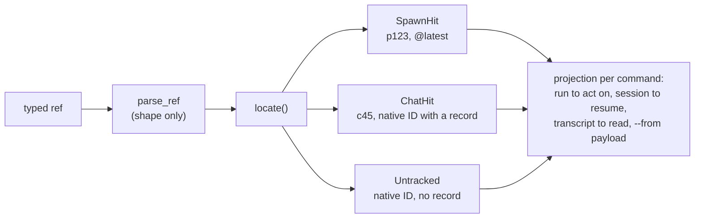

# Decisions: Classifying and Locating References

Every command that takes a spawn, chat or session reference classifies it in
one parser, by its shape alone, and finds what it names in one step. Each
command then takes only the part of the answer it needs. This page records why
the model is shaped that way and what it replaced. `-f` file references are a
different subject: [reference resolution](../concepts/reference-resolution.md).

**Status:** current choices by the tech lead, except where a decision quotes the
owner. Built on meridian-cli branch `refactor/ref-resolution` (#800), reviewed;
not merged as of 2026-10-28. The mechanism is in meridian-cli
`src/meridian/lib/ops/.context/CONTEXT.md` ("Session Reference Resolution") and
`src/meridian/lib/state/.context/CONTEXT.md`; what changed for users is in
`docs/upgrading.md` ("Chat and session references").

---

## D-ref-by-shape: a reference's kind is decided by its shape (2026-10) {#d-ref-by-shape}

### Problem

Before #800, about ten places decided what a reference was: a chat-ID regex,
two copies of a spawn-ID regex, and inline `startswith("c") and [1:].isdigit()`
tests. They disagreed at the edges. "Is this a tracked chat?" fell back to
checking whether a record existed, so a misspelled chat ID could pass as a raw
session ID: `meridian --continue c99999` resumed an untracked harness session
literally named `c99999`, and `spawn children <uuid>` printed "(no children)"
for a session that didn't exist. The spawn commands' resolver returned the raw
string on a miss, and the transcript reader raised `ValueError` for some misses
and `FileNotFoundError` for others. Two lookups from a raw harness ID to its
chat picked different generations when the ID was recorded under more than one
chat (one took the lowest chat, the other the highest).

### Decision

1. **Four kinds, decided by shape alone** (`lib/core/refs.py` `parse_ref`, no
   I/O):

   | Kind | Shape |
   |---|---|
   | spawn | `p` + ASCII digits |
   | chat | `c` + ASCII digits |
   | selector | `@latest`, `@last-failed`, `@last-completed`; any other `@…` is an error |
   | native | anything else non-empty |

   The shape is the whole test for a chat ID because `reserve_chat_id` is the
   only thing that mints one, and `start_session` now rejects a caller-supplied
   chat ID of any other shape.
2. **A miss is one error.** A spawn, chat or selector reference that names
   nothing raises `RefNotFound`, in every command. Only a native ID with no
   record is "untracked", and only where acting on a session Meridian never
   saw is a feature: primary `--continue` and `--fork`, `spawn --fork`, and the
   session read commands. `spawn --continue` refuses it, because it needs the
   spawn's retained metadata, and the spawn commands (`show`, `cancel` and the
   rest) report it not found: there is no spawn to act on.
3. **One native lookup.** `session_store.native_generations` finds a raw
   harness ID on any generation and picks the newest generation that has a
   native session key, else the newest. Resume and read share it. An ID
   recorded under two harnesses or two native stores is refused as ambiguous;
   the user passes the chat ID instead.
4. **Raw harness IDs work on spawn commands without being advertised.** The
   owner asked "can it take a raw session?" and "should some of the spawn ref
   resolvers use the 2nd one; and just hide that it can take a raw session
   id?". The spawn commands' help names spawn and chat IDs only. A chat ID is
   the address agents should use: it is in `$MERIDIAN_CHAT_ID`, unique within
   a project, and the same whichever harness runs it, while a raw ID can exist
   under two harnesses and the spawn commands have no `--harness` flag to pick
   one. `--continue` and `--fork` keep documenting raw IDs, since resuming a
   session Meridian never tracked is a real use there.

---

## D-locate-projections: one locate step, one projection per command group (2026-10) {#d-locate-projections}

### Decision

`ops/locate.py` `locate()` is the only code that branches on a reference's
kind. It returns a `SpawnHit` (spawn ref or selector), a `ChatHit` (chat ref, or
native ID with a record), or `Untracked`. Commands project from that result and
never look at the string's shape again:

| Command group | Spawn ref | Chat or native ref |
|---|---|---|
| Inspect and act: `spawn show`, `status`, `children`, `wait`, `cancel`, `done`, `rearm`, `report`, `message` | that spawn | the run live in the chat now, else the chat's owner |
| Resume: `--continue`, `--fork` | the spawn's current chat (`continue_chat_id`) | that chat |
| Read: `session log`, `export`, `search` | as resume, plus read-only fallbacks | as resume, plus read-only fallbacks |
| `--from` | the spawn's report and its current chat | that chat's own transcript |

The rules behind the table:

1. **A spawn ID never goes through a chat.** `p100` names p100 even when a
   later run took over p100's chat, so `spawn show p100` shows p100, an older
   generation. Only chat IDs and raw harness IDs go through a chat. The first
   design for #800 routed every reference through its chat first and would have
   made `spawn show p100` return the newer run; a review of the plan against
   the code caught it.
2. **Every spawn command on a chat ref follows the run live in that chat.** A
   running process can move into a chat another run started, through the
   harness's native `/resume`. `spawn message` already sent to that occupant;
   now `show`, `cancel` and the rest name it too, and fall back to the chat's
   owner ([D-chat-names-own-session](chat-spawn-ownership.md#d-chat-names-own-session))
   when no run is live in the chat. Asked how `show` and `cancel` should behave
   after a takeover, the owner first picked "Follow the takeover". When the
   mechanism for that (below) was ruled out, they said: "idk man... tbh, maybe
   we should tell people not to use native resume and use meridian sesssion
   browse... or else meridian might break...", then "but still i guess do our
   best to support /resum e". So following a takeover is best effort with no
   new state, and the docs steer users to `meridian --continue` and
   `meridian session browse`.
3. **The occupant query is the one history-index read on this path.** It
   reads the index's running spawns, rather than every spawn's state file, and
   checks each candidate whose current chat matches against its live session
   lease and process scope before naming it. When the index can't answer (it
   raises `HistoryIndexIncomplete` or a coordination error) the command names
   the owner instead of failing. So the index only nominates: a candidate that
   isn't live is skipped, and a missing one degrades the answer to the owner,
   which comes from the session journal, the authoritative file.
4. **Reading keeps fallbacks that resuming refuses.** The read commands still
   find reclaimed spawns and archive aliases through the history index,
   portable history UUIDs, and restored historical records. Reading an old
   transcript is harmless; resuming the wrong session is not.
5. **`--from cN` names cN's own transcript**, following the owner's rule that
   a chat ID names that chat's own session; `--from pN` takes the spawn's
   current chat. After `/clear` a conversation is in a new chat, so its entry
   chat ID would hand off the transcript from before the `/clear`. Handoff
   therefore passes the run's spawn ID, which `meridian task-dir --json` prints
   as `spawn_id`. The capabilities block points at that command instead of
   printing the ID: the block is fixed at launch and shared across
   `--continue`, so a printed ID would name the previous run.
6. **A message's reply address is the sender's current chat**
   (`continue_chat_id`), so a reply still reaches a primary after its `/clear`
   ([D-spawn-message-frame](primary-inject.md#d-spawn-message-frame)).

Rules 5 and 6 and the sum-type result are the tech lead's calls, without an
owner ruling.

### Residuals

- Until a continuing run's session starts, `spawn show`, `wait`, `cancel` and
  `message` by chat ID name the previous run
  ([D-owner-on-start](chat-spawn-ownership.md#d-owner-on-start)).
- A fresh child spawn that fails before its session starts carries its
  caller's chat as a placeholder, so `--continue pN` or `session log pN` on it
  opens the caller's conversation. This is a known bug, open as meridian-cli
  #810.

### Rejected

| Alternative | Why rejected |
|---|---|
| Spawn commands resolve through `resolve_session_reference`, the resume resolver | It returns resume metadata rather than a spawn, resumes an unknown ref as untracked (so `cancel <typo>` would succeed on nothing), and runs recovery and the historical-session refusal, none of which `show` needs |
| Route every ref through its chat, spawn IDs included | Names the wrong spawn once a later run took over the chat (rule 1) |
| A separate resolver per question (inspect, message, resume) | One dispatch on ref kind per resolver; one `locate()` with projections has one dispatch site in total |
| On `/resume`, write a new session generation linked to the adopting run, so the existing "newest linked generation" rule names it | Projects the first run's open generation as stopped while that run still holds the chat lock; breaks hiding archived primaries, which keys on the newest generation's `history_id`; points forks at a history no spawn owns |
| Resolve lookups through the history index | Measured on a 66 MB, 49k-line `sessions.jsonl`: one filtered pass is 142 ms (about 15% of a 1 s `spawn show cN`), index catch-up plus an alias query 6 ms warm. Rejected anyway: every index query takes the runtime-wide catch-up lock exclusively and writes, can raise `HistoryIndexBusy`, rebuilds cold in up to 15 s, and its chat aliases are ambiguous across generations. The owner had asked "do we have an sqlite index of all of this for quick lookup?" and agreed to decide by measurement |
| Split `cli/spawn.py` in the same change | The deprecation shims and help text are about 120 of its 1,573 lines; the bulk is `_spawn_create` (508 lines), its own refactor (meridian-cli #803) |

**Revisit when:** a harness exposes a native `/resume` event Meridian can
observe, chats gain a first-class owner field, or the spawn-identity redesign's
"continue keeps the spawn ID"
([D-spawn-identity-v2](spawn-identity.md#d-spawn-identity-v2), PR 7) lands and a
spawn ID can again span chats.

**Provenance:** `work:ref-resolution`, `chat:c9695` (owner answers, lead
decisions), issue #800 and its design and correction comments; classifier map
`spawn:p10010`; before-state and timings `spawn:p10011`; plan structure review
`spawn:p10013`; reviews `spawn:p10031`, `spawn:p10032`, `spawn:p10034`,
`spawn:p10048`, `spawn:p10052`; probes `spawn:p10033`, `spawn:p10049`,
`spawn:p10053`.

## Related

- [Chat→spawn ownership](chat-spawn-ownership.md): which spawn owns a chat, and
  who writes that link.
- [Session reference resolution](session-reference-resolution.md): recovering a
  located spawn's or chat's harness session ID.
