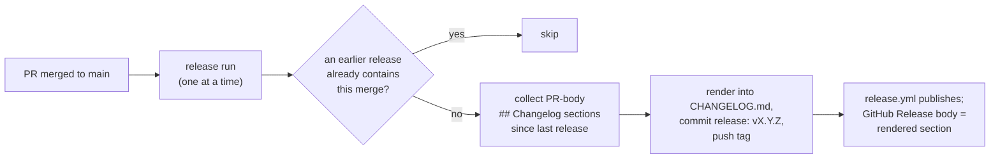

# Decisions: Release Process (meridian-cli and mars-agents)

> **Status:** Shipped in both repos: meridian-cli since v0.15.0 (PR #782),
> mars-agents since v0.20.7 (PR #241). The mechanism and the recovery steps live
> in each repo: meridian-cli `docs/releasing.md` ("What CI does"), mars-agents
> `.github/workflows/README.md` and its `AGENTS.md` release section. This page
> records why the process is shaped this way and which parts are the owner's
> choices.

meridian-cli and mars-agents release the same way. Every merge of a PR to `main`
starts a release run; the PR's `release:*` label picks the kind of release; the
run collects each merged PR's `## Changelog` body section, renders the sections
into `CHANGELOG.md`, commits `release: vX.Y.Z`, and tags it. The tag push starts
the publish workflow, whose GitHub Release body is that same rendered section.

The two repos run separate copies of the scripts (`scripts/changelog-notes.py`,
`scripts/collect-release-notes.sh`, the release workflow), not a shared
package, and the copies already differ: mars's renderer has a `Breaking`
section that meridian-cli's lacks. A fix to one copy needs checking against the
other.

---

## D-changelog-one-writer: the release job is the only writer of `CHANGELOG.md`

**Decision.** No PR edits `CHANGELOG.md`. A PR's entry goes in its body's
`## Changelog` section; the release job renders the sections of every PR merged
since the last `release: v` commit under the new version heading.
`## [Unreleased]` stays an empty anchor. A PR-body check fails a PR whose body
lacks a valid section, or whose branch adds content under `[Unreleased]` or adds
a release heading.

**Why.** While every branch wrote under the shared `## [Unreleased]` and the
release job inserted the version heading at that same anchor, two failures
followed from one mutable section:

- **Misfiled entries.** A branch that merged `main` back in, or rebased across a
  `release:` commit, had its bullets land under the version `main` had just
  released. In mars-agents a stacked branch (#238) merged `main` after the 0.20.4
  release; its two `### Fixed` entries appended to the block 0.20.4 had left
  under its own heading, so they sat under `[0.20.4]` and 0.20.5 shipped with an
  empty section. meridian-cli hit the same misfile four times on 2026-10-16
  alone.
- **Conflicts.** Parallel branches added bullets to the same region of the file
  (mars-agents #233 and #238), and one had to merge `main` back in to resolve
  it, which is how the misfile above happened.

With one writer, nothing a branch does can move another release's entries, and
contributors write the entry where they already describe the change.

**Rejected.** meridian-cli first added a check that refused misfiled bullets
(#653, in the pre-push hook and CI), with an override label for legitimate edits
to released sections. It stopped a misfile from merging but left the shared
section, the cause, in place, so branches still conflicted and still needed
fixing by hand. The check was removed when the release job took over the file.

**What it costs.** Notes now depend on PR bodies: a merged PR whose section is
missing or malformed fails the release before anything is written, and the fix
is to edit that merged PR's body and re-run the job. A direct push to `main`
releases nothing and contributes no notes.

## D-release-guard: a release run skips when an earlier release already contains its merge

**Decision.** Before releasing, the run checks whether a release commit later on
`main`'s first-parent chain already contains the triggering merge (the merge
commit is an ancestor of that release commit). If that release's kind covers the
request, the run skips. A stable release covers a release-candidate (RC)
request; an RC does not cover a stable request, so promoting an RC to stable
still runs.

**Why.** Release runs wait in line (`concurrency: release-on-main`,
`cancel-in-progress: false`), but merges do not. When a second PR merges while
the first PR's release is running, the first run's checkout of `main` already
contains the second merge, so it renders both PRs' notes but records only its
own trigger in its `Release-Trigger:` trailer. Without the guard, the second run
finds no trailer naming its merge and cuts another release that repeats the
second PR's notes.

meridian-cli has had the check since #782 (it looks at the newest release
commit). The mars-agents port (#241) first copied the scripts without that
workflow block; the port's review caught the gap, and mars now scans every later
release commit.

**Rejected: a merge queue.** A GitHub merge queue would also prevent the race by
holding each merge until the previous one's checks finish, at the cost of
repository rules and slower merges for a repo with a single merger. The owner
chose the guard ("ok, guard fix").

## D-unlabeled-is-rc: a merged PR with no `release:*` label cuts a release candidate

**Decision.** A PR merged without a `release:*` label releases an RC
(`vX.Y.Z-rc.N`). An unknown `release:*` label, or conflicting labels, also
resolve to RC. `release:skip` releases nothing (its notes wait for the next
release); a direct push to `main` releases nothing.

**Why.** Forgetting the label is the likely mistake, and the safe outcome of a
mistake is a prerelease, not a stable version users upgrade to. Both repos'
`AGENTS.md` still say to set a label before every merge.

## D-advisory-checks: no merge queue and no required checks

**Decision (current choice, owner).** Neither repo has a merge queue or required
status checks. mars-agents `main` has no rules; meridian-cli's only ruleset
(`protect-main`) blocks deleting and force-pushing `main`. A failing PR check,
including the PR-body check and the test suites, shows red and leaves the merge
button working.

**Why.** The owner merges every PR himself and reads the checks. When the agent
that ported the process proposed making the PR-body check required, he answered
"ca't it just be a pr lint check...?": a visible red check is enough. The release
job is the backstop for notes: it validates every collected section before it
writes anything, so a bad body that merged fails the release with the PR named,
and nothing half-written reaches `CHANGELOG.md` or a package.

**What not to do.** Don't propose branch protection or a merge queue as a fix for
an unenforced check; treat the missing enforcement as chosen. Docs that call a
check "advisory until it is required" describe a step nobody plans to take.

## D-minor-means-breaking: `release:minor` only for a change that breaks something

**Decision.** `release:patch` (or `release:stable`) is the label for features
and fixes that break nothing; `release:minor` and `release:major` are for
changes that break existing behaviour, config or on-disk state. The rule and
what counts as breaking are in meridian-cli `docs/releasing.md` and
[compatibility-versioning.md](compatibility-versioning.md); mars-agents uses
the same labels.

**Why it is recorded here.** Agents reached for `release:minor` when a change
felt big rather than when it broke something. The owner asked "why is 796
minor...?" and "why is 254 minor?". meridian-cli #796 removed expired
deprecations, so config that used to load now fails: breaking, so it stayed
minor. mars-agents #254 only let the user `config.toml` accept more keys:
nothing that worked stopped working, so it was relabelled patch. mars-agents
#249 (OpenCode plugin agents, a pure addition) had already merged as
`release:minor` and shipped as Mars 0.23.0 instead of a patch; it was left as
released.

## D-integration-branch: every minor or major release collects on `release/v<X>.<Y>.0`

**Decision.** Breaking work never merges to `main` piece by piece. Every minor
or major release is assembled on an integration branch `release/v<X>.<Y>.0`
cut from `main`, even when it starts as one PR, and one PR from that branch to
`main` carries the `release:minor`/`release:major` label, the combined
changelog and the upgrade notes. Any other minor or major change made before
it ships joins the same branch; patch-level changes still merge to `main` on
their own. The agent leading the release merges its reviewed part PRs into the
branch without asking; the merge to `main` needs the owner's approval. Only
docs-only changes and tiny, obvious bug fixes go straight to `main` without it. The steps are in meridian-cli
`docs/releasing.md` ("Minor and major releases collect on a release branch").

The owner, 2026-10-28, planning Mars 0.25: "if you make a minor... (or
major), always use a release/0.X for those breakings changes to collect", and
"u have permission to just directly merge ur PRs into the minor release";
"other minor or major changes" join it; "I never said u could merge into
main"; and "docs only should push to main and are allowed, also tiny obvious
bugs can be merged to main directly".

**Why.** Each labelled merge to `main` cuts its own release, so two breaking
PRs merged separately give users two breaking releases to upgrade through.
The owner, on #796: "this should be included in the \"next minor release\" -
so create releases/X". meridian-cli 0.17.0 was the first:
`release/v0.17.0` collected #796, #790, #804, #805 and #806, and #798
released them once. Part PRs merged into the branch never render notes on
their own (only `main`'s first-parent commits reach the renderer), so their
`## Changelog` sections are copied into the integration PR by hand.

**Related CI change.** The PR-body check compares a PR's `CHANGELOG.md`
against the tip of its base branch (`origin/<base ref>`), not
`pull_request.base.sha`, which GitHub doesn't refresh when the base moves and
only the body is edited (meridian-cli #806, mars-agents #276). With the stale
SHA, a release section `main` gained later (`## [0.16.4]`) is in the PR's
merge commit but not in the old base copy, so the check blamed #798 for
adding it.

## D-release-parity: a release branch is compared against main before it merges

**Decision.** Before an integration branch's PR merges to `main`, compare the
release head with `main` three ways. Fix every regression, or name it in the
release PR's changelog and upgrade notes:

- **Benchmark on a copy of a real runtime.** Run the same commands on both
  builds against a copy of a real `.meridian` runtime, in paired, alternating
  runs, and report the median and range of the paired difference. Add a
  synthetic copy scaled well past the real one (12,000 spawns for v0.18.0) to
  find limits a real runtime hasn't reached yet.
- **Run the same workflows on both builds.** Script the user workflows the
  release touches, run them on each build in isolated runtimes, and diff the
  normalized outputs.
- **Audit the whole diff.** A reviewer classifies every behavior change in
  `main...release` as improvement, intended (and in the changelog), or
  regression.

The fixes land on the release branch, and the comparison reruns on its final
head. The results go in the release PR's Benchmarks section.

**Why.** The owner, before v0.18.0 merged: "make sure we don't have any
regressions from the behavior, only improvements, and make sure that's all on
the release -> main PR" (`chat:c9758`, 2026-10-29). Part PRs are each reviewed
against the release branch, never against `main`, so nothing else measures what
the release as a whole changes for a user. For v0.18.0 the three checks found
what no part review had: warm `spawn list` and `spawn stats` 80–100 ms slower,
a first index build that failed at 12,000 spawns, `spawn report search` missing
an earlier run's report after a continue, `report_path` removed from four JSON
outputs with no deprecation, and a cancel race that skipped `spawn.finished`
hooks ([the fixes](spawn-identity.md#final-round-no-regressions-against-main)).
A failure that `main` shares, like the 12,000-spawn build, is not a
regression: fix it when that is cheap, otherwise file an issue.

**Kind.** The owner's words were about v0.18.0. Applying the method to every
minor or major release is the lead's current choice.

## D-pr-body-summary: the PR body is a summary of the whole change

**Decision.** meridian-cli's PR template (`.github/PULL_REQUEST_TEMPLATE.md`)
has ten sections in the order a reviewer needs them: Changelog, Why, Examples,
Benchmarks, Design decisions, Changes, Compatibility and risk, Verification,
Deferred, References. Examples shows commands and their output, one block per
change. Benchmarks is one `Before | After | Change` table with the method
stated once above it. Agents fill the template from the comments under
each heading, so those comments carry the rules.

**Why.** The owner: "the pr should basically be a summary of the entire PR and
we want to make sure we quickly understand whats happening and the impacts, so
we want benchmarks, walkthroughs" (`chat:c9758`, 2026-10-29). Before #846 the
template had 17 sections; a reader got through four before learning what
the PR did, three sections listed the same parts, and neither a walkthrough nor
comparable numbers had a home. Ruled out: keeping performance inside
Verification, where it was easy to skip, and keeping a prose Before / After
beside Examples, which restated the changelog. The owner's sentence is the
direction; the ten sections are the agent's design of it, a current choice.
Only `## Changelog` is parsed by CI (`scripts/changelog-notes.py`).

---

## Open question: a stable release's notes after RCs

The notes walk starts at the last `release: v` commit of any kind. Because an
unlabeled merge cuts an RC, a stable release that follows RCs lists only what
merged since the last RC, in both its `CHANGELOG.md` section and its GitHub
Release body; what shipped in the RCs is under the RC headings. One option is to
walk a stable release from the last stable release commit instead. Both repos
behave the same way, and it stays as is unless the owner says otherwise.

## Related

- [mars-portable-hooks.md](mars-portable-hooks.md): Mars 0.25, the release that
  collected the legacy-ownership removal and portable hooks on `release/v0.25.0`
- [compatibility-versioning.md](compatibility-versioning.md): what counts as a
  breaking change, and so which label a PR needs
- [../lessons/release-sequencing.md](../lessons/release-sequencing.md): ordering
  a producer release before its consumer's pin bump

Provenance: `work:post-0-19-followups`, `chat:c9182`, `chat:c9589`;
meridian-cli PRs #782, #798, #806, mars-agents PR #241.
