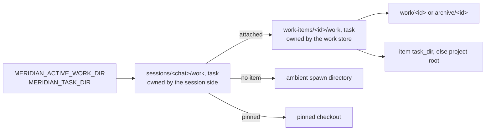

# Decisions: Per-Execution Work and Checkout Links

Why a running agent reaches its work directory and source checkout through
symlinks it owns, why the work store and the session store each own their own
link and never write the other's, and what `work done`, `rename` and `delete`
do to agents that are still running.

**Status:** shipped in meridian-cli v0.16.0 (PR #786, closes #768). The
mechanism is documented beside the code: `src/meridian/lib/state/AGENTS.md`
(roots, lock order), `src/meridian/lib/state/.context/CONTEXT.md` ("Work Item
Directory Moves"), `src/meridian/lib/launch/AGENTS.md` and its
`.context/CONTEXT.md` (which values go in the prompt, checkout pins), and
`docs/upgrading.md` ("Per-chat work and checkout links"). This page holds the
reasons and the rejected designs, not the mechanism. Work item
`work:post-0-19-followups`, `chat:c9182`.

## The shape

The environment names the chat's links, never a concrete path. Each link is a
projection of one store: derived from it, never consulted to learn what it holds.
When an agent writes under its link, the operating system resolves the chain of
two symlinks, so `work done` or `rename` only has to swap the second hop.

Terms used below:
- An **execution** is one running primary session or one spawn run. Each has a
  **chat** (Meridian's conversation ID, `cN`) and a **session row**, its record in
  `sessions.jsonl`, which names the work item the chat is attached to.
- The **work store** holds work items: their directories under `work/` or the
  archive, and each item's `__status.json`.
- The execution's **spawn scope** is a small per-run file; the field that matters
  here is its pinned checkout, if any.
- A **managed** run is one Meridian launched; it has `MERIDIAN_SPAWN_ID` set. A shell
  without it is unmanaged, and there the env is the only source there is.

---

## D-execution-owns-links: every execution owns its chat and its two links {#d-execution-owns-links}

**Status:** current choice. A structure review proposed it as a replacement
for the deferred archive move the owner had accepted; asked to choose, the
owner answered "I thought that was how it worked already lol...".

**Decision.** Every live execution, primary or spawn, has its own chat and its
own `sessions/<chat>/work` and `sessions/<chat>/task` links. Its work
attachment and its chat come from its own session row, never from an inherited
`MERIDIAN_ACTIVE_WORK_ID` or `MERIDIAN_CHAT_ID`; the launch environment speaks
only for an unmanaged shell.

**Why.** Paths fixed at launch go stale while the agent runs: after `work done`
or `work rename` an agent kept writing to a directory that had moved. An
earlier round gave links to primaries only. That left spawns on concrete paths,
and it kept a misrouting bug: a Codex or OpenCode spawn publishes no chat
observation, so it resolved its chat from the env it inherited, which named the
parent. Its `work switch` then moved the parent primary's attachment and links.
The owner's answer shows this was the model they expected all along.

**Where the paths appear.** A primary names its links in the system prompt. A
spawn names them in its first user turn, so sibling spawns keep byte-identical
system prompts ([D-stable-system-prompt](launch.md#d-stable-system-prompt)).

**Rejected:**
- *Links for primaries only:* spawns stay on stale paths, and the
  parent-misrouting bug stays.

---

## D-one-projection-per-owner: each store publishes its own link; chat links point at item links {#d-one-projection-per-owner}

**Status:** current choice; tech lead, from a design pass after the review loop
on #768 hit its limit (`spawn:p9857`).

**Decision.**
- The work store owns `work-items/<id>/work` and `work-items/<id>/task`, and
  republishes them inside its own lock on every write to that item: before the
  write, to repair whatever a crash or an older build left, and after it.
- A chat link is a pure function of the chat's row and the execution's spawn scope. It
  points at the item's link, the ambient directory, or a pinned checkout, and it
  never asks the work store where an item lives.
- So `work done`, `reopen` and `task-dir` write no session state at all. Only
  commands that change an attachment write session rows: `switch`, `start` and
  `clear` for the caller, and `rename` and `delete` for live executions only.
- The work store's lock and the session lock pair are never held at the same
  time. A command that changes both stores runs them as sequential steps, work
  store first.
- A projection is never read back as an input. Code does not read the env or a
  link to decide what a store holds.

**Why.** The first design used one symlink per chat that pointed straight at
the item's directory. That link joined two stores: the session journal (which
item a chat is on) and the work store (where the item is). Every work-store
write then had to find the chats attached to the item and rewrite session state
while the work store was mid-change. Four review rounds each found a new blocker
from that join, or from a fix that tried to hold it together. See
[the lesson](../lessons/state-design-lessons.md#a-link-that-spans-two-stores).

**Rejected:**
- *One link joining both stores:* the cause of the review loop.
- *Rows follow the item (rewrite every row that names it):* a work-store
  command became a bulk session rewrite. It deadlocked against
  `session restore`, failed halfway on historical rows, and took 99 s to
  rewrite 603 ended rows under the lock.
- *Holding the sessions lock across the directory move:* it was taken to stop a
  write through the old link from re-creating the directory. A probe showed that
  a write under a dangling link fails loudly (`mkdir -p` gives EEXIST, a shell
  redirect gives ENOENT) and never re-creates it, so the lock bought nothing.

**Revisit if** something must open the link path itself as a file (not a path
under it). That is the one write that creates something at a dangling link,
instead of failing; agents write under the directory, so nothing does today.

---

## D-done-moves-at-once: `done`, `reopen` and `start` of a done item move at once and never delete either copy {#d-done-moves-at-once}

**Status:** current choice. The owner asked what `work done` does to a
running agent's link, and asked that `reopen` and `work start` of an
archived item work the same way ("work start <archived> also functions the
same way..."). The single move core, the never-delete rule and moving at once
are tech-lead decisions; moving at once replaced a deferred move the owner had
accepted, once spawns had their own links.

**Decision.**
- `work done` moves the directory to the archive immediately. `work reopen`,
  and `work start` or `work switch` of a done item, move it back through the same
  move core.
- A move never deletes either copy. When both locations exist it refuses and
  names both paths. Only `work delete --force` removes a directory.
- A primary attached to a done item keeps the attachment, as before #768. An
  intermediate round detached primaries on `done`; that made `done` a session
  writer, and it was dropped.

**Why.** Before #768, a running spawn held a concrete path. After `work done` its
next write re-created the old directory, the item then existed in both places,
and the next archive call `rmtree`d the archived copy. The first fix, which the
owner accepted, marked the item done at once and deferred the move until the
last attached spawn ended; `reopen` and `start` of an archived item cancelled or
reversed it through the same move core. Once every execution had its own link,
the move could happen at once: the link follows the directory, and a running
spawn's writes land in the archive. The deferral needed a new on-disk "done but
still in `work/`" state and its own repair sweep, about 300 lines; immediate
moves need neither. The owner agreed to the shape that made the deferral
unnecessary ([D-execution-owns-links](#d-execution-owns-links)).

**Rejected:**
- *Deferred move until the last spawn ends:* a new on-disk state and a sweep
  that per-execution links make unnecessary.
- *Merge the two copies:* briefly built, then replaced by refusing; a refusal
  that names both paths loses nothing and needs no merge rules.

---

## D-ended-chats-keep-their-item: ended chats are never rewritten {#d-ended-chats-keep-their-item}

**Status:** current choice (tech lead).

**Decision.** `work rename` moves live executions onto the new name; a chat that
already ended keeps the name it ended on. A session row that names an item which
no longer exists resolves to no item, with a warning. Only an explicit `--work`
creates a work item, so `--from` on an ended chat, or an inherited ambient item,
cannot bring back a renamed or deleted one.

**Why.** Rewriting ended rows is what made rename a bulk session write. The read
rule fixes the one thing ended rows needed, not resurrecting a gone item, with
two `stat` calls and no write.

**Rejected:**
- *A rename record the resolver follows:* a new on-disk field every later build
  must read, ambiguous once a new item reuses the old name. If ended chats should
  follow renames, that is a separate user-visible feature.

---

## D-checkout-pin-sources: pin a checkout only when no store can recompute it {#d-checkout-pin-sources}

**Status:** current choice (tech lead).

**Decision.** An execution's checkout is its pin, else its item's `task_dir`,
else the project root. Bind writes a pin only for facts no store holds: an
explicit `--task-dir`, a launch from a directory outside the project, or the
pin of the execution that launched this one, read from that execution's spawn
scope. `MERIDIAN_TASK_DIR` is
never a pin source inside a managed run.

**Why.** Without a pin, a link recomputed on refresh sent a `--task-dir` spawn's
checkout back to the project root. Pinning from the inherited env had the
opposite fault: the parent's `MERIDIAN_TASK_DIR` is only a projection of
wherever the parent's checkout pointed, so a child that saved it as its own pin
stopped following `work task-dir` and `work switch` even when the parent had no
pin. Reading the parent's spawn scope keeps the worktree workflow (a
`--task-dir` parent's children stay on that worktree) without that freeze.

---

## D-work-commands-default-current: agents never need a work item's ID {#d-work-commands-default-current}

**Status:** current choice. The owner rejected the proposal that agents ask
`meridian work current` for the ID ("agents ask meridian work current... idk...
it feels kinda icky still... that was the orignnal problem still right...?");
the `HEAD`-style defaults and the `current` keyword are the tech lead's answer.

**Decision.** Commands that act on a work item default to the session's current
item, the way git commands read `HEAD`: `work done`, `update`, `rename` and
`show` take no name, and `current` is accepted wherever a work ID is.
`work delete` still needs a name but accepts `current`. `current` is reserved as
an item name. Neither the environment nor the prompt gives a primary the ID.

**Why.** An ID in the env or the prompt goes stale after `work switch`. Telling
agents to ask `meridian work current` for it moved the same problem somewhere
else. The fix removes the need for the ID instead of moving where it is read.

---

## Values that change mid-session

The owner asked that the other values which can change mid-session get links
too ("can we make sure the other variable stuff that can change also get the
smylnk?"). The tech lead's inventory:

| Value | Changes mid-session? | Treatment |
|---|---|---|
| `MERIDIAN_ACTIVE_WORK_DIR` | yes (`switch`, `done`, `rename`) | per-chat link `sessions/<chat>/work` |
| `MERIDIAN_TASK_DIR` | yes (`task-dir`, `work task-dir`, `switch`) | per-chat link `sessions/<chat>/task` |
| `MERIDIAN_ACTIVE_WORK_ID` | yes, but it is a name, not a path | dropped for primaries; commands default to the current item |
| `MERIDIAN_CONTEXT_*` (KB, archive, strategy) | only by editing config | no link |
| `MERIDIAN_PROJECT_DIR` | no | no link |

## Related

- [State decisions](state.md) — stores, locking and work-item location as
  archived-ness authority.
- [Launch decisions](launch.md#d-stable-system-prompt) — what may enter the
  system prompt.
- [Work items](../codebase/work-items.md) — work-item behavior.
