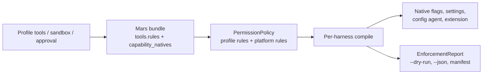

# Decisions: Profile Tool Permissions

How an agent profile's `tools`, `sandbox` and `approval` fields become limits a
harness actually enforces, and why. A profile's `tools:` block means what it
says on every harness that can express it: `bash(git log *): allow` with no other
`bash` rule means the agent may run `git log` and no other shell command.

**Status:** owner rulings of 2026-10-21 and 2026-10-22 and lead decisions through four review
rounds (`work:session-permissions`). Shipped in meridian-cli v0.12.0 (PR #730) and
Mars 0.17.0 (mars-agents PR #179); the Meridian
side requires Mars ≥ 0.17.0 and stops with "install mars >= 0.17.0" against an
older binary.

**Where the mechanism lives.** User-facing semantics and the per-harness table:
meridian-cli `docs/agent-profiles.md`, section "Permissions by harness". Policy,
allowlists, platform rules and reports: `src/meridian/lib/safety/.context/CONTEXT.md`.
Per-harness compiles: `src/meridian/lib/harness/projections/.context/CONTEXT.md`.
The bundle contract: [Mars launch bundle](../architecture/mars-launch-bundle.md#tools-field).

## The problem

Before these decisions Meridian mostly did not enforce profile tool rules, and nothing
showed that it didn't:

- **Wrong names.** Meridian translated capability names to harness tool names
  with its own table and guessed what the table lacked. Claude received
  `Websearch` and `Askuser`, which are not Claude tools, so those denies did
  nothing.
- **No carrier.** Pi ignored every rule. OpenCode applied rules to spawns but
  not to primaries. Claude had nowhere to put a scoped rule or an `ask`. Codex
  turned the tool list into a guessed sandbox mode.
- **Headless `ask` broke.** An OpenCode 2 spawn that hit `ask` hung, because the
  server rejected Meridian's reply with HTTP 400. Codex could not parse
  Meridian's reply and the model saw `approval request failed`.

So the @session-miner profile shipped in the meridian-base prompt package, which allows only a few scoped `bash`
commands under `approval: never`, could run any shell command on Claude and Pi.

---

## D-permission-mars-names: Mars owns every harness tool name {#d-permission-mars-names}

**Decided (owner direction, lead design):** Mars emits typed rules in the launch bundle, `tools.rules[]`, each
with `capability` and `pattern` (meaning), `action` (`allow`/`deny`/`ask`), and
two harness facts: `native`, the permission-rule spelling, and `native_tools`,
the harness tools the rule concerns. Meridian reads `capability` only for
mechanism it owns (Codex switches, platform overrides) and emits `native` and
`native_tools` as given. It keeps no tool-name table and never derives a native
name from a capability or the reverse. Platform rules take their names from
`tools.capability_natives`. A name Mars cannot map is `native_status: unknown`
and reported as a gap; nothing guesses.

**Why:** every name bug on record came from re-reading native names as
capabilities or guessing a spelling. Fixing Meridian's table would fix the
misspellings found so far, not the class.

**Why two native fields.** Claude checks paths only through `Edit(path)` and
`Read(path)`, so `write(src/*): allow` is the permission `Edit(src/*)` on the
tool `Write`. With one field, `*: deny` plus that rule emitted `--tools
Edit,Read,Bash` and the agent could not call `Write`. Meridian mapping
`Edit` back to `Write` would have been a name table again.

**Vocabulary fixed in Mars at the same time:** `agent` is sub-agents (Claude
`Agent`, `SendMessage`, `ListAgents`; OpenCode `task`), and `task` is task-list
tools (Claude `TaskCreate`…; OpenCode `todowrite`/`todoread`). Shipped profiles
deny both, so they mean different things, and Mars dropped its `task`→`agent`
alias. `web` is `web_search` plus `web_fetch`. Mars normalizes a Bash prefix
`X:*` to `X *`, because OpenCode reads the colon literally and shipped profiles
used `bash(git revert:*)`.

**Rejected:** a dual reader of the old flat `allowed`/`disallowed` lists.
Meridian already pins Mars and prefers the binary beside its interpreter, so a
dual reader buys nothing. The overlap that matters is persisted launch
snapshots: an older snapshot's `tools` map is read as native-only rules
(`capability=None`), reported `[legacy snapshot]`.

## D-permission-native-enforcement: each harness's own mechanism, no Meridian hook {#d-permission-native-enforcement}

**Decided (owner):** enforce through what each harness provides, and nothing
Meridian intercepts:

| Harness | Carrier |
|---|---|
| Claude | `--tools`, `--disallowedTools`, `--settings` permission rules and sandbox, permission mode |
| OpenCode | `permission` rules on the `meridian-<profile>` config agent, V1 and V2, spawns and primaries |
| Pi | `--tools`/`--exclude-tools`, plus a bundled `meridian-permissions` extension that blocks scoped and `ask` calls through Pi's `tool_call` event |
| Codex | Per-launch on/off switches for shell, web search and image viewing; no scoped rules |
| Cursor | None for tools; reported |

OpenCode's carrier is the config agent from
[D-opencode-config-agent](opencode-prompt-delivery.md#d-opencode-config-agent-deliver-the-prompt-as-a-config-agent-projected-at-bind);
it replaces the `OPENCODE_PERMISSION` environment variable and the V2
connection's permission merge.

**Rejected:**

- *A Meridian hook that mediates every call.* It would let Meridian force its
  own refusal text everywhere, at the cost of a second enforcement layer per
  harness that can disagree with the native one.
- *Writing Codex trust files* so a Meridian checker could run on Codex (owner).
- *Hosting Pi's checks in the `managed-bash` extension.* It saves 25–40 lines
  but ties permission enforcement to `disable_managed_bash`. The owner accepted
  the Pi extension reluctantly: drop it if it stops being worth its code.
- *Approximating a missing sandbox with tool denies,* such as a fake read-only
  Pi from `edit`/`write` denies (owner). `sandbox` and `tools` mean different
  things; where a harness has no sandbox, the report says so.
- *A `bwrap` process sandbox for OpenCode and Pi* (owner): a possible opt-in
  later, not part of this.

## D-permission-report-only-gaps: one compile, one report read from what was emitted {#d-permission-report-only-gaps}

**Decided (owner):** where a harness cannot express part of a profile, the gap
is reported, not warned about and not refused. Each harness compile returns its
native projection and an `EnforcementReport` together: one line per policy
element, with status `native`, `partial`, `unsupported` or `platform`. The report
appears in `--dry-run`, as `permission_report` in `--json`, and in the
projection manifest. A shared completion step marks anything a compile did not
place `unsupported`, so every element gets exactly one line. Mars's gap reasons
travel as rule notes, never as launch warnings.

**Why one compile:** a report built from the profile claims what the profile
asked for, not what the harness got; on Claude the two differ whenever a rule is
moved to another channel or left out (a plain `Bash` deny dropped beside scoped
allows, for one). So report lines are built from the emitted flags and settings.
A separate report function per harness would drift from what launches.

**Rejected:** a launch warning, and an `on_gap = "refuse"` setting. Gaps are
standing facts about a harness, shown where a user checks a profile.

The same `EnforcementReport` carries the launch-bundle fields a harness does not apply, such
as `harness-overrides` passthrough and compaction thresholds
([bundle field consumption](bundle-field-consumption.md)).

## D-permission-primaries-bound: the profile limits the model on every harness {#d-permission-primaries-bound}

**Decided (owner):** profile rules bind interactive primaries as well as
spawns. The profile limits the model, not the human: a human may widen their
own primary, for example by switching OpenCode to `build` with Shift+Tab or
choosing "always allow". That is documented, not blocked. On Claude, allows in
the user's own settings files and passthrough permission flags are likewise
reported rather than stripped, because command-line flags outrank the profile.

The cost is the one the owner accepted: a profile now changes what a user can
do in their own TUI. On OpenCode the rules ride the same config agent that
delivers the prompt, so a primary and a spawn of one profile get one rule set.

## D-permission-headless-ask: `ask` in a spawn is refused at once {#d-permission-headless-ask}

**Decided (owner):** a spawn has no human to answer, so a supported `ask` is
refused immediately with a reason the model can read, recorded in the spawn's
`permission_requests.jsonl`, and listed by `meridian spawn show`
(`denied_requests` in `--json`). The owner chose "refuse and log it"; never
routing the request to the parent agent was part of the recommendation the
owner accepted. A primary keeps `ask`. Claude spawns disable permission prompts; Pi's extension
blocks with Meridian's reason. Approval requests a harness raises from its own
approval mode are refused and journaled the same way, which needed the Codex
reply `decline` and the OpenCode V2 reply key `decision`.

> [!FLAG] **Needs human review.** The lead accepted the OpenCode divergence
> below without an owner ruling; the owner was told and has not answered.

**Accepted divergence (OpenCode):** the owner mechanism lowers `ask` to native
`deny` in OpenCode spawns. So the model sees OpenCode's own refusal text, not
Meridian's reason, and a tool native policy removes from the catalog produces no
attempted call to journal. Forcing Meridian's reason would need a mediation hook,
which D-permission-native-enforcement rejects, or an upstream seam for custom
denial reasons. Tracked in meridian-cli `src/meridian/lib/harness/.context/TODO`.

## D-permission-allowlists: scoped allows alone are the only calls allowed {#d-permission-allowlists}

**Decided (owner):** a capability whose only rules are scoped allows is an
allowlist for that capability: `bash(rg *): allow` with no plain `bash` rule
means only `rg` runs in the shell, whatever `approval` says. `approval: never`
means "don't prompt", not "allow anything". An allowlist for the whole
profile is `'*': deny` plus allows in map form; the list form is not one
([D-permission-list-form-deprecated](#d-permission-list-form-deprecated)). An
explicit `*` rule or an unscoped rule for the capability decides unmatched
calls, so `*: allow` plus `bash(git *): allow` is not an allowlist.

**Mechanism decided with it:** the policy writes each allowlist as the unscoped
deny it means (Meridian-internal origin `allowlist`) and resolves its overlap with broader
unscoped rules the way Mars does for its own rules: the narrower capability
wins. Each compile then emits that deny as it would a profile's plain deny
beside scoped allows, so no compile has an allowlist path. Codex alone skips it,
because its shell switch would also refuse the scoped allows and Codex reads
files through the shell; an allowlist on Codex turns web search and image
viewing off and is reported `partial`.

**Claude's permission mode, decided by probe.** Claude evaluates deny before
allow, so a plain `Bash` deny would also block `Bash(rg *)`. A per-capability
allowlist therefore compiles to the scoped allows under `manual` mode, where any
other Bash call needs approval a spawn cannot give. `acceptEdits` was rejected:
live, it ran an out-of-list `touch` and auto-runs `mkdir`, `cp`, `mv`, `rm`,
`sed -i` and redirects in working directories. `dontAsk` is used only for a
whole-policy `*: deny`, because it turns every unlisted tool off. The accepted
costs: `manual` still runs calls Claude classifies as read-only (`ls`, `cat`,
Read/Grep/Glob), reported `partial`; and a bash allowlist under `auto` or
`never` refuses edits in a spawn unless the profile also allows `edit`/`write`.

**Profiles changed to match:** @subagent's scoped `bash(meridian …)` allows were
meant as pre-approval, and this rule would have turned them into a shell
allowlist; meridian-base PR #5 removes them. The other bash-allowlist profiles
(explorer, cold-reader, kb-maintainer, session-miner, prompt-reviewer) intend
the restriction.

## D-permission-list-form-deprecated: `tools: [a, b]` only grants {#d-permission-list-form-deprecated}

**Decided (owner, 2026-10-22):** the list form `tools: [read, grep]` is
deprecated for agents and skills. Mars still accepts it, turns each entry into
an `allow` rule (its 0.16.0 behavior), adds no deny, and raises a deprecation
warning. "Only these tools" is written as a map with `'*': deny` plus allows.
A project's `mars.toml` tool overlay `allowed` list likewise replaces the
profile's `allow` rules and makes no allowlist.

**Supersedes** the owner ruling of 2026-10-21 that a list means exactly those
tools (Mars adding `*: deny`). That ruling's wire field, the rule `origin` Mars
emitted to mark the added deny, is gone from the bundle.

**Why:** the same YAML already meant two things. In Claude's agent frontmatter
`tools: Read, Grep` means "only these"; in a skill, `allowed-tools` means
"pre-approve these". Either reading of a bare list surprises someone, so the
unambiguous map form is the only way to say "only these".

**Imports keep their meaning.** Mars lifts a foreign Claude agent file's tools
list to the canonical map with `'*': deny`, so a ported agent stays restricted
and raises no deprecation warning. A foreign skill's `allowed-tools` lifts to
`allow` rules with no `'*': deny`.

**Rejected:**

- *Keep list = allowlist and only document it.* It stays ambiguous next to
  skills' `allowed-tools`, and a reader taking the other meaning quietly widens a
  ported Claude agent.
- *List = allowlist for agents only.* One field would have two meanings
  depending on the file it sits in.

Meridian reads only the typed `tools.rules`, so this needed no Meridian code change; its
docs, changelog and upgrade note say `'*': deny`.

## D-permission-platform-rules: Meridian's own rules hold under any profile {#d-permission-platform-rules}

**Decided:** Meridian adds rules the profile author does not write, applied
after the profile's rules:

- **Sub-agent deny.** Native sub-agent tools are denied on every launch unless
  the project's Mars config makes native agent copies the delegation mechanism
  for that harness. No profile rule opts out, scoped allows included, because
  Meridian cannot track work started that way. Built-in agents are denied
  unless `[harness.<id>] allow_builtin_agents = true`.
- **Task-list deny on spawns,** unless the profile has an explicit unscoped
  `task: allow` or `task: ask`; `*: allow` does not count.
- **Completion commands on every spawn.** `meridian spawn done` and
  `meridian spawn rearm` are allowed exactly, under any allowlist. Without them
  a `'*': deny` plus `read: allow` child cannot confirm or reject its own completion, and
  live Claude refused `spawn done` even with no profile rules.

## D-codex-sandbox-inference-deleted: an unset sandbox is the harness default {#d-codex-sandbox-inference-deleted}

**Decided (owner):** Meridian no longer guesses a Codex sandbox from the tool
list. A profile with `tools` and no `sandbox` previously ran `read-only` on
Codex (or `danger-full-access` for some rule shapes) and got `--sandbox enabled`
on Cursor; now each harness uses its own default. The upgrade note tells users
to set `sandbox` explicitly. `approval: default` stays harness-specific
(owner); `--dry-run` shows what it resolves to.

## D-claude-settings-files-kept: a user's own harness settings stay in force {#d-claude-settings-files-kept}

**Decided (owner):** Meridian keeps a harness vanilla so a user's own setup keeps
working with Meridian added. Claude reads the user's, project's and local settings
files as it always does; their `permissions.allow` entries run outside a profile
allowlist, and `--dry-run` reports them. Rejected: launching allowlist profiles with
`--setting-sources` that omit project and local files, which closes the gap but also
drops those files' hooks. OpenCode follows the same principle: a headless spawn under
`approval: default` gets the allow-all fallback only while no rule names a known
OpenCode tool, so once a profile says something, the user's OpenCode config decides.
The OpenCode native-denial divergence (refusal text is OpenCode's own; no event for
tools it removes) is accepted.

## Open questions

Current behavior is reported in `--dry-run`.

- **Codex completion when the profile sets no sandbox.** A read-only Codex
  sandbox cannot run `meridian spawn done`, because Meridian's state lock lives
  outside it. An explicit `sandbox: read-only` now skips the confirmation turn
  ([D-completion-channel](completion-drain.md#d-completion-channel),
  v0.12.4). A profile with no `sandbox` still gets the confirmation
  under Codex's own read-only default: Meridian does not read Codex's config, so
  it cannot know an unset sandbox resolves to read-only. No shipped profile omits `sandbox`.

## Provenance

`work:session-permissions`: `design/owner-decisions.md` (owner rulings),
`design/implementation-decisions.md` (lead decisions and review dispositions;
section "List form deprecated" for the 2026-10-22 ruling, Mars lane `spawn:p8925`),
`DIVERGENCE/opencode-d5.md`, `pr-body-permissions.md`. Probes:
`spawn:p8820` (Claude `dontAsk`), `spawn:p8881` and `spawn:p8891` (live
matrices on Claude, OpenCode V1/V2, Pi, Codex). Reviews: `spawn:p8867`,
`spawn:p8872`, `spawn:p8879`, `spawn:p8880`, `spawn:p8884` (Claude modes),
`spawn:p8886`, `spawn:p8890`, `spawn:p8892`. Mars review: `spawn:p8855`,
`spawn:p8864`. Owner rulings are in `chat:c8514`; it has no owner turn after the
rulings, so the open questions above and the OpenCode divergence are unanswered there.
