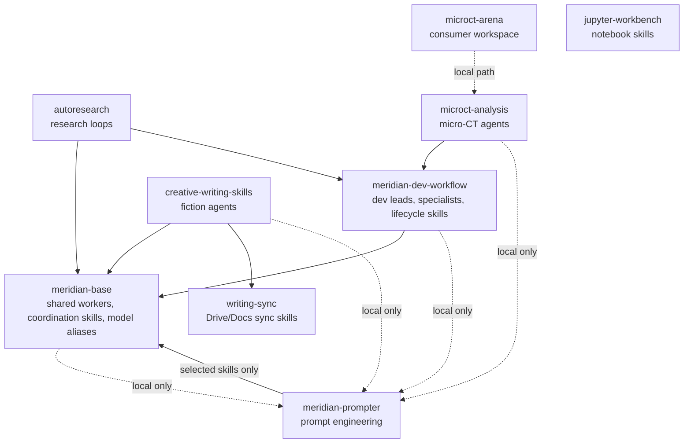

# Prompt Packages Overview

A prompt package is a mars source repo of agent profiles, skills, hooks and
bootstrap docs. `meridian mars sync` resolves a project's packages and
compiles them into `.mars/`, which Meridian reads at spawn time, and copies
them into whichever harness directories the project lists as targets. How
mars resolves, compiles and targets is documented under
[package management](../../concepts/package-management/overview.md); this
page covers the packages themselves: which exist, how they depend on each
other, and the traps in that graph.

Checked against the package sources on 2026-10-23.

## Where Each Fact Lives

Each package's README lists its agents and skills, and each agent or skill
file states its own model, tools and method. meridian-base's README carries
the model-alias table, generated from its `mars.toml`. Its `CHANGELOG.md`
dates every change. Read those for inventories. The KB pages for each
package hold what no repo file says: why the package has its shape, what it
used to be, and what trips agents up.

The KB used to copy inventories. Within a few months its package pages
described agents, skills and model aliases that had been deleted, and they
misled agents that trusted them. So these pages link instead.

## The Package Graph

Sources live in sibling checkouts under `../prompts/<package>/`.

Solid arrows are published `[dependencies]`: a project that installs the
package gets them too. Dashed arrows are `[local-dependencies]`, which mars
resolves when someone works inside that package's checkout but does not
export to consumers.

meridian-base is the root. Every other Meridian-flavored package builds on
it, directly or through meridian-dev-workflow. writing-sync and
jupyter-workbench stand alone. Domain packages are covered in
[domain-packages.md](../domain-packages.md).

## Prompter Is Local, Not a Foundation

Several packages list meridian-prompter as a local dependency, so a prompt
author editing meridian-base or meridian-dev-workflow can run `prompt-dev`
and load `/prompt-principles` inside that checkout. Because the edge is
local, nobody who installs those packages receives prompter. A project gets
`/prompt-principles` only by declaring meridian-prompter itself, as
meridian-cli's `mars.toml` does. The published edge runs the other way:
meridian-prompter depends on meridian-base, filtered to the handful of skills
its agents load.

Older KB text called prompter "a dependency of both base and dev-workflow."
That was never true for consumers.

## Traps

- **Pins track the current minor and have to be raised by hand.** Each
  dependent package pins meridian-base and meridian-dev-workflow to their
  current minor (for example `>=0.11.0, <0.12.0`), so patch releases flow
  through and a new minor does not. Each new minor of meridian-base or
  meridian-dev-workflow means raising every dependent's pin and releasing
  it. Until 2026-10-23 several packages still pinned `<0.11.0` and
  `<0.14.0`, which no longer admitted the current releases, because nobody
  had raised them. When meridian-base went to 0.12.0, its dependents widened
  their pins to `<0.13.0` in the same round.
- **A package that drops content Meridian now supplies must require that
  Meridian first.** It sets `requires-meridian` to the release that ships the
  replacement, then releases. meridian-base 0.12.0 deleted its Meridian-specific
  skills and requires Meridian 0.14.5, which bundles them
  ([D-bundled-meridian-skills](../../decisions/launch.md#d-bundled-meridian-skills-meridian-owned-operations-guidance-versions-with-the-cli)).
- **meridian-benchmark-agents is parked.** Its checkout holds only a README
  saying what the package was for and how to revive it (the full package is
  at commit `a23b22c`); it was never published and has no git remote.
- **jupyter-workbench's manifest predates the current schema.** It lists
  skills as `[[package.skills]]` path entries, where other packages rely on
  directory discovery.
- **microct-arena is a workspace, not a distributable package.** It points
  at a local microct-analysis worktree so a human can drive those agents by
  hand.
- **meridian-prompter has no README.** Its [KB page](meridian-prompter.md)
  is its main description.

## Releasing and Consuming

Each package's `AGENTS.md` gives the release command. From a Meridian
session, pass the package root explicitly (`meridian -C "$PWD" mars version
patch --push`), because nested `meridian` commands resolve the session's
project root, not the current directory. Consumers pick up a release with
`meridian mars add <package>@<version>` followed by `meridian mars sync`.

## Related

- [meridian-base.md](meridian-base.md) — the root package
- [meridian-dev-workflow.md](meridian-dev-workflow.md) — development leads and lifecycle
- [meridian-prompter.md](meridian-prompter.md) — prompt engineering
- [prompt-principles.md](prompt-principles.md) — the prompt-engineering doctrine
- [../domain-packages.md](../domain-packages.md) — domain packages
- [../../concepts/package-management/overview.md](../../concepts/package-management/overview.md) — how mars resolves, compiles and targets packages

## Provenance

- Audit of the package sources against this page: `spawn:p9065`
- Rewrite: `chat:c8796`
