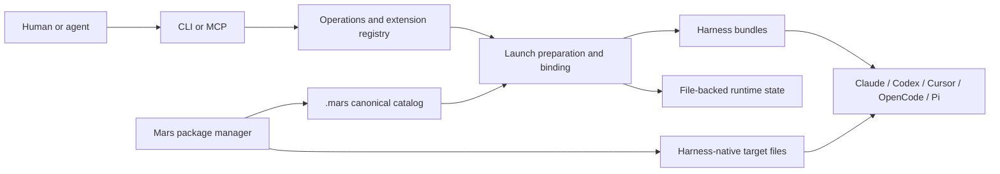

# Meridian KB

Why meridian-cli, Mars and the surrounding packages are the way they are. Directory contracts live beside the code in the source checkouts' `AGENTS.md` and `.context/`, the project invariants in meridian-cli's root `AGENTS.md`, and user guidance in meridian-cli `docs/`. Terms are in the [vocabulary](vocabulary.md); the [KB guide](AGENTS.md) explains how to maintain these pages.

## The system

Meridian launches AI-harness subprocesses, tracks them, and keeps enough state on disk for other processes to observe, steer and recover them. It does no inference, defines no workflow, and needs no database. Mars, a separate Rust CLI, resolves prompt packages into the `.mars/` catalog Meridian reads and into each harness's native files.

The CLI and the MCP server share one extension registry and operations layer (source checkout `src/meridian/lib/extensions/.context/CONTEXT.md`). Files and who owns them:

- **`meridian.toml`** is committed project configuration; its `[project].id` is a committed project's identity. A directory with neither `meridian.toml` nor `mars.toml` is an ad-hoc place, and Meridian writes nothing into it ([project identity](state/project-identity.md)).
- **`~/.meridian/projects/<project-id>/`** holds Meridian's runtime state: spawn rows, session events, locks, caches and artifacts. Repo-local `.meridian/` holds no state.
- **The context work root** holds work items ([work items](state/work-items.md)).
- **`.mars/`** is Mars's compiled catalog; **`~/.meridian/mars/`** holds user-scope packages ([Mars user scope](mars/package-management.md#user-scope)). `.agents/` is not a catalog fallback.
- **`.claude/`, `.codex/`, `.cursor/`, `.opencode/`, `.pi/`** are Mars's projections for each harness ([targets](mars/package-management.md#targets)).

## Topics

- **[State](state/overview.md)** — project identity, spawns and launches, spawn outcome, session state, native session binding and transcript reads, portable history, durability and locking, work items, compatibility between builds, per-operation cost.
- **Launching** — [launch system](launch/launch-system.md), [continue and fork](launch/continue-and-fork.md), [spawn and chat references](launch/session-references.md), [primaries](launch/primaries.md), [process scope](launch/process-scope.md), [session browse](launch/session-browse.md).
- **Spawns and sessions** — [spawn lifecycle](spawns/lifecycle.md), [completion hold](spawns/completion-hold.md), [results and waiting](spawns/results-and-waiting.md), [messaging a live session](spawns/messaging.md), [idle notifications](spawns/idle-notifications.md).
- **[Harnesses](harnesses/overview.md)** — [Claude](harnesses/claude.md), [Pi](harnesses/pi.md), [OpenCode](harnesses/opencode.md), [Cursor](harnesses/cursor.md).
- **Permissions** — [tool permissions](permissions/tool-permissions.md), [sandbox projection](permissions/sandbox-projection.md), [workspace](permissions/workspace.md).
- **Mars** — [package management](mars/package-management.md), [model resolution](mars/model-resolution.md), [skills](mars/skills.md), [portable hooks](mars/package-hooks.md), [launch bundle](mars/launch-bundle.md).
- **Other mechanisms** — [hooks](hooks.md), [telemetry](telemetry.md).
- **Working on the code** — [codebase guide](codebase/guide.md), [testing](codebase/testing.md), [verifying changes](codebase/verifying-changes.md), [releasing](codebase/releasing.md), [the Rust rewrite](codebase/rust-rewrite.md).
- **Operations** — [setup](operations/setup.md), [troubleshooting](operations/troubleshooting.md).
- **Related projects** — [ecosystem](ecosystem.md).

## Research

External facts, probed live, that the topic pages rest on. Recheck them after upgrading the tool they describe.

- [Prompt-cache retention](research/prompt-cache-retention.md) by harness, provider and authentication.
- [Claude Code mods and the cross-session inbox](research/claude-code-mods-and-inbox.md).
- [Reaching a live TUI](research/reaching-a-live-tui.md): what Codex, OpenCode and Pi accept from a second process.
- [How harnesses load plugins](research/harness-plugin-loading.md).
- [OpenCode config and prompt semantics](research/opencode-config-semantics.md).
- [Tailscale serve and funnel semantics](research/tailscale-serve-semantics.md), behind `meridian artifact serve`.

The [corrections register](corrections.md) records recurring agent mistakes and their remedies.
