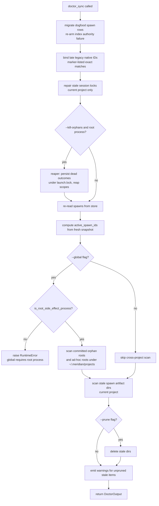

# operations/health-checks — Doctor, Pruning, and Background Repairs

`meridian doctor` is the single-entry health-check command. It repairs stale locks and metadata, reports dead spawns, scans for stale artifacts, and optionally deletes them. The command has two tiers: a cheap per-project default and an explicit cross-project global mode.

## The Core Distinction: Live, Dead, Terminal

Doctor selects rows by **stored** status (what `state.json` says) and, for warnings,
classifies each stored-active row by its
[derived status](../architecture/state-system/derived-status.md) (the runner holds
`launch.lock` or it doesn't):

| Spawn | Artifact prunable? | Appears in warning? |
|---|---|---|
| Stored terminal (succeeded/failed/cancelled/timed_out) | Yes, subject to TTL | No |
| Stored active, runner gone (derived `crashed`/`cancelled`) | No: stored-active rows stay protected until an outcome is written | `dead_spawns_unfinalized`; with `--kill-orphans` the outcome is written first and the run reports the repair category `orphan_runs` |
| Stored active, runner holds the lock | Never | `live_active_spawns_remain` |

`live_active_spawns_remain` is informational: these runners are alive.
`dead_spawns_unfinalized` means readers already show the crash, but no outcome
is persisted; `meridian doctor --kill-orphans` writes it and reaps the processes.
Plain `doctor` never persists outcomes.

## Two-Tier Design

| Command | Scope | Allowed state | Cost |
|---|---|---|---|
| `meridian doctor` | Current project only | Current project runtime root, config surface, spawn/session state | Cheap default |
| `meridian doctor --global` | Cross-project maintenance | Everything in local + `~/.meridian/projects/` orphan scan | Expensive, explicit, opt-in |

Local doctor does NOT traverse `~/.meridian/projects` for sibling projects. It does NOT read or write any global cache file. It does NOT launch background global scans. These were deliberate deletions: see [doctor-cache deletion rationale](../decisions/startup-health-sandbox.md#doctor-cache-deleted--global-scan-moved-to-explicit-opt-in).

## `meridian doctor` Flow

Order matters. The protected active-spawn set is computed **after** any `--kill-orphans` repair.



**Why re-read after repair?** Before this pattern was established, step F used a *pre-repair* snapshot. Orphaned rows that were just repaired to terminal would still appear in `active_spawn_ids` — their artifact dirs were excluded from pruning and they could appear in live-session warnings, falsely implying cleanup had failed.

### No State, No Repair

`doctor` is a read: it never mints an id, writes a marker, or creates a runtime
root or the user Mars root. The per-project steps above (bindings, Pi recovery,
dead-launch repair, telemetry, artifact prune) run only when the current project's
runtime root already exists; otherwise doctor reports
`project_state: no state here` and skips them. `--global` always runs, and its
root deletions run last so local helpers cannot recreate a root just pruned.

`--global` runs two scans, one per namespace. Committed roots keep the
quiescent tree-mtime rule under `state.retention_days`. Ad-hoc roots
(`adhoc.*`) use `state.adhoc_retention_days` from user config or env only,
with reasons `adhoc-idle`, `adhoc-shadowed` and `adhoc-path-gone`, and are
deleted together with their `context/<id>/`. Text output lists **every**
materialized ad-hoc root, not only those past retention, as an `adhoc_project:
<id>` block with `origin_path`, `reason`, `last_activity`, `size_bytes`,
`prunable: yes|no` and `state`; `--prune` deletes only the prunable ones. The
rules and their locking are in
[project identity](../architecture/state-system/project-identity.md#retention).
Nothing prunes on its own; see
[D-two-tier-identity](../decisions/state.md#d-two-tier-identity).

### Root-Process Gating

The reaper (`reconcile_active_spawn`) runs only when `_MERIDIAN_DEPTH` is absent, empty, or `0`. Nested spawns never trigger reaper side effects; the parent process owns that responsibility. When it is skipped (nested depth), dead rows stay stored-active and are reported as `dead_spawns_unfinalized`.

Global maintenance (`--global`) requires `is_root_side_effect_process()` to return true. The guard lives in `doctor_sync()` itself, not just the CLI layer — nested callers that try to pass `global_=True` get a `RuntimeError` before any cross-project traversal begins.

## Two-Tier Pruning

| Tier | Location | Scope | Flag |
|---|---|---|---|
| Spawn artifact dirs | `~/.meridian/projects/<uuid>/spawns/<id>/` | Current project | always scanned |
| Orphan project dirs | `~/.meridian/projects/<uuid>/` | Machine-wide | `--global` only |
| Telemetry segments | `~/.meridian/projects/<uuid>/telemetry/` | Current project | always scanned |

**Orphan project dirs** are project-level state dirs with no active spawns and no recent activity. Each UUID corresponds to one past project. Machine-wide pruning requires `--global` to avoid accidentally walking other active projects.

**Spawn artifact dirs** are per-spawn working dirs: `prompt.md`, `report.md`, `stderr.log`, `params.json`, `tokens.json`, `pi-lifecycle.json`, etc. Runner `history.jsonl` and `last-observed-event.json` are no longer written. Old copies are pruned by `session archive --prune-runner-history`, not by doctor ([prune operation](session-archive-pruning.md#runner-history-prune)).

**Telemetry segments** are per-process JSONL event files under the current project's `telemetry/` directory. Local doctor scans them for retention cleanup: expired non-live segments are removed first, then older closed segments may be removed to enforce the total-size cap. Global orphan-project scanning is separate.

### TTL Logic

Controlled by `config.state.retention_days` in `meridian.toml`, `meridian.local.toml`, or `~/.meridian/config.toml`:

```toml
[state]
retention_days = 30   # -1 = never prune, 0 = prune immediately, N = days
```

Environment override: `MERIDIAN_STATE_RETENTION_DAYS`.

Staleness check uses the latest mtime across all files in the artifact tree. If any file was touched within the retention window, the directory is not stale. The TTL clock starts from the terminal transition (when `report.md` or another artifact was last written), not from spawn creation.

### Windows-Safe Deletion

Pruning uses `shutil.rmtree` with an `onexc` hook that restores write bits before retrying. This handles Windows read-only files that would otherwise block tree deletion. A `FileNotFoundError` is treated as success (idempotent).

## Background Per-Project Repairs

On `PRIMARY_LAUNCH` startup paths, cheap per-project repairs run in a non-blocking background daemon thread:

- **Dogfood-row migration** — runs first, in its own guard. It rewrites spawn rows written by the PR 1 dogfood build (see below) and logs `dogfood_spawn_rows_failed` once per pass for rows it cannot migrate
- **Late legacy binding** — checks only chats recorded as `no_session_id` by the one-time import and binds only exact, header-validated matches. It does not run on ordinary commands or browse/read paths.
- **Stale session lock cleanup** — clears abandoned lock files under the current project's sessions directory
- **Dead-launch repair** — the reaper persists the outcome of dead lock-backed spawns and reaps their scopes, as `doctor --kill-orphans` does. Skipped when the launch is a `--continue`, whose own sweep owns the source's lock

These repairs touch only the **current project's runtime root** (`~/.meridian/projects/<uuid>/`). They never enumerate sibling project directories. They run as a daemon thread and never block process exit.

The former global background scan (which ran `doctor_sync(global_=True)` and wrote `doctor-cache.json`) was deleted. Users discover cross-project stale state through explicit `meridian doctor --global`. See [startup/health decisions](../decisions/startup-health-sandbox.md#doctor-cache-deleted--global-scan-moved-to-explicit-opt-in) for rationale.

## Dogfood-Row Migration

The PR 1 dogfood build wrote spawn rows with flat run-boundary fields that the strict
schema quarantines. `state/spawn/dogfood_migration.migrate_dogfood_spawn_rows` rewrites
them once, under the shared mutation lock and the spawn lock, and is idempotent. Each
row is isolated, so one malformed row never keeps the rest quarantined. When at least
one row migrated, it clears a history-index `authority` initialization failure
(`HistoryIndex.clear_authority_failure`, under the catch-up lock), so the next
index-backed command retries without a manual rebuild.

**After installing PR 3, run `meridian doctor` once** (a primary launch does the same
in the background). Until then `spawn show pN` on such a row ends its
quarantine message with "run `meridian doctor` to migrate it". Rerunning is safe; rows written later by a still-running
PR 1 runner are picked up by the next run. The module is deletable once no dogfood rows
remain. Rationale: [native-only history](../decisions/native-only-history.md#dogfood-rows-migrate-once-not-on-read).

**Late legacy native-ID repair.** An old-build session may write its native ID after
the one-time import has already marked it `no_session_id`. `bind_late_legacy_sessions`
is an explicit repair, not a read fallback: it considers only marker-listed chats,
revalidates exact native identity and generation under the session lock, and records
each eligible row as attempted. Doctor reports `repaired: late_legacy_bindings` only
when at least one chat is newly bound. The same repair runs in primary-launch
background work, never on every command.

**Legacy Pi recovery.** In the same two places, a one-shot pass binds old 0.6.7 Pi
spawn chats that have content proof (their first user message equals the retained
prompt, else the final reply equals the report). Each marker-listed chat is examined
once (`pi_recovery_tried`). When any binds, doctor reports `repaired:
legacy_pi_sessions` and a `legacy_pi_sessions:` count line that names `meridian
session repair cN` for the rest. Rule and results:
[legacy native import](../decisions/legacy-native-import.md#old-pi-chats-that-067-never-bound-content-proven-recovery-manual-repair).

## `DoctorOutput` Key Fields

| Field | Meaning |
|---|---|
| `repaired` | Categories repaired this run, including `dogfood_spawn_rows` and, when any chat binds, `late_legacy_bindings` or `legacy_pi_sessions`, alongside orphan and artifact repairs |
| `pruned_spawn_artifacts` | Count of artifact dirs deleted |
| `pruned_orphan_dirs` | Count of orphan project dirs deleted |
| `telemetry_counts` | Current-project telemetry summary, including expired segment count |
| `warnings` | Issues surviving repair and not pruned — genuine attention needed |
| `ok` | `True` iff `warnings` is empty |

Warning codes emitted from `warnings` include:

- `stale_spawn_artifacts`
- `stale_telemetry_segments`
- `stale_orphan_project_dirs` (`--global` only)
- `live_active_spawns_remain`
- `dead_spawns_unfinalized` — payload `spawn_ids`; dead runners with no persisted outcome
- `dogfood_spawn_rows_failed` — payload `spawn_ids` and `reasons`; each reason names the failing field, e.g. `ValidationError: run_boundary.status: …`
- `dogfood_index_rearm_failed` — the migration could not re-arm the history index (catch-up lock timeout)

`stale_telemetry_segments` is not age-only. It can mean either:

- expired non-live telemetry segments were found, or
- total telemetry bytes exceeded the hard cap and cleanup would delete older closed segments

## Warning Semantics

Do not key automation or docs on a specific two-line prose rendering. Treat
doctor warnings as structured categories:

- `stale_spawn_artifacts` — prunable with `meridian doctor --prune`
- `stale_telemetry_segments` — prunable with `meridian doctor --prune`
- `stale_orphan_project_dirs` — committed roots, prunable with `meridian doctor --prune --global`
- `stale_adhoc_project_dirs` — the prunable subset of the listed ad-hoc roots (payload carries ids, paths, reasons), reclaimed with `meridian doctor --prune --global`
- `live_active_spawns_remain` — informational; these runners still hold their launch locks
- `dead_spawns_unfinalized` — runners gone, outcome not persisted; run `meridian doctor --kill-orphans`

`--prune` only helps for stale-state categories. If the only warning is
`live_active_spawns_remain`, there is nothing to delete.

## Diagnostic Commands

```bash
# Check health (per-project, no side effects)
meridian doctor

# Check + prune current project
meridian doctor --prune

# Full cross-project check + prune (explicit, root-only)
meridian doctor --prune --global

# Kill processes for orphaned spawns (explicit, destructive)
meridian doctor --kill-orphans

# JSON output for scripting
meridian doctor --format json
```

### `--kill-orphans` Flag

`meridian doctor --kill-orphans` runs the reaper: for each stored-active row it
claims the spawn's `launch.lock` non-blocking. A held lock means the runner is
alive and the row is left alone. A free lock means it is dead: the reaper records
a cleanup claim, writes the outcome readers already show (`failed`/`crashed`, or
`cancelled` with a cancel request), then terminates the claimed process scopes
(or a managed primary's metadata PIDs, or the recorded worker PID, when no scopes
were recorded). It also finishes cleanup claims left on terminal rows by an
earlier crashed pass, and captures native history for repaired primaries. Rows
with no lock file (older builds) are never finalized. Details:
[derived status](../architecture/state-system/derived-status.md#who-persists-a-dead-launchs-outcome).

This flag is useful when:
- `meridian doctor` warns `dead_spawns_unfinalized`
- A managed-primary launcher died and its runtime children are still running
- Orphaned harness or backend processes remain after a crash

For managed primaries, `meridian spawn cancel <id>` on the terminal row also runs
best-effort cleanup. See
[../architecture/managed-primary-lifecycle.md](../architecture/managed-primary-lifecycle.md#repair-and-cleanup-boundary).

## Cross-References

- [../principles/design-principles.md](../principles/design-principles.md) — crash-only design and why artifacts accumulate
- [../architecture/state-system/spawn-state.md](../architecture/state-system/spawn-state.md) — spawn artifact directory layout
- [../architecture/sandbox-projection.md](../architecture/sandbox-projection.md) — why `~/.meridian/` is not globally projected into sandboxes
- [../concepts/spawn-lifecycle.md](../concepts/spawn-lifecycle.md) — crash recovery and who persists a dead spawn's outcome
- [../decisions/startup-health-sandbox.md](../decisions/startup-health-sandbox.md#doctor-and-health-checks) — doctor cache deletion rationale, tier split decision
- [troubleshooting.md](troubleshooting.md) — recovery procedures for crashed spawns
- [../lessons/arch-refactor-pitfalls.md](../lessons/arch-refactor-pitfalls.md) — process-group cleanup and managed-primary cleanup pitfalls from PR #184
